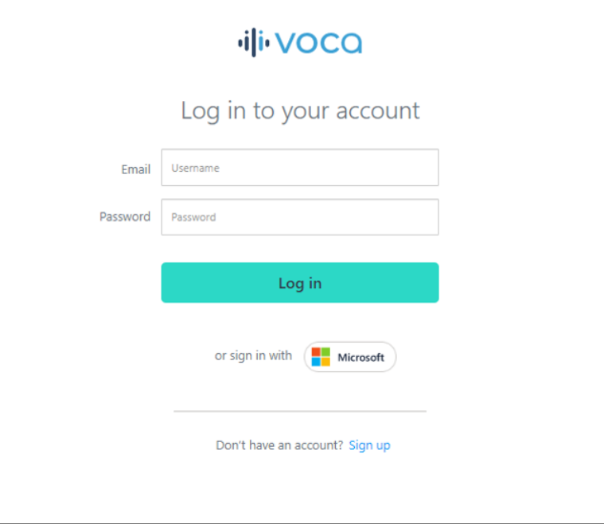
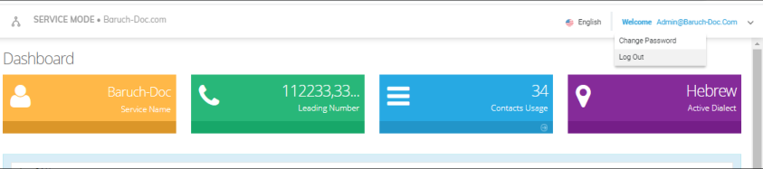
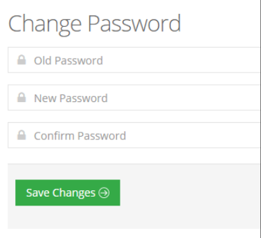
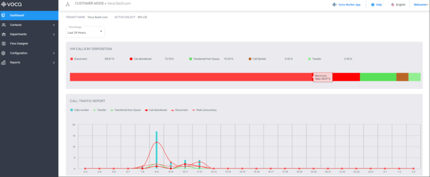
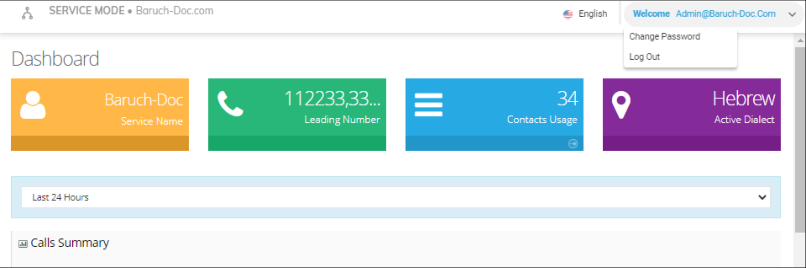

This section describes how to log in to Voca Web Management.

## Logging in to Voca

You can log in to Voca in either of the following ways:

- **Email and Password:** Sign-up first and only after finishing the process log in with the username and password.
- **Microsoft SSO:** Clicking the Microsoft logo to log in using SSO. This option is required to initiate user consent for signing into the application. In some organizations, user consent is blocked and can only be approved by the administrator.

  

## Changing your Password

The procedure below describes how to change the login password.

### To change the login password

1. Place the cursor on the Voca username, on the upper-right corner of the screen; the following appears:

   

2. Select **Change Password** to change the password after initially logging in using the default (recommended); the following appears:

   

3. In the 'Old Password' field, enter your previous password.
4. In the 'New Password' field, enter your new password.
5. In the 'Confirm Password' field, re-enter the new password.
6. Click **Save Changes** to save your changes.

## Getting Familiar with the GUI

### Sidebar Panel

Based on the available licenses, the following menu options are displayed:

- [Dashboard](#dashboard):** This option displays Tenant Name, Active Dialect, and graphical summary statistics.
- **Contacts:** This option allows you to manage details of all your contacts, including adding, editing, and deleting contacts. You can also import and export your Contact list using CSV files.
- **Departments:** This option allows you to manage your Department Dictionaries and details of all your departments inside the [Department Dictionary](/tenant-administration/admin-04-managing-departments#using-the-dictionary-list). The Department Dictionary is a list of departments which belong to a specific Application Support Package (ASP) and may be used as separate grammar when performing voice detection. Using the Departments menu, you can add, edit, and delete Department Dictionaries and Departments. You can also import and export your departments list from the ASP or from CSV files.
- **Flow Designer:** This option allows you to configure, design and manage complex call flows including API interactions.
- **Configuration:** This option allows you to configure various Voca system settings.
- **Reports:** This option allows you to produce a range of reports.

### Dashboard

The following Dashboard titles appear in the colored boxes:

- Tenant Name - Displays the Customer or Company name
- Active Dialect – Displays the main supported language.

The dashboard also displays graphical summaries based on calls made in:

- Last 24 hours
- Last week
- Last month

## Logging Out

The procedure below describes how to log out from Voca.

### To log out from Voca

1. Place the cursor on the Voca username, on the upper-right corner of the screen; the following appears:

   

2. Select **Log Out**.
