The Contacts page allows the Administrator the option to manage all the contacts in the organization in a centralized place.

The Contacts page can be used for routing calls to contacts by their name or they can be assigned to different places in the Administrator portal.

The Administrator can manage contacts in different ways:

- Manually: Using the Administrator portal to add, edit, delete.
- Import/Export contact using CSV file.
- Automatic synchronization using Active Directory/Azure Active Directory.

Automatic synchronization using [LDAP](/tenant-administration/admin-06-configuration/admin-06-7-system-settings#configuring-ldap) (AD/AAD) requires additional configuration.

For more information, refer to [Directory Synchronization](/tenant-administration/admin-06-configuration/admin-06-7-system-settings#directory-synchronization).

## Contact Details Actions

This section describes the various Contact Details actions that can be performed.

### Adding a Contact

The following describes how to add a contact.

#### To add a contact

1. Open the Contact Details page (**Contacts** &gt; **Contacts List**).

   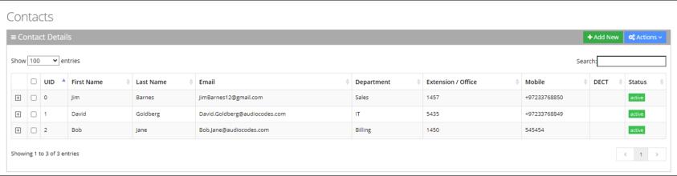

2. Click **Add New**; the following appears:

   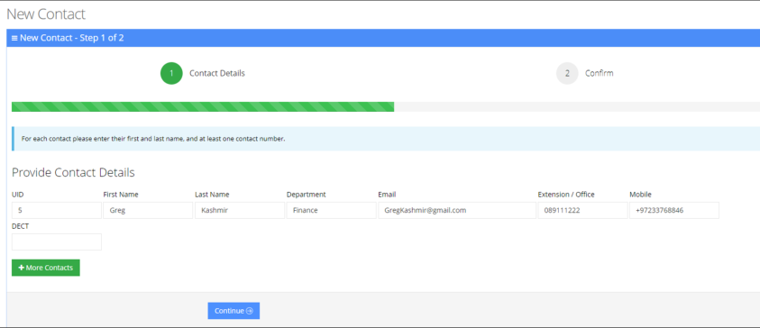

3. Under the Provide Contact Details group, enter the following:
   - UID
   - First Name
   - Last Name
   - Department
   - Email
   - Extension/Office
   - Mobile
   - DECT

   <Note>
   - DECT is only available if the Administrator has configured it for a specific customer/service.
   - Every contact must have a unique User ID (UID).
   </Note>

4. Click **Continue**; the following appears:

   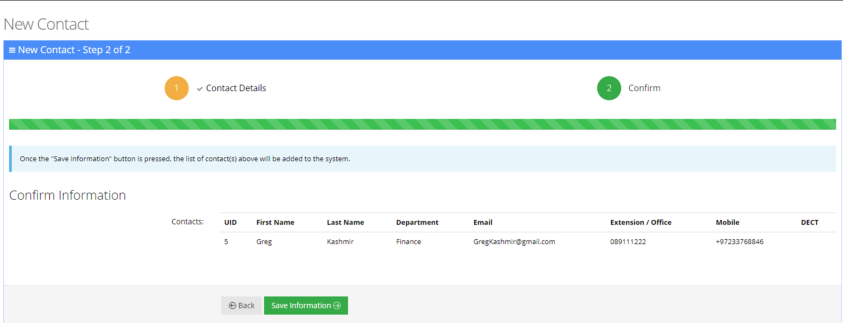

5. Click **Save Information**.

### Editing a Contact

The procedure below describes how to edit a contact.

#### To edit a contact

1. Open the Contact Details screen (**Contacts** &gt; **Contacts List**).
2. Select the contact you wish to edit by selecting the corresponding **Contact** check box.

   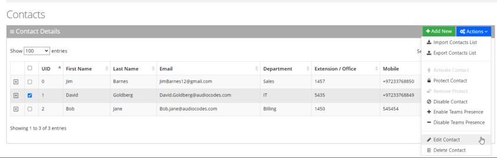

3. From the ‘Actions’ drop-down menu, choose **Edit Contact**; the following appears:

   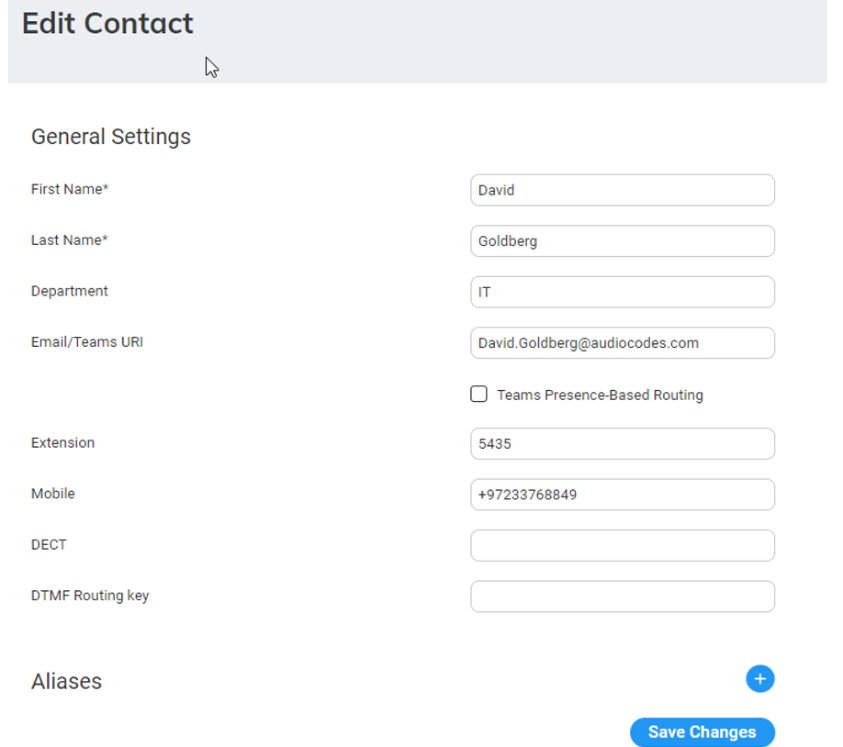

4. Select the 'Teams Presence-Based Routing' check box to allow the system to check for presence when transferring to this Contact, if it is selected as a queue member in the member queue. To use this feature two things are required:
   - **UID:** The UID of the contact must be the same as the Object ID of the user in the Azure Portal.
   - **Teams Presence Routing:** This requires additional configuration on the System Setting page. For more information, refer to [Teams Presence Routing](/tenant-administration/admin-06-configuration/admin-06-7-system-settings#teams-presence-settings).
5. In the 'DTMF Routing key' field, enter the DTMF routing key. This key is used to reach this contact when entering this DTMF code in the [Speech menu](/tenant-administration/admin-06-configuration/admin-06-3-configuring-menu-settings#adding-a-speech-menu) (if **Transfer by DTMF routing key** is enabled in the menu). The key must be unique within the service.
6. Make your changes on the ‘Edit Contact’ screen, and then click **Save Changes**; the updated Contact details appear.

### Creating an Alias for a Contact

When using speech recognition on Voca, the system searches for a full Contact Name, by default.

An alias of the contact allows you to configure another name for a contact, known or more familiar under another specified name.

The alias for the contact can be configured for:

- **First Name:** The alias only replaces the first name of the user.
- **Last Name:** The alias only replaces the last name of the user.
- **Full Name:** The alias replaces the full name of the user.

Depending on the configured option, the system will search for the contact with selected alias.

#### To create an alias for a contact

1. Open the Edit Contact 1 of 2 screen (**Contacts** &gt; **Contacts List**).
2. Select the contact you wish to edit by selecting the corresponding check box.
3. From the ‘Actions’ drop-down menu, choose **Edit Contact**.
4. Under the **Alias** group, click **+** sign; the following example appears:

   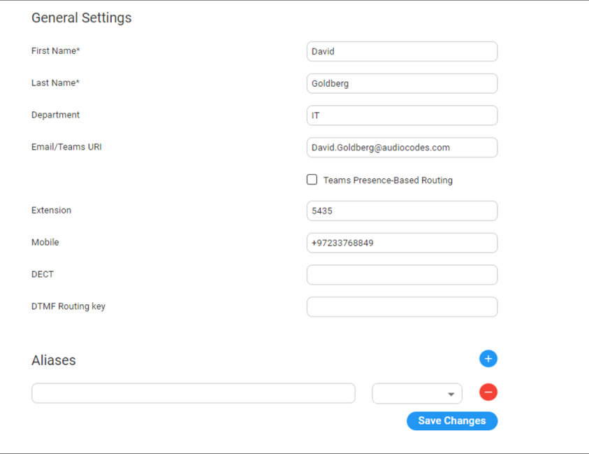

5. Enter an alias name in the alias field (e.g., "Dave").
6. From the Alias Contact drop-down list, select the description field, for example, First Name.

   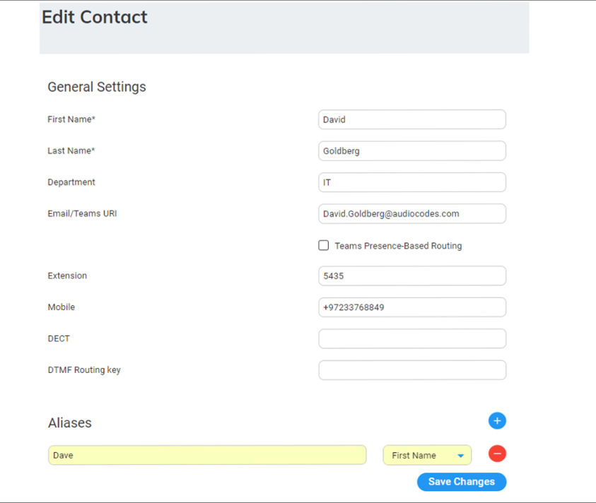

7. For more aliases, click the  sign.
8. Click **Save Changes**.

### Deleting a Contact

The procedure below describes how to delete a contact.

#### To delete a contact

1. Open the Contact Details screen (**Contacts** &gt; **Contacts List**).
2. Select the contact you wish to delete by selecting the 'Contact' check box.
3. From the ‘Actions’ drop-down menu, choose **Delete Contact**.

   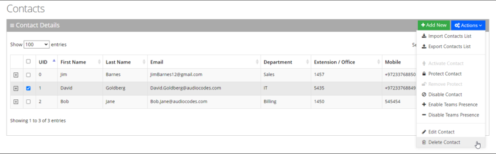

4. The following message appears: "Are you sure you want to delete the selected contact(s)?"
5. Click **OK** to delete the selected contact.

### Searching a Contact

The procedure below describes how to search for a contact.

#### To search for a contact

1. Open the Contacts menu (**Contacts** &gt; &lt;department Dictionary name&gt;).
2. Click on the **Contact List** menu.
3. Enter the search criteria in the Search field; the searched data is displayed.

### Protecting a Contact

In most cases, the Contacts List is retrieved from an external source (e.g., Active Directory or a CSV file). Organization administrators have the option to change specific contact details and set the contact to Protect mode. By doing this, a re-synchronization of the Contacts List will not override the change.

#### To protect a contact

1. Open the Contact Details screen (**Contacts** &gt; **Contacts List**).
2. Select the contact you wish to protect by selecting the 'Contact' check box.
3. From the ‘Actions’ drop-down list, choose **Protect Contact**; the following appears:

   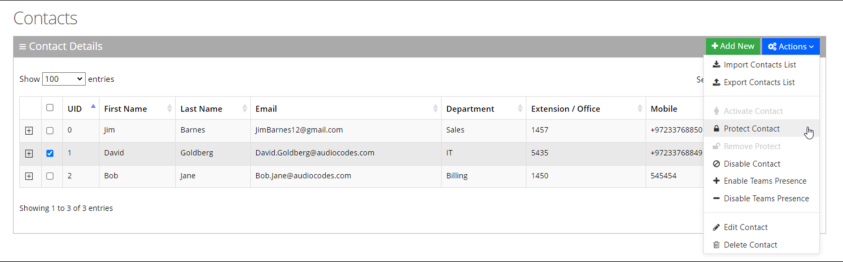

   The selected contact appears with a status of "Protected".

   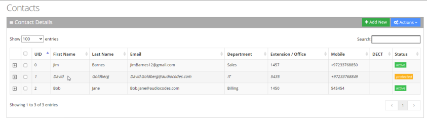

### Removing Protection from a Contact

The procedure below describes how to remove protection from a contact.

#### To remove protection from a contact

1. Open the Contact Details screen (**Contacts** &gt; **Contacts List**).
2. Select the protected contact you wish to remove the "Protect" status, by selecting the 'Contact' check box.
3. From the ‘Actions’ drop-down menu, choose **Remove Protect**; the following appears:

   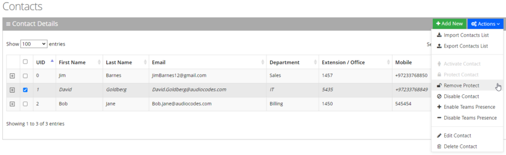

   The "protect" status is removed as shown in the figure below:

   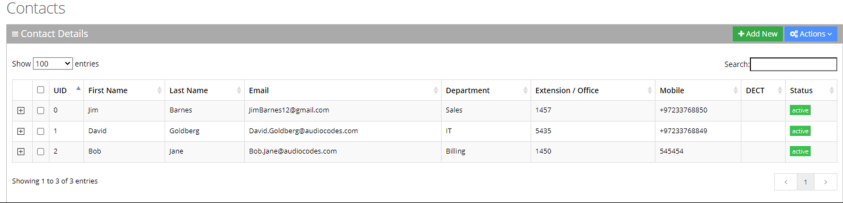

### Activating a Contact

When a contact is created, it is activated (enabled) by default. The procedure below describes how to activate a contact, in case it was disabled.

#### To activate a contact

1. Open the Contact Details page (**Contacts** &gt; **Contacts List**).
2. Select the contact you wish to activate by selecting the 'Contact' check box.

   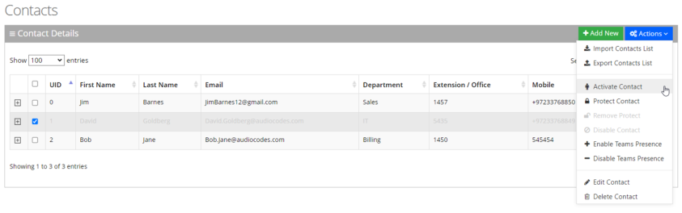

3. From the ‘Actions’ drop-down menu, choose **Activate Contact**; the following appears:

   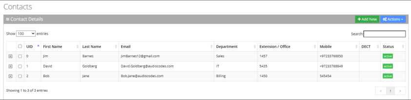

### Disabling a Contact

When you disable a contact, the system removes the contact from the Contact Detection List.

When a "disabled" contact calls the system, it will be recognized as non-employee caller.

The procedure below describes how to disable a contact.

#### To disable a contact

1. Open the Contact Details screen (**Contacts** &gt; **Contacts List**).
2. Select the contact you wish to disable by selecting the 'Contact' check box.
3. From the ‘Actions’ drop-down menu, choose **Disable Contacts**; the following appears:

   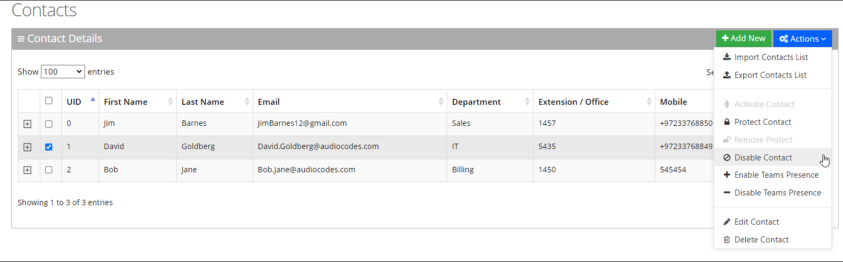

4. The status is set to "disabled" as shown in the figure below:

   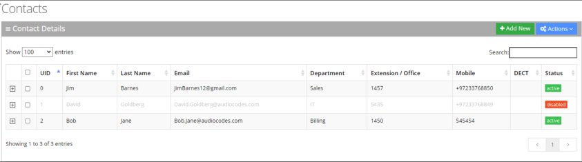

## Importing and Exporting Contact List

The procedure below describes how to import and export CSV and Excel files containing Contact lists. When using CSV files, we recommend you use Notepad++ and save files in UTF-8 encoding format.

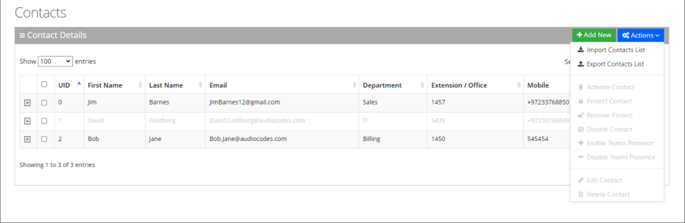

### Importing Contact Information

The procedure below describes how to import Contact information.

#### To import contact information from a CSV file

1. From the Actions drop-down list, on the Contact Details screen, click **Import Contacts List**.

   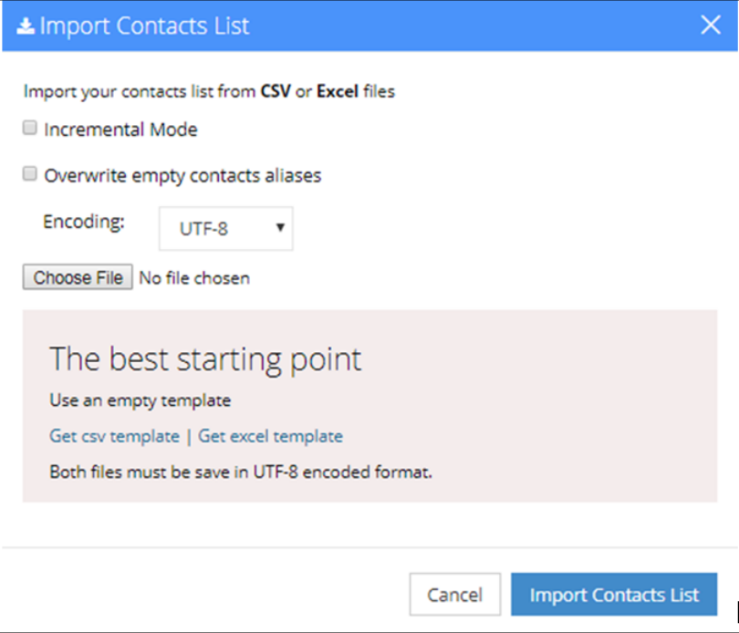

2. If you select the 'Incremental Mode' check box, only the records that you are importing will be active in your Contacts List. All pre-existing records will be disabled.
3. If you select the 'Overwrite empty contacts aliases' check box, all empty contacts aliases in the imported file are overwritten.
4. From the 'Encoding' drop-down list, select the **Encoding type**. The recommended value is **UTF-8**.
5. Click **Choose File**, and then select the file to be imported.
6. Select the CSV or Excel template.
7. Click **Import Contacts** List.

   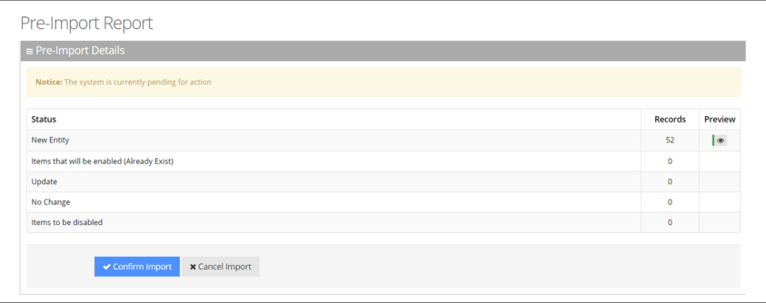

8. This report lists the status of the contracts to be imported. In the example above, 52 new contacts are ready to be imported. Clicking the **Preview** icon displays these new contacts before they are imported. If there is an update to an existing contact, click the **Preview** icon. The contact (before the update) appears with a pink background, while the updated contact appears with a green background.

   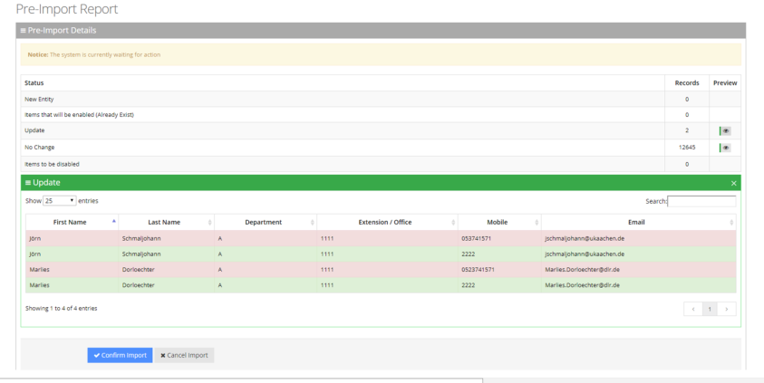

9. Click **Confirm Import** to import the contacts. If you wish to cancel the import process, click **Cancel Import**.

   <Note>
   If you do not click **Confirm Import** or **Cancel Import**, or you switch to another tab, the actual import will be pending and all contacts will be disabled.
   </Note>

   <Note>
   The same behavior applies for Contacts that have been disabled.
   </Note>

10. You can return to the **Confirm Import** or **Cancel Import** processes by clicking on the **here** link.

    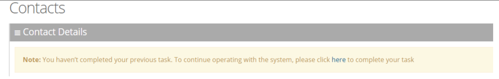

11. The CSV file to be imported should contain the following:
    - UID (mandatory) - an employee ID or any unique number, name or both.
    - First name
    - Last name
    - Extension number
    - Mobile number
    - Department
    - Email
    - First Name Aliases separated by ";"
    - Last Name Aliases separated by ";"
    - Full Name Aliases separated by ";"

    <Note>
    - It is highly recommended that the CSV file will be saved in UTF-8 encoding format (Unicode Text). Use Notepad++ to view CSV files.
    - You can import a new contact with an existing UID in the same tab. For example, you can import a new contact from the **Contacts** &gt; **Import/Export**. The imported contact overwrites the existing contact with the same UID. However, if you import a new department with a UID that is already in use by an existing contact or branch, an error appears with the following message: "Upload has failed. One or more of the UIDs already exist in contacts or branches list! \[UID number\]".
    </Note>

The Excel file can be imported according to the following layout.

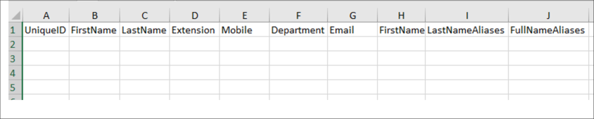

### Exporting Contact Information

The procedure below describes how to export contact information.

#### To export contact information

1. From the 'Actions' drop-down menu, on the Contact Details screen, click **Export Contacts List**.

   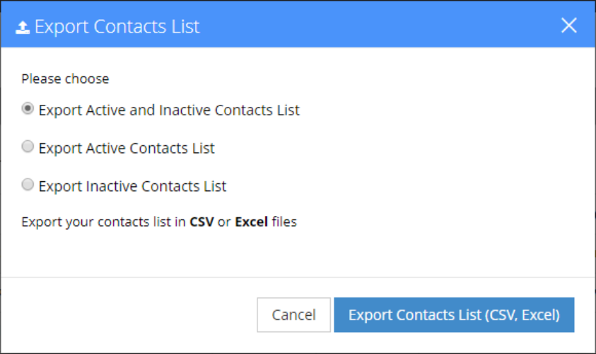

2. Select the type of Contact List to be exported – **Excel** or **CSV**.
3. Click **Export Contacts List**.

## Defining Additional Employees

The procedure below defines the system behavior for adding [additional employees](#defining-additional-employees) to the organization.

Configuring additional employees allows the organization Administrator to add more contacts which will not be included in the organization's contact list. These additional employees will not be reached through voice dialing, but will be part of the organization and will be provided with employee privileges (i.e., the same configuration that is set for employees).

### To define the additional employees

1. Open the Additional Employees Details screen (**Configuration** &gt; **Additional Employees**).
2. Click **Add New**; the following appears:

   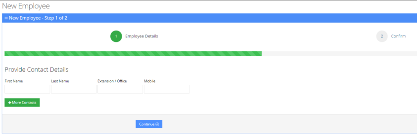

3. Under the **Provide Contact Details** group, enter the following:
   - First Name
   - Last Name
   - Extension/Office
   - Mobile
4. Click **Continue**; the following appears:

   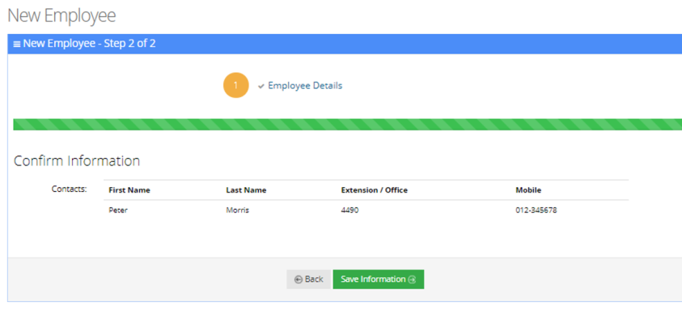

5. Click **Save Information**.
