The Departments page allows the Administrator to manage all the departments in theorganization ifrom a centralized place.

The Administrator can manage the department in the following ways:

- Manually using the Administrator portal to add, edit, delete
- Importing/Exporting departments using the CSV file

## Using the Dictionary List

Voca provides the ability to create separate lists of departments that can be used on a menu level for detection. You can manually add Department Names or import them from pre-defined packages into your department lists.

For every tenant/service the "Default" [Dictionary List](#using-the-dictionary-list) is pre-defined and can't be deleted. It can be used for creating your list or alternatively you can create a new department list with your required name.

### Adding Department Dictionary

The procedure below describes how to add a department dictionary.

#### To add a department dictionary

1. Open the Department Dictionary menu (**Departments** &gt; **Dictionary List**).
2. Click **Add New**; the following appears:

   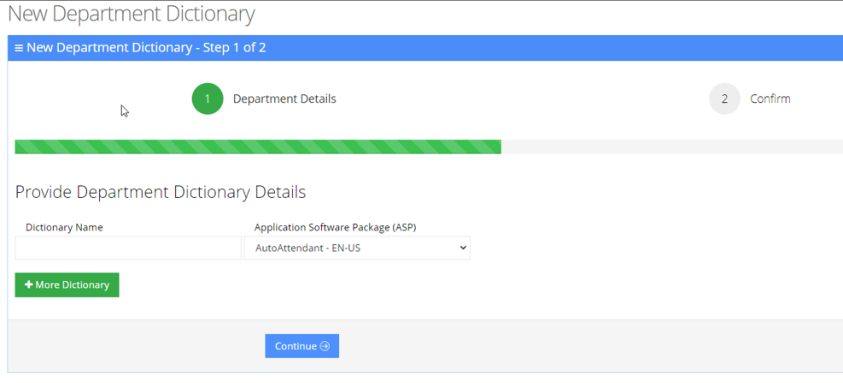

3. Under the Provide Department Dictionary Details group, enter the following:
   - Dictionary Name
   - Application Software Package (ASP)
4. Enter the required fields.

   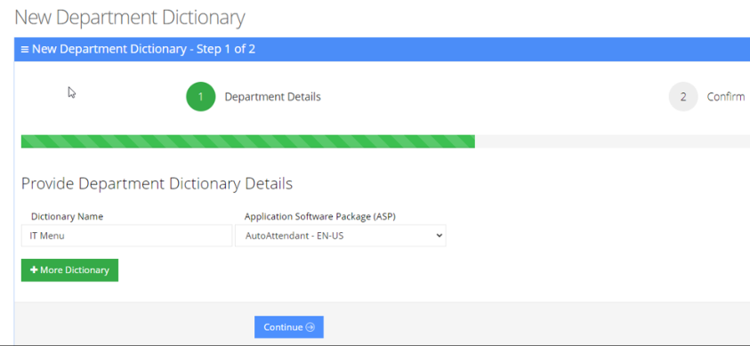

5. Click **Continue**.
6. Click **Save Information**.

### Editing Department Dictionary

The procedure below describes how to edit a Department dictionary.

#### To edit a department Dictionary

1. Open the Department Dictionary menu (**Departments** &gt; **Dictionary List**).
2. Check the **Department Dictionary** that you wish to edit.
3. From the 'Actions' drop-down menu, choose **Edit Dictionary**.

   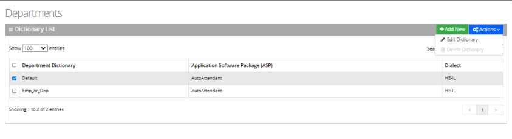

4. Edit the required fields.

   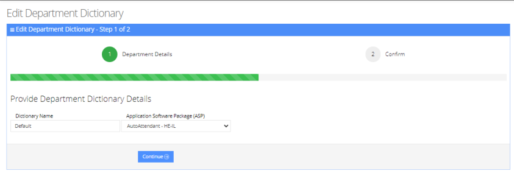

5. Click **Continue**.
6. Click **Save Information**.

### Deleting Department Dictionary

The procedure below describes how to delete a department Dictionary.

#### To Delete a department Dictionary

1. Open the Department Dictionary menu (**Departments** &gt; **Dictionary List**).
2. Check the Department Dictionary that you wish to Delete.
3. From the drop-down action list select **Delete Dictionary**.

   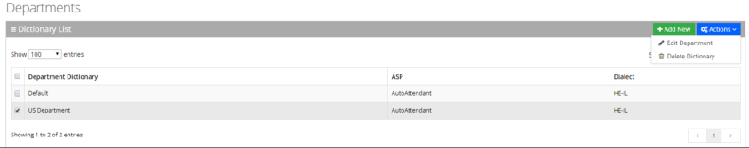

## Adding a Department Manually

The procedure below describes how to add a department to a specific department Dictionary manually.

### To add a department manually

1. Open the Departments menu, and then click on the required department Dictionary (**Departments** &gt; **Departments &gt; \{department Dictionary name\}**).
2. Click on the **Department List** menu.

   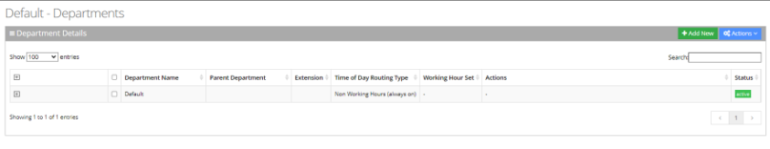

3. Click **Add New;** the following appears:

   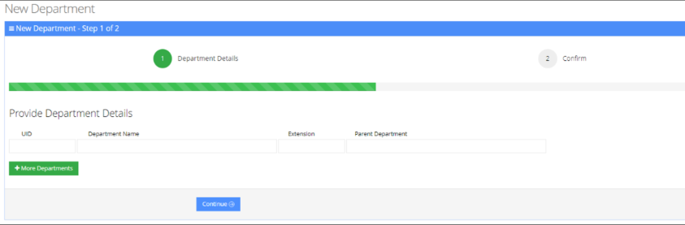

   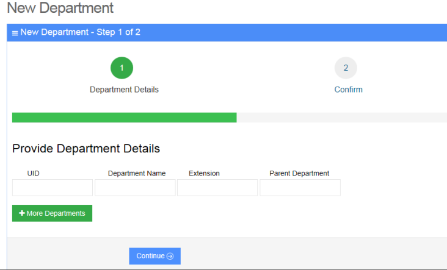

4. Under the **Provide Department Details** group, enter the following:
   - UID
   - Department Name
   - Extension
   - Parent Department
5. Enter the required fields.

   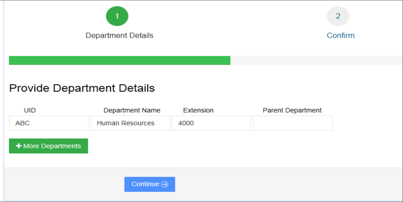

6. Click **Continue**.
7. Click **Save Information**.

   <Note>
   - Every Department must have a unique ID. It can either be a unique number or a name (e.g., ABC123).
   - The ‘Parent Department’ field can be ignored for this step.
   </Note>

## Editing a Department

The procedure below describes how to edit a department.

### To edit a department

1. Open the **Departments** menu, and then click on the required department (**Departments** &gt; **\{Department Dictionary Name\}**).
2. Click on the **Department List** menu.
3. Select the department you wish to edit by selecting the **Department** check box.

   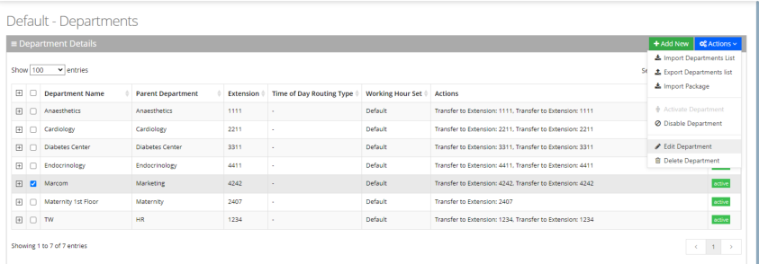

4. From the ‘Actions’ drop-down menu, choose **Edit Department**; the following appears:

   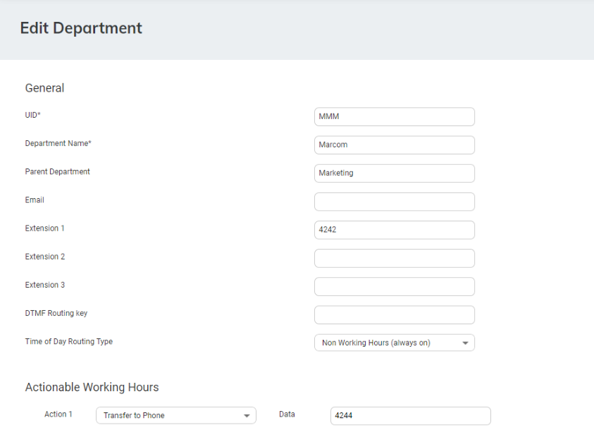

5. In the ‘Parent Department’ field, enter additional an name for the selected department. If there is more than one department with the same name, Voca checks for the Parent Department that is configured.
6. In the 'Email' field, enter the main department email address that can be used for sending missed call notifications for that department.
7. In the 'Extension 1/2/3' fields, enter the extension numbers for the department. These extensions might be used if Call Hunting is activated for departments in the [Speech menu](/tenant-administration/admin-06-configuration/admin-06-3-configuring-menu-settings#adding-a-speech-menu).
8. In the 'DTMF Routing key' field, enter the DTMF routing key. This key is used to reach this department, when entering this DTMF code during the Speech menu (if **Transfer by DTMF routing key** is enabled in the menu). The key must be unique within the service.
9. The 'Time Of Day Routing Type' drop-down list determines how to handle the incoming call based on working hours. There are three possible options:
   - If you select **Working Hours (always on)**, all incoming call, regardless of any working hours, are always handled according to the actions selected.
   - If you select **Working Hours Vs Non Working Hours**, calls are handled based on working hours. When selecting this option, a [Working Hours Set](/tenant-administration/admin-06-configuration/admin-06-5-defining-working-hours) should be selected. Actions will be configured for actionable working hours and for actionable Nonworking hours.

     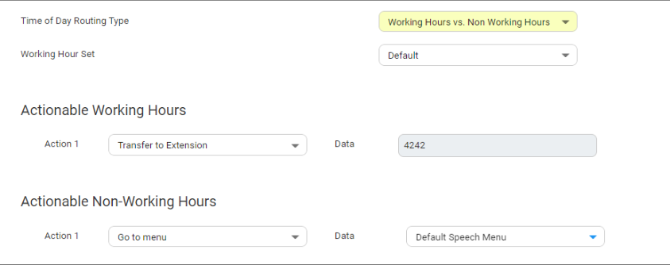

   - If you select **Actionable Working Hours (with shifts)**, calls are handled based on working hours. When selecting this option, a Working Hours Set should be selected. All shifts defined in that set will be displayed and for each working hour shift.

     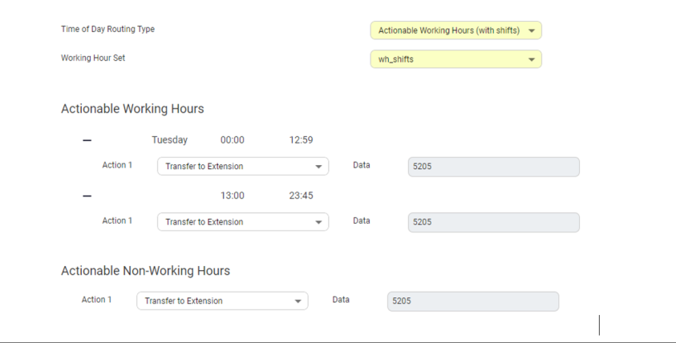

   - Relevant actions can be also configured for the non-working hours.
10. From the 'Action 1' drop-down list, select one of the following options:

    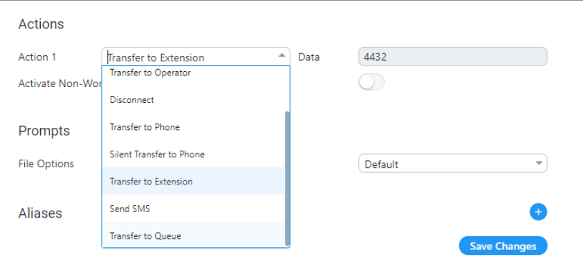

11. In the 'Action1 Data' field, enter the related action data for the 'Action 1' field. For more information of the possible Actions, see [Actions](/tenant-administration/admin-08-actions).
12. Make your changes, and then click **Save Changes**.

## Configuring Department Prompts

The procedure below describes how to configure a Department audio prompt for the Voca service. You can use an existing default prompt, upload a prompt or record a new prompt.

### To use the default department prompt

1. Open the Department menu and click on the required department (**Departments** &gt; **\{department Dictionary name\}**).
2. Click on the **Department List** menu.
3. Select the department you wish to edit by selecting the **Department** check box.
4. From the ‘Actions’ drop-down list, select **Edit Department**; the following appears:

   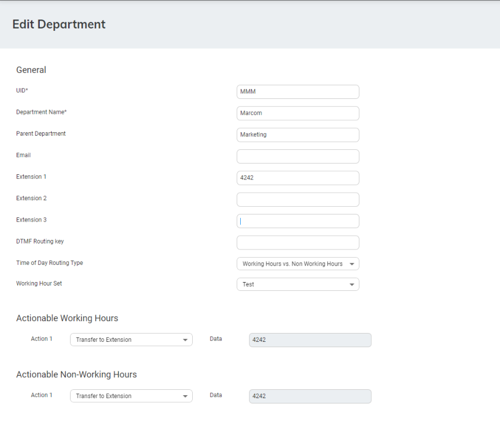

   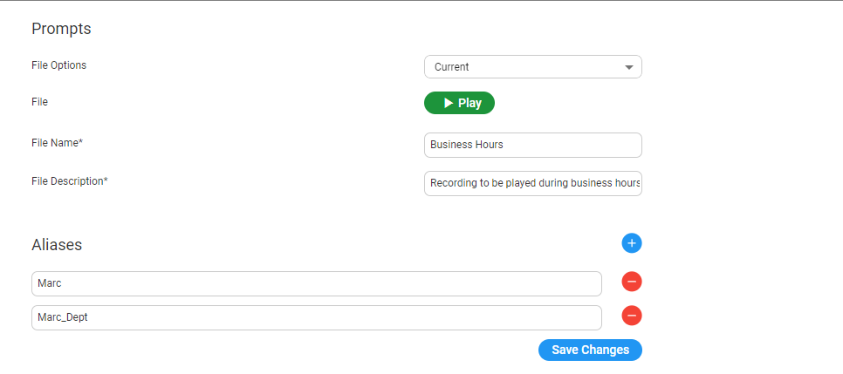

5. Under the **Prompts** group, select 'default' to use a pre-existing prompt.

### To upload a prompt

1. From the 'File Options' drop-down list, select **Upload**.

   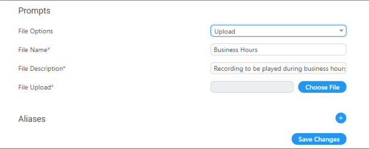

2. In the ‘File Name’ field, enter the audio file name.
3. In the ‘File Description’ field, enter a description of the prompt.
4. Click **Choose File** to locate the audio file to be uploaded; and then click **Open** to select the file.

   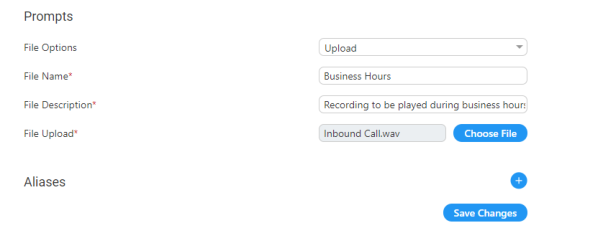

5. Click **Save Changes** to complete the upload process. A 'department Successfully Updated' message appears.

   <Note>
   The audio file must be in the following format - .wav file, with 16 Bit Resolution, mono, 8000Hz.
   </Note>

### To record a prompt

1. From the 'File Options' drop-down list, select **Record**.
2. Click **Record** and then begin recording your prompt.

   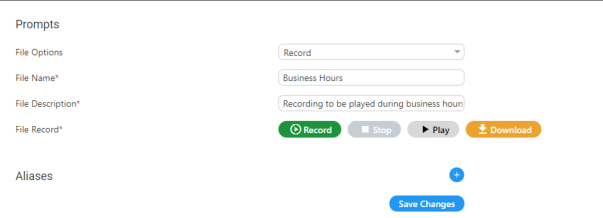

3. When finished recording, click **Stop**.
4. To replay the recent recording, click **Play**.
5. To save a copy of the recorded audio file, click **Download**.
6. Click **Save Changes** to complete the recording process.

## Creating Keywords for a Department

An alias is another name for a department, known or more familiar under another specified name. You can create an alias for a specified department.

### To create a keyword for a department

1. Open the **Departments** menu, and then click on the required department (**Departments** &gt; **\{department Dictionary name\}**).
2. Click on the **Department List** menu.
3. Select the department you wish to edit by selecting the 'Department' check box.
4. From the ‘Actions’ drop-down menu, choose **Edit Department**.
5. Under the **Keywords** group, click  ; the following appears:

   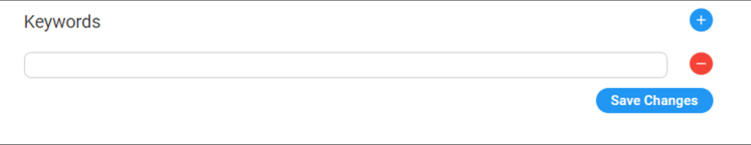

6. Enter the keyword name(s).

   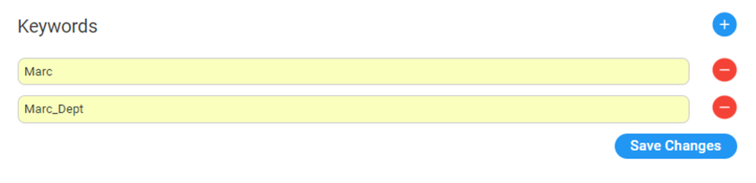

7. Click **Save Changes**; the changes have been updated.

## Deleting a Department

The procedure below describes how to delete a department.

### To delete a department

1. Open the **Departments** menu and click on the required department (**Departments** &gt; **\{department dictionary name\}**).
2. Click on the **Department List** menu.
3. Select the department you wish to delete.
4. From the ‘Actions’ drop-down menu, choose **Delete Department**.

   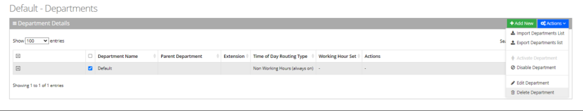

5. The following message appears: 'Are you sure you want to delete the selected department (s)?'
6. Click **OK** to delete the selected department.

## Searching a Department

The procedure below describes how to search for a department.

### To search for a department

1. Open the Departments menu and click on the required department (**Departments** &gt; **\{department dictionary name\}**).
2. Click on the **Department List** menu.
3. Enter the search criteria in the **Search** field; the searched data is displayed.

   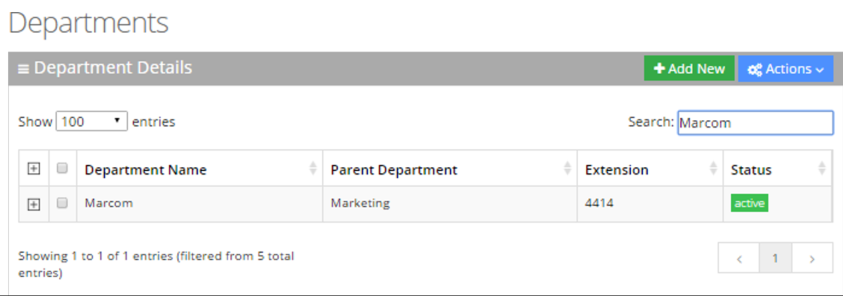

## Disabling a Department

The procedure below describes how to disable a department.

### To disable a department

1. Open the **Departments** menu and click on the required department (**Departments** &gt; **\{Department Dictionary name\}**).
2. Click on the **Department List** menu.
3. Select the department you wish to disable by selecting the **Department** check box.
4. From the ‘Actions’ drop-down menu, choose **Disable Department**.

   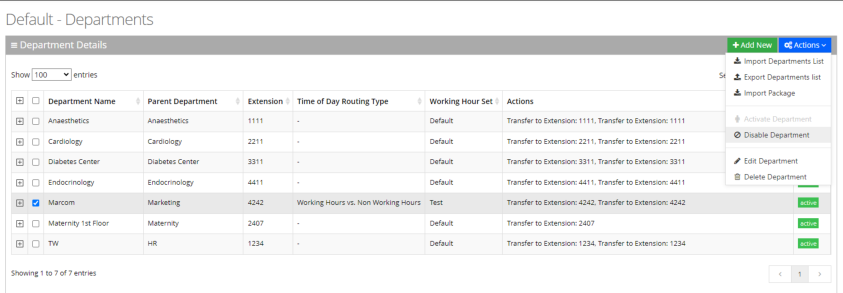

5. The selected department is "disabled" as shown in the figure below:

   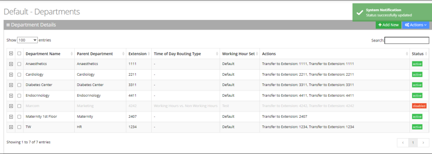

## Activating a Department

The procedure below describes how to activate a department.

### To activate a department

1. Open the Departments menu and click on the required department Dictionary (**Departments** &gt; **\{department Dictionary name\}**).
2. Click on the **Department List** menu.
3. Select the department you wish to activate by selecting the **Department** check box.
4. From the ‘Actions’ drop-down menu, choose **Activate Department**.

   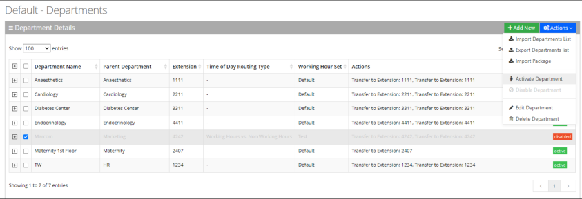

5. The disabled department appears with a green status of "active", as shown below.

   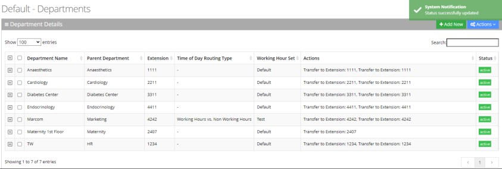

## Searching for a Keyword

You can use the **Search** box to search for specific text on the Department Aliases page.

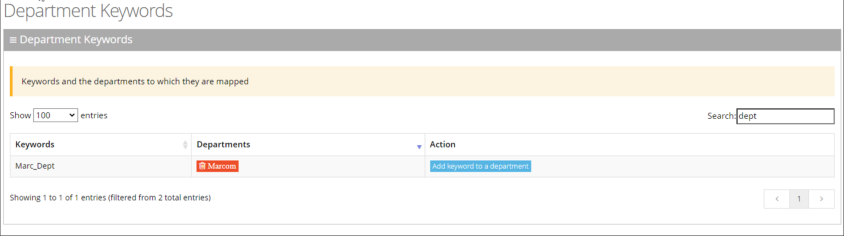

## Importing/Exporting Department List

The procedure below describes how to import and export CSV or XLS files containing Department lists from/to a specific department Dictionary. When using CSV files, we recommend you use Notepad++ and save files in UTF-8 encoding format.

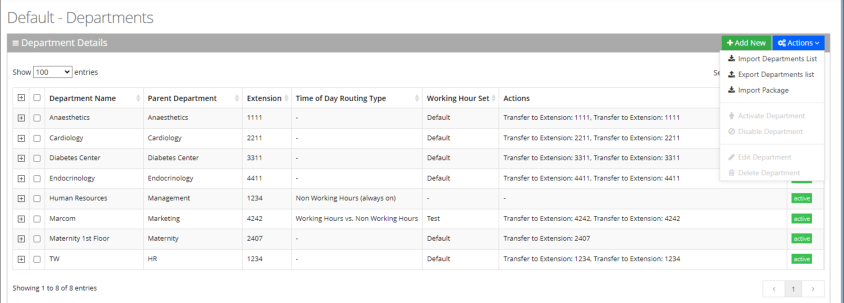

### Importing Department Information

The procedure below describes how to import department information.

#### To import department information

1. Open the **Departments** menu, and then click on the required department (**Departments** &gt; **\{department dictionary name\}**).
2. Click on the **Department List** menu.
3. From the **Actions** drop-down list, on the Department Details page, click **Import Departments List**.

   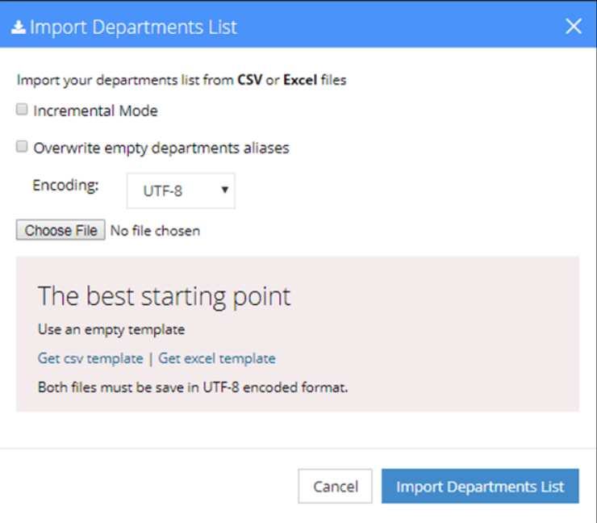

4. If you select the 'Incremental Mode' check box, only the records that you are importing are activated in your Departments List. All pre-existing records are disabled.
5. If you select the 'Overwrite empty departments aliases' check box, all empty departments aliases in the imported file are overwritten.
6. From the 'Encoding' drop-down list, select the Encoding type. The recommended value is **UTF-8**.
7. Click **Choose File** and select the file to be imported.
8. Select the CSV or Excel template.
9. Click **Import Departments List**.

   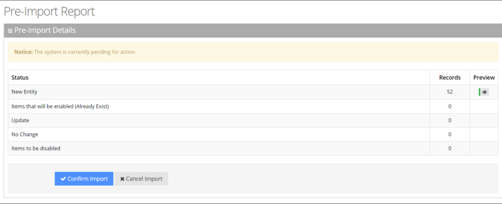

   This report lists the status of the departments to be imported. In this example, 52 new departments are ready to be imported. Clicking the Preview icon, displays these new departments before they are imported.
10. Click **Confirm Import** to import the departments. If you wish to cancel the import process, click **Cancel Import**.

    If you do not click **Confirm Import/Cancel Import** or switch to another tab, the actual import will be pending and all departments will be disabled. the following appears:

    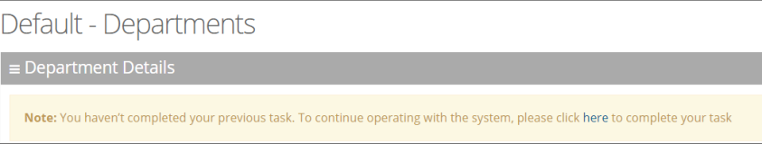

11. You can return to the **Confirm Import** or **Cancel Import** processes by clicking on the **here** link.
12. The CSV to be imported should contain the following:
    - UID (mandatory) - a Department ID or any unique number, name or both need to be entered.
    - Department name
    - Extension number
    - Aliases separated by ";"

    <Note>
    It is highly recommended that the CSV file will be saved in UTF-8 encoding format (Unicode Text). Use Notepad++ to view CSV files.
    </Note>

13. The Excel file can be imported according to the following layout:

    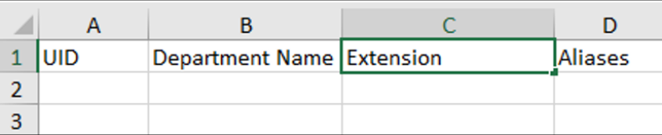

### Exporting Department Information

The procedure below describes how to export department information.

#### To export department information

1. From the Actions drop-down list, on the Department Details screen, click **Export Departments List**.

   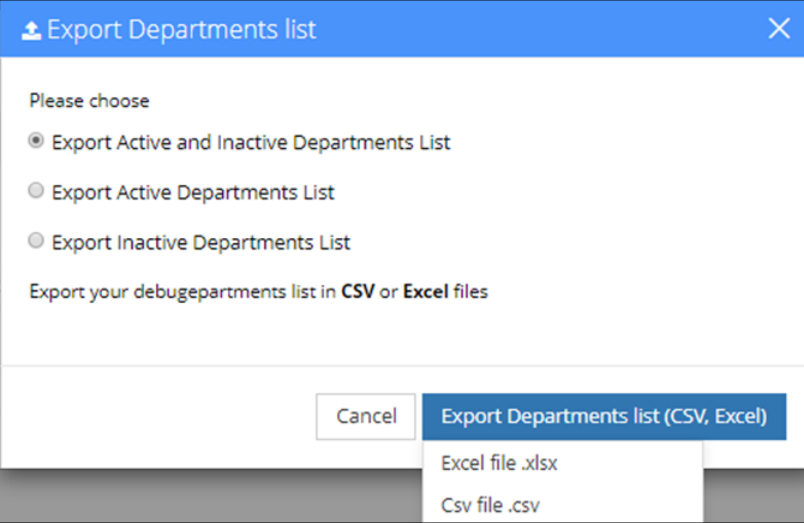

2. Select the type of Department List to be exported:
   - Active and Inactive Departments List
   - Active Departments List
   - Inactive Departments List
3. Click **Excel file** or **CSV file** as the format to export the Departments List.
