The procedures below describe how to view and configure voice settings and assign DNIS numbers.

## To view voice settings

1. Open the Voice Settings screen (**Configuration** &gt; **Interaction Manager** &gt; **Voice**); the following appears.

   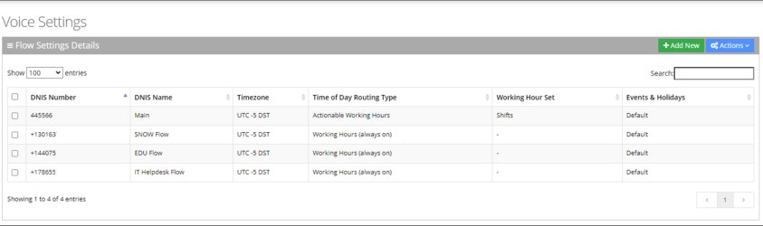

The Voice Settings page is described below:

- **DNIS Number:** Defines the Access phone number for the IVR service. e.g., 5555
- **DNIS Name:** Defines the name of the IVR service.
- **Timezone:** Defines the timezone associated with the DNIS number. When calling this number, working hours, holidays and events are checked based on the timezone.
- **Time Of Day Routing Type:** Defines how to handle incoming calls based on working hours. This can be set by editing the three options in the Flow Settings records:
- **Working Hour Set:** Defines which working hour set will be used to define the working/nonworking days/time for the flow.
- **Events & Holidays:** Selects the relevant [Events and Holidays](/tenant-administration/admin-06-configuration/admin-06-6-defining-events-and-holidays) set. Events and Holidays actions take precedence over Working Hours actions. (see [Defining Events and Holidays](/tenant-administration/admin-06-configuration/admin-06-6-defining-events-and-holidays))

## Adding a Flow Setting

The procedure below describes how to add a flow setting.

### To add a flow setting

1. Open the Voice Settings page (**Configuration** &gt; **Interaction Manager** &gt; **Voice**); the following appears.

   

2. Click **Add New**; the following appears:

   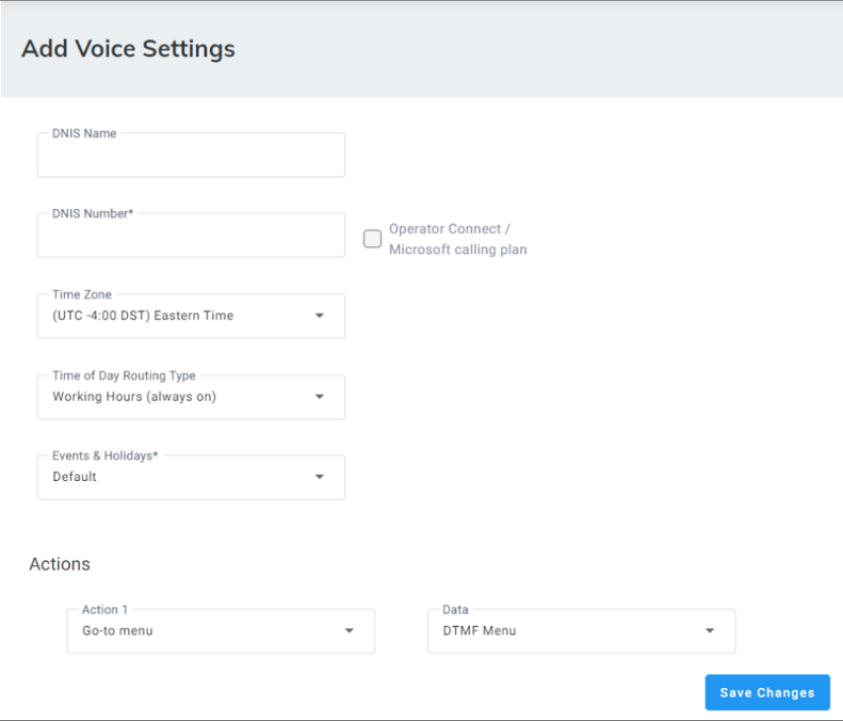

3. In the 'DNIS Name' field, enter the name of the IVR service.
4. In the 'DNIS Number' field, enter the access phone number for the IVR service. e.g., 5555.

   <Note>
   If you are using [Operator Connect](/tenant-administration/admin-a-appendix-dnis-number-for-operator-connect-microsoft-calling-plan) or Microsoft calling plan, select the check box. A Microsoft window appears prompting you to enter the designated Microsoft Teams user created for this integration. See [DNIS Numbers for Operator Connect and Calling Plan](/tenant-administration/admin-a-appendix-dnis-number-for-operator-connect-microsoft-calling-plan).
   </Note>

5. From the 'Timezone' drop-down list, select the timezone associated with the DNIS number. When calling this number, working hours, holidays and events are checked based on the timezone.
6. From the 'Time Of Day Routing Type' drop-down list, select the method for handling incoming calls based on working hours. This can be set by editing the three options in the Flow Settings records:

   <Note>
   Events & Holidays actions always take precedence.
   </Note>

   - If you select **Working Hours (always on)**, all incoming calls, regardless of any working hours, are always handled according to the 'Actions' configured below.
   - If you select **Actionable working hours**, calls are handled based on the working hours. When selecting this option, a [Working Hours Set](/tenant-administration/admin-06-configuration/admin-06-5-defining-working-hours) should be selected. All shifts defined in that set are displayed and for each working hour shift, relevant actions can be configured. Relevant actions can be also configured for non-working hours.

     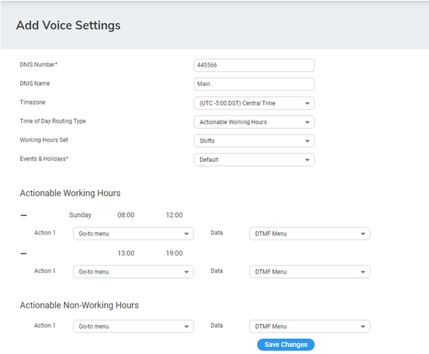

   - If you select **Actionable working hours (Emp./Non-Emp):** Calls are handled based on working hours and whether the caller is an employee or non-employee. When selecting this option, a 'Working Hours Set' option should be selected. All shifts defined in that set are displayed for employees and non-employees. For each working hour shift, relevant actions can be configured. Relevant actions can be also configured for non-working hours for employees and non-employees.

     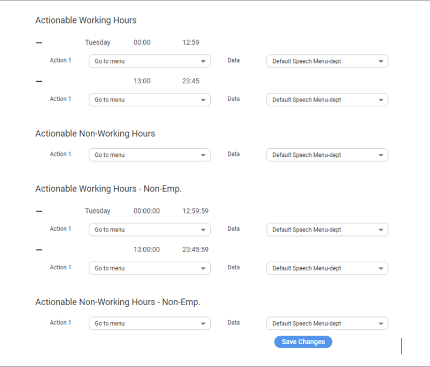

   For more information of the possible Actions, see [Actions](/tenant-administration/admin-08-actions).
7. Add your details, and then click **Save Changes**.

## Editing a Flow Setting

The procedure below describes how to edit [Email Interaction Settings](/tenant-administration/admin-06-configuration/admin-06-1-configuring-interaction-manager/admin-06-1-2-configuring-email-interaction-settings).

### To edit Flow Settings

1. Open the Voice Settings page (**Configuration** &gt; **Interaction Manager** &gt; **Voice**); the following appears:

   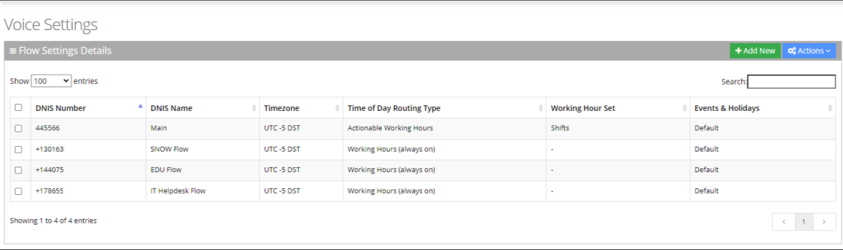

2. Select the voice interaction check box that you want to edit.

   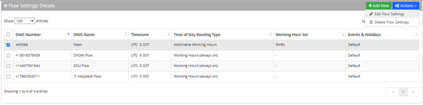

3. From the 'Actions' drop-down menu, choose **Edit Voice Settings**; the following appears:

   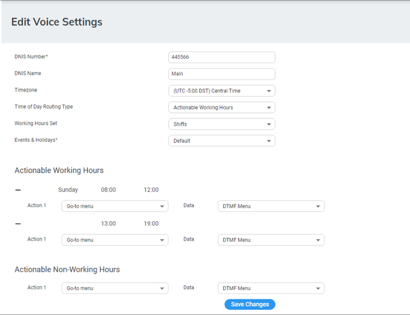

4. Edit the fields you want to change.
5. Click **Save Changes**.

## Deleting a Flow Setting

The procedure below describes how to delete a Flow setting.

### To delete a Flow setting

1. Open the Voice Settings Details page (**Configuration** &gt; **Interaction Manager** &gt; **Voice**).

   

2. Select the Flow Setting you want to delete by selecting the **Flow Settings** check box, and then From the ‘Actions’ drop-down menu, choose **Delete Flow Settings**.
3. Click **OK** to delete the selected Flow Setting.

## Keyword to Department Mapping

The procedures below describe how aliases are mapped to departments, and allow removing and adding aliases to additional departments.

### To add a keyword to a department

1. Open the Departments Aliases page (**Departments** &gt; **\{department Dictionary name\}**).
2. Click on the **Department Keywords** menu.

   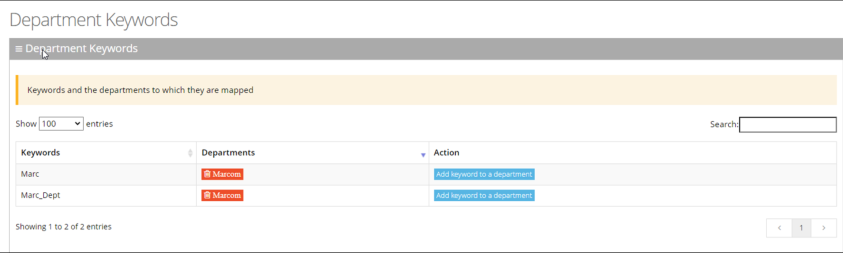

3. Place the cursor on the keywords that you wish to have the department mapped to.
4. In the **Action** column, click the 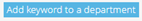 button.
5. From the **Department** drop-down list, select the department you wish to map to the alias.

   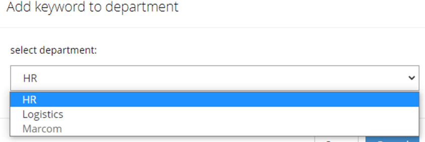

6. Click **Save**; In our example, **HR** was added to the Marc keywords name.

   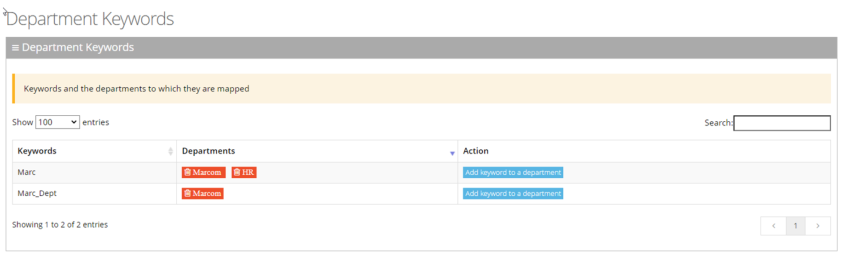

### To delete an Alias from a Department

1. Open the Departments Aliases page (**Departments** &gt; **\{department Dictionary name\}**).
2. Click on the **Department Keywords** menu.

   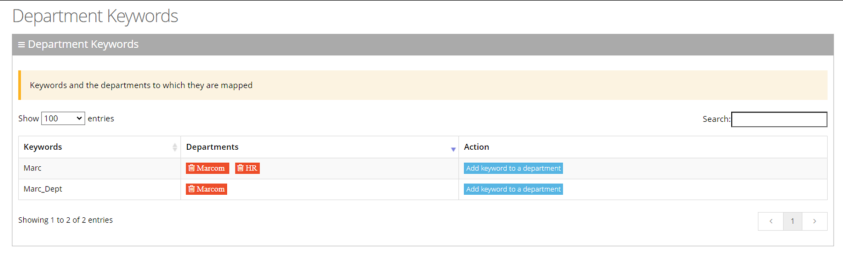

3. Double-click the department button that you want to delete. In our example, we want to delete **Marc** from the **HR** department. A message appears informing you that the alias will be deleted from the department.
4. Click **OK**.
