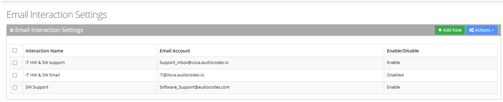
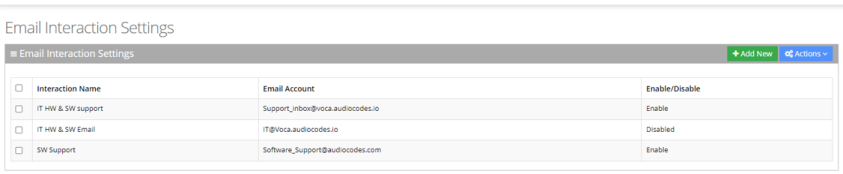
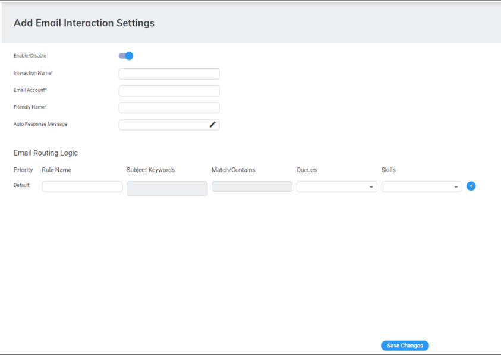
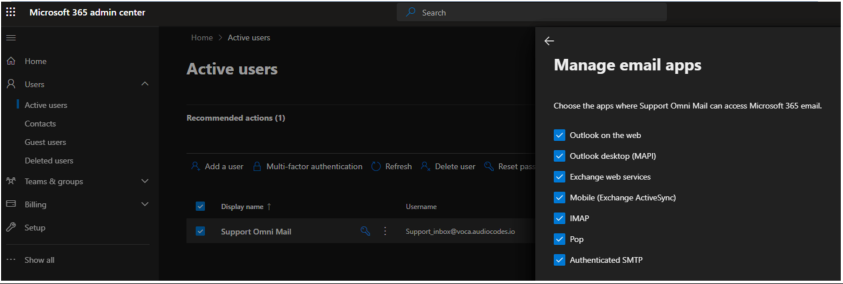
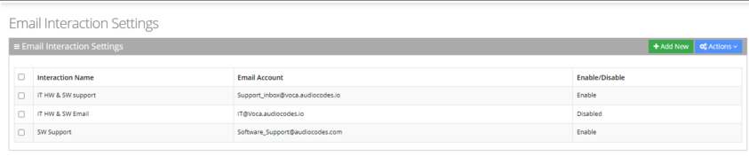
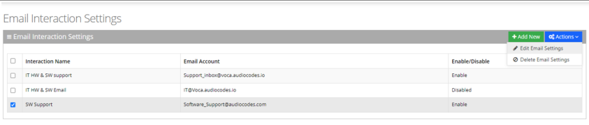
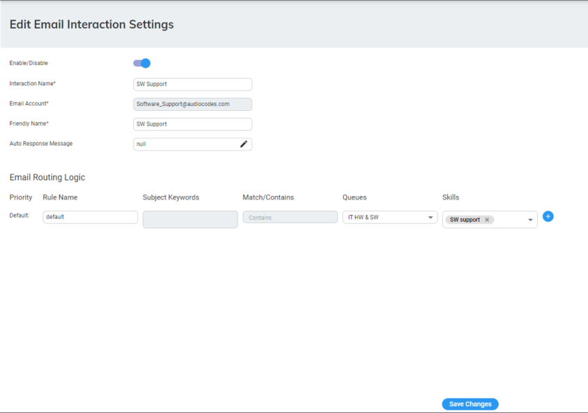
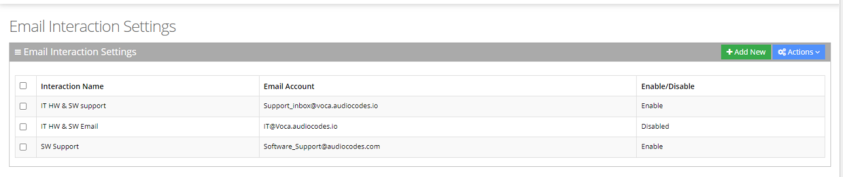
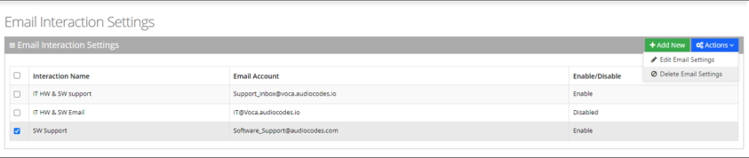

Use Voca CIC’s Email channel support to route emails efficiently and have your workers handle them easily, with controlled distribution, routing and real-time analytics.

Email settings are available for Digital Engagement Tenants.

The procedure below describe how to view and configure email settings.

<Note>
Before performing the below configuration, make sure that you have configured [Omnichannel settings](/tenant-administration/admin-06-configuration/admin-06-7-system-settings#omnichannel-configuration) in the System Settings section.
</Note>

## To view email settings

1. Open the email Settings screen (**Configuration** &gt; **Interaction Manager** &gt; **Email**); the following appears:

   

- 'Interaction Name': Defines the name of the Email interaction.
- 'Email Account': Defines the email account for the interaction.
- Enable / Disable: An enabled interaction pulls emails from the email account into Voca.

## Adding Email Interactions

The procedure below describes how to add Email Interaction settings.

### To add email Interaction Settings

1. Open the Email Settings page (**Configuration** &gt; **Interaction Manager** &gt; **Email**).

   

2. Click **Add New**.

   

3. Click the 'Enable/ Disable' toggle button to enable the pulling of emails from the configured email account into Voca.
4. In the 'Interaction Name' field, type the name of the interaction.
5. In the 'Email Account' field, type the email address that is used for this interaction to receive and send emails.
6. In the 'Friendly Name' field, define the identification name of the sender, which is displayed in an email client.
7. In the 'Auto Response Message' field, type the message that is automatically sent to the customer when they send an email.
8. The **Email Routing Logic** section configures rules that connect commonly used phrases sent to the email account with queues and skills:
   1. In the 'Priority' field, order routing logics by drag and drop to define which matches are checked first.
   1. In the 'Subject Keywords’ field, type commonly used phrases (one or more) that should be routed to the same queues and skills.

   <Note>
   Press Enter in the text field for each phrase to save the entry.
   </Note>

   1. In the 'Match/Contains' drop-down list, select whether matches are based on exact or contains method.
      - **Exact Match:** a partial phrase is not considered a match.
      - **Contains:** a partial phrase is considered a match.
   1. In the 'Queues' drop-down list, select the queue to where you want the email routed.
   1. In the 'Skills' drop-down list, select the skills that the Worker should have to receive the email.
9. Click **Save Changes**.
10. After configuring the 'Omnichannel' email server integration on the [System Setting](/tenant-administration/admin-06-configuration/admin-06-7-system-settings) page (see [Omnichannel Configuration](/tenant-administration/admin-06-configuration/admin-06-7-system-settings#omnichannel-configuration)), configure the following PowerShell commands on the customer’s Azure tenant to enable email interaction with a specific email mailbox:

    ```text
    Connect-ExchangeOnline -Organization
    ```

    The following command is a one-time configuration; there is no need to configure it again if it has been configured before:

    ```text
    New-ServicePrincipal -AppId <Voca Omnichannel Email Application ID> -
    ObjectId <Voca Omnichannel Email Object ID>
    ```

    Add the following command for each new mailbox interaction:

    ```text
    Add-MailboxPermission -Identity “Support_inbox@voca.audiocodes.io" -User
    <Voca Omnichannel Email Object ID> -AccessRights FullAccess
    ```

    After applying the above command on the email mailbox make sure that this mailbox has the 'Authenticated SMTP' check box selected from the Admin Center page in your Azure:

    

## Editing Email Interaction Settings

The procedure below describes how to edit Email Interaction Settings.

### To edit Email Interaction Settings

1. Open the Email Interaction Settings page (**Configuration** &gt; **Interaction Manager** &gt; **Email**); the following appears:

   

2. Select the email interaction check box that you want to edit.

   

3. From the 'Actions' drop-down list, choose **Edit Email Settings**; the following appears:

   

4. Edit the fields you want to change.
5. Click **Save Changes**.

## Deleting an Email Interaction Setting

The procedure below describes how to delete Email Interaction Settings.

### To delete Email Interaction Settings

1. Open the Email Interaction Settings page (**Configuration** &gt; **Interaction Manager** &gt; **Email**); the following appears:

   

2. Select the email interaction check box that you want to delete.

   

3. From the 'Actions' drop-down list, choose **Delete Email Settings**.
4. Click **OK** to delete the selected item.
