Use Voca CIC’s Chat channel support to customize a live chat widget and [SMS interactions](#configuring-sms-interactions) for the organization, enabling customer engagement while browsing or on mobile. Form fields, drop down menus, colors, contact reason selection, and branding are fully customizable. See below for configuration details on each.

- [Configuring Webchat Interactions](#configuring-webchat-interactions)
- [Configuring SMS interactions](#configuring-sms-interactions)

## Configuring Webchat Interactions

This section describes how to view and configure [webchat interaction](#configuring-webchat-interactions) settings and assign it to a website.

### To view interaction settings

1. Open the Chat Interaction Settings page (**Configuration &gt; Interaction Manager &gt; Chat**); the following appears:

   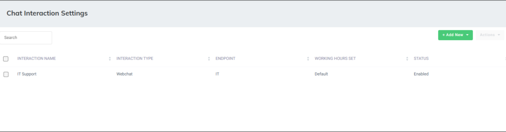

The Chat Interaction Settings page is described below:

- 'Interaction Name': Defines the interaction name.
- 'Interaction Type': Defines the interaction type, either webchat or SMS.
- 'Endpoint': the interaction points of the customer with the system. This is either the webchat domain or the SMS number.
- 'Working Hour Set': Defines which working hour set is used to define the working / nonworking days / time for the flow.
- 'Status': Either 'Enable' or Disable'. An enabled interaction allows the appearance of the chat widget on the website or the SMS.

### Adding Webchat Interaction Settings

The procedure below describes how to add Webchat Interaction Settings. Adding a webchat interaction setting includes the following three parts:

- General
- Webchat Design
- Pre-Chat

#### To add a Webchat Interaction Setting

1. Open the Chat Settings page (**Configuration** &gt; **Interaction Manager** &gt; **Chat**); the following appears:

   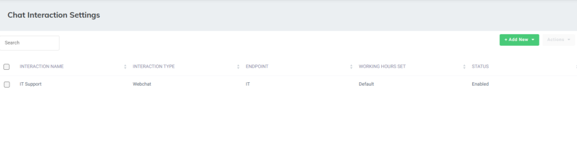

2. Click **Add New**, and choose +**Webchat Interaction**.

   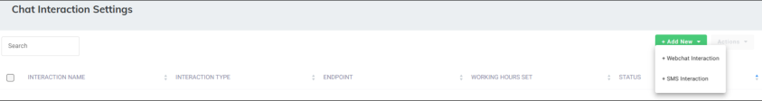

   The following appears, with the **General** tab displayed by default:

   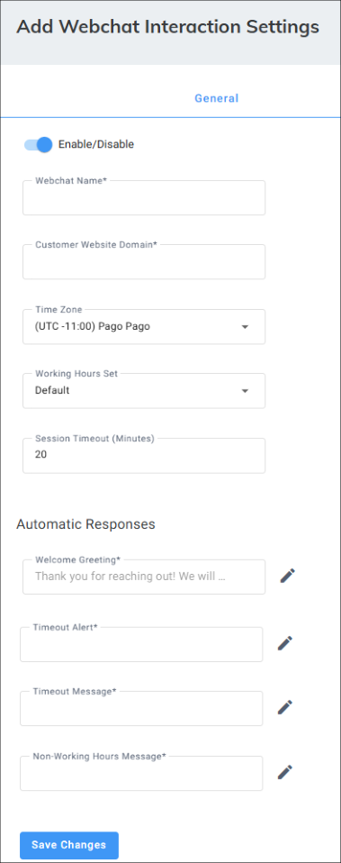

3. Under the **General** tab, do the following:
   1. Click the ‘Enable/ Disable’ toggle switch to enable the display of the webchat on the website.
   1. In the ‘Customer Website Domain’ field, type the domain of the website to connect with the webchat's widget.
   1. From the 'Time Zone' drop-down list, select the timezone associated with the webchat interaction. When interacting with this webchat, working hours, holidays and events are checked based on the timezone.
   1. From the ‘Working Hours Set’ drop-down list, select a working hour set to define the working / non-working days and time for the webchat interaction.
   1. In the ‘Session Timeout (Minutes)’ field, define the time that a customer must respond to an agent before the session is automatically closed.
   1. Under the **Automatic Responses** group, define automatic messages for different scenarios:
      - 'Welcome Greeting' field: Greet the customer when starting a new conversation.
      - 'Timeout Alert': Notify the customer that the session is about to be closed because no response has been received.
      - 'Timeout Message': Notify the customer that the session has been closed because of inactivity.
      - 'Non-Working Hours Message': Notify the customer that the chat is currently unavailable because it's outside of working hours.
4. Select the **Webchat Design** tab; the following appears:

   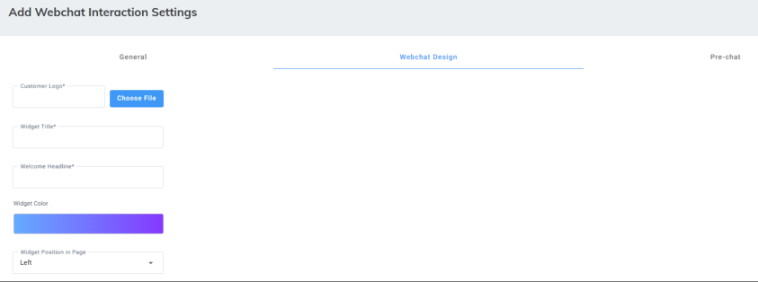

5. Define the widget's appearance:
   1. In the ‘Customer Logo’ field, click Choose File and then upload your organization logo (see item #1 in the example figure below).
   1. In the ‘Widget’ field, type the name of the widget (see item #2 in the example figure below).
   1. In the ‘Welcome Headline’ field, type a short webchat introduction (see item #3 in the example figure below).
   1. Click the ‘Widget color’ button, and then pick a widget color.
   1. From the ‘Widget Position in Page’ drop-down list, choose the widget’s position.

      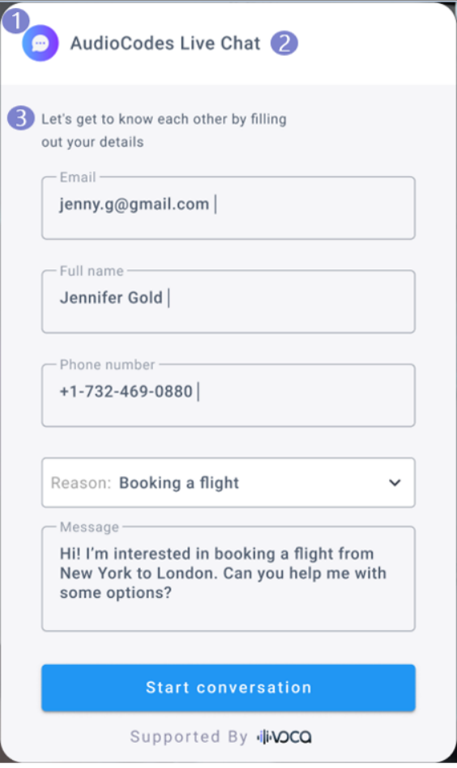

6. Select the **Pre Chat** tab; the following appears:

   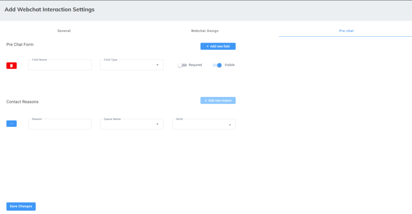

7. Under the **Pre Chat Form** group, define the information customers should provide before starting a new conversation. Data can be viewed by an agent during the chat and in the conversation history:
   1. In the ‘Field Name’ field, type a name for the field, which is displayed to the customer.
   1. From the ‘Field Type’ drop-down list, select the type of input that the system expects to receive.
   1. Click the ‘Required’ toggle button to turn on the field as mandatory.
   1. Click the ‘Visible’ toggle button to turn on the display of the field on the widget, or turn off the toggle button to hide the field so that data is automatically pulled from signedin users.

   <Note>
   Implementing data extraction from hidden fields should be configured by the administrator within the provided code script.
   </Note>

   1. Add a new field, by clicking  **Add new field**.
8. Under the **Contact Reasons** group, define a set of contact reasons and assign them to the relevant queues and skills:
   1. In the ‘Reason’ field, type a possible contact reason that is visible for the customer.
   1. From the ‘Queue Name’ drop-down list, select the queue to which the email is routed.
   1. From the ‘Skills’ drop-down list, select the relevant skills that the Worker should have to receive the email.
   1. To add additional Main Contact Reasons, click the **Add new reason** button.
   1. To delete a Main Contact Reason, click the ellipsis (...) button corresponding to the reason, and then from the drop-down menu, choose **Delete**.
   1. To add a sub-reason to a Main Contact Reason, click the ellipsis (...) button corresponding to the reason, and then from the drop-down menu, choose **Add New**.
   1. You can add sub-reasons to sub reasons.

### Connecting the Webchat Interaction to the Website

The procedure below describes how to connect the webchat widget to the website.

#### To connect webchat widget to website

1. Open the Chat Settings page (**Configuration** &gt; **Interaction Manager** &gt; **Chat**); the following appears:

   

2. Select the Webchat interaction check box whose code you wish to copy.

   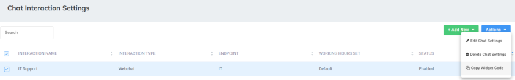

3. From the ‘Actions’ drop-down menu, choose **Copy Widget Code** ; the following pop-up appears:

   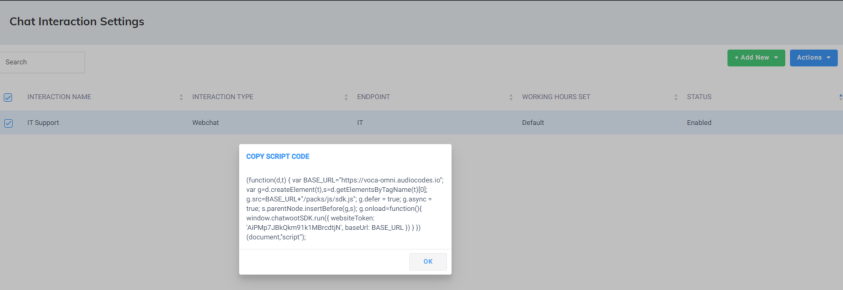

4. Copy and paste the code script into the website’s HTML code.

### Editing Webchat Interaction Settings

The procedure below describes how to edit Webchat Interaction Settings.

#### To edit a Webchat Interaction Setting

1. Open the Chat Interaction Settings page (**Configuration** &gt; **Interaction Manager** &gt; **Chat**); the following appears:

   

2. Select the webchat interaction that you want to edit.

   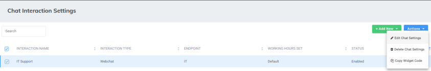

3. From the ‘Actions’ drop-down menu, choose **Edit Chat Settings**; the following appears:

   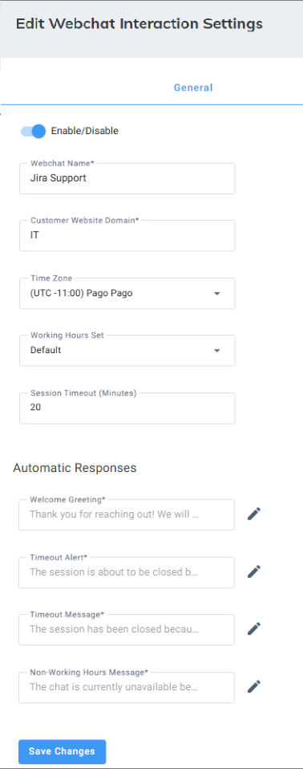

4. Edit the fields you want to change.
5. Click **Save Changes**.

### Deleting Chat Interaction Settings

The procedure below describes how to delete Webchat Interaction Settings.

#### To delete a Webchat Interaction Setting

1. Open Chat Interaction Settings page (**Configuration** &gt; **Interaction Manager** &gt; **Chat**); the following appears:

   

2. Select the webchat interaction check box that you want to delete.

   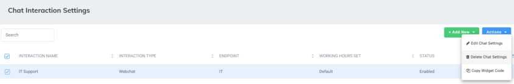

3. From the ‘Actions’ drop-down menu, choose **Delete Chat Settings**.
4. Click **OK**.

## Configuring SMS interactions

This section describes how to view and configure the SMS interactions.

<Note>
You must configure SMS settings, in the [System Settings](/tenant-administration/admin-06-configuration/admin-06-7-system-settings) before adding an SMS interaction. For details, see [Configuring Omnichannel settings for SMS](/tenant-administration/admin-06-configuration/admin-06-7-system-settings#configuring-omnichannel-settings-for-sms).
</Note>

### To view interaction settings

1. Open the Chat Interaction Settings page (**Configuration** &gt; **Interaction Manager** &gt; **Chat**); the following appears:

   

The Chat Interaction Settings page is described below:

- 'Interaction Name': Defines the interaction name.
- 'Interaction Type': Defines the interaction type, either webchat or SMS.
- 'Endpoint': the interaction points of the customer with the system. This is either the webchat domain or the SMS number.
- 'Working Hour Set': Defines which working hour set is used to define the working / nonworking days / time for the flow.
- 'Status': Either 'Enable' or Disable'. An enabled interaction allows the appearance of the chat widget on the website or the SMS.

### Adding SMS interactions

<Note>
You must configure SMS settings, in the System Settings, before adding an SMS interaction. For details, see [Configuring Omnichannel settings for SMS](/tenant-administration/admin-06-configuration/admin-06-7-system-settings#configuring-omnichannel-settings-for-sms).
</Note>

#### To add an SMS Interaction Setting

1. Open the Chat Settings page (**Configuration** &gt; **Interaction Manager** &gt; **Chat**); the following appears:

   

2. Click **Add New**, and choose +**SMS Interaction**.

   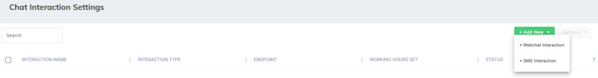

   The following appears, with the **General** tab displayed by default:

   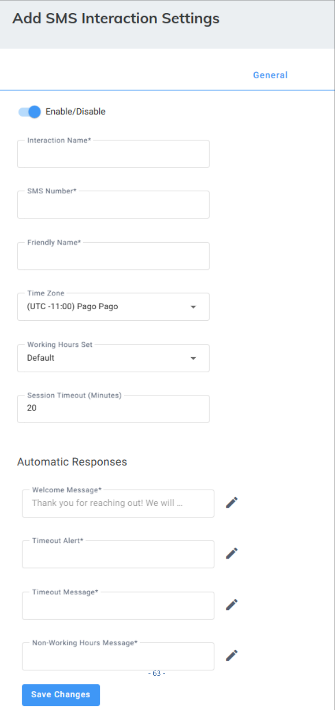

3. Under the **General** tab, do the following:
   1. Click the ‘Enable/ Disable’ toggle switch to enable the SMS interaction.
   1. In the ‘Interaction Name’ field, type the name of the interaction.
   1. In the ‘SMS Number’ field, type the phone number that receives the SMS messages. This phone number connects between the SMS inbox settings and the customer's interaction.

   <Note>
   This SMS number must be supported by the SMS service provider.
   </Note>

   1. In the 'Friendly Name' field, type The name that will be presented to the customer when they receive the SMS interaction.

   <Note>
   The friendly name may not be supported in some countries due to local regulations. In some cases, SMS providers may block it, displaying the number instead of the name.
   </Note>

   1. From the 'Time Zone' drop-down list, select the timezone associated with the SMS interaction. When interacting with this SMS , working hours, holidays and events are checked based on the timezone.
   1. From the ‘Working Hours Set’ drop-down list, select a working hour set to define the working / non-working days and time for the SMS interaction.
   1. In the ‘Session Timeout (Minutes)’ field, define the time that a customer must respond to an agent before the session is automatically closed.
   1. Under the **Automatic Responses** group, define automatic messages for different scenarios:
      - 'Welcome Greeting' field: Greet the customer when starting a new conversation.
      - 'Timeout Alert': Notify the customer that the session is about to be closed because no response has been received.
      - 'Timeout Message': Notify the customer that the session has been closed because of inactivity.
      - 'Non-Working Hours Message': Notify the customer that the chat is currently unavailable because it's outside of working hours.
4. Select the **Routing** tab to choose where customers will be routed to when sending an SMS to this number. There are two options:
   - **Predefined -** Select this to choose where all messages that are sent to this SMS number will be routed to.
   - **Quick Reply** - Select this to create a tiered menu system. This allows customers to select their contact reason and any sub-reasons, and they will be routed to the appropriate queue.
5. If you selected **Predefined**, the following appears:

   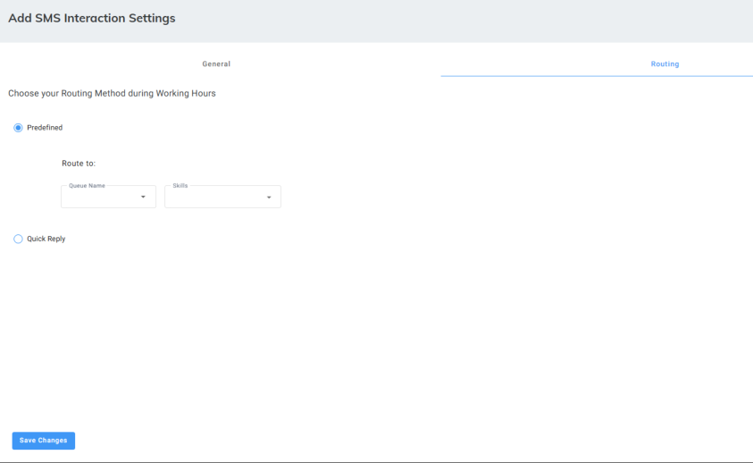

   1. Under **Route to**, from the 'Queue Name' field, select the queue.
   1. From the 'Skill's drop down list, select the specialized skills associated with this queue.
6. If you selected **Quick Reply**, the following appears:

   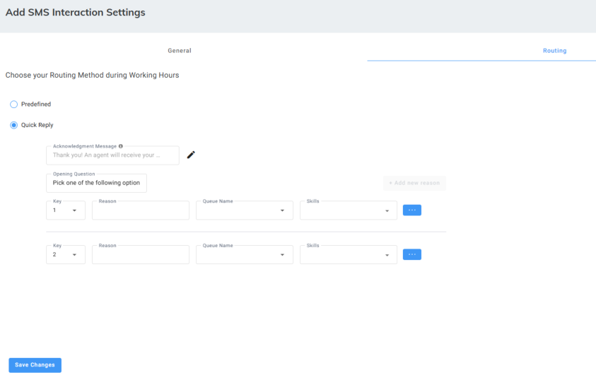

   1. In the 'Acknowledgment Message' field, click the edit icon, and enter a message that will be sent to the caller after they complete the selecting all the menu options, to notify the customer that an agent will receive their message shortly and get back to them soon.
   1. From the 'Key' field, select the number the customer should press to select a specific option. The example shows '1' and '2' for the first two options.
   1. In the 'Reason' field, enter the text that corresponds to the key. This is what the customer will see as an option (for example, "Technical Support", "Sales Inquiry").
   1. From the 'Queue Name' drop down, select the queue where messages should be routed if the customer chooses this option.
   1. From the 'Skills' drop down, select any specific skills required by agents in the chosen queue to handle this type of inquiry.
   1. Add one or more sub-reasons that appear when the customer selects a specific option. For example, if they press 1, they will see another sub-menu with additional options to refine their contact reason:
      1. Click the three dots on the side.

   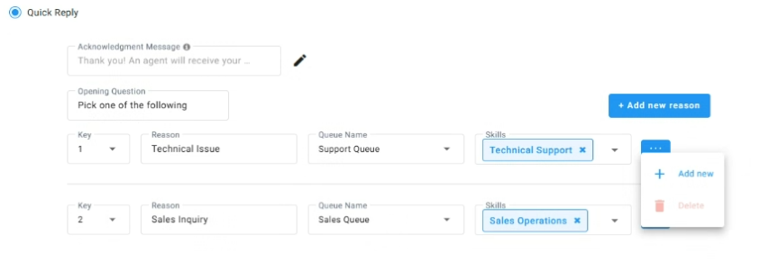

   1. Click **Add new.**

   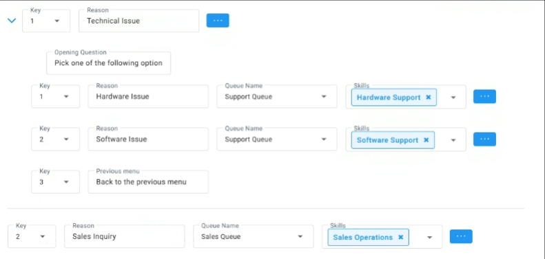

   1. Enter the following details for the sub-reason: Key, Reason, Queue Name, and Skills for the additional reason.
   1. When complete, configure a key and instructions for returning to the previous menu.
   1. If you need to add more options, click the "+ Add new reason" button and repeat the steps for each additional option.

### Editing SMS interactions

The procedure below describes how to edit SMS Interaction Settings.

#### To edit SMS Interaction Settings

1. Open the Chat Interaction Settings page (**Configuration** &gt; **Interaction Manager** &gt; **Chat**); the following appears:

   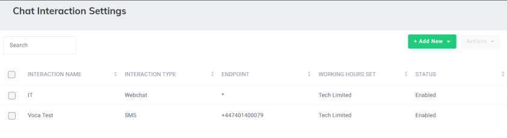

2. Select the SMS interaction check box that you want to edit.

   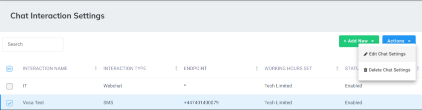

3. From the ‘Actions’ drop-down menu, choose **Edit SMS Interaction Settings**; the following appears:

   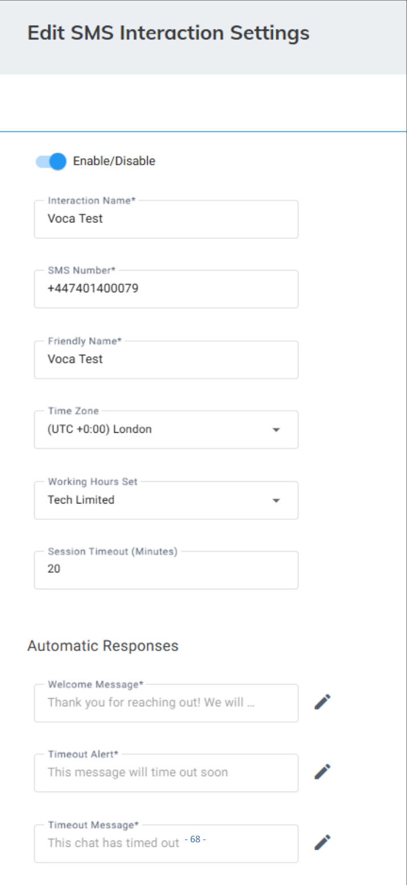

4. Under the **General** tab, edit the fields you want to change.
5. Select the **Routing** tab, and edit the field you want to change.

   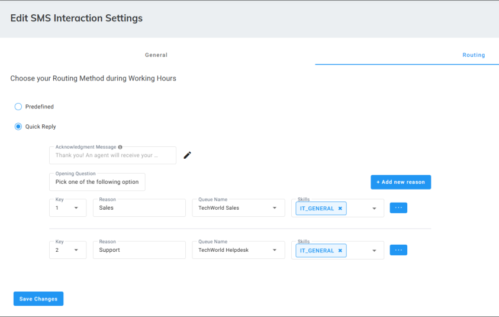

6. Click **Save Changes**.

### Deleting SMS interactions

The procedure below describes how to delete SMS Interaction Settings.

#### To delete an SMS Interaction Setting

1. Open Chat Interaction Settings page (**Configuration** &gt; **Interaction Manager** &gt; **Chat**); the following appears:

   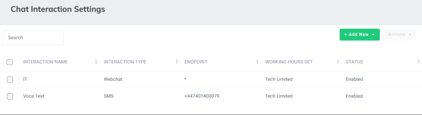

2. Select the SMS interaction that you want to delete.

   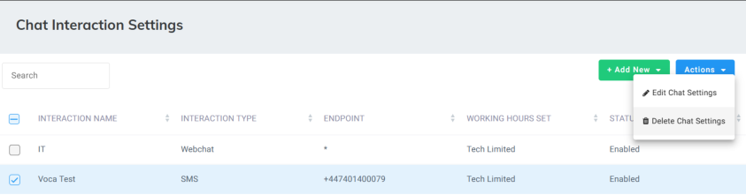

3. From the ‘Actions’ drop-down menu, choose **Delete SMS Settings**.
4. Click **OK**.
