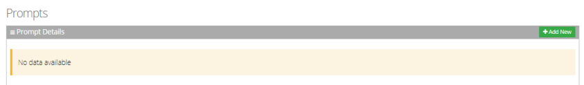
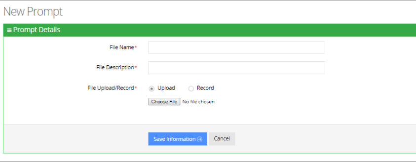
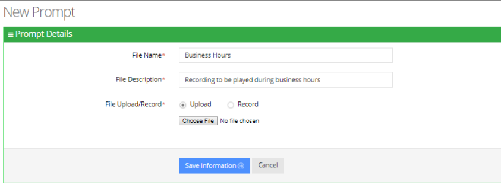
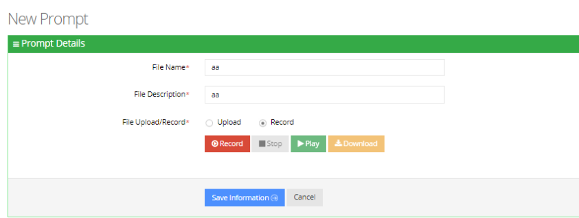

When calling the Voca service, the recorded prompts will be heard. The prompts can be used for other settings in the menu configuration. The system contains default prompts. These prompts can be overwritten or new prompts can be recorded with specific messages.

The procedure below describes how to upload an audio prompt for the Voca service.

## To add a new prompt

1. Open the Prompt Details screen (**Configuration** &gt; **Prompts**); the following appears:

   

2. From the Prompts screen, click **Add New**; the following appears:

   

3. Enter the prompt details in the fields provided.
4. In the ‘File Name’ field, enter the audio file name.
5. In the ‘File Description’ field, enter a description of the prompt.
6. You can either Upload a prompt or Record a new prompt.

## To upload a file

1. Click the **Upload** option.
2. Click **Choose File** to locate the audio file to be uploaded.

   

3. Click **Save Information** to complete the upload process.

   <Note>
   The audio file must be in the following format - .wav file, with 16 Bit Resolution, mono, 8000Hz.
   </Note>

## To record a file

1. Click **Record**, and then begin recording your prompt.

   

2. When finished recording, click **Stop**.
3. To replay the recent recording, click **Play**.
4. To save a copy of the recorded audio file, click **Download**.
5. Click **Save Information** to complete the recording process.
