The procedure below describes how to add and configure speech and [DTMF menus](#adding-a-dtmf-menu). There are two different types of menus:

- [DTMF Menu](#adding-a-dtmf-menu)
- [Speech Menu](#adding-a-speech-menu)

## Adding a DTMF Menu

The procedure below describes how you can add a DTMF menu.

### To add a DTMF menu

1. Open the Menu Settings page (**Configuration** &gt; **Menu Settings**); the following screen example appears.

   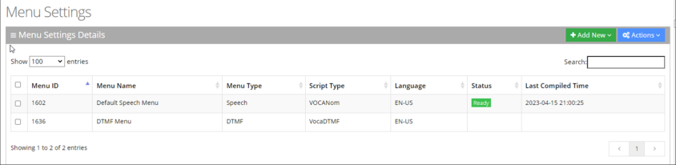

2. Click **+ Add New**; the following appears:

   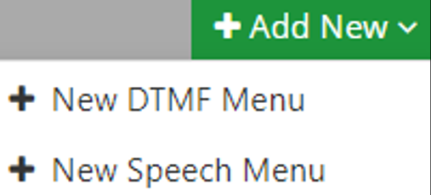

3. Click **+ New DTMF Menu**; the following appears:

   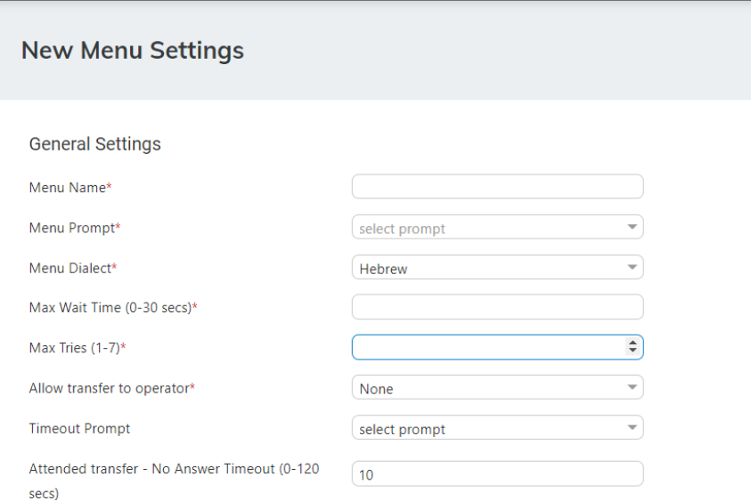

4. From the 'Menu Prompt' drop-down list, select the pre-configured prompt. See [Adding a Voice Prompt](/tenant-administration/admin-06-configuration/admin-06-2-adding-a-voice-prompt) for more information.
5. From the 'Menu Dialect' drop-down list, select the language of the prompts. The system plays the prompts according to the menu dialect selected.
6. In the 'Max Wait Time' field, enter how much time to wait in seconds (0-30) until the user presses the DTMF.
7. In the 'Max Tries' field, enter how many times to repeat the prompts when there no response from the user.
8. In the 'Operator Extension Working Hours' field, enter the Operator's extension during working hours. This field appears only if the 'Allow transfer to operator' field is set to one of the following values:
   - Anonymous
   - Employee
   - All In these cases, the 'Operator extension Working Hours' field is mandatory.
9. In the 'Operator Extension Non-Working Hours' field, enter the Operator's extension during non-working hours. This field appears only if the 'Allow transfer to operator' field is set to one of the following values:
   - Anonymous
   - Employee
   - All In these cases, the 'Operator extension Working Hours' field is mandatory.
10. From the 'Timeout Prompt' drop-down list, select the prompt in case the user doesn’t respond at all and the timeout period expires.
11. Set the 'Attended transfer - No Answer Timeout (0-120 secs)' to the desired value. This parameter is used when 'Attended transfer' is selected as one of the following actions.
12. Under the **Action Settings** group, select the appropriate option. For more information of the possible Actions, see [Actions](/tenant-administration/admin-08-actions).
13. Click **Save Changes**.

## Adding a Speech Menu

The procedure below describes how to add an Interactive Voice Response (IVR) speech menu.

### To add a Speech Menu

1. Open the Menu Settings page (**Configuration** &gt; **Menu Settings**); the following example appears.

   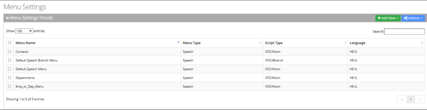

2. Click the **+ Add New** drop-down menu; the following appears:

   

3. Select the **+ New Speech Menu**; the New Menu Settings page appears:

   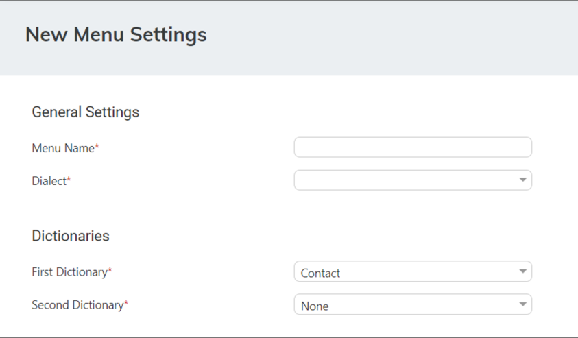

4. Under the **Dictionaries** group, select the 'First Dictionary' and 'Second Dictionary' fields to be used for the menu. The 'Second Dictionary' can be set to "None". The Contact dictionary contains Contact Names without departments. The dictionaries are taken from the [Dictionary List](/tenant-administration/admin-04-managing-departments#using-the-dictionary-list) in the Department setting that you created.
5. Under the **Prompts Settings** group, select the prompts to play:
   - None
   - Anonymous
   - Employees
   - All

     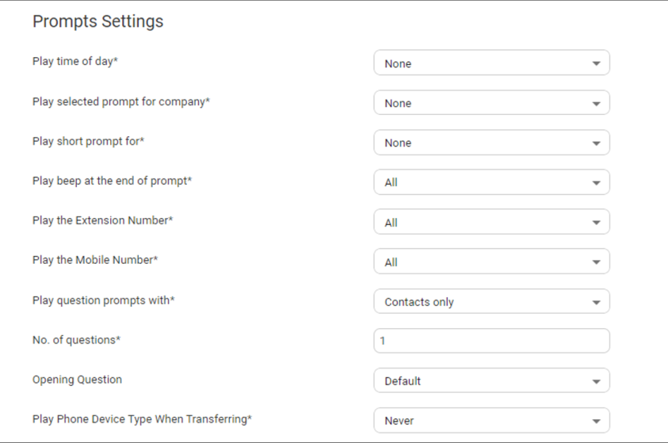

   - **‘Play time of day’:** Select for which group you are playing the time system menu prompts.
   - **‘Play selected prompt for company’:** Select for which group you are playing the selected prompt.
   - **‘Play short prompt for’:** Select for which group you are playing the short prompt.
   - **‘Play beep at the end of prompt’:** Select for which group you are playing the beep prompt.
   - **‘Play the extension number':** Select for which group you are playing this.
   - **‘Play the mobile number':** Select for which group you are playing this.
   - **‘Play question prompts with':** Select for which group you are playing the selected question prompts.
   - **The number of questions to be asked (1 to 3).** This defines how many questions will be asked (opening/second/third questions).
     - **'Opening Question':** Select Default or any other pre-recorded prompt.
     - **'Second Question':** Select Default or any other pre-recorded prompt.
     - 'Third Question': drop-down list, select Default or any other pre-recorded prompt.
   - From the 'Play Phone Device Type When Transferring' drop-down list, select the appropriate value.

     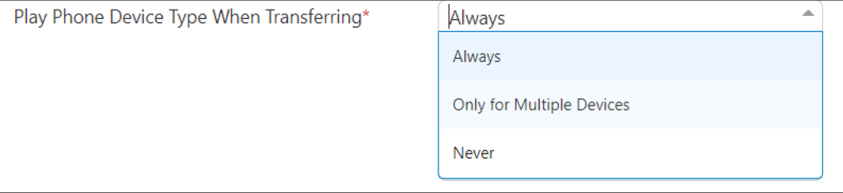

     - **Always:** Play the phone device when transferring a call. For example, "Transferring call to John Doe's mobile" even if the caller said "mobile" specifically or this is the only available number for the contact.
     - **Only for Multiple Devices:** If only a single phone device is available for a contact, do not play the phone device when transferring a call, even if the caller said the phone device (for example," John Doe mobile". Do not play the phone device when transferring). If more than a single phone device is available for a contact, the phone device must be played when transferring a call.
     - **Never:** Never play with the phone device when transferring a call.
6. Under the **Additional Settings** group, select the following:

   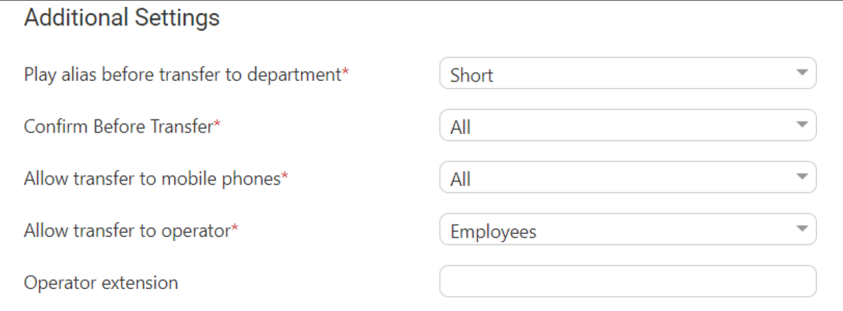

   - 'Play alias before transfer to department' field: select one of the following options:
     - **Short:** If the alias was recognized, the system plays the recognized alias instead of the Department name before the transfer. If there is disambiguation between departments, the alias is played before playing the disambiguation options.
     - **Long:** If the alias was recognized, the system plays the recognized alias and the department name before the transfer. If there is disambiguation between departments, the alias is played before playing the disambiguation options.
     - **Disabled:** Plays only the department name before the transfer. If there is disambiguation, only disambiguation options are played.
   - 'Confirm Before Transfer' field: Select which group you are playing this to. If not 'None', the relevant group is asked to confirm the entity they are going to be transferred to.
   - ‘Allow transfer to mobile phones’ field: Select which group you are allowing to transfer calls to mobile devices.
   - ‘Allow transfer to operator for’ field: Select to whom you are allowing to transfer calls to the operator. The 'Operator extension' field appears only if the 'Allow transfer to operator' field is set to one of the following values:
     - Anonymous
     - Employee
     - All

   <Note>
   The 'Operator extension' field is mandatory if you select any of the above values.
   </Note>

   - 'Operator extension’ field: Select the number to dial when the user presses “0” or says “operator”.
7. Under the **Call Routing and Hunting - Contact** group from the 'Routing Settings' drop-down list, select either:
   - **Basic routing (default):** The call routing process remains as it is currently set.
   - **Advanced routing:** The call is set according to the following parameters:

   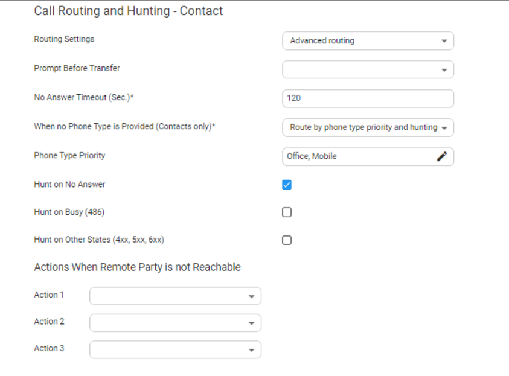

   - From the 'Prompt Before Answer' drop-down list, select a prompt from a list of available prompts, before the call is transferred.
   - In the 'No answer timeout (0-120 secs)' field, set the time you want the system to wait, for the remote side to answer the call before moving to the next phone type, when hunting or doing an action when the remote party is not reachable.
   - From the 'When no Phone Type is Provided' drop-down list, select the appropriate action. When the caller says a Contact’s name without requesting a specific phone type, the system can be configured to behave in several different ways:
     - **Ask for phone type:** The system asks the caller to choose a Phone Type it plays to the caller. Voca transfers the call to the highest priority phone type defined in configuration. If the first priority phone type is not available for a contact, the call is transferred to the second, or third priority. This phone type priority list is configurable.
     - **Route by phone type priority and hunting:** Voca can perform Call Hunting based on the phone type priority list.
   - In the 'Phone Type Priority' choose the priority list that the system should hunt when routing contact and choose which type of hunt you want to enable.
   - Voca can perform Call Hunting based on the selected option. Configure which of the following states performs the hunting:
     - Hunt on No Answer
     - Hunt on Busy (486)
     - Hunt on Other States (4XX,5XX,6XX)
   - When Voca transfers a call to a destination, the remote side (whether it is a contact or a department) may not be reachable. In such a case, Voca performs pre-defined actions. Under the Actions when Remote Party is not Reachable group, from the 'Action 1' drop- down list, select the appropriate value. For more information of the possible Actions, see [Actions](/tenant-administration/admin-08-actions).
8. Under the **Call Routing and Hunting - Department** group and from the 'Routing Settings' drop-down list, select either:
   - **Basic routing (default):** The call routing process remains as it is currently set.
   - **Advanced:** The call is set according to the following parameters:

     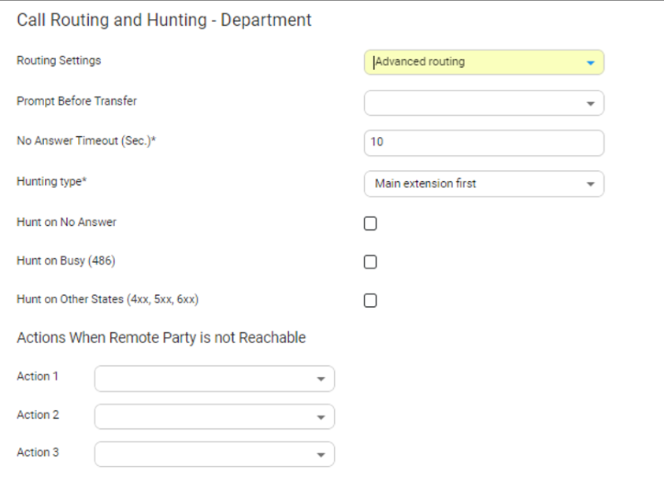

   - From the 'Prompt Before Transfer' drop-down list, select a prompt from a list of available prompts, before the call is transferred.
   - In the 'No answer timeout (0-120 secs)' field, set the time you want the system to wait for the remote side to answer the call, before moving to the next phone type, when hunting or doing an action when the remote party is not reachable.
   - From the 'Hunting type' drop-down list, select one of the options:
     - **Main extension first:** Select this option when hunting for a free extension always start from Extension 1.
     - **Round robin:** Select this option when hunting for a free extension. Always start from the extension following the last one used.
   - Voca can perform Call Hunting based on the selected option. Configure which of the following states performs the hunting:
     - Hunt on No Answer
     - Hunt on Busy (486)
     - Hunt on Other States (4XX,5XX,6XX)
9. Under the **Actions when Remote Party is not Reachable** group, from the 'Action 1' dropdown list, select the appropriate value. When Voca transfers a call to a destination, the remote side (whether it is a contact or a department) may not be reachable. In such a case, Voca performs pre-defined actions. For an explanation of the above actions, see [Actions](/tenant-administration/admin-08-actions).
10. Under the **DTMF** group, from the 'Collect and route type' drop-down list, select the appropriate value. This is used to collect and route by one or more digits:
    - **None (default):** Functionality is disabled.
    - **Transfer to extension:** Instead of saying a contact/department name, you can enter the entity phone number by DTMF and selecting either:
      - Minimum length of extension number
      - Maximum length of extension number

    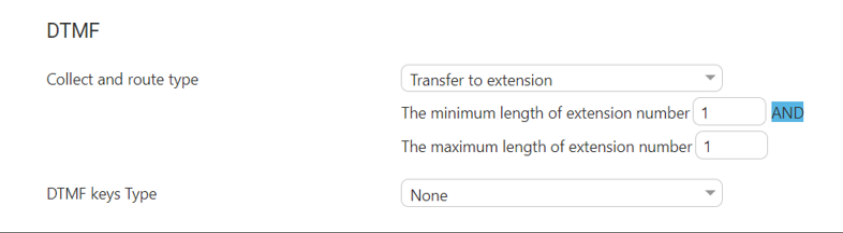

    - **Transfer by DTMF routing key:** The collected digits are used to route the call to the contact or department tagged with the same DTMF routing key:
      - The minimum length of routing key
      - The maximum length of routing key
11. Under the **DTMF** group, from the 'DTMF keys Type' drop-down list, select **Second Language**. This option maps actions for DTMF keys. If this option is activated, the 'Collect and route type' field cannot be configured to collect only one digit. Select one of the following:
    - **DTMF:** Configures the DTMF key that is pressed to trigger the required behavior
    - **Behavior:** Defines the behavior of the DTMF key:
      - **Operator:** The call is diverted to the operator
      - **Go to menu:** The call is diverted to another menu

## Editing Menu Settings

The procedure below describes how to edit menu settings.

### To edit menu settings

1. Open the Menu Settings screen (**Configuration** &gt; **Menu Settings**); the following screen example appears:

   **Figure 6-1:**

   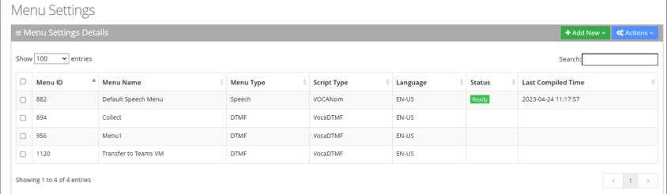

2. Enable the menu check box that you wish to edit.
3. Click **Actions**; the following appears:

   **Figure 6-2:**

   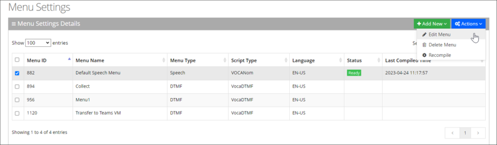

4. Select **Edit Menu**.
5. Edit the fields you want to change.
6. Click **Continue**.
7. Click **Save Changes**.

## Deleting Menu Settings

The procedure below describes how to delete menu settings.

### To delete menu settings

1. Open the Menu Settings screen (**Configuration** &gt; **Menu Settings**); the following screen example appears:
2. Select the menu check box that you wish to delete.
3. Click **Actions**; the following appears.

   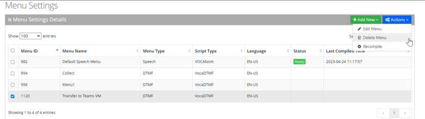

4. Select **Delete Menu**; the message "Are you sure you want to delete the selected menu?" appears.
5. Click **OK** to delete the selected menu; a message appears that the menu was successfully deleted.

## Recompile Menus

[Speech menus](#adding-a-speech-menu) (IVR and Branch) that include phrase list for recognition, must be compiled to support the recognitions. Compilation is done automatically in the background but can also be triggered by the customer. The procedure below describes how to compile menus.

### To recompile menus

1. Open the Menu Settings screen (**Configuration** &gt; **Menu Settings**); the following appears:
2. Enable the menu check box that you wish to recompile.
3. From the 'Actions' drop-down menu, choose **Recompile**.

   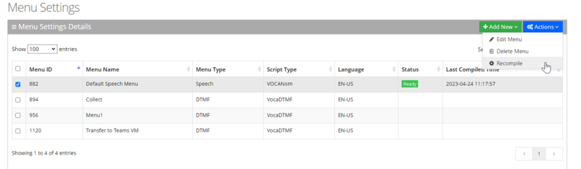

The following columns show the compilation status:

- **Status:** Displays the menu compilation status. It can be one of the following:
  - **Pending:** Waiting for compilation
  - **In progress**: Compilation is now in progress
  - **Ready**: Compilation is done
  - **Failed**: Compilation failed
  - **Failed for second language:** If a second language is defined for the tenant and menu compilation failed
- **Last compilation time:** Last time of menu compilation
4. To trigger a new compilation, select **Actions,** and then click **Recompile**.
