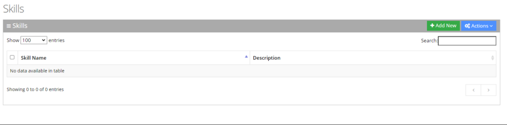
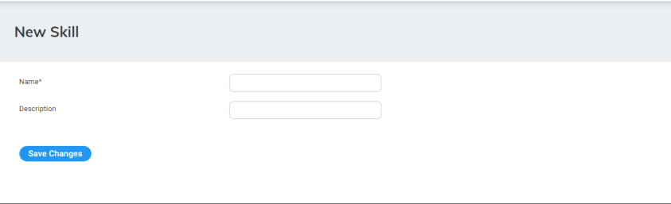
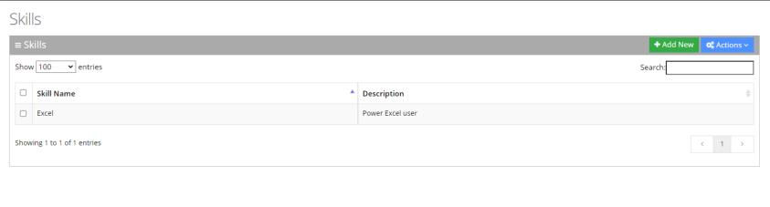
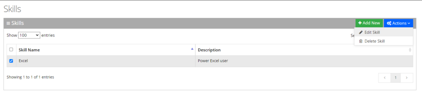
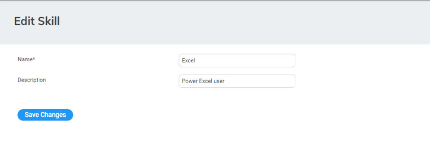
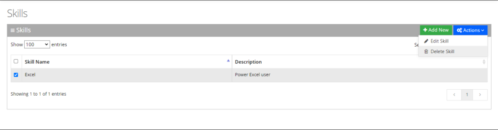

Skills are customer-definable labels assigned to workers. The Voca Interaction Center can route incoming calls to workers who have the necessary skills or sets of skills to handle the call.

## Adding a Skill

The procedure below describes how to add a Skill.

### To add a skill

1. Open the Skills page (**Configuration** &gt; **Routing** &gt; **Skills**); the following appears:

   

2. Click **Add New**; the following appears:

   

3. In the 'Name' field, enter the name of the skill (e.g., "Excel").
4. In the 'Description' field, enter a description of the skill (e.g., "Power user of Excel").
5. Click **Save Changes**.

## Editing a Skill

The procedure below describes how to edit a Skill.

### To edit a Skill

1. Open the Skills page (**Configuration** &gt; **Routing** &gt; **Skills**); the following appears:

   

2. Select the Skill you wish to edit by selecting the corresponding check box.

   

3. From the ‘Actions’ drop-down menu, choose **Edit Skill**; the following appears:

   

4. Make your necessary changes, and then click **Save Changes**.

## Deleting a Skill

The procedure below describes how to delete a Skill.

### To delete a Skill

1. Open the Skills page (**Configuration** &gt; **Routing** &gt; **Skills**); the following appears:

   

2. Select the Skill you wish to delete by selecting the corresponding check box.
3. From the ‘Actions’ drop-down menu, choose **Delete Skill**.

   

   A confirmation message box appears.
4. Click **OK** to confirm deletion.
