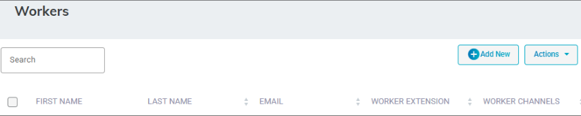
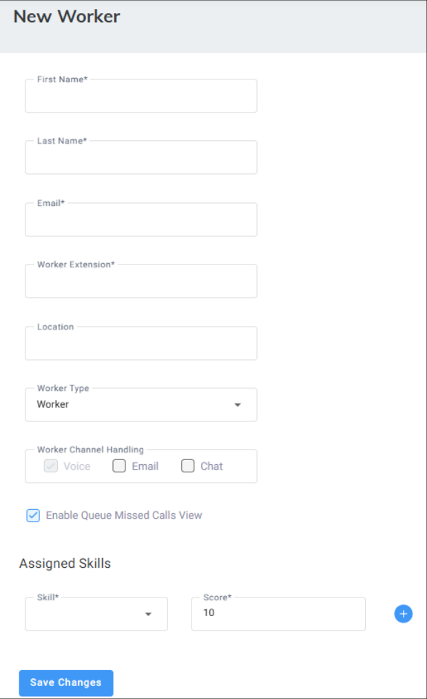
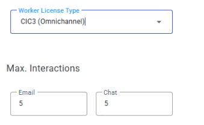
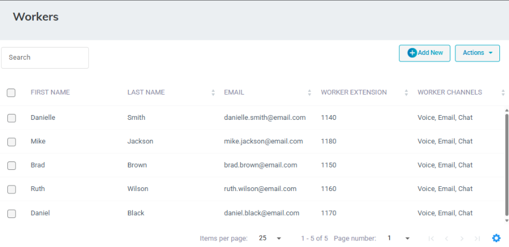
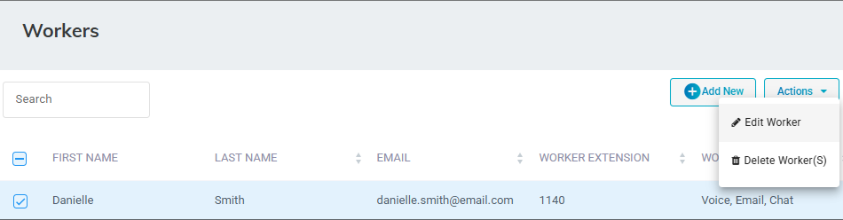
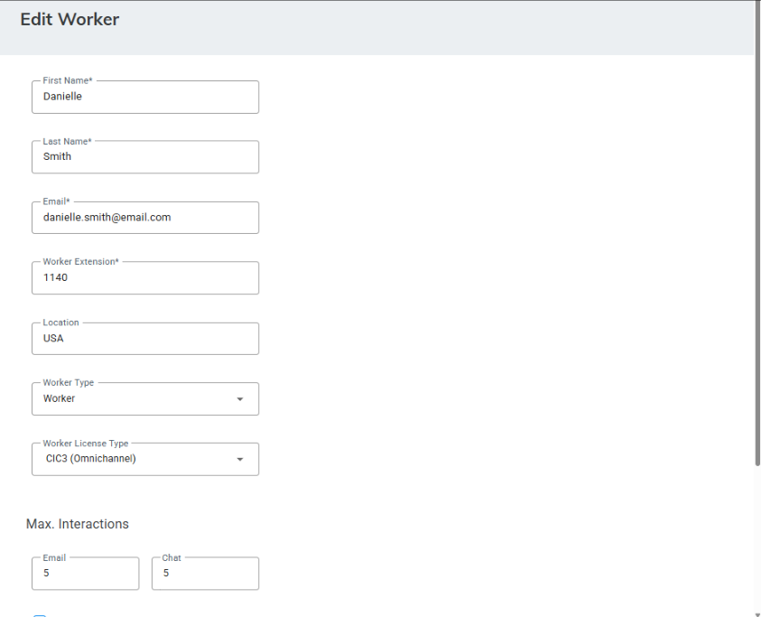
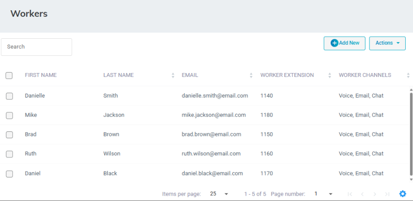
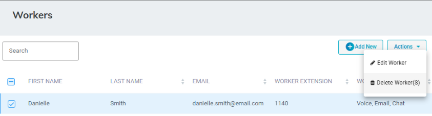

A Worker is a user that is available to handle incoming calls based on the worker's queue registration and skill sets.

When configuring a Worker, the administrator needs to create a Worker that has a 'Worker Type' with a value of **Worker** or **Supervisor**.

<Note>
When the administrator adds a new Worker with a 'Worker Type' with a value of **Supervisor**, it means that the supervisor not only has also worker capabilities to handle calls, but can also can manage and monitor that supervisor's workers.
</Note>

## Adding a Worker

The procedure below describes how to add a Worker or Supervisor.

<Note>
Before adding a worker, ensure you configured skills. For details, see [Adding a Skill](/tenant-administration/admin-06-configuration/admin-06-4-configuring-routing/admin-06-4-1-configuring-skills#adding-a-skill).
</Note>

### To add a Worker

1. Open the Workers page (**Configuration** &gt; **Routing** &gt; **Workers**); the following appears:

   

2. Click **Add New**; the following appears:

   

3. In the 'First Name' field, enter the first name of the Worker.
4. In the 'Last Name' field, enter the last name of the Worker.
5. In the 'Email' field, enter the email address of the Worker.
6. In the 'Worker Extension' field, enter the phone extension of the Worker.
7. In the 'Location' field, enter the location of the Worker.
8. From the 'Worker Type' drop-down list, select the Worker Type.
9. Select the 'Allow Supervisor Web Management Access' check box to enable the Supervisor to log in to the **Voca Web Management** interface.

   <Note>
   This check box is only displayed if you selected **Supervisor** for 'Worker Type'.
   </Note>

10. **For Digital Engagement Tenants only:**

    

    ‘Worker License type’ settings appear only if the tenant has both CIC2 and CIC3 workers. Select the check boxes of the channels that the Worker is allowed to handle; **CIC2 (Voice)** is selected by default. If you select **CIC3 (Omnichannel)**, then configure the 'Max interactions' the worker can handle simultaneously for 'email' and 'chat'.
11. Select the 'Enable Queue Missed Calls View' check box, to enable the Supervisor to view missed calls through the **Supervisor Statistics** tab in the Worker App.
12. Under the **Assigned Skills** group, from the 'Skill' drop-down list, select the skill you wish to assign to the Worker, and then in the 'Score' field, enter the competence level assigned for that skill.

    <Note>
    The skill score ranges from 1 to 10, where 1 indicates the lowest priority and 10 indicates the highest priority.
    </Note>

13. Click  to assign another skill to this Worker.
14. Click **Save Changes**.

    <Note>
    Supervisors with 'Allow Supervisors Web Management Access' set to enabled are allowed to view/edit the following pages:

    - Flex queues that the Supervisor is assigned to as a Supervisor (see [Configuring Flex Queues](/tenant-administration/admin-06-configuration/admin-06-4-configuring-routing/admin-06-4-8-configuring-queues#configuring-flex-queues))
    - Worker queues their supervised Workers (in relevant [Worker Groups](/tenant-administration/admin-06-configuration/admin-06-4-configuring-routing/admin-06-4-6-configuring-workers-group)) relate to
    - All Tenant Workers
    - Worker Groups they supervise
    - Relevant Reports
    </Note>

## Editing a Worker

The procedure below describes how to edit a Worker.

### To edit a Worker

1. Open the Workers page (**Configuration** &gt; **Routing** &gt; **Workers**); the following appears:

   

2. Select the Worker you wish to edit by selecting the corresponding check box.

   

3. From the ‘Actions’ drop-down menu, choose **Edit Worker**.

   

4. Make your necessary changes, and then click **Save Changes**.

## Deleting a Worker

The procedure below describes how to delete a Worker.

### To delete a Worker

1. Open the Workers page (**Configuration** &gt; **Routing** &gt; **Workers**); the following appears:

   

2. Select the Worker you wish to delete by selecting the corresponding check box.
3. From the ‘Actions’ drop-down menu, choose **Delete Worker**.

   

   A confirmation message box appears.
4. Click **OK** to confirm deletion.

   <Note>
   - At least one skill must be selected if the user is defined as a Worker.
   - The Administrator can set different score levels for each Worker's skill that has been selected (The Score level indicates the Worker's level of expertise in that skill).
   </Note>
