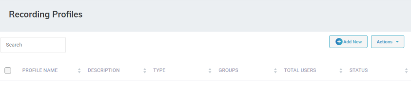
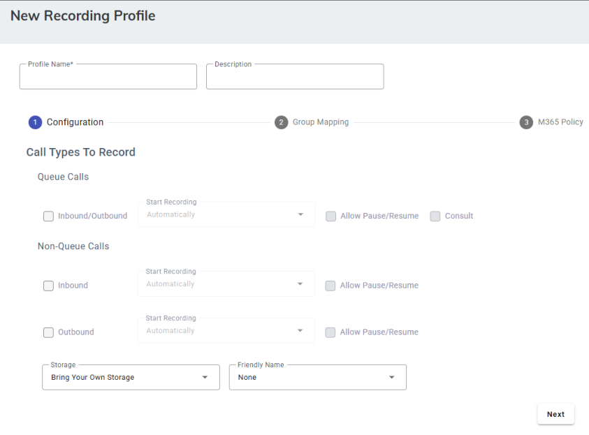
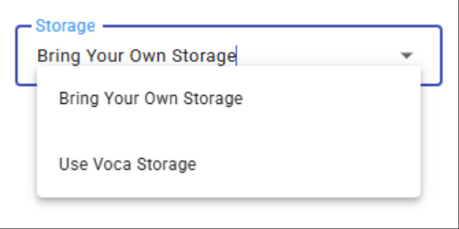
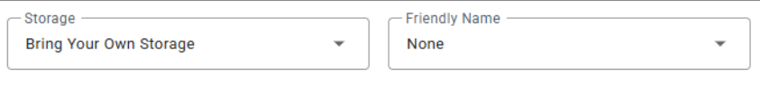
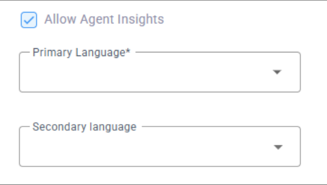
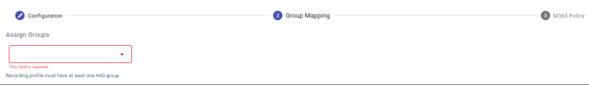
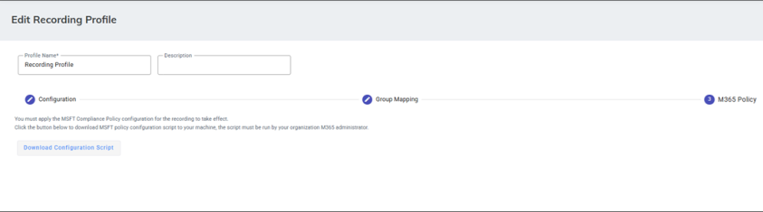
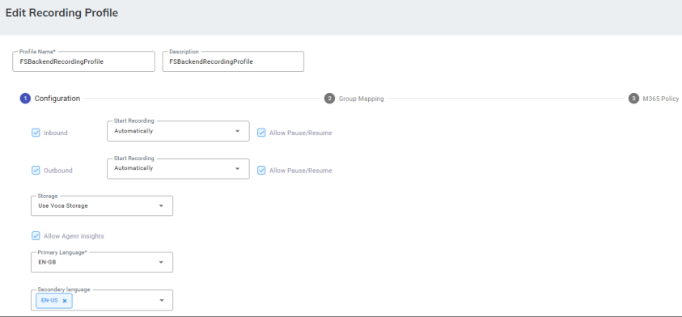
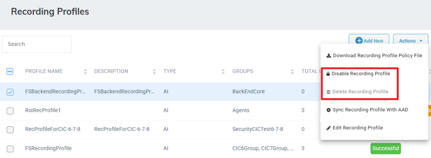
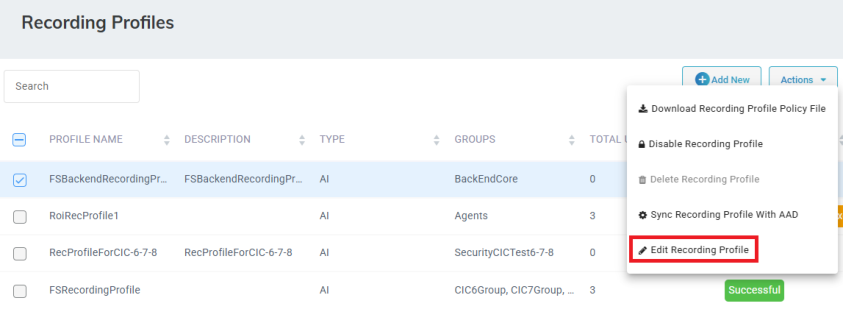

A Recording Profile defines how calls are recorded and analyzed for specific agent groups and call scenarios. As an admin, you can create multiple profiles with different recording and AI policies for each call type (for example, inbound vs. outbound, specific queues) to ensure consistent and compliant behavior across the team.

## Adding a Recording Profile

The procedure below describes how to add a Recording Profile. The Admin can configure which call types are recorded based on call direction.

Calls are categorized as follows:

- **Inbound queue call** – A call routed to the Worker through a queue.
- **Outbound queue call** – A call initiated by the Worker on behalf of a queue.
- **Inbound direct call** – A non-queue call received directly by the Worker.
- **Outbound direct call** – A non-queue call initiated directly by the Worker.

  <Note>
  - Worker's calls are recorded only when the Worker is logged in to the Worker Application.
  - [Hybrid Workers](/tenant-administration/admin-06-configuration/admin-06-7-system-settings#hybrid-workers)' calls are recorded when the Worker is logged in to Microsoft Teams.
  </Note>

### To add a Recording Profile

1. Open the Recording Profiles page (**Configuration** &gt; **Routing** &gt; **Recording Profiles**).

   

2. Click **Add New.**

   

3. In the 'Name' field, enter the name of the recording profile.
4. Under 'Call Types to Record', under 'Queue Calls',
   1. Select **Inbound/Outbound** to apply recording on queue calls.
   1. Choose whether recording will start **Manually** or **Automatically**.
   1. Select **Allow Pause/Resume** to let agents pause or resume recording for compliance purposes. When **Manual Recordin**g is selected, this option is automatically enabled and cannot be changed.
   1. (Optional) Select **Consult** if you want to record consultation calls (when an agent consults another agent or supervisor).
5. Under 'Call Types to Record', under 'Non-Queue Calls', configure recording settings separately for inbound and outbound non-queued calls.
   1. Select **Inbound** to apply recording on inbound non-queue calls.
   1. Choose whether recording will start **Manually** or **Automatically**.
   1. Select **Allow Pause/Resume** to let agents pause or resume recording for compliance purposes. When **Manual Recordin**g is selected, this option is automatically enabled and cannot be changed.
   1. Select **Outbound** to apply recording on outbound non-queue calls.
   1. Repeat above steps.
6. Configure storage type. Choose between:
   - **Voca Storage** – By default, all call recordings are saved to Voca-managed storage.
     - Retention Policy: Follows the retention settings defined at the Tenant level.
   - **Bring Your Own Storage (BYOS)** – To direct recordings to a custom storage, it must first be configured under [System Settings](/tenant-administration/admin-06-configuration/admin-06-7-system-settings) &gt; Call Recordings.
     - Retention Policy: Recordings are retained for a period of one year.

   

7. Select **Bring Your Own Storage** or **Use Voca Storage**.
8. If you selected Bring Your Own Storage, give your storage a name.

   

9. Select **Allow Agent Insights**.

   <Note>
   This option (and related settings) is visible only if the tenant has the Agent Insight add-on.

   
   </Note>

10. From 'Primary Language', select the main language for AI processing. This language will be used to create transcripts, summaries, and sentiment analysis. You need to set it manually (auto-detection is not supported). Agents can change the primary language during a call if needed.
11. (Optional) From 'Secondary Language', select additional languages the agent can switch to during a call. Agents can choose from 14 supported languages (e.g., Spanish, Mexican Spanish, French).
12. Click **Next**.

    

13. In the Group Mapping section, under 'Assign Groups', select at least one AAD group. The security groups is automatically populated after synchronization is completed in the Call Recording tab in the System Settings that was configured earlier.
14. Click Next.

    

15. In the M365 Policy section, click Download Configuration Steps. Admins need to download and run the PowerShell script in the Azure environment to enable these settings. Once completed, the Recording Profile status will change to ‘Success’. This is a mandatory step.

    <Note>
    When using Microsoft Calling Plan or [Operator Connect](/tenant-administration/admin-a-appendix-dnis-number-for-operator-connect-microsoft-calling-plan) as the PSTN carrier, recording announcements are enforced by Microsoft's cloud infrastructure and cannot be modified, delayed, or suppressed.
    </Note>

## Editing a Recording Profile

The procedure below describes how to edit a Recording Profile.

### To edit a Recording Profile

1. Open the Recording Profiles page (**Configuration** &gt; **Routing** &gt; **Recording Profiles**).
2. Select the Recording Profiles you wish to edit by selecting the corresponding check box.

   

3. From the ‘Actions’ drop-down menu, choose **Edit Recording Profile**.

   

4. Make your necessary changes, and then click **Save Changes**.

## Disabling and deleting a Recording Profile

The procedure below explains how to delete a Recording Profiles. To delete a Recording Profile, you need to first disable it.

### To delete a Recording Profiles

1. Open the Recording Profiles page (**Configuration** &gt; **Routing** &gt; **Recording Profiles**).

   

2. Select the Recording Profile you wish to delete by selecting the corresponding check box.
3. From the ‘Actions’ drop-down menu, choose **Disable Recording Profile** and then **Delete Recording Profile**. A confirmation message box appears.
4. Click **OK** to confirm deletion.

## Additional Actions

Additionally, you can perform the following actions on a Recording Profile:

- **Download Recording Profile Policy File** - Save and download the script later
- **Disable th Recording Profile** - Disable the Recording Profile before deleting
- **Sync Recording Profile with AAD**

### To do additional actions

Select the Recording Profile, then from the Actions drop-down menu, then select the desired action.
