The Administrator can create and manage Worker events (e.g., Not Ready / Wrap-up codes) for finalizing calls.

**Wrap-Up Reason Codes**:

- Represent the reasons for whenever a Worker ends an interaction but isn’t ready yet to take the next one.
- The wrap-up codes are automatically populated to the Worker application per the incoming call to the queue.

**Not Ready Reason Codes**:

- The Administrator configures these codes in Voca and automatically populate the Worker application.
- They represent the reasons that Workers can select when they change their state to **Not Ready**. This is reflected in the reports.

  <Note>
  Before ending the call, the Worker must select the relevant Wrap-up Reason code from the available list before the interaction is ended. The call is then disconnected automatically after the timer has reached its limit, or otherwise, the Worker can hang up the call manually by pressing the **Hang up** button.
  </Note>

For a Worker application intuitive experience, the Voca Interaction Center provides the following built-in Not-ready system default states that are reflected in the reports.

- **Shift Start:** Worker automatic state after login
- **Shift End:** Worker must select this state before logout (if not selected, the “logout” button is locked)
- **Call Not Answered:** This happens when the worker was in ready state and didn’t answer to incoming call.
- **Engaged:** Call is ringing
- **Talking:** Worker is on active call

## Adding Worker Status Events

The procedure below describes how to add a Worker Status Event. You can add either a wrapup event or a Not ready group event.

### Add a Wrap-Up Event

#### To add a Wrap-up event

1. Open the Worker Status Events page (**Configuration** &gt; **Routing** &gt; **Worker Status Event**).

   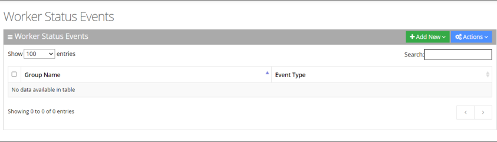

2. Click **Add new**.

   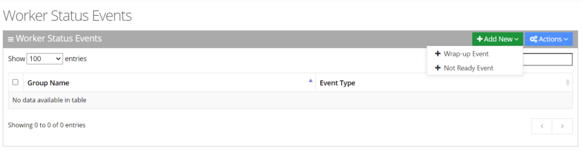

3. Select the **Wrap-up Event**.
4. In the **Wrap-up Event**, enter the 'Group Name' and 'Event Name' in the appropriate fields.

   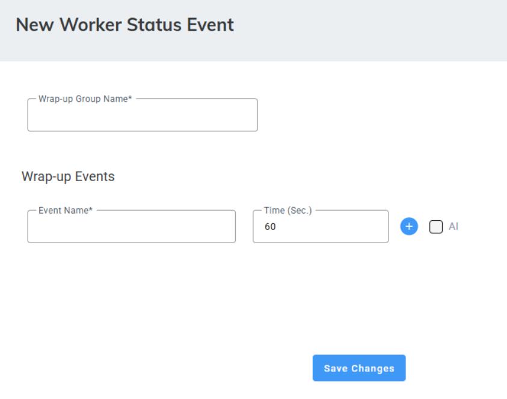

5. For tenants with the [Hybrid Worker](/tenant-administration/admin-06-configuration/admin-06-7-system-settings#hybrid-workers) feature enabled (System Settings &gt; Hybrid Worker), select the ‘Hybrid Wrap-up’ checkbox to set a designated Wrap-up event for Hybrid Workers.
6. For tenants with Call Recordings ([System Settings](/tenant-administration/admin-06-configuration/admin-06-7-system-settings) &gt; Call Recordings) and the Agent Insights add-on, select **AI** to allow Workers with Agent Insights capabilities to view the call’s transcript, summary, and sentiment, and to enable sending this data to the CRM.

   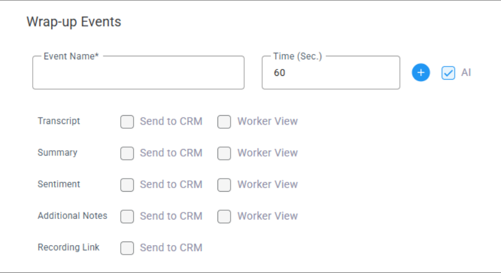

7. Configuration includes five components:
   - 'Transcript' – Contains the complete conversation between the caller and the agent, including speaker diarization that identifies who spoke and when.
   - 'Summary' – Contains key conversation highlights and a short summary with follow-up actions, generated based on the prompt assigned by the admin for this event.
   - 'Sentiment' – Displays the caller’s sentiment throughout the conversation, based on the analyzed interaction.
   - ‘Additional notes’ – Allows Worker to add notes at the end of the call.
   - ‘Recording Link’ – Sends to CRM ticket a URL with call details and recording.

   For each component, you can decide which information is sent to if the agent can view it.
   1. Select **Send to CRM** - at the end of the call the information is sent to the CRM as a .json file.
   1. Select **Worker View** to allow the Worker to view the information.

      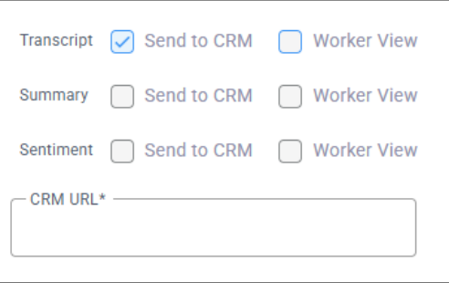

8. Enter the 'CRM URL'.
9. If you selected 'Summary', under 'Summary Prompting', select one of the top 10 predefined prompts. Voca uses the selected prompt to generate the conversation summary.

   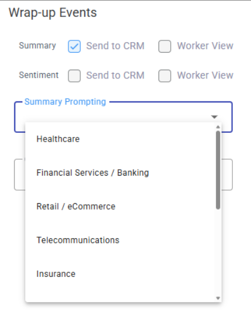

10. You can write your own prompt to generate a summary. Under 'Summary Prompting', select **Custom**.

    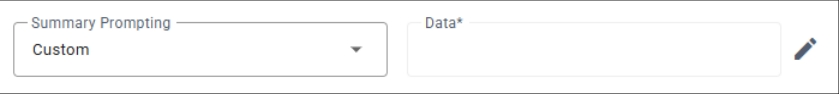

11. Under 'Data', click the edit icon.

    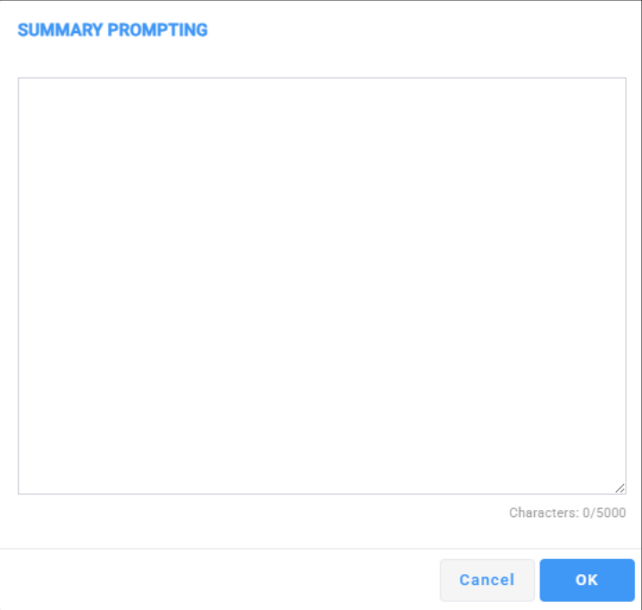

12. Enter your custom prompt, and click **OK**.
13. Click **Save Changes**.

### Add a Not Ready Group Event

#### To add a Not Ready Group event

1. Open the Worker Status Events page (**Configuration** &gt; **Routing** &gt; **Worker Status Event**).
2. Click **Add new**.

   

3. Select the **Not Ready Event**.
4. In the **Not Ready Event,** enter the 'Group Name' and 'Event Name' in the appropriate fields.

   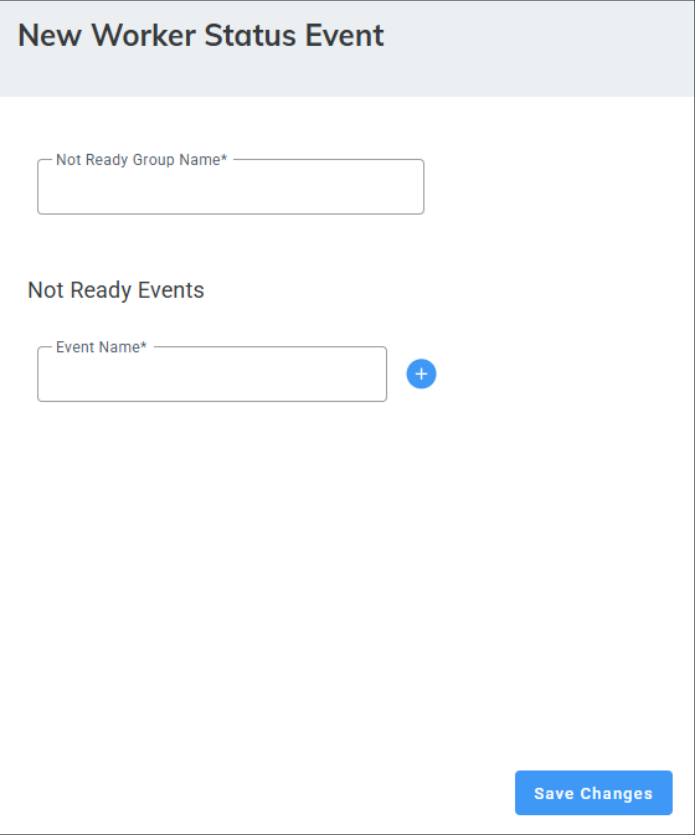

5. Click  to add additional events.
6. Click **Save Changes**.

## Editing Worker Status Events

The procedure below describes how to edit a Worker Status Event.

### To edit a Worker Status Event

1. Open the Worker Status Events page (**Configuration** &gt; **Routing** &gt; **Worker Status Events**); the following appears:

   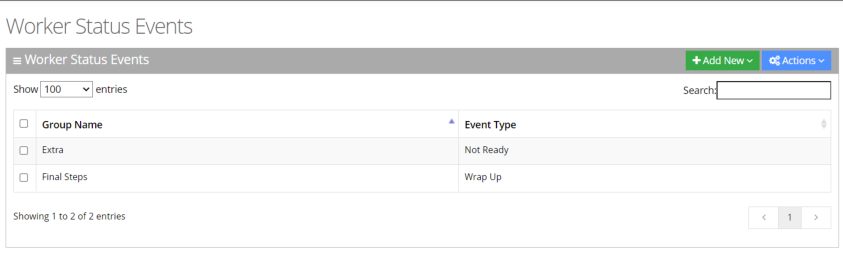

2. Select the event you wish to edit by selecting the corresponding check box.

   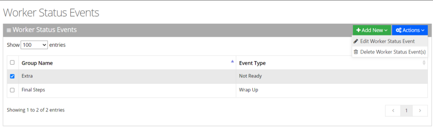

3. From the ‘Actions’ drop-down menu, select **Edit Worker Status Event**; the following appears:

   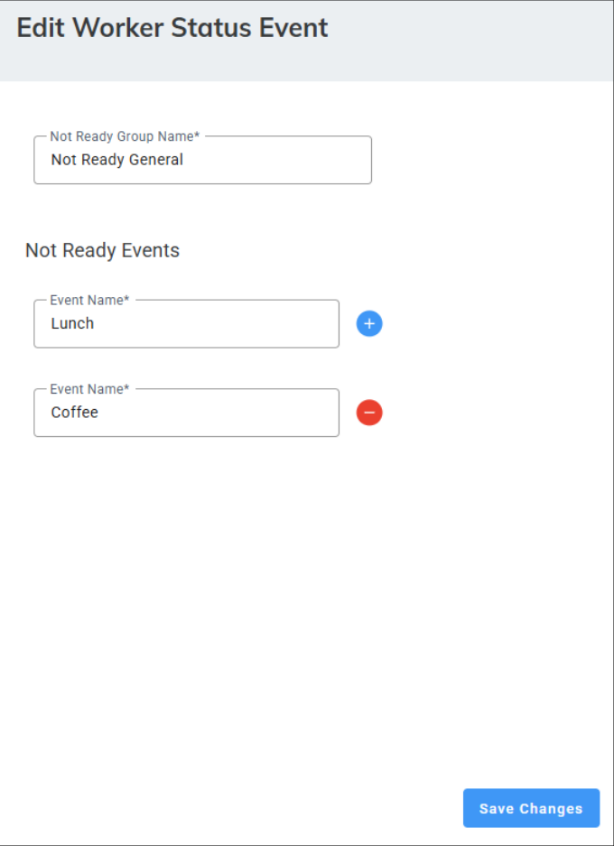

4. Make your necessary changes, and then click **Save Changes**.

## Deleting Worker Status Events

The procedure below describes how to delete a Worker Status Event.

### To delete a Worker Status Event

1. Open the Worker Status Events page (**Configuration** &gt; **Routing** &gt; **Worker Status Events**); the following appears:

   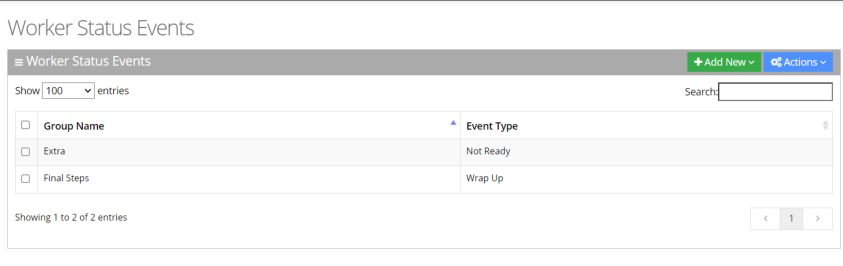

2. Select the Worker Status Event you wish to delete by selecting the corresponding check box.
3. From the ‘Actions’ drop-down menu, choose **Delete Worker Status Event(s)**.

   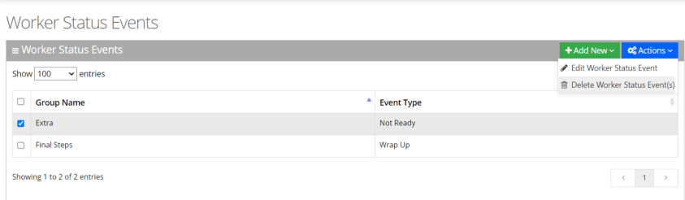

   A confirmation message box appears.
4. Click **OK** to confirm deletion.
