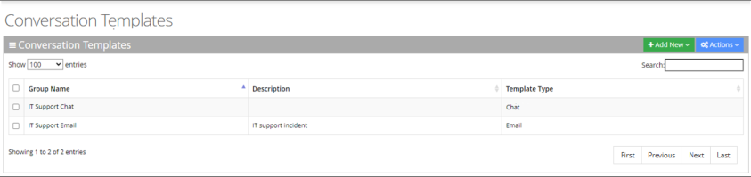
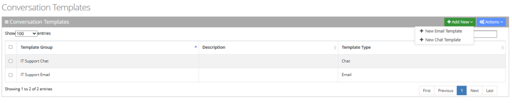
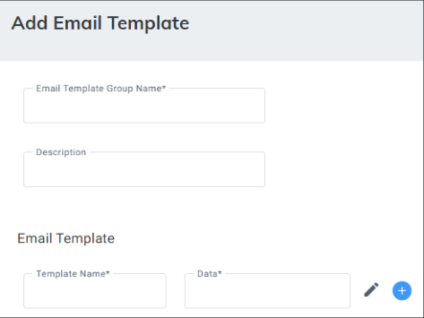
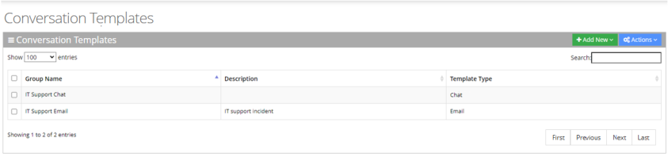
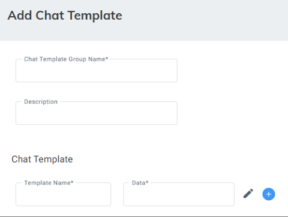
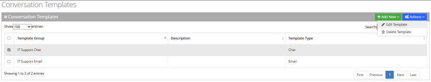
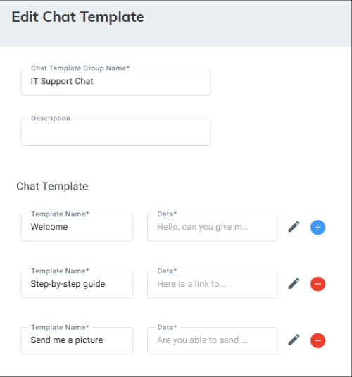
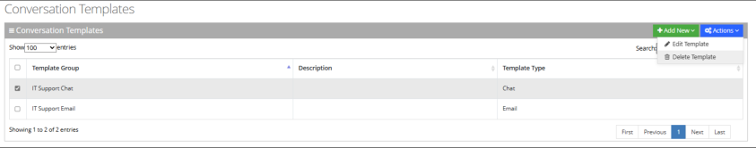

<Note>
Available for Digital Engagement Tenants only.
</Note>

You can create conversation templates that Workers can use during email or chat interactions. Templates are quick, editable replies with common and suggested messages. Any Email or Chat queue can be assigned one Template group.

## Adding a Conversation Templates

This section describes how to add a Conversation Template for email and chat interactions.

### Adding an Email Conversation Template

The procedure below describes how to add an Email Conversation Template.

#### To add an Email Conversation Template

1. Open the Conversation Templates page (**Configuration** &gt; **Routing** &gt; **Conversation Templates**); the following appears:

   

2. Click **Add New**; a drop-down menu appears:

   

3. From the drop-down menu, choose **New Email Template**; the following appears:

   

4. In the ‘Email Template Group Name’ field, type a name for the template group.
5. In the 'Description' field, type a description for the template group.
6. In the ‘Template Name’ field, type a name for the template.
7. Click the 'Data' field to add the template's content.
8. To add additional templates to the group, click  .
9. Click **Save Changes**.

### Adding a Chat Conversation Template

The procedure below describes how to add a Chat Conversation template.

#### To add a Chat Conversation Template

1. Open the Conversation Templates page (**Configuration** &gt; **Routing** &gt; **Conversation Templates**); the following appears:

   

2. Click **Add New**; a drop-down menu appears:

   

3. From the drop-down menu, choose **New Chat Template**; the following appears:

   

4. In the ‘Chat Template Group Name’ field, type a name for the template group.
5. In the 'Description' field, type a description for the template group.
6. Under Chat Template, in the ‘Template Name’ field, type a name for the template.
7. Click the 'Data' field to add the template's content.
8. To add additional templates to the group, click  .
9. Click **Save Changes**.

## Editing Conversation Template

The procedure below describes how to edit a Conversation Template.

### To edit a Conversation Template

1. Open the Conversation Templates page (**Configuration** &gt; **Routing** &gt; **Conversation Templates**); the following appears:

   

2. Select the check box corresponding to the template that you wish to edit.

   

3. From the ‘Actions’ drop-down menu, choose **Edit Template**; the following appears (e.g., for editing chat template):

   

4. Make your necessary changes, and then click **Save Changes**.

## Deleting a Conversation Template

The procedure below describes how to delete a Conversation Template.

### To delete a Conversation Template

1. Open the Conversation Templates page (**Configuration** &gt; **Routing** &gt; **Conversation Templates**); the following appears:

   

2. Select the check box corresponding to the template that you wish to delete.

   

3. From the ‘Actions’ drop-down menu, choose **Conversation Template(s)**; a confirmation message box appears.
4. Click **OK** to confirm.
