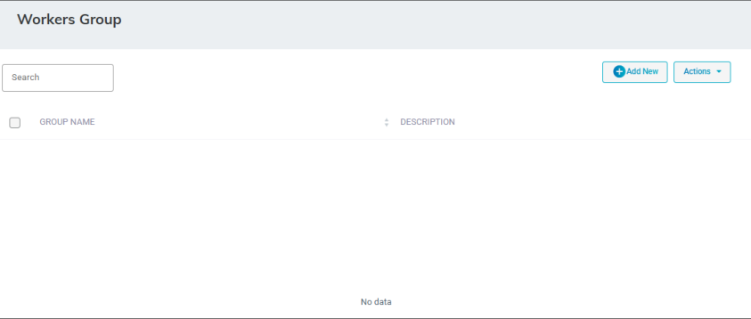
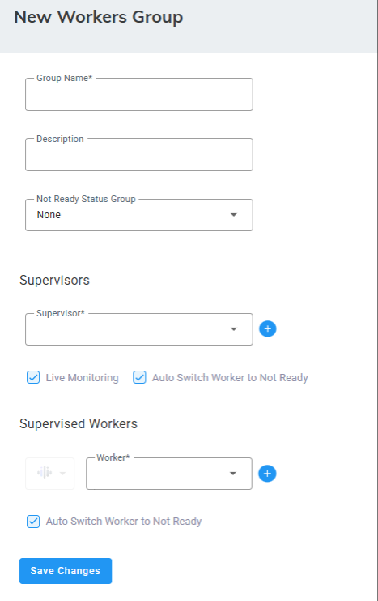
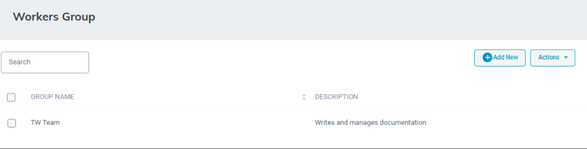
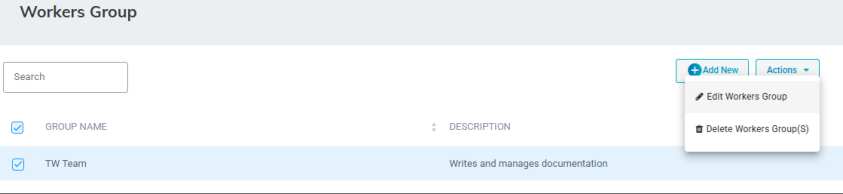
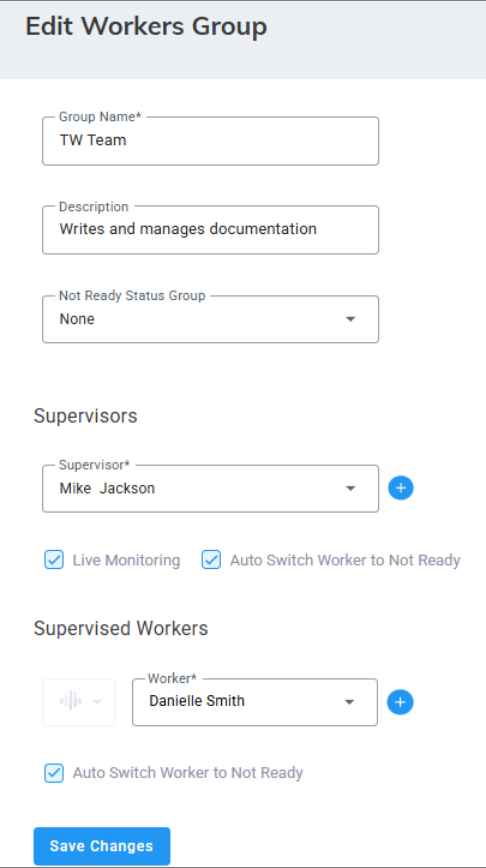
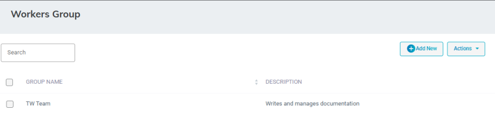
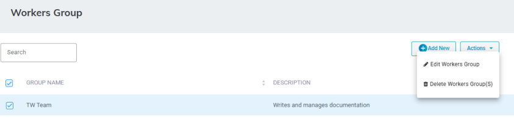

The Administrator can create or associate Workers, supervisors and Not Ready reason code events to a group. This group is only for viewing and management of Supervisor or Worker statistics from the Supervisor app. The Worker and Supervisor will inherit the “Not Ready” reason codes from this group.

<Note>
- Workers can be assigned to only one group.
- A Worker Group can only contain one [Not-Ready Status event](/tenant-administration/admin-06-configuration/admin-06-4-configuring-routing/admin-06-4-4-configuring-worker-status-events).
</Note>

## Adding a Workers Group

The procedure below describes how to add a Workers Group.

### To add a Workers Group

1. Open the Workers Group page (**Configuration** &gt; **Routing** &gt; **Workers Group**); the following appears:

   

2. Click **Add New**; the following appears:

   

3. In the 'Group Name' field, enter the name of the Group.
4. In the 'Description' field, enter a description of the Group.
5. From the 'Not Ready Status Group' drop-down list, select the appropriate value.
6. From the 'Supervisor' drop-down list, select the Supervisor name of the group.
7. Select **Live Monitoring** to allow the supervisor the following capabilities: listen, whisper, and barge-in.
8. Select **Auto Switch Worker to Not Ready** to automatically change the worker's status from **Ready** to **Not Ready** after they miss a call in the Worker Application.
9. From the 'Supervised Worker' drop-down list, select the appropriate Worker name.

   For Tenants with the [Hybrid Worker](/tenant-administration/admin-06-configuration/admin-06-7-system-settings#hybrid-workers) feature enabled (System Settings &gt; Hybrid Worker), for each Worker, select their answering device, Worker Application, or Microsoft Teams.

   <Note>
   If the worker is currently logged in, the change will take effect after they log out and log back in.
   </Note>

10. Click  to add additional Supervisors or Workers.
11. Click **Save Changes**.

## Editing a Workers Group

The procedure below describes how to edit a Workers Group.

### To edit a Workers Group

1. Open the Workers Group page (**Configuration** &gt; **Routing** &gt; **Workers Group**); the following appears:

   

2. Select the Workers Group you wish to edit by selecting the corresponding check box.

   

3. From the ‘Actions’ drop-down list, select **Edit Workers Group**; the following appears:

   

4. Make your necessary changes, and then click **Save Changes**.

## Deleting a Workers Group

The procedure below describes how to delete a Workers Group.

### To delete a Workers Group

1. Open the Workers Group page (**Configuration** &gt; **Routing** &gt; **Workers Group**); the following appears:

   

2. Select the Workers Group you wish to delete by selecting the Workers Group check box.
3. From the ‘Actions’ drop-down menu, choose **Delete Work Group**.

   

   A confirmation message box appears.
4. Click **OK** to confirm deletion.
