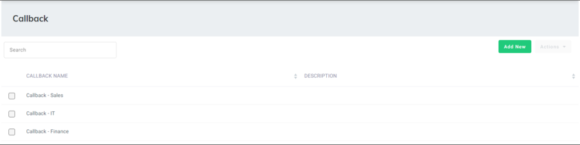
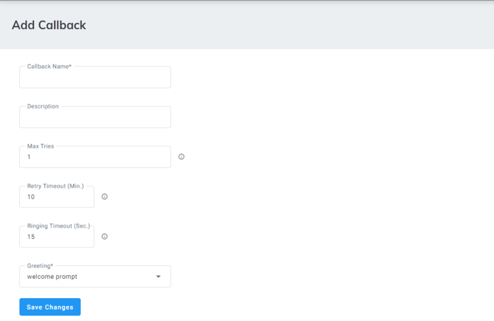
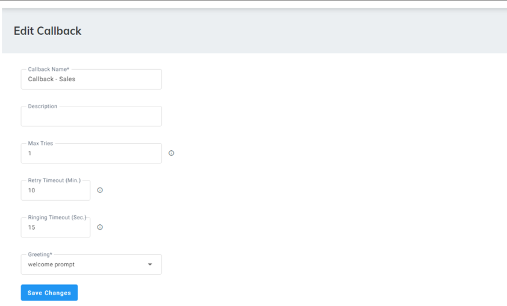
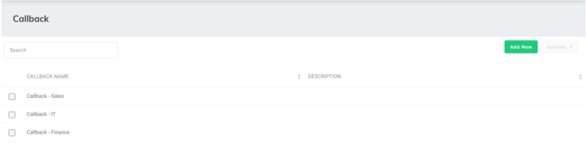

The administrator can create callback offers that callers can use while waiting in the queue.

<Note>
- Callback instances implementation is within the ‘In Queue Settings’ in the [Skill Based Queue](/tenant-administration/admin-06-configuration/admin-06-4-configuring-routing/admin-06-4-8-configuring-queues#configuring-worker-queues) configuration.
- You can use one Callback instance for multiple Skill Based Queues, or create several.
</Note>

## Adding a Callback

The procedure below describes how to add a Callback.

### To add a Callback

1. Open the Callback page (**Configuration** &gt; **Routing** &gt; **Callback**); the following appears:

   

2. Click **Add New**; the following appears:

   

3. In the 'Callback Name' field, enter the name of the Callback.
4. In the 'Description' field, enter a description of the Callback.
5. In the 'Max Retries' field, enter the maximum number of callbacks that will be attempted to reach a caller.
6. In the 'Retry Timeout (Min.)' field, enter the number of minutes that Voca waits after a failed callback attempt before injecting the call into the queue again.
7. In the 'Ringing Timeout (Sec.)' field, enter the time that Voca waits for the remote side to answer the call.
8. From the 'Greeting' drop-down list, select the prompt that will be heard by the callers when they receive the callback once their turn arrives.
9. Click **Save Changes**.

## Editing a Callback

The procedure below describes how to edit a Callback.

### To edit a Callback

1. Open the Callback page (**Configuration** &gt; **Routing** &gt; **Callback**); the following appears:

   

2. Select the Callback you want to edit, by selecting the corresponding check box.
3. From the ‘Actions’ drop-down list, choose **Edit Callback**; the following appears:

   

4. Make your necessary changes, and then click **Save Changes**.

## Deleting a Callback

The procedure below describes how to delete a Callback.

### To delete a Callback

1. Open the Callback page (**Configuration** &gt; **Routing** &gt; **Callback**); the following appears:

   

2. Select the Callback you want to delete, by selecting the corresponding check box.
3. From the ‘Actions’ drop-down list, choose **Delete Callback**; a confirmation message box appears.
4. Click **OK** to confirm deletion.
