This section deals with how to configure the following Queues:

- [Flex Queues](#configuring-flex-queues): This queue type is used for informal agents that use their Team's client or any other third-party extension.
- [Worker Queues](#configuring-worker-queues): This queue type is used for formal agents that are using the Voca Worker App.

## Configuring Flex Queues

[Flex Queues](#configuring-flex-queues) provide the ability to place an incoming call in a queue before transferring it to one of its destination lists. When the call is in a queue, the caller hears music on hold. The system supports defining several call queues per customer or service.

### Adding a Flex Queue

The procedure below describes how to add a new Flex Queue.

#### To add a new Call Queue

1. Open the Queues page (**Configuration** &gt; **Routing &gt; Queues**).

   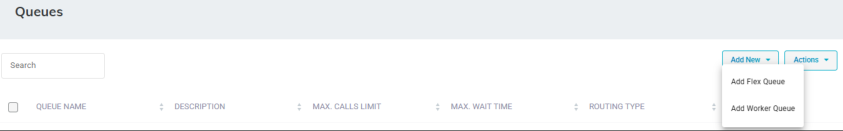

2. From the **Add New** drop-down menu, select **Add Flex Queue**.
3. In the 'Name' field, enter the name of the queue.
4. In the 'Description' field, enter a short description for the queue.
5. From the 'Queue Greeting' drop-down list, select the greeting that will be play when the call enters the queue.
6. From the 'Music on Hold' drop-down list, select the music on hold that will be play when the caller waiting in the queue.
7. From the 'Routing Type' drop-down list, select the appropriate routing type:
   - **Round Robin (default):** Sequentially hunt for each queue member
   - **Serial:** Hunt each queue member starting from the first queue member
   - **Broadcast:** Simultaneously ring for all the queue members
8. In the 'No Answer Timeout(Sec.)' field, enter the ringing time at the destination after which the call is considered as not answered by the destination.
9. From the 'Supervisors' drop-down list, select a Supervisor (see [Step 9](/tenant-administration/admin-06-configuration/admin-06-4-configuring-routing/admin-06-4-2-configuring-workers#to-add-a-worker) in Adding a Worker).
10. From the 'Queue Members' drop-down list, select either a contact name or enter a E.164 number. If a contact is selected and a presence is activated for that contact, the relevant presence will be queried before trying to transfer to this destination.
11. In the 'Allow Routing on Teams Presence Status' check box, enable or disable for which Teams Presence Status the call should transfer. Available is always marked for transfer.
12. In the 'Overflow Call When All Queue Members Are ' check box, enable or disable the admin can choose on which Teams presence status will be considered as logged out. When all the queue members meet the selected presence status the caller will automatically transfer to the relevant action that configured in the 'When overflow condition is set'.

    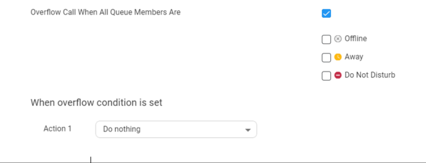

    For more information of the possible Actions, see [Actions](/tenant-administration/admin-08-actions).
13. In the 'Maximum Call in Queue' field, enter the maximum number of calls that can wait in the queue (between 1 to 99). When the maximum number of calls has been reached, the caller will automatically transfer to the relevant action that configured in the 'When the maximum number of calls is reached'.

    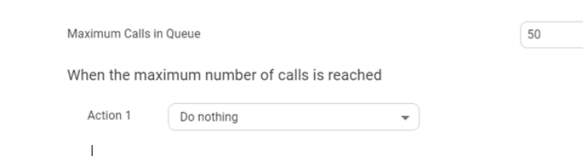

    For more information of the possible Actions, see [Actions](/tenant-administration/admin-08-actions).

    <Note>
    This limit requires the same or higher licensed channels.
    </Note>

14. In the 'Maximum Wait Time (Min.)' field, enter the maximum time for a call to be waiting in the queue. When the maximum wait time has been reached, the caller will automatically be transferred to the relevant action configured in the 'When the maximum wait time is reached' field.

    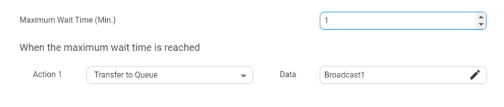

    For more information of the possible Actions, see [Actions](/tenant-administration/admin-08-actions).
15. To provide callers with various actions and options during their waiting time, select the ‘Inqueue Settings’ check box; the following appears:

    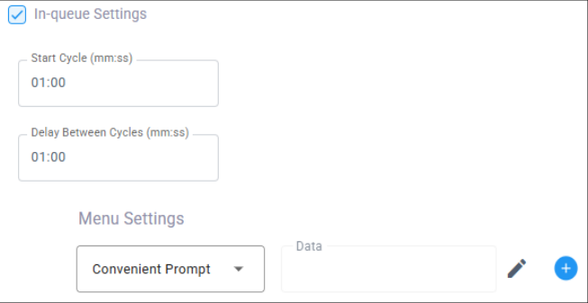

    1. In the ‘Start Cycle’ field, enter the duration (in minutes) that the basic ‘music on hold’ is played to the caller, before playing the set of in-queue actions to the caller.
    1. In the ‘Delay Between Cycles’ field, enter the duration (in minutes) that the basic ‘music on hold’ is played to the caller after the current set of in-queue actions and before the next set of in-queue actions begins.
    1. Under **Menu Settings**, select the actions and options that are played / offered when inqueue. Their order from top to bottom is the order in which they are played during the cycle. You can change the order by dragging and dropping each item.

       | **From drop-down list, select** | **Description** | **Edit fields** |
       | --- | --- | --- |
       | **Convenient Prompt** | This prompt plays a selected prompt  | 1. Click the ‘Data’ field's icon; the following appears: 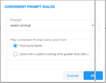 2. From the ‘Prompt’ drop-down list, select a prompt from the Tenant’s prompts list. 3. Under the **Play Convenient Prompt every cycle from** group, select one of the following options: ✔ **First Cycle Starts** - plays prompt according to duration configured in the ‘Start Cycle’ field (above). ✔ **Cycle with a caller's waiting time greater than** - prompt starts playing in the cycle that is equal to or greater than the time configured in this field. |
       | **Position in Queue** | This prompt informs callers about their position in the queue.  | 1. Click the ‘Data’ field's icon; the following appears: 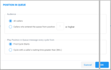 2. Under the **Audience** group, choose which callers will hear this prompt: ✔ **All Callers** ✔ **Callers who entered the queue from position** - plays the prompt only to callers who entered the queue from the position that you configure in the field or higher 3. Under the **Play Position in Queue message every cycle from** group, select one of the following options: ✔ **First Cycle Starts** ✔ **Cycle with a caller's waiting time greater than** - prompt starts playing in the cycle that is equal to or greater than the time configured in this field. |
       | **Expected Waiting Time** | This prompt inform callers about their estimated waiting time in  the queue. | 1. Click the ‘Data’ field's icon; the following appears: 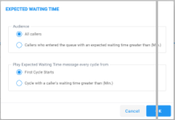 2. Under the **Audience** group, choose which callers will hear this prompt: ✔ **All Callers** ✔ **Callers who entered the queue ...** - plays the prompt only to callers who entered the queue from the position configured in the field or higher 3. Under the **Play Expected Waiting Time every cycle from** group, select one of the following options: ✔ **First Cycle Starts** ✔ **Cycle with a caller's waiting time greater than** - prompt starts playing in the cycle that is equal to or greater than the time configured in this field |
       | **Menu** | Configure an in-queue DTMF menu to allow callers to make actions during their in-queue waiting time. | 1. From the 'Menu Prompt' drop-down list, select a pre-configured prompt. For more information about these prompts, see [Adding a Voice Prompt](/tenant-administration/admin-06-configuration/admin-06-2-adding-a-voice-prompt). 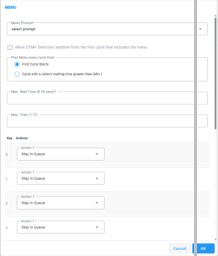 2. Select ‘Allow DTMF Selection anytime from the first cycle that includes the menu’ to let callers choose an in-queue DTMF option at any time after the DTMF menu is first played. 3. Under the **Play Menu every cycle from** group, select one of the following options: ✔ **First Cycle Starts** ✔ **Cycle with a caller's waiting time greater than** - menu's prompt starts playing in the cycle that is equal to or greater than the time configured in this field. 4. In the 'Max Wait Time' field, enter how much time to wait in seconds (0- 30) until the user presses the DTMF key. 5. In the 'Max Tries' field, enter how many times to repeat the prompts when there is no response from the user. 6. Under the **Key Actions** group, select one or more of the following options in the 'Action' drop-down list: ✔ **Leave a Message** ✔ **Send SMS** ✔ **Stay in Queue** ✔ **Disconnect** ✔ **Callback** - allows callers to request a callback, reserving their place in the queue. When it's their turn, Voca CIC automatically calls them back. 7. For more information on the above actions, see [Actions](/tenant-administration/admin-08-actions). |

16. Click **Save Changes**.

### Editing Flex Queues

The procedure below describes how to edit a Flex Queue.

#### To edit a Flex Queue

1. Open the Queues page (**Configuration** &gt; **Routing** &gt; **Queues**); the following appears:

   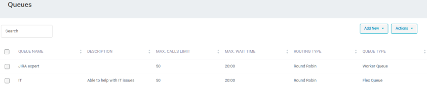

2. Select the Queue you wish to edit by selecting the corresponding Queue check box.

   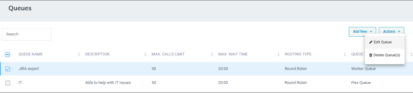

3. From the ‘Actions’ drop-down menu, choose **Edit Queue**; the following appears:

   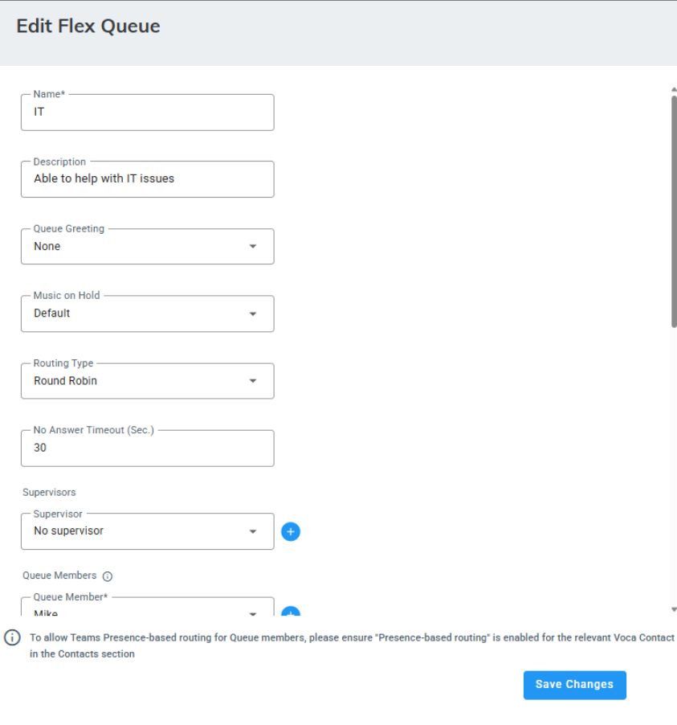

4. Make your necessary changes, and then click **Save Changes**.

### Deleting a Flex Queue

The procedure below describes how to delete a Flex Queue.

#### To delete a Flex Queue

1. Open the Queues page (**Configuration** &gt; **Routing** &gt; **Queues**); the following appears:

   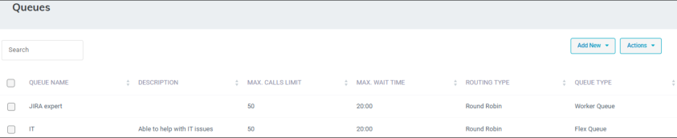

2. Select the Queue you want to delete by selecting the corresponding check box.
3. From the ‘Actions’ drop-down menu, choose **Delete Queue(s)**.

   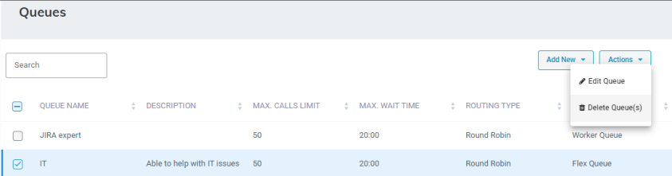

4. Click **OK** to confirm deletion.

   <Note>
   - When deleting a queue, the system checks if the queue is already used in any related transfer to queue actions.
   - If the queue is in use, the delete request is denied with an appropriate message.
   </Note>

## Configuring Worker Queues

Worker Queues provide a method of intelligent routing of customers to Workers when they all registered to the queue to handle customer requests. With this [skill-based routing](/tenant-administration/admin-06-configuration/admin-06-4-configuring-routing) capability, the Administrator can ensure that the interaction routing strategy, where customers are associated to workers with the most relevant skills to handle their requests, is based on their availability and skills required.

Digital Engagement Tenants support omnichannel capabilities, enabling integration of Voice, Email, and Chat channels.

Each channel is fully customizable and operates independently within the same queue.

### Adding a Worker Queue

The procedure below describes how to add a new [Worker Queue](#configuring-worker-queues) for Voice, Email and Chat channels.

- [Adding a worker queue for voice](#adding-a-worker-queue-for-voice)
- [Adding a worker queue for email](#adding-a-worker-queue-for-email)
- [Adding a worker queue for chat](#adding-a-worker-queue-for-chat)

#### Adding a worker queue for voice

This procedure outlines the steps to create a new skill-based routing queue for voice, ensuring that incoming calls are directed to the most qualified agents based on predefined skill criteria.

##### To add a new Worker Queue for voice

1. Open the Queues page (**Configuration** &gt; **Routing &gt; Queues**); the following appears:

   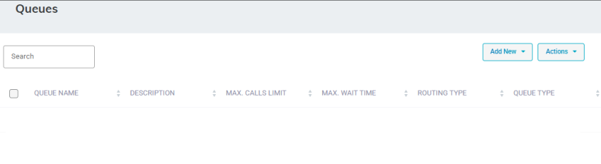

2. Click **Add New**; a drop-down menu appears:

   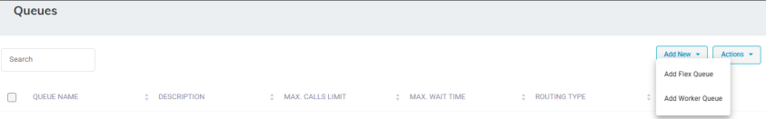

3. From the drop-down menu, choose **Add Worker Queue**; the following appears:

   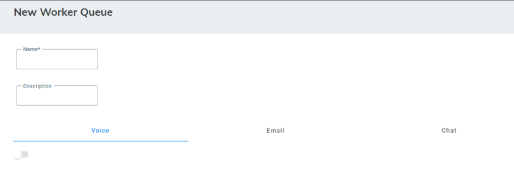

4. In the 'Name' field, enter the name of the Queue.
5. In the 'Description' field, enter a short description for the Queue.
6. Select the **Voice** tab; and click the toggle button to enable the establishment of the channel for the queue. The following appears:

   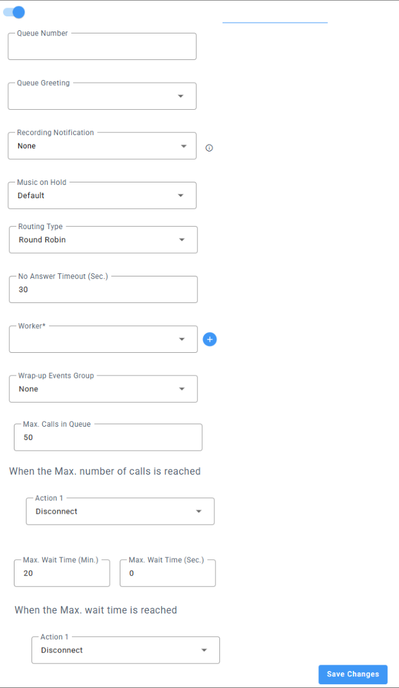

7. In the 'Queue Number' field, type the number to display on the customer's side when Workers make outbound calls through the queue.
8. From the ' Queue Greeting' drop-down list, select the greeting to play when the call enters the queue.
9. (Optional) Allow admins to notify their callers if the call will be recorded or recorded and analyzed.

   This notification will play at the beginning of queue while the caller is waiting.

   From the 'Recording Notification' drop-down list, select **Calls may be recorded** or **Calls may be recorded and analyzed by AI**. Select **None** if you don't want to notify callers.

   Admins can also upload their own audio file to the Prompt section (**Configuration &gt; Prompts**) to use a custom recording instead of the system-defined options in the dropdown. Once uploaded, the custom recording will appear in the drop-down list.
10. From the 'Music on Hold' drop-down list, select the music to play while the caller is waiting in the queue.
11. From the 'Routing Type' drop-down list, select the appropriate routing type:
    - **Round Robin:** (Default) Sequentially searches for a Worker within the queue.
    - **Longest Available Worker:** Routes calls based on the worker who has not answered queue calls for the longest time.
    - **Skill-based Priority Routing:** Routes calls based on the Worker level of expertise (score level for each skill).
12. From the 'Worker' drop-down list, select the appropriate Worker name.
13. From the 'Wrap-up Events Group' drop-down list, select the appropriate value.

    <Note>
    Wrap-up codes are listed in the Worker Application per incoming call selected queue.
    </Note>

14. In the 'Max. Calls in Queue' field, enter the maximum number of calls that can wait in the queue (1 to 99). When the maximum number of calls has been reached, the caller is automatically transferred to the relevant action, which is configured in the 'When the maximum number of calls is reached' field. For more information of possible actions, see [Actions](/tenant-administration/admin-08-actions).

    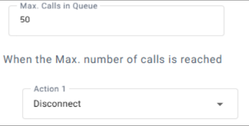

    <Note>
    This limit requires the same or more licensed channels.
    </Note>

15. In the 'Max. Wait Time (Min.)' field, enter the maximum time in minutes that a call can wait in the queue.
16. In the 'Max. Wait Time (Sec.)' field, enter the maximum time in seconds that a call can wait in the queue.

    When the maximum waiting time has been reached, the caller is automatically transferred to the relevant action, which is configured in the 'When the maximum wait time is reached' field. For more information of possible actions, see [Actions](/tenant-administration/admin-08-actions).

    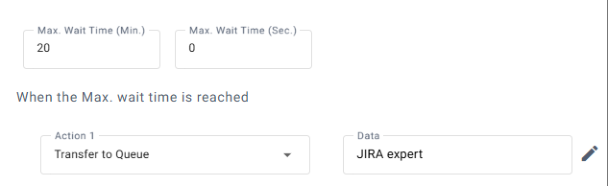

17. To configure an overflow action when all workers are logged out, select the 'Check for logged out Workers' check box, and then from the 'Action' drop-down list, select the action (**Play Prompt**, **Go-to menu**, **Disconnect**, **Silent Transfer to Phone**, **Send SMS**, **Transfer to Queue**, **Go-to Flow**, or **Leave Message**).

    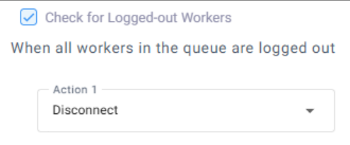

18. To configure an overflow action when all workers are ‘Not Ready’, select the 'Check for Not-Ready Workers' check box, and then from the 'Action' drop-down list, select the action (**Play Prompt**, G**o-to menu**, **Disconnect**, **Silent**, **Transfer to Phone**, **Send SMS**, **Transfer to Queue**, **Go-to Flow**, or **Leave Message**).

    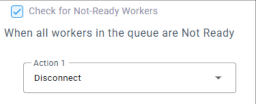

19. To provide callers with various actions and options during their waiting time, select the 'Inqueue Settings' check box; the following appears:

    

    1. In the ‘Start Cycle’ field, enter the duration (in minutes) that the basic ‘music on hold’ is played to the caller, before playing the set of in-queue actions to the caller.
    1. In the ‘Delay Between Cycles’ field, enter the duration (in minutes) that the basic ‘music on hold’ is played to the caller after the current set of in-queue actions and before the next set of in-queue actions begins.
    1. Under **Menu Settings**, select the actions and options that are played / offered when inqueue. Their order from top to bottom is the order in which they are played during the cycle. You can change the order by dragging and dropping each item.

       | **From drop-down list, select** | **Description** | **Edit fields** |
       | --- | --- | --- |
       | **Convenient Prompt** | This prompt plays a selected prompt  | 1. Click the ‘Data’ field's icon; the following appears:  2. From the ‘Prompt’ drop-down list, select a prompt from the Tenant’s prompts list. 3. Under the **Play Convenient Prompt every cycle from** group, select one of the following options: ✔ **First Cycle Starts** - plays prompt according to duration configured in the ‘Start Cycle’ field (above). ✔ **Cycle with a caller's waiting time greater than** - prompt starts playing in the cycle that is equal to or greater than the time configured in this field. |
       | **Position in Queue** | This prompt informs callers about their position in the queue.  | 1. Click the ‘Data’ field's icon; the following appears: 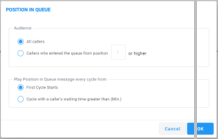 2. Under the **Audience** group, choose which callers will hear this prompt: ✔ **All Callers** ✔ **Callers who entered the queue from position** - plays the prompt only to callers who entered the queue from the position that you configure in the field or higher 3. Under the **Play Position in Queue message every cycle from** group, select one of the following options: ✔ **First Cycle Starts** ✔ **Cycle with a caller's waiting time greater than** - prompt starts playing in the cycle that is equal to or greater than the time configured in this field. |
       | **Expected Waiting Time** | This prompt inform callers about their estimated waiting time in  the queue. | 1. Click the ‘Data’ field's icon; the following appears:  2. Under the **Audience** group, choose which callers will hear this prompt: ✔ **All Callers** ✔ **Callers who entered the queue ...** - plays the prompt only to callers who entered the queue from the position configured in the field or higher 3. Under the **Play Expected Waiting Time every cycle from** group, select one of the following options: ✔ **First Cycle Starts** ✔ **Cycle with a caller's waiting time greater than** - prompt starts playing in the cycle that is equal to or greater than the time configured in this field |
       | **Menu** | Configure an in-queue DTMF menu to allow callers to make actions during their in-queue waiting time. | 1. From the 'Menu Prompt' drop-down list, select a pre-configured prompt. For more information about these prompts, see [Adding a Voice Prompt](/tenant-administration/admin-06-configuration/admin-06-2-adding-a-voice-prompt).  2. Select ‘Allow DTMF Selection anytime from the first cycle that includes the menu’ to let callers choose an in-queue DTMF option at any time after the DTMF menu is first played. 3. Under the **Play Menu every cycle from** group, select one of the following options: ✔ **First Cycle Starts** ✔ **Cycle with a caller's waiting time greater than** - menu's prompt starts playing in the cycle that is equal to or greater than the time configured in this field. 4. In the 'Max Wait Time' field, enter how much time to wait in seconds (0- 30) until the user presses the DTMF key. 5. In the 'Max Tries' field, enter how many times to repeat the prompts when there is no response from the user. 6. Under the **Key Actions** group, select one or more of the following options in the 'Action' drop-down list: ✔ **Leave a Message** ✔ **Send SMS** ✔ **Stay in Queue** ✔ **Disconnect** ✔ **Callback** - allows callers to request a callback, reserving their place in the queue. When it's their turn, Voca CIC automatically calls them back. 7. For more information on the above actions, see [Actions](/tenant-administration/admin-08-actions). |

20. Click **Save Changes**.

#### Adding a worker queue for email

This procedure details the steps to create a new worker queue for email, ensuring that incoming emails are assigned to the most qualified agents based on predefined skill criteria

##### To add a new Worker Queue for email

1. Open the Queues page (**Configuration** &gt; **Routing &gt; Queues**); the following appears:

   

2. Click **Add New**; a drop-down menu appears:

   

3. From the drop-down menu, choose **Add Worker Queue**.
4. In the 'Name' field, enter the name of the Queue.
5. In the 'Description' field, enter a short description for the Queue.
6. Select the **Email** tab; the following appears:

   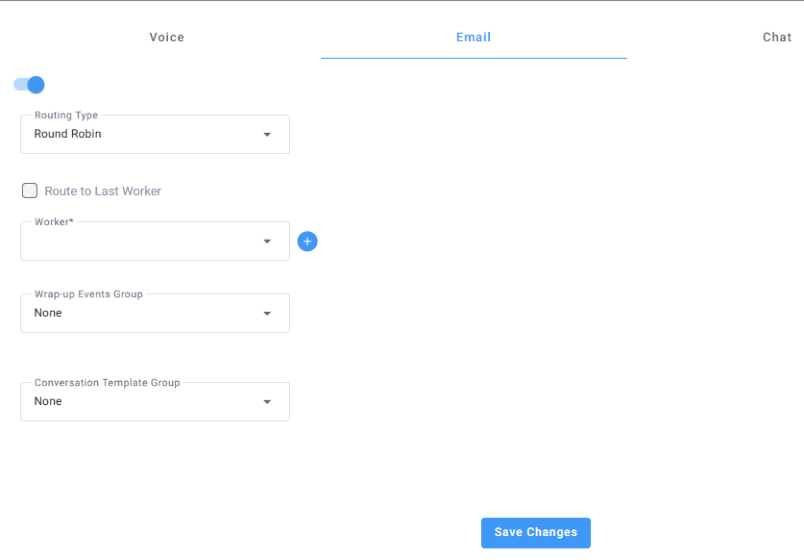

7. Click the toggle button to enable the establishment of the channel for the queue.
8. From the ‘Routing Type’ drop-down list, select the appropriate routing type:
   - **Round Robin:** (Default) Sequentially searches for a Worker within the queue.
   - **Longest Available Worker:** Routes emails based on the worker who has not answered queue [email interactions](/tenant-administration/admin-06-configuration/admin-06-1-configuring-interaction-manager/admin-06-1-2-configuring-email-interaction-settings) for the longest time.
   - **Skill-based Priority Routing:** Routes calls based on the Worker level of expertise (score level per skill).
9. Select the ‘Route to Last Worker’ check box to route an ongoing chained emails to the last agent who handled the customer interaction. If the last agent is unavailable, the interaction is forwarded to the next available skilled Worker.
10. In the ‘Last Interaction (Days)’ field, define the maximum period for which an ongoing interaction is routed to the last agent.
11. From the ‘Worker’ drop-down list, select the appropriate Worker names.
12. From the ‘Wrap-up Events Group’ drop-down list, select the appropriate value.
13. From the ‘Conversation Template Group’ drop-down list, select the template group.
14. Click **Save Changes**.

#### Adding a worker queue for chat

This procedure explains the steps to create a new worker queue for chat, ensuring that incoming chat requests are routed to the most qualified agents based on predefined skill criteria.

##### To add a new Worker Queue for chat

1. Open the Queues page (**Configuration** &gt; **Routing &gt; Queues**); the following appears:

   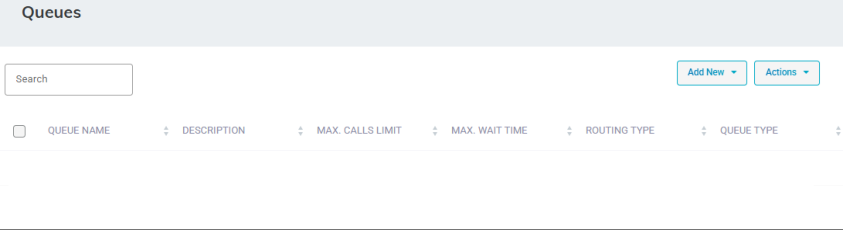

2. Click **Add New**; a drop-down menu appears:

   

3. From the drop-down menu, choose **Add Worker Queue**.
4. In the 'Name' field, enter the name of the Queue.
5. In the 'Description' field, enter a short description for the Queue.
6. Select the **Chat** tab; the following appears:

   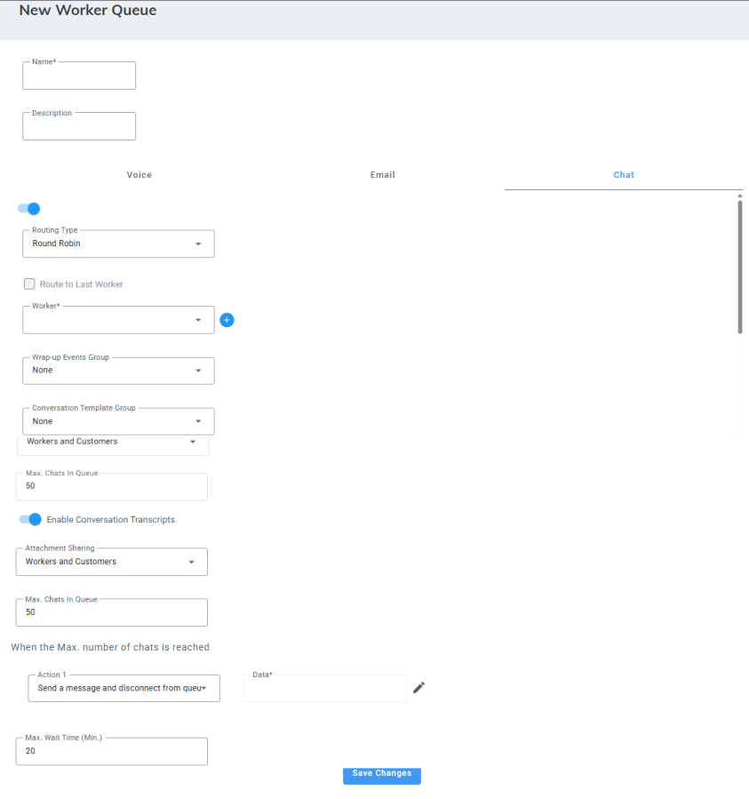

7. Click the toggle button to enable the establishment of the channel for the queue.
8. From the ‘Routing Type’ drop-down list, select the appropriate routing type:
   - **Round Robin:** (Default) Sequentially searches for a Worker within the queue.
   - **Longest Available Worker:** Routes chats based on the worker who has not answered queue chat interactions for the longest time.
   - **Skill-based Priority Routing:** Routes calls based on the Worker level of expertise (score level per skill).
9. Select the ‘Route to Last Worker’ check box to route a returning customer to the last agent who handled the customer interaction. If the last agent is unavailable, the interaction is forwarded to the next available skilled Worker.
   - In the ‘Last Interaction (Days)’ field, define the maximum period for which a returning customer is routed to the last agent.
10. From the ‘Workers’ drop-down list, select the appropriate Worker names.
11. From the ‘Wrap-up Events Group’ drop-down list, select the appropriate value.
12. From the ‘Conversation Template’ drop-down list, select the template group.
13. Click the **Enable Conversation Transcripts** toggle button to turn on the feature that allows Webchat users to download their conversation transcripts with the Workers.

    <Note>
    This field is not applicable to [SMS interactions](/tenant-administration/admin-06-configuration/admin-06-1-configuring-interaction-manager/admin-06-1-3-configuring-chat-interaction-settings#configuring-sms-interactions).
    </Note>

14. From the ‘Attachment Sharing’ drop-down list, select the Webchat participants that are allowed to transfer files.

    <Note>
    This field is not applicable to SMS interactions.
    </Note>

15. In the 'Max. Chats in Queue' field, enter the maximum number of chats that can wait in the queue (1 to 120). When the maximum number of calls is reached, the user is automatically transferred to the relevant action, which is configured under the **When the Max. number of chats is reached** group ('Action' and 'Data' fields).

    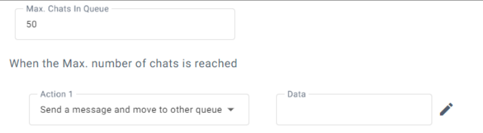

16. In the 'Max. Wait Time' field, enter the maximum time that a chat can wait in the queue. When the maximum waiting time is reached, the user is automatically transferred to the relevant action, which is configured under the **When the Max. wait time is reached** group ('Action' and 'Data' fields).

    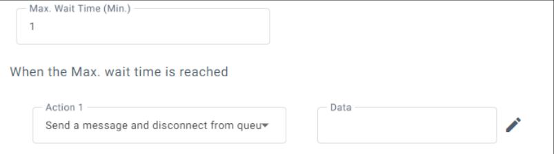

17. Select **Check for Logged-out Workers**.
18. Click **Save Changes**.

### Editing a Worker Queue

The procedure below describes how to edit a skill-based Routing Queue.

#### To edit a Worker Queue

1. Open the Call Queue page (**Configuration** &gt; **Routing** &gt; **Queues**); the following appears:

   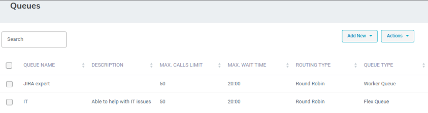

2. Select the Worker Queue that you wish to edit, by selecting the corresponding Call Queue check box.

   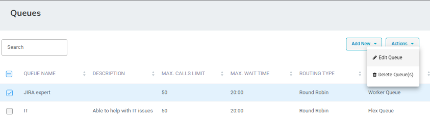

3. From the ‘Actions’ drop-down menu, choose **Edit Queue**; the following appears:

   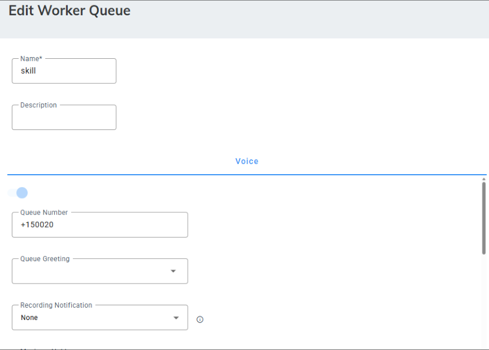

4. Make your necessary changes, and then click **Save Changes**.

### Deleting a Worker Queue

The procedure below describes how to delete a Worker Queue.

#### To delete a Worker Queue

1. Open the Queues page (**Configuration** &gt; **Routing** &gt; **Queues**); the following appears:

   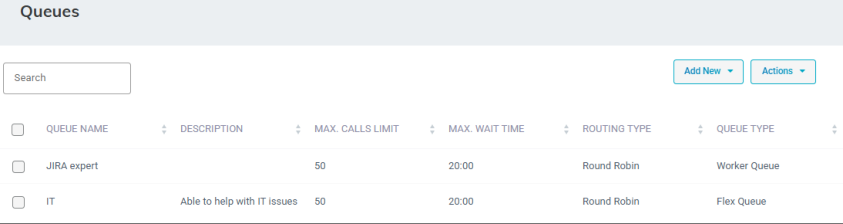

2. Select the check box corresponding to the Call Queue that you want to delete.
3. From the ‘Actions’ drop-down menu, choose **Delete Queue(s)**.

   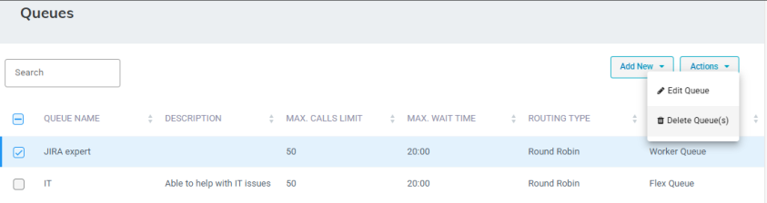

4. A confirmation box appears.
5. Click **OK** to confirm deletion.

   <Note>
   When deleting a queue, the system checks if the queue is already used in any related transfer to queue actions. If the queue is in use, the delete request is denied with an appropriate message.
   </Note>
