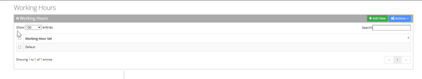
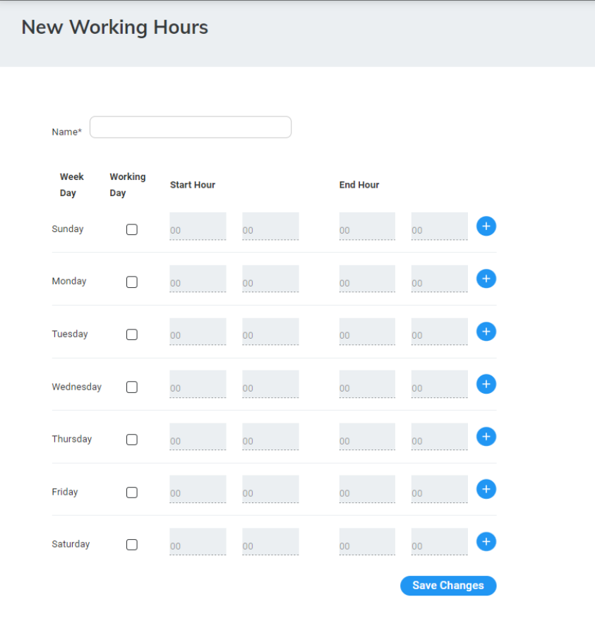
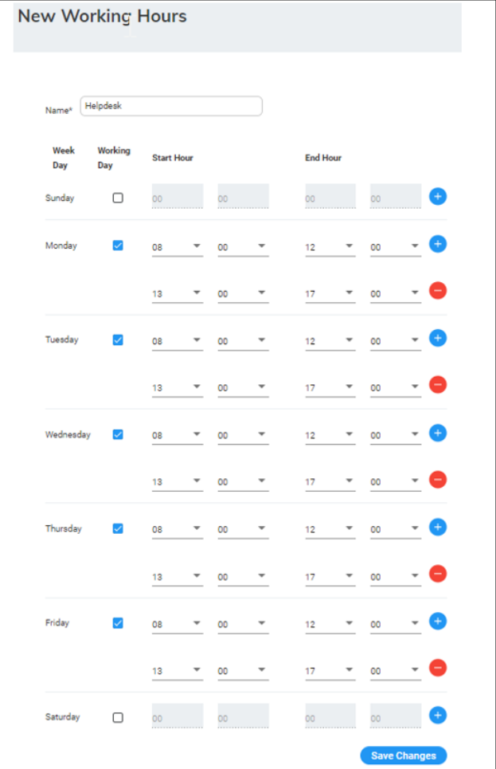
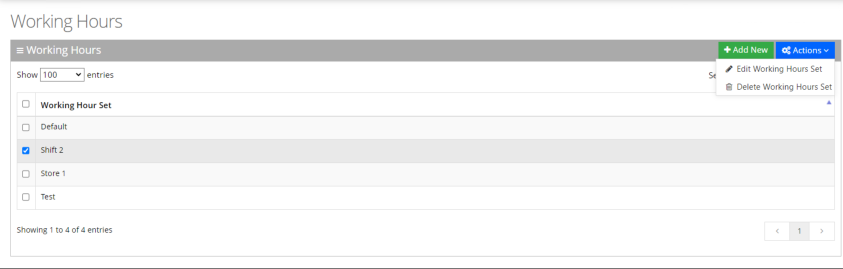
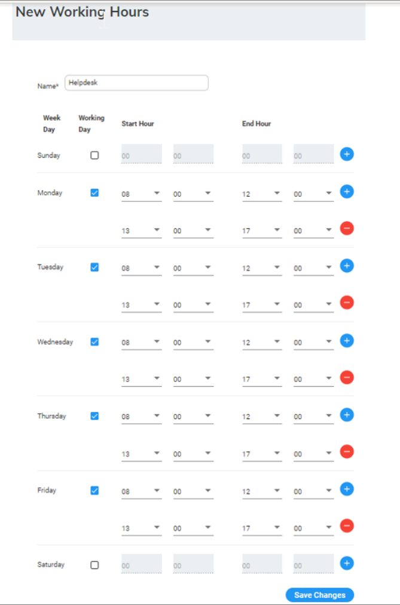
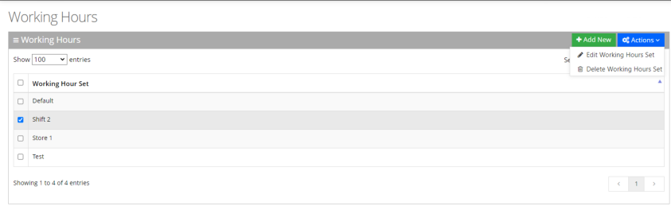

The system supports defining several sets of working hours per customer/service to allow the definition of different non-working and working time. By default, every customer/service has one working time set which can't be deleted.

## Adding Working Hours Set

The procedure below describes how to add a new Working Hours Set.

### To add a new Working Hours Set

1. Open the Working Hours Details screen (**Configuration** &gt; **Working Hours**); the following appears:

   

2. Click **"+Add New"**; the following appears.

   

3. In the 'Name' field, enter the name of the working hours.
4. In the 'Working Days' check box, define the working days and hours, each appropriate working day.
5. Select the 'Start Hour' and 'End Hour' for each applicable day.
6. Click **Save Changes**.
7. In the following example, we have defined the company's working days with shifts from Monday till Friday.

   

## Editing Working Hours Set

The procedure below describes how to edit a Working Hours Set.

### To edit a Working Hours Set

1. Open the Working Hours Details screen (**Configuration** &gt; **Working Hours**); the following appears:

   

2. Select the Working Hours Set that you wish to edit.
3. Click **Actions**; the following appears.

   

4. Select **Edit Working Hours Set**; the following appears:

   

5. Edit the working days and hours, by selecting the check box of each appropriate working day.
6. Edit the 'Start Hour' and 'End Hour' for each applicable day.
7. Click **Save Changes**.

## Deleting Working Hours Set

The procedure below describes how to delete a Working Hours Set.

### To delete a Working Hours Set

1. Open the Working Hours Details screen (**Configuration** &gt; **Working Hours**); the following appears:

   

2. Select the Working Hours Set that you wish to delete.
3. Click **Actions**; the following appears.

   

4. Select **Delete Working Hours Set**.
5. An "Are you sure want to delete the selected working hour set?" message appears; click **OK** to delete.
