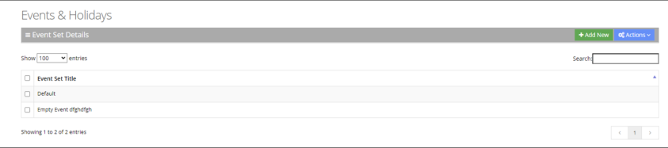
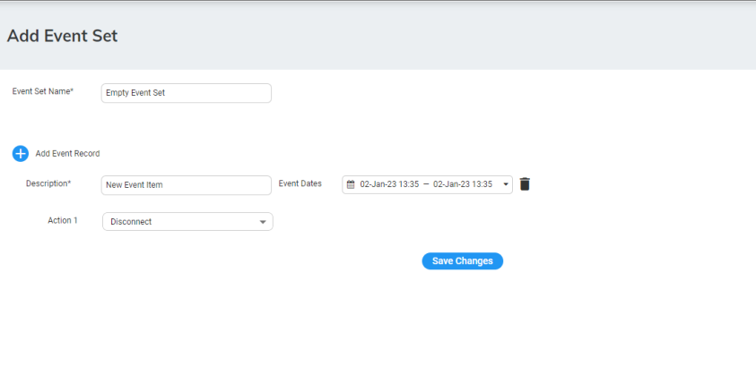
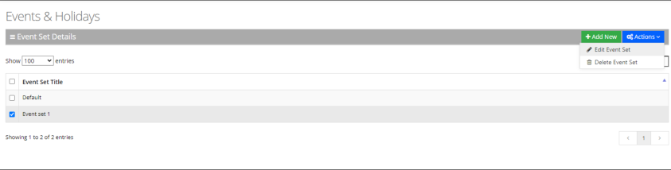
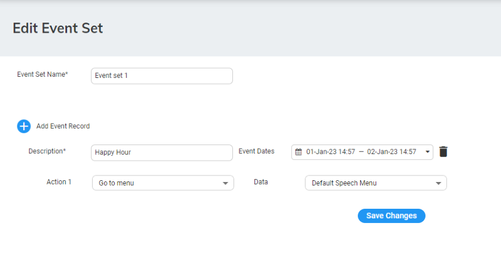

The procedure below describes how to configure Voca to define special corporate events and holidays in the system calendar. This allows for a more efficient way of defining working time.

## Adding Events and Holidays

### To add events and holidays

1. Open the Events & Holidays Details screen (**Configuration** &gt; **Events & Holidays**); the following appears:

   

2. Click **"+Add New"**; the following appears:

   

3. In the 'Event Set Name' field, enter name of the event set.
4. Add a new event by clicking  .
5. In the ' Description' field, enter the event description.
6. In the 'Event Dates' field, enter the Start and End times for the event.
7. From the 'Actions' drop-down list, select the appropriate actions.
8. For more information of the possible Actions, see [Actions](/tenant-administration/admin-08-actions).
9. Click the  delete icon to delete an event.
10. Click **Save Changes** to confirm your details; A “New event successfully created” message appears.

## Editing Events and Holidays

The procedure below describes how to edit Events and Holidays.

### To edit Events and Holidays

1. Open the Telephony Settings screen (**Configuration** &gt; **Events & Holidays**).
2. Select the event or holiday that you wish to edit.
3. Click **Actions**; the following appears:

   

4. Select **Edit Event**.

   

5. Edit the necessary information, and then click **Save Changes**; an “Event Successfully Updated” message appears.

## Delete Events and Holidays

The procedure below describes how to delete Events and Holidays.

### To delete Events and Holidays

1. Open the Telephony Settings screen (**Configuration** &gt; **Events & Holidays**).
2. Select the event or holiday that you wish to delete.
3. Click **Actions**; the following appears:

   

4. Select **Delete Event Set**; an "Are you sure want to delete the selected event set/s?" message appears.
5. Click **OK**.
