System settings consists of the following:

- [Teams Presence Settings](#teams-presence-settings)
- [Directory Synchronization](#directory-synchronization)
- [General Email Configuration](#general-email-configuration)
- [Hybrid Worker](#hybrid-workers)
- [Omnichannel Configuration](#omnichannel-configuration)
- [Cognitive Services](#cognitive-services)
- [Call Recordings](#call-recordings)
- [Data Export](#data-export)

## Teams Presence Settings

To get the presence of Azure tenant users, the application should get permissions for accessing this information.

<Note>
The organization Administrator (Microsoft 365) should grant tenant-wide admin consent to “Directory and Presence” applications on behalf of the organization, this is done through an app registration process:

1. Enter the Azure tenant details in the required fields below.
2. Click **Consent** to initiate the integration.
3. An **Azure Global Administrator** must approve the request to register the application with the necessary permissions.
4. Once approved, the application is created in Azure, granting Voca access to the requested data— the organization's contacts Teams presence information.
</Note>

### To obtain permissions

1. Open the System Settings page (**Configuration** &gt; **System Settings &gt; Teams Presence**); the following appears:

   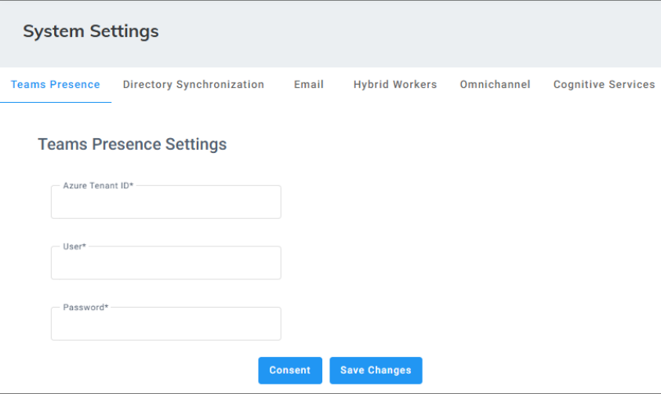

2. In the 'Azure Tenant ID' field, enter the Azure Tenant ID.
3. In the 'User' field, enter the Microsoft global Administrator.
4. In the 'Password' field, enter the Microsoft user password.
5. Click **Save Changes** to save your changes.
6. Click **Consent**; the following appears:

   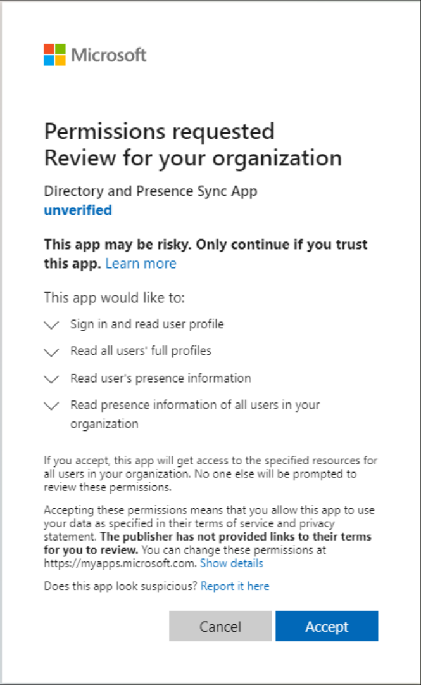

7. Click **Accept**; the access permission to the Azure Active Directory (AD) and presence for Azure tenant is enabled, so Voca can access it.

## Directory Synchronization

Synchronize Contacts from Active Directory, using either Azure Active Directory (AD) or Lightweight Directory Access Protocol ([LDAP](#configuring-ldap)) .

- Configure [Azure AD](#configuring-azure-ad)
- Configure LDAP

### Configuring Azure AD

The process below describes what is required when synchronizing between Voca tenant with Azure Active Directory.

<Note>
The organization Administrator (Microsoft 365) should grant tenant- wide admin consent to “Directory and Presence” applications on behalf of the organization, this is done through an app registration process:

1. Enter the Azure tenant details in the required fields below.
2. Click **Consent** to initiate the integration.
3. An **Azure Global Administrator** must approve the request to register the application with the necessary permissions.
4. Once approved, the application is created in Azure, granting Voca access to the requested data— the organization's contact list.
</Note>

<Note>
The consent process is required once for Azure AD sync and once for Teams Presence.
</Note>

#### To configure Azure AD

1. Open the System Settings page (**Configuration &gt; System Settings &gt; Directory Synchronization**); the following appears:

   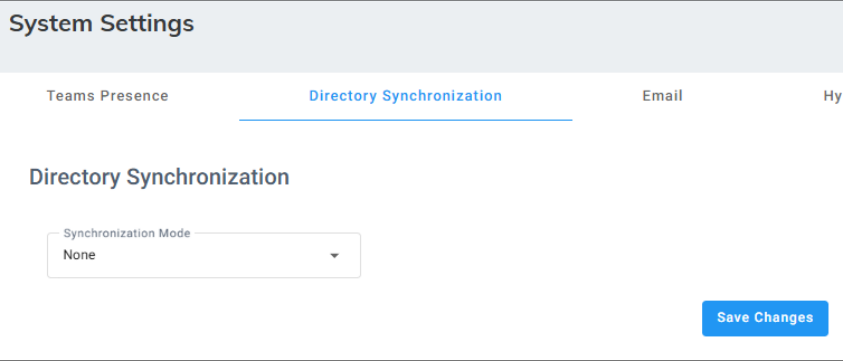

2. Under the **Directory Synchronization** group, from the 'Synchronization Mode' drop-down list, select **Azure AD**; the following appears:

   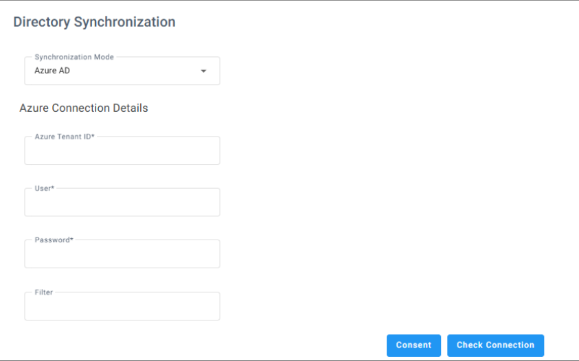

3. In the 'Azure Tenant ID' field, enter the Azure Tenant ID from which to request the presence.
4. In the 'User' field, enter the name of the user defined on the Azure tenant with permissions to access the presence.
5. In the 'Password' field, enter the user’s password.
6. In the 'Filter' field, enter the filter configuration. For example:

   ```text
   "(startsWith(givenName, 'V') OR endsWith
   (mail,'@outlook.com')) AND businessPhones/any(p:p le 'a') AND
   surname ne null and NOT(surname eq 'Last')"
   "department in ('Retail', 'Sales') AND givenName le 'zzz' AND
   mobilePhone ge '9'"
   ```

7. Click **Consent**.

   <Note>
   **Operators:** 'Contains', 'lt' and 'gt' are not supported. For more information, refer to [https://docs.microsoft.com/en-us/graph/aad-advanced-queries?tabs=http](https://docs.microsoft.com/en-us/graph/aad-advanced-queries?tabs=http).
   </Note>

   <Note>
   To check connectivity to Azure AD, click **Check Connection**.
   </Note>

8. Under the **Azure AD User Attributes** group, enter the following:
   1. In the 'Unique ID' field, enter "Id".
   1. In the 'First Name' field, enter "givenName".
   1. In the 'Last Name' field, enter "surname".
   1. In the 'Extension' field, enter "businessPhone".
   1. In the 'Mobile' field, enter "mobilePhone".
   1. In the 'Department' field, enter "department".
   1. In the 'Email' field, enter "mail".

      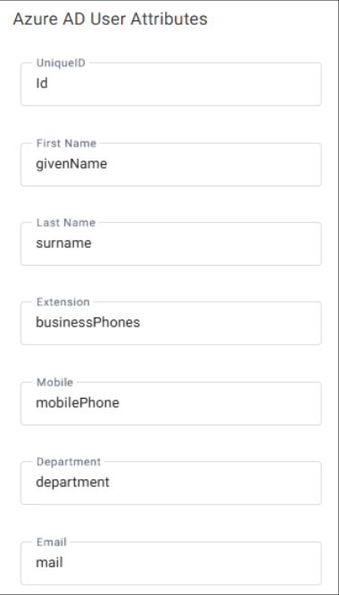

9. Select the following fields for when you want to import contacts from the Azure AD server:
   - Days
   - Start Time not before
   - Start time not before (Sec)

     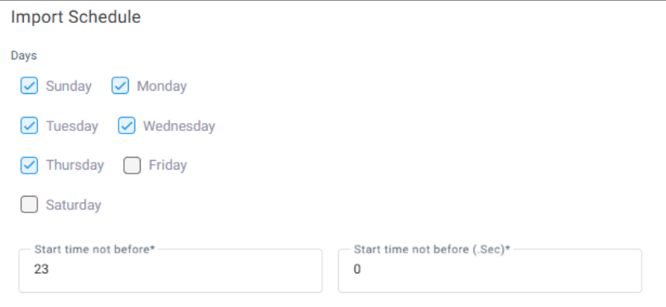

10. From the 'Email Notification' drop-down list, select one of the following to indicate when notification emails should be sent:
    - None
    - Success
    - Failure
    - All

      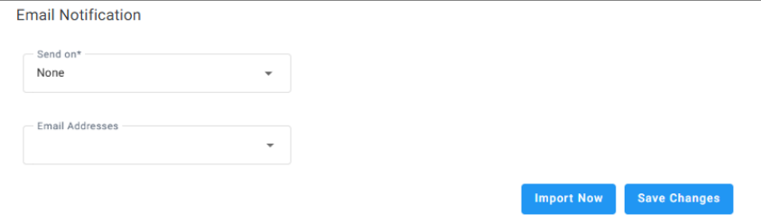

11. Click **Save Changes**.
12. Click **Import Now** to import contacts from the Azure AD server immediately (Optional).

### Configuring LDAP

Synchronize between Voca tenant with LDAP (Lightweight Directory Access Protocol).

#### To configure LDAP

1. Open the System Settings page (**Configuration** &gt; **System Settings &gt; Directory Synchronization**).

   

2. Under the **Directory Synchronization** group, from the 'Synchronization Mode' drop-down list, select **LDAP**; the following appears:

   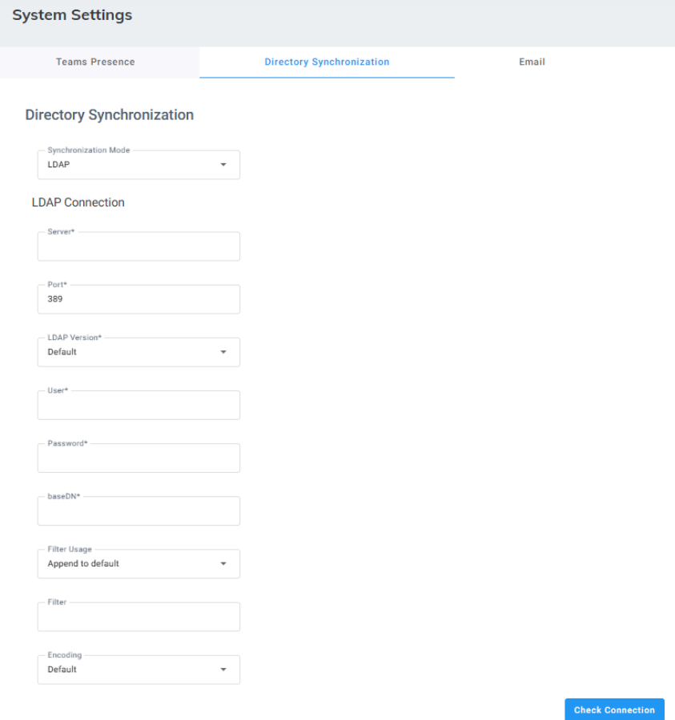

3. In the 'Server' field, enter the URL of the LDAP server. It can include either FQDN or an IP Address.
4. In the 'Port' field, enter the port that synchronizes with LDAP. Enter either "398" or "3268".
5. From the 'LDAP Version' drop-down list, select the LDAP Version.
6. In the 'User' field, enter the Service Administrator Name.
7. In the 'Password' field, enter the Service Administrator password.
8. In the 'baseDN' field, define the baseDN that you want to use.
9. From the 'Filter Usage' drop-down list, select the appropriate filter:
   - **Append to default:** Uses the default filter that was applied on Voca. The default filter is: (&(objectCategory=person)(objectClass=user)(" + id + "=\*)(\|(" + firstName + "=\*)(" + lastName + "=\*)))
   - **Replace Default:** Replaces the default filter with the filter that you configured in the 'Filter' field.
10. In the 'Filter' field, define the filter that you want to use. For more information, click [here](https://www.ldapexplorer.com/en/manual/109010000-ldap-filter-syntax.htm).
11. From the 'Encoding' drop-down list, select the appropriate encoding to be used when importing from the LDAP filter.

    <Note>
    To check connectivity to the LDAP server, click the **Check LDAP connection** button.
    </Note>

12. Under the LDAP User Attributes group, you can enter different attributes to import for LDAP or use the default.

    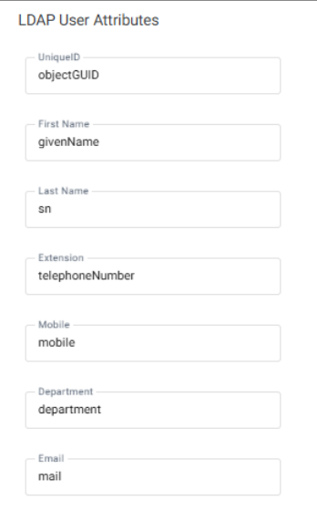

13. Select the following fields when you want to import contacts from the Azure AD server:
    - Days
    - Start Time
    - Start time not before (Sec)

      

14. If you select the 'Incremental Mode' check box, the LDAP sync disables all contacts NOT in the list. If the 'Incremental Mode' check box is not enabled, the LDAP sync adds the contacts to the system (without disabling the contacts that do not appear in the updated list).

    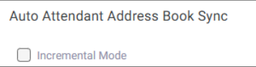

15. From the 'Email Notification' drop-down list, select one of the following to indicate when notification emails should be sent:
    - None
    - Success
    - Failure
    - All

      

16. Click **Save Changes**.
17. Click **Import Now** to import contacts from the LDAP server immediately (Optional).

## General Email Configuration

The procedure below describes how to configure general email settings. It is used for sending AD synchronization alarms, scheduled reports, missed calls notifications, and 'leave a message'.

Configuration depends on your server type:

- [Configuring Email for Azure](#configuring-email-for-azure)
- [Configuring Email for SMTP](#configuring-email-for-smtp)

### Configuring Email for Azure

#### To configure general email settings for Azure

1. Open the System Settings page (**Configuration** &gt; **System Settings &gt; Email**); the following appears:

   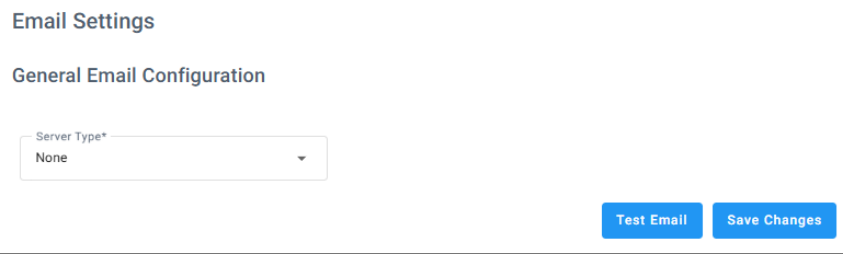

2. Under **General Email Configuration**, from the ‘Server Type’ drop-down list, select **Azure**; the following appears:

   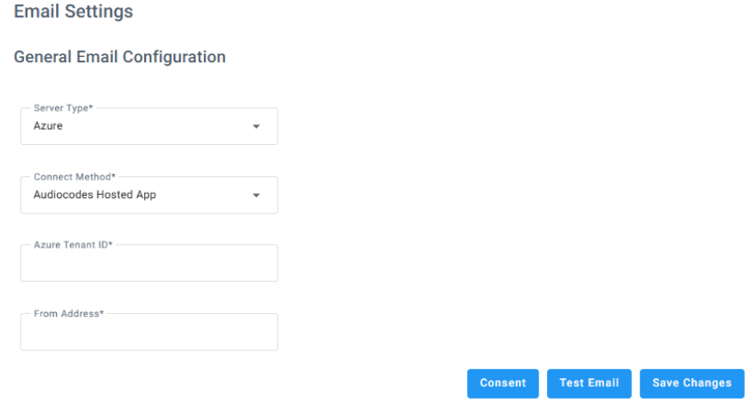

3. From the 'Connect Method’ drop down list, choose **AudioCodes Hosted App**, **Self-Hosted App (Delegated)**, or **Self-Hosted App (Application)**.
4. Follow these steps based on the 'Connect Method' you selected:

   | **Connect Method** | **Steps** |
   | --- | --- |
   | **AudioCodes Hosted App**: | 1. In the 'Azure Tenant ID' field, enter the Azure Tenant ID from which to receive the emails.<br/>2. In the 'From Address' field, enter the address from where emails are sent. |
   | **Self-Hosted App (Delegated)** | 1. In the ‘Azure Tenant ID’ field, type the Azure Tenant ID from which to receive the emails.<br/>2. In the ‘App ID’ field, type the App ID.<br/>3. In the ‘Username’ field, type the name of the user that is defined on the Azure tenant with permissions to access the emails.<br/>4. In the ‘Password’ field, type the user’s password.<br/>5. In the ‘From Address’ field, type the address from where emails are to be sent. |
   | **Self-Hosted App (Application)** | 1. In the ‘Azure Tenant ID’ field, type the Azure Tenant ID from which to receive the emails.<br/>2. In the ‘App ID’, type the App ID.<br/>3. In the ‘Secret Key’, type the application secret key.<br/>4. In the ‘From Address’, type the address from where emails are to be sent. |

5. Click **Save Changes**.

### Configuring Email for SMTP

#### To configure general email settings for SMTP

1. Open the System Settings page (**Configuration** &gt; **System Settings** &gt; **Email**); the following appears:

   

2. Under **General Email Configuration**, from the ‘Server Type’ drop-down list, select **SMTP**; the following appears:

   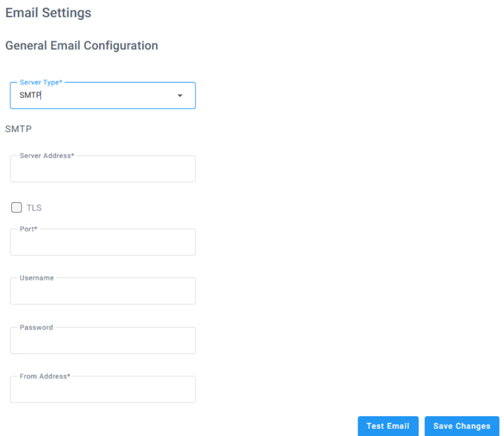

3. In the 'Server Address' field, type the URL of the email server. It can include an FQDN or IP address.
4. Select the 'TLS' check box if the email server uses TLS.
5. In the 'Port' field, type the port ('25' or '587') used for the email server.
6. In the 'Username' field, type the username for the email address you’re using.
7. In the 'Password' field, type the password for the email address you’re using.
8. In the 'From Address' field, type the address from where the email is to be sent.
9. Click **Save Changes**.

## Hybrid Workers

Enable this feature to allow selected Workers to receive calls via Microsoft Teams native application. The selection is done within the ‘Workers Group’ page or by Supervisors via the Worker Application.

### To enable Hybrid Workers

1. Open the System Settings page (**Configuration** &gt; **System Settings** &gt; **Hybrid Workers**), the following appears:

   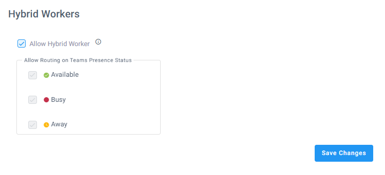

2. Select the 'Allow [Hybrid Worker](#hybrid-workers)’ check box to enable the feature in the Tenant.
3. Under ‘Allow Routing on Teams Presence Status’, select the Workers’ presence status in Microsoft Teams that is considered ‘Ready’ to accept a call.

   <Note>
   Currently, statuses ‘Available’, ‘Busy’, and ‘Away’ are not configurable.
   </Note>

## Omnichannel Configuration

The procedures below describe how to configure omnichannel settings. This configuration enables Voca to manage Email and [SMS interactions](/tenant-administration/admin-06-configuration/admin-06-1-configuring-interaction-manager/admin-06-1-3-configuring-chat-interaction-settings#configuring-sms-interactions) by integrating with your Email server and/or SMS Provider.

Configuration depends on your server type:

- [Configuring Omnichannel Email for Azure](#configuring-omnichannel-email-for-azure)
- [Configuring Omnichannel Email for SMTP & IMAP](#configuring-omnichannel-email-for-smtp--imap)
- [Configuring Omnichannel settings for SMS](#configuring-omnichannel-settings-for-sms)

### Configuring Omnichannel Email for Azure

Configure your Azure tenant so that [email interactions](/tenant-administration/admin-06-configuration/admin-06-1-configuring-interaction-manager/admin-06-1-2-configuring-email-interaction-settings) can be managed by Voca.

This process requires the the organization Administrator (Microsoft 365) to grant tenant-wide admin consent to omnichannel email applications on behalf of the organization.

#### To configure omnichannel email settings for Azure

1. Open the System Settings page (**Configuration** &gt; **System Settings &gt; Omnichannel**); the following appears:

   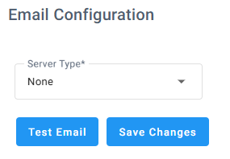

2. From the ‘Server Type’ drop-down list, select **Azure**; the following appears:

   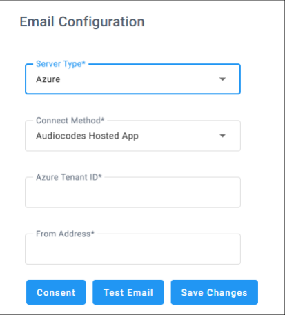

3. From the 'Connect Method’ drop down list, choose **AudioCodes Hosted App**, **Self-Hosted App (Delegated)**, or **Self-Hosted App (Application)**.
4. Follow these steps based on the 'Connect Method' you selected:

   | **Connect Method** | **Steps** |
   | --- | --- |
   | **AudioCodes Hosted App** | 1. In the 'Azure Tenant ID' field, enter the Azure Tenant ID from which to receive the emails.<br/>2. In the 'From Address' field, enter the address from where emails are sent. |
   | **Self-Hosted App (Delegated)** | 1. In the ‘Azure Tenant ID’ field, type the Azure Tenant ID from which to receive the emails.<br/>2. In the ‘App ID’ field, type the App ID.<br/>3. In the ‘Username’ field, type the name of the user that is defined on the Azure tenant with permissions to access the emails.<br/>4. In the ‘Password’ field, type the user’s password.<br/>5. In the ‘From Address’ field, type the address from where emails are to be sent. |
   | **Self-Hosted App (Application)** | 1. In the ‘Azure Tenant ID’ field, type the Azure Tenant ID from which to receive the emails.<br/>2. In the ‘App ID’, type the App ID.<br/>3. In the ‘Secret Key’, type the application secret key.<br/>4. In the ‘From Address’, type the address from where emails are to be sent. |

5. Click **Save Changes**.

### Configuring Omnichannel Email for SMTP & IMAP

Configure your SMTP & IMAP server so that email interactions can be managed by Voca.

#### To configure email settings for SMTP & IMAP

1. Open the System Settings page (**Configuration** &gt; **System Settings** &gt; **Omnichannel**); the following appears:

   

2. From the ‘Server Type’ drop-down list, select **SMTP & IMAP**; the following appears:

   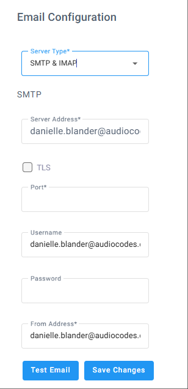

   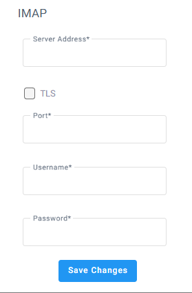

3. Under **SMPT**, in the 'Server Address' field, type the URL of the email server. It can include an FQDN or IP address.
4. Select the 'TLS' check box if the email server uses TLS.
5. In the 'Port' field, type the port ('25' or '587') used for the email server.
6. In the 'Username' field, type the username for the email address you’re using.
7. In the 'Password' field, type the password for the email address you’re using.
8. In the 'From Address' field, type the address from where the email is to be sent.
9. Click **Save Changes**.

   <Note>
   To complete the integration with your email channel, make sure that you configure the PowerShell commands described in [Adding Email Interactions](/tenant-administration/admin-06-configuration/admin-06-1-configuring-interaction-manager/admin-06-1-2-configuring-email-interaction-settings#adding-email-interactions) customer’s Azure Tenant to enable email interaction with a specific email mailbox.
   </Note>

10. Under **IMAP**, in the 'Server Address' field, type the URL of the email server. It can include an FQDN or IP address.
11. Select the 'TLS' check box if the email server uses TLS.
12. In the 'Port' field, type the port ('25' or '587') used for the email server.
13. In the 'Username' field, type the username for the email address you’re using.
14. In the 'Password' field, type the password for the email address you’re using.
15. Click **Save Changes**.

### Configuring Omnichannel settings for SMS

Configure the integration with the service provider you will be using for the SMS omnichannel interactions.

#### To configure omnichannel settings for SMS

1. Open the System Settings page (**Configuration** &gt; **System Settings** &gt; **Omnichannel**); the following appears:

   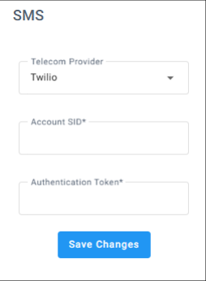

2. Under **SMS**, from the 'Telecom Provider' drop-down menu, select **Twilio** or **Bandwith**.
3. Do the following per your chosen provider, enter the required information from your provider:

   | **Telecom Provider** | **Enter values for...** |
   | --- | --- |
   | **Twillio** | •  Account SID<br/>•  Authentication Token |
   | **Bandwith** | •  Account ID'<br/>•  Application ID<br/>•  API Key<br/>•  API Secret |

4. Click **Save Changes**.

## Cognitive Services

By default, our system provides the AudioCodes Text-to-Speech (TTS) service. However, you now have the option to use your own Azure TTS service. To do so, configure it in the System Settings under the **Cognitive Services** section by entering your Azure TTS key and region.

<Note>
This change applies only to the Text-to-Speech block in the [Flow Designer](/flow-designer/admin-05-flow-designer).

- If no configuration is provided, the system defaults to AudioCodes TTS.
- Once configured, Voca automatically switches to the specified Azure TTS service.
</Note>

### To configure Azure TTS

1. Open the System Settings page (**Configuration** &gt; **System Settings &gt; Cognitive Services**); the following appears:

   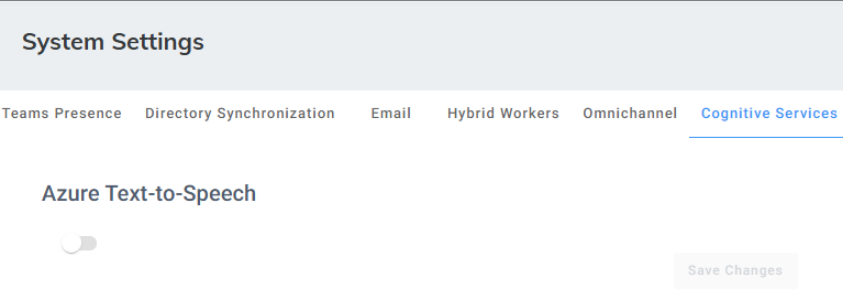

2. Under **Azure Text-to-Speech,** Click the 'Enable/ Disable' toggle button; the following appears:

   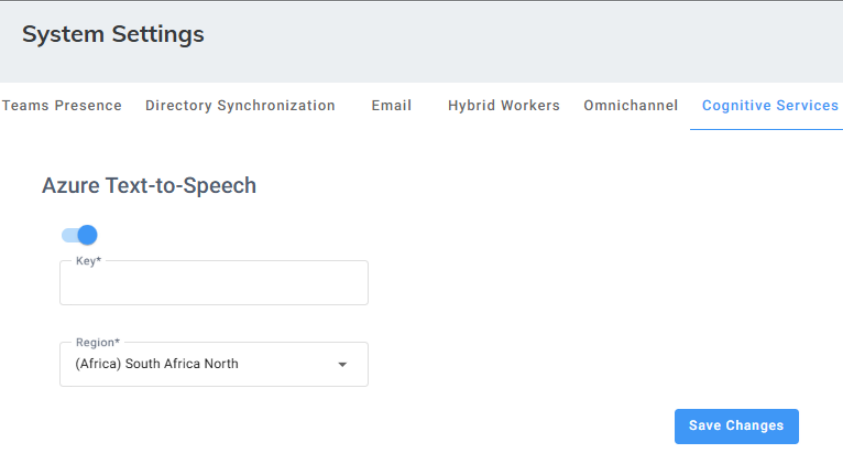

3. In the 'Key' field, enter the your Azure Text-to-Speech key.
4. From the 'Region' field, select the Azure locale voice.
5. Click **Save Changes**.

## Call Recordings

<Note>
The Call Recordings tab is available only for tenants that have CIC2 or CIC3 configured as a built-in option.
</Note>

1. Open the System Settings page (**Configuration** &gt; **System Settings &gt; Call Recordings**).

   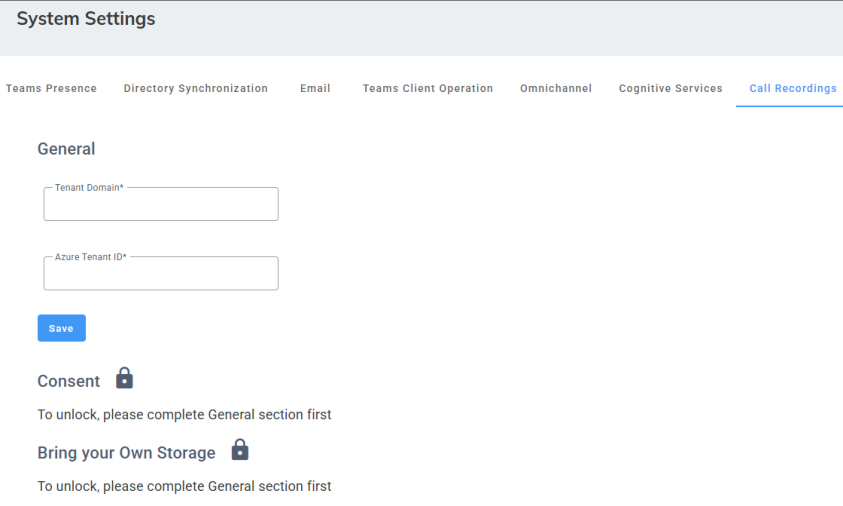

2. Under 'General' field, enter the Tenant Domain and Azure Tenant ID.
3. Click **Save**. After saving, you need to complete three consent actions.

   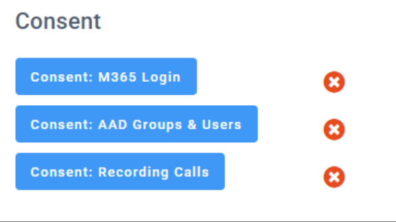

4. Click each of the buttons below and complete the Microsoft consent process. These consents are mandatory to enable call functionality in the customer’s environment.
   - **Consent: M365 Login**
   - **Consent: AAD Groups & Users**
   - **Consent: Recording Calls**

     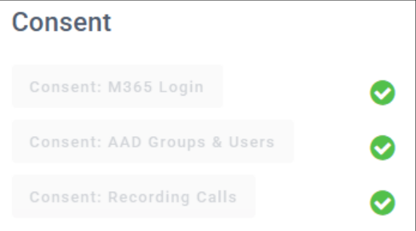

5. Once completed, you can optionally configure your own storage (up to 10).

   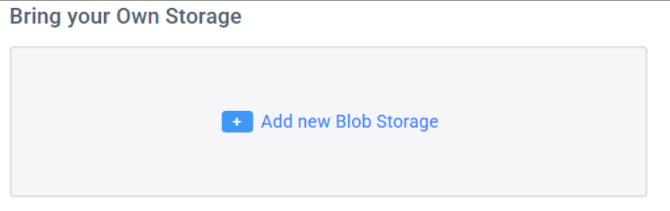

6. Click **Add new Blob Storage**.

   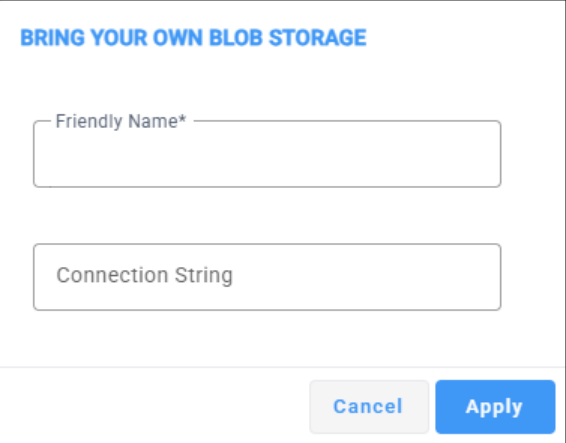

7. Click **Save Changes** to save your changes.
8. In the 'Friendly Name' field, enter a name for your storage.
9. Enter a connection string.An Azure Blob Storage connection string is a text value that specifies how your application connects to a specific storage account, including its location and authentication details.
10. Click **Apply**.

## Data Export

The procedure below describes how to extract interaction raw data records from Voca CIC.

### To export data

1. Open the System Settings page (**Configuration** &gt; **System Settings**):

   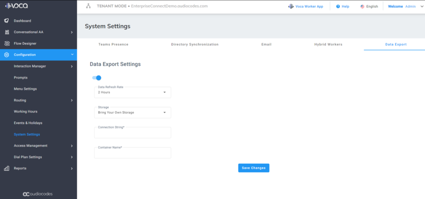

2. Click the toggle button to enable the Data Export feature.
3. From the Data Refresh Rate’ drop-down list, choose the intervals in which new data will be downloaded (as a compressed ‘.tar’ file containing multiple CSV files) to the storage platform defined below.
4. From the 'Storage' drop-down list, select one of the following:
   - **Bring Your Own Storage:** enables Voca CIC to automatically download interaction records to your designated storage.
     1. In the ‘Connection String’ field, enter the connection string.
     1. In the ‘Container Name’ field, enter the container name.
   - **Voca Storage**: uses Voca’s storage for extracting interaction records.
     - Click the **Generate Key** button to generate a token in UUID format, which can be used to authorize the request to download files using the API.

   <Note>
   When generating a New Key, copy and save it immediately. It will not be displayed again.
   </Note>

5. Click **Save Changes**.

### Pulling Tenant Data from VOCA CIC storage via API

To securely pull Tenant’s data from Voca Storage, use the following external APIs:

- [Get Token: https://&lt;domain&gt;/api/DataExport/External/token](#get-token-httpsdomainapidataexportexternaltoken)
- [Get Files: https://&lt;domain&gt;/api/DataExport/External/Files](#get-files-httpsdomainapidataexportexternalfiles)

### Current Domain for All Voca CIC Environments

| **Region** | **Domain** |
| --- | --- |
| IO | voca-dm.audiocodes.io |
| APAC | vocaau-dm.audiocodesaas.com |
| EMEA | voca-dm.audiocodesaas.com |
| INDIA | vocaindia-dm.audiocodesaas.com |
| AMER | vocaus-dm.audiocodesaas.com |

#### Get Token: https://&lt;domain&gt;/api/DataExport/External/token

files using the `/api/DataExport/External/Files` API (see the next section).

##### Usage

- URL: https://&lt;domain&gt;/api/DataExport/External/token
- Method: GET
- Request Headers: x-api-key: &lt;user-api-key&gt;
- The API key is generated in the UI during the initialization process.

##### Responses

- 200 OK: Token generation was successful.
- [Example Response Body](#example-response-body):

  ```text
  {"token": "123e4567-e89b-12d3-a456-426614174000"}
  ```

- 401 Unauthorized: Invalid API key
- 500 Internal Server Error: Failed to generate the token

#### Get Files: https://&lt;domain&gt;/api/DataExport/External/Files

This API is triggered by users to obtain download links to a tar file containing CSV files representing their data stored in the Voca Storage account. The user must provide a valid token, which can be retrieved using the `/api/DataExport/External/token` API.

##### Usage

- URL: https://&lt;domain&gt;/api/DataExport/External/Token
- Method: GET
- Request Headers: `Authorization: Bearer &lt;token&gt;`

The token is generated via the /api/DataExport/External/token API.

##### Responses

- 200 OK: Successfully retrieved file URLs.

##### Example Response Body

```text
[
"https://<AzureResourceName>.blob.core.windows.net/<containerName>/<fileNa
me>.tar",
"https://<AzureResourceName>.blob.core.windows.net/<containerName>/<fileNa
me>.tar"
]
```

- 401 Unauthorized: Invalid token.
- 500 Internal Server Error: Failed to retrieve file links.

  <Note>
  - The download links provide access to the `.tar` files from Voca Storage.
  - The links are valid for 30 minutes and must be used before they expire.
  - Ensure that the token is still valid; it expires 1 hour after generation.
  </Note>
