Access Management lets you add or edit users and assign them specific Tenant privileges. By default, there are two predefined profiles available, Tenant Admin and Analytic Users. You can also create custom profiles, as needed. These profiles can be assigned to new or existing users, ensuring everyone has the right level of access based on their role.

Create a user and assign them a specific profile. The assigned profile determines the different of viewing or editing capabilities in the Voca CIC Tenant.

- [User Lists](#adding-users) - here you add or edit users.
- [Access Profiles](#creating-profiles) - here you can create a customized profile , edit the predefined profiles or clone profiles.
- [Recording Links](#recording-links) - here you can also can control who can access call recording links.

## Configuring Users

This section describes how to add, edit and delete users from the Users List.

### Adding Users

Add users to the organization's list. Create a user and assign a specific profile. The assigned profile determines the different of viewing or editing capabilities in the Tenant Voca CIC management.

#### To add a user

1. Open the User List page (**Configuration** &gt; **Access Management** &gt; **Users List**); the following appears:

   

The User Lists page is described below:

- **Email:** Displays the user’s email.
- **Access Profile:** Displays the profile that is assigned to the user. Every profile can have different capabilities of viewing or editing pages in the Tenant Voca CIC management.
2. Click **+Add New** to add a new user, the following appears:

   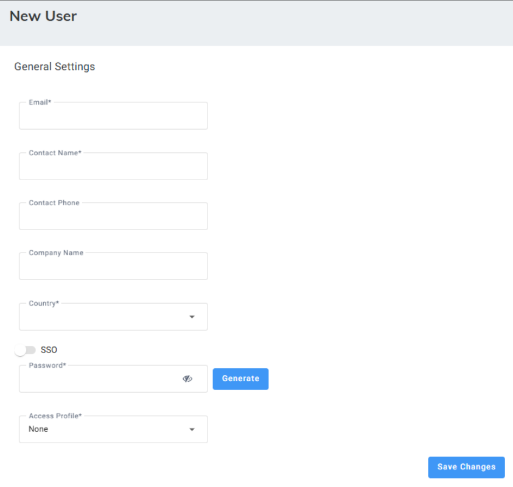

3. Under 'General Settings', in the 'Email' field, enter the user's email address.
4. In the 'Contact Name' field , enter the name of the user.
5. In the 'Contact Phone' field, enter the user's phone number.
6. In the 'Company Name' field, enter the name of the user's organization name.
7. From the 'Country' drop-down list, select the location of the organization.
8. If you are defining an SSO user with [Azure AD](/tenant-administration/admin-06-configuration/admin-06-7-system-settings#configuring-azure-ad) (as configured in the system setting &gt; AD sync)., toggle the SSO button.
9. In the 'Password' field, click the **Generate** button to auto-generate a password.
10. From the 'Access Profile' drop-down list, select a profile to assign the user. Profiles are defined in [Create a profile](#creating-profiles).

    <Note>
    This is mandatory for non-SSO users.
    </Note>

    <Note>
    If Tenant Administrators do not directly select an [Access Profile](#configuring-profiles) for a SSO user, they must ensure that:

    - The SSO user belongs to exactly one Azure Security Group
    - The Azure Security Group is assigned to a profile on the Profile Page.
    </Note>

### Editing Users

You can edit user details to change their access profile and enable or disable SSO.

#### To edit a user

1. Open the User List page (**Configuration** &gt; **Access Management** &gt; **Users List**); the following appears:

   

2. Select the user that you want to edit.

   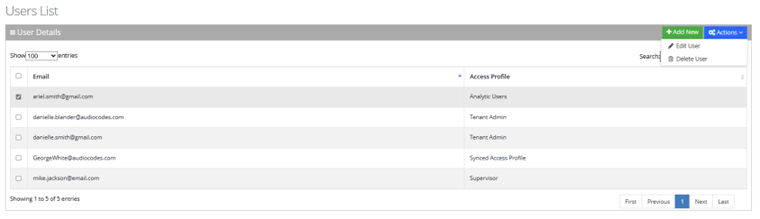

3. From the ‘Actions’ drop-down list, choose **Edit User**; the following appears:

   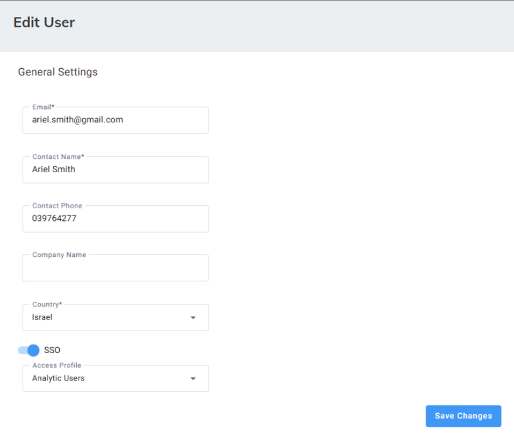

4. Edit the fields you want to change.
5. Click **Save Changes**.

### Deleting Users

You can delete users from the Users List.

#### To delete a user

1. Open the User List page (**Configuration** &gt; **Access Management** &gt; **Users List**); the following appears:

   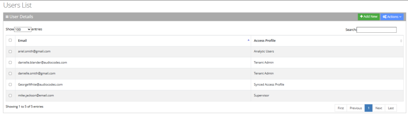

2. Select the user(s) that you want to delete.

   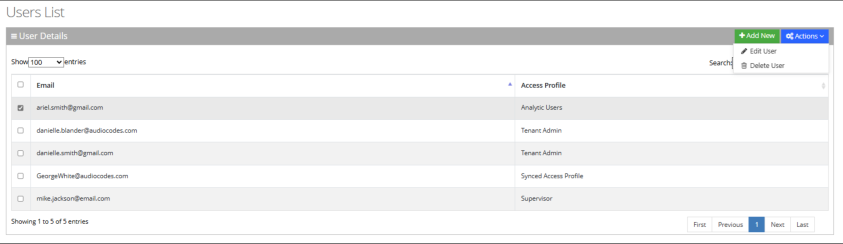

3. From the ‘Actions’ drop-down menu, choose **Delete User**.
4. Click **OK**.

## Configuring Profiles

This section covers the following access profile management actions:

- Add new custom profiles
- Edit:
  - Custom profiles can be fully edited.
  - Default profiles (Tenant Admin and Analytic Users) can only have their AD Security Groups configured.
- Clone custom profiles. You can clone custom profiles you created to quickly create new profiles with similar settings. You cannot clone the default predefined profiles (Tenant Admin and Analytic Users).
- Delete custom profiles

  <Note>
  The core permissions of the default Tenant Admin and Analytic Users profiles are system-protected and cannot be edited, cloned, or deleted.
  </Note>

### Creating Profiles

The Access Profile list comes with two built-in non-editable profiles (except AD Security Groups). The assignment to these profiles is similar to the assignment of manually configured profiles.

- **Tenant Admin:** Defines privileges for all Voca configuration sections (including Access Profile section).
- **Analytics User:** Defines Users with privileges to see only the Reports section.

#### To create a profile

1. Open the Access Profile page (**Configuration** &gt; **Access Management** &gt; **Access Profile**); the following appears:

   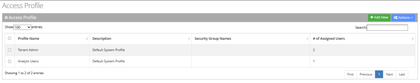

   The Access Profile page is described below:
   - **Profile Name:** Displays the Profile’s name.
   - **Description:** Displays the Profile’s description.
   - **Security Group Names:** Displays the Azure Directory Security Groups that their Voca SSO users are assigned to this profile.
   - **# Of Assigned Users:** Displays the number of local users (non-SSO users) that are assigned manually to this profile.
2. Click **+Add New** to add a new profile, or select an Access Profile and from the ‘Actions’ drop-down menu, choose **Edit Profile**; the following appears:

   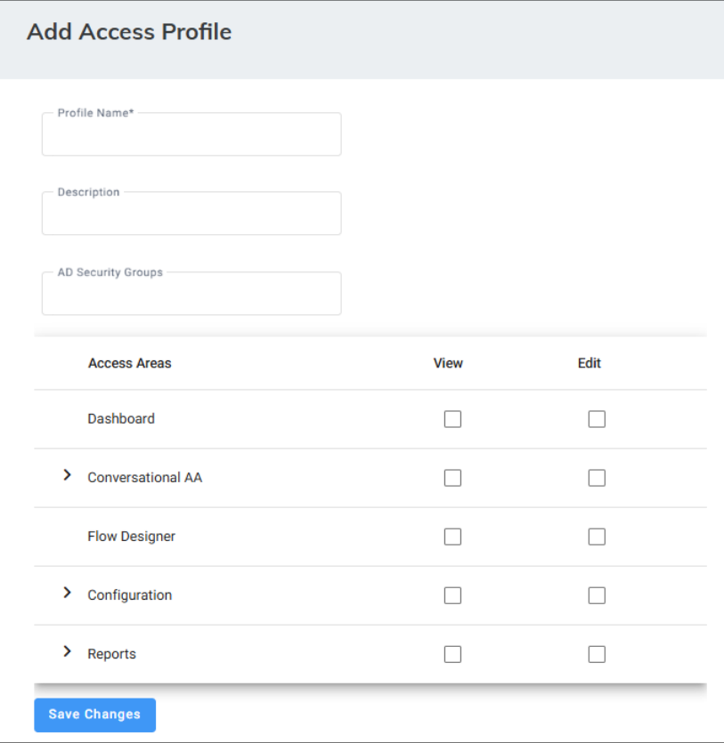

3. In the ' Profile Name' field, enter a name for the profile.
4. (Optional) In the Description field, enter a description of the profile you are creating.
5. In the 'AD Security Groups' field, enter the Azure Directory Security group name/s. This will automatically assign all SSO users in this Security Group to this profile, during the logging process (unless their profiles were selected manually on the User Configuration Page).

   <Note>
   Press **Enter** in the text field for each AD Security Group input, to save the entry.
   </Note>

6. Under 'Access Areas', selectively check specific sections/pages to allow users with this Profile viewing and/or editing those sections/pages.

### Editing Profiles

Customize user access by editing custom profiles. While predefined profiles (Tenant Admin and Analytic Users) are locked and cannot be modified, you can configure their AD Security Groups.

#### To edit a profile

1. Open the User List page (**Configuration** &gt; **Access Management** &gt; **Access Profile**); the following appears:

   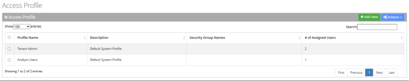

2. Select the profile that you want to edit.

   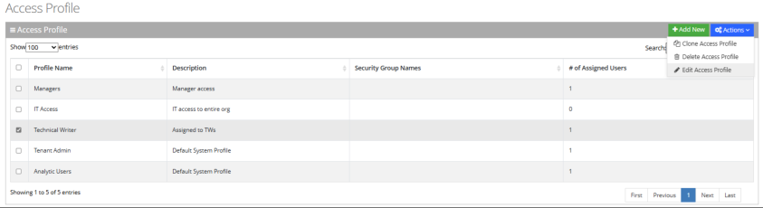

3. From the ‘Actions’ drop-down list, choose **Edit User**; the following appears:

   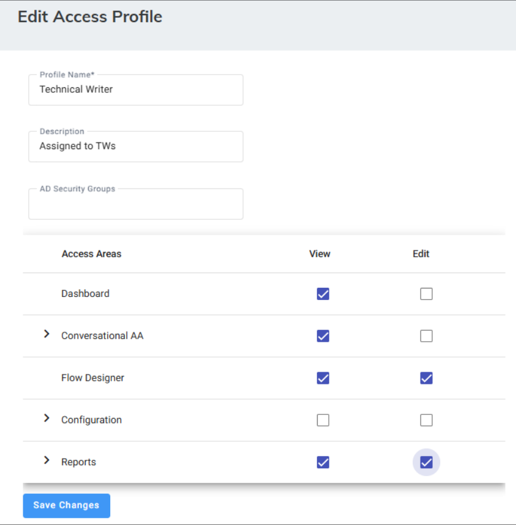

4. Edit the fields you want to change.

   <Note>
   Default profiles (Tenant Admin and Analytic Users) are limited to AD Security Group configuration only.
   </Note>

5. Click **Save Changes**.

### Cloning Profiles

Clone custom profiles you created to quickly create new profiles with similar settings. You cannot clone the default predefined profiles (Tenant Admin and Analytic Users).

#### To clone a profile

1. Open the User List page (**Configuration** &gt; **Access Management** &gt; **Access Profile**); the following appears:

   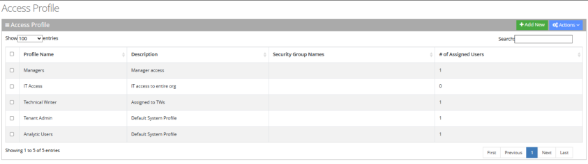

2. Select the custom profile that you want to clone.

   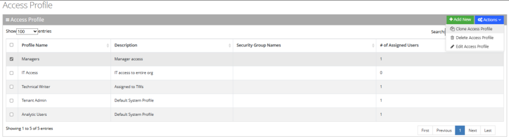

3. From the ‘Actions’ drop-down list, choose **Clone Access Profile.** The following appears:

   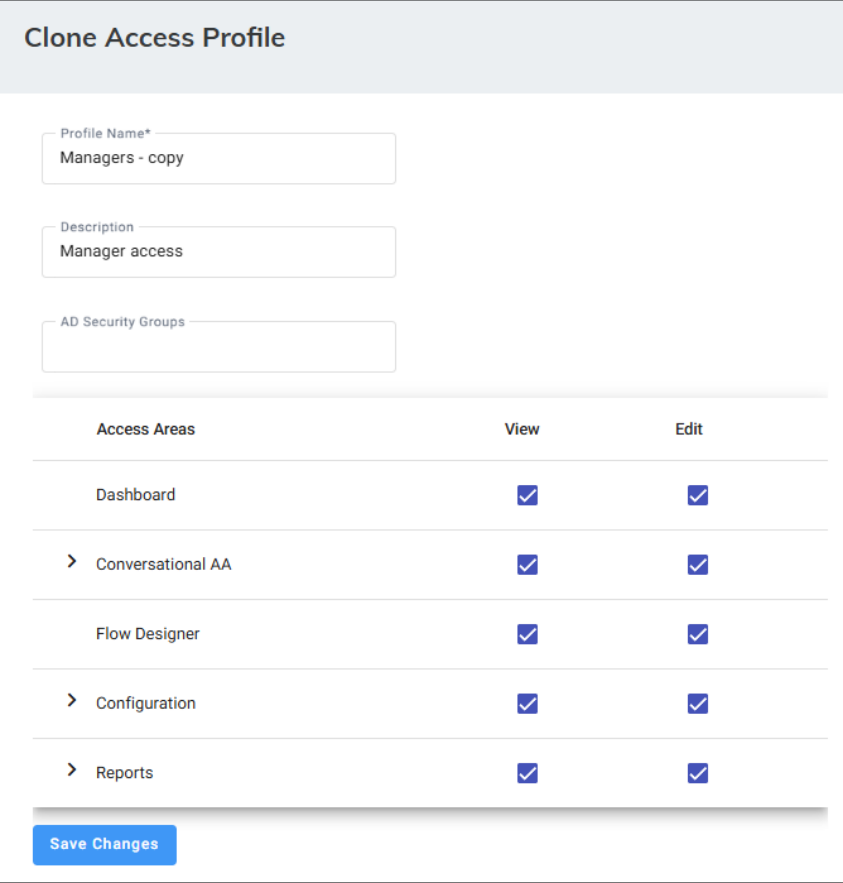

4. You can modify the profile or proceed without modification.
5. Click **Save Changes**.

### Deleting Profiles

Delete custom profiles you created. You cannot delete the default predefined profiles (Tenant Admin and Analytic Users).

#### To delete a profile

1. Open the User List page (**Configuration** &gt; **Access Management** &gt; **Access Profile**); the following appears:

   

2. Select the custom profile that you want to delete.

   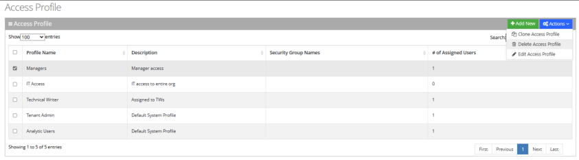

3. From the ‘Actions’ drop-down list, choose **Delete Access Profile.**
4. Click **OK**.

## Recording Links

The [Recording Links](#recording-links) section in Access Management controls who can access call-recording links. In the Worker Call Report, calls that include recordings display a shareable recording link. By default, only Tenant Admins and Tenant Analysts can open these links.

This section describes how to grant additional users or groups access to recording links. Each recorded call is associated with a [Recording Profile](/tenant-administration/admin-06-configuration/admin-06-4-configuring-routing/admin-06-4-3-configuring-recording-profiles). When you grant access to a user or an Azure AD security group for a specific Recording Profile, they can view all recordings associated with that profile.

### Assigning Access to Recording Links

#### To assign access to a recording link

1. Open the Recording Links page (Configuration &gt; Access Management &gt; Recording Links).

   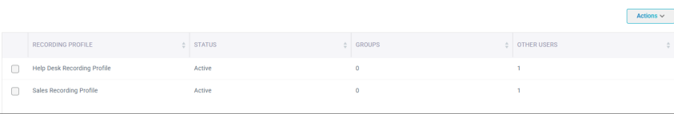

   The Recording Links page is described below:
   - **Recording Profile**: Displays the Recording Profile name.
   - **Status**: Displays the Recording Profile status.
   - **Groups**: Displays the number of Azure AD Security Groups with access to recording links for this profile.
   - **Other Users**: Displays the number of individual users (not part of Azure AD groups) with access to recording links for this profile.
2. Select the Recording Profile that you want to add access to groups/users to access the Recording Profile’s recording links.

   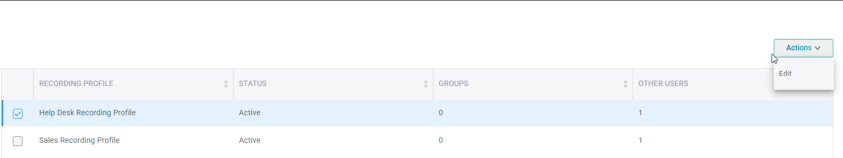

3. From the ‘Actions’ drop-down list, choose “Edit”; the following appears:

   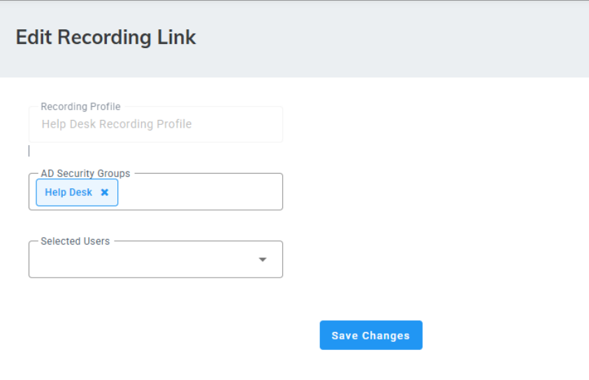

4. In the ‘AD Security Groups’ field, enter the Azure Directory Security group name/s. All SSO users within the selected groups will be granted access to the recordings associated with this Recording Profile.

   <Note>
   Press **Enter** in the text field for each AD Security Group input, to save entry.
   </Note>

5. In the ‘Selected users’ field, choose individual users from the drop-down list to grant them access to the recordings associated with this Recording Profile.
