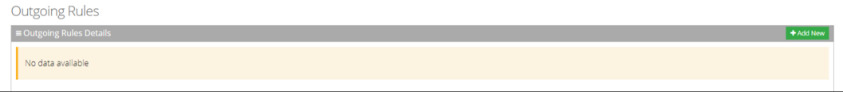
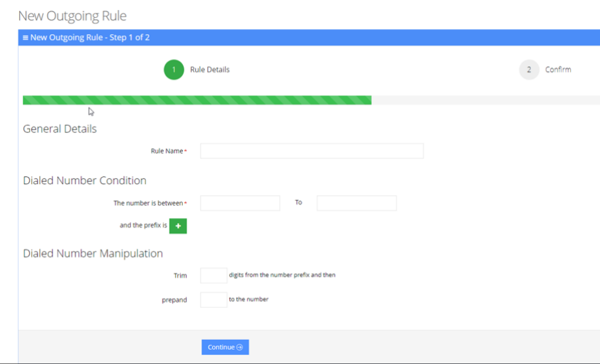
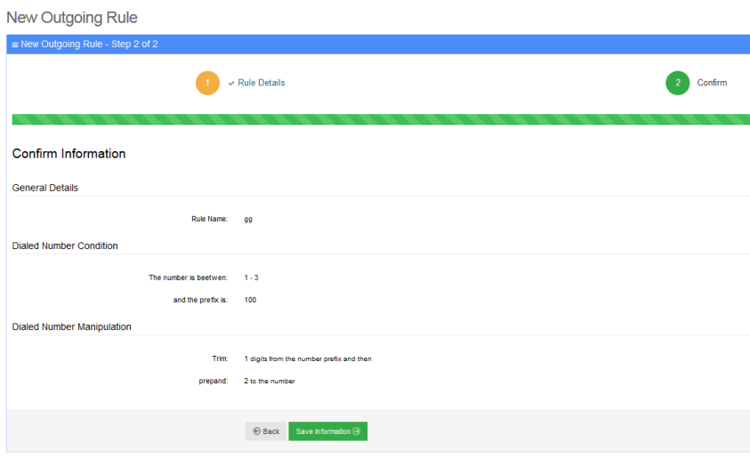
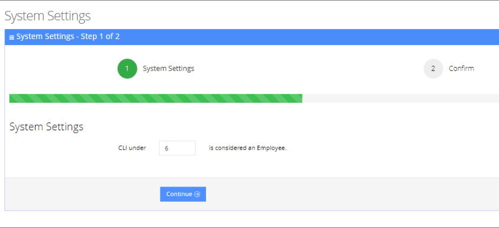
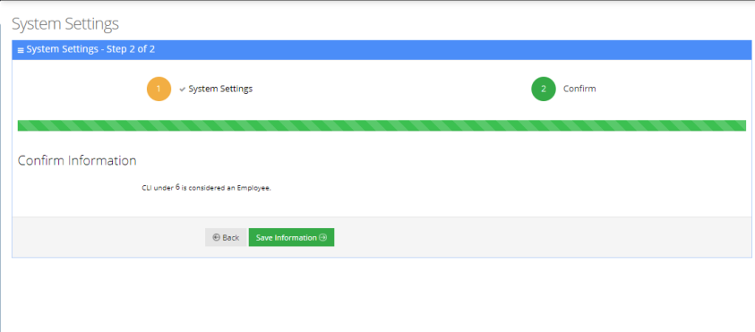

This section gives the Administrator the option to configure and manage inbound and outbound basic routing manipulations on Voca, sent out to the customer's SBC/IP PBX.

## Configuring Outgoing Rules

The procedure below describes how to define outgoing phone number manipulation rules.

### To create a new outgoing rule

1. Open the Outgoing Rules Details screen (**Configuration** &gt; **Dialplan Settings &gt; Outgoing Rules**); the following appears:

   

2. From the Outgoing Rules page, click **Add New**; the following appears:

   

3. Under the General Details group, in the ‘Rule Name’ field, enter the name of the new manipulation rule to be added.
4. Under the Dialed Number Condition group, in the “The number is between” field, enter the number of digits (minimum and maximum) required for the manipulation.
5. Click the Green plus  button to enter a prefix.
6. Under the Dialed Number Manipulation group:
   - In the 'Trim' field, enter the number of digits to be removed from the prefix of the Destination number.
   - In the 'Prepend' field, enter the number to be added to the Destination number.
7. Click **Continue**; the following appears:

   

8. Click **Save Information**.

## Configuring Incoming Rules

The procedure below defines the length of the Caller ID (CLI) field which is used to determine valid employee numbers.

### To configure a new incoming rule

1. Open the [System Settings](/tenant-administration/admin-06-configuration/admin-06-7-system-settings) page (**Configuration** &gt; **Dialplan Settings** &gt; **Incoming Rules**); the following appears:

   

2. Set the CLI to the number of desired digits. In the example below, the CLI is set to be six digits or under. Any Caller ID that is up to six digits long, is considered a valid employee number.
3. Click **Continue**.

   

4. Click **Save Information**.
