You can generate the following Call Queue historical reports and Real-time dashboard view:

- [Report Scheduler](#report-scheduler)
- [Journey Manager Report](#journey-manager-report)
- [Overall Report](#overall-report)
- [Call Date Report](#call-date-report)
- [Drilldown Report](#drilldown-report)
- [Real-time Dashboard](#real-time-dashboard)

## Report Scheduler

The Report Scheduler provides an easy way to automate the generation of reports on a regular and recurring basis by setting up a schedule. Scheduled reports can run at predetermined times and automatically sent to email recipients as attachments.

<Note>
The Report Scheduler functionality is only applicable if Voca is integrated with an email Server. For more information, click here.
</Note>

### Adding a Report Scheduler

The procedure below describes how to add a new Report Scheduler.

#### To add a new Report Scheduler

1. Open the Report Scheduler page (**Reports &gt; Interaction Center Reports &gt; Report Scheduler**); the following appears:

   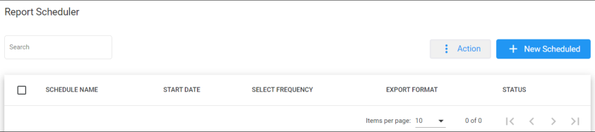

2. The following is a description of all the fields:

   | **Field** | **Description** |
   | --- | --- |
   | Schedule Name | Defines the report scheduler name that was configured. |
   | Start Date | Defines the start dates that were configured on the report scheduler. |
   | Select Frequency | Defines the frequency that this report is sent. |
   | Export Format | Defines the format in which this report is sent. |
   | Status | Defines the status of the schedule report. |

3. Click **+ New Scheduled**; the following appears:

   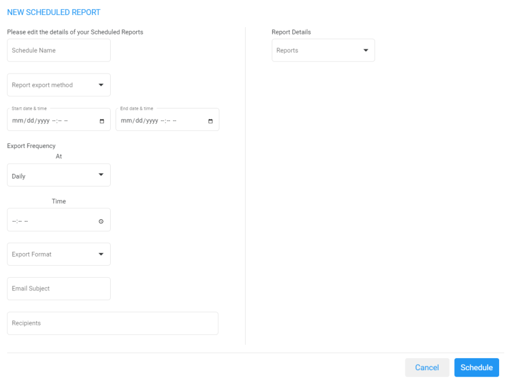

4. The following is a description of the fields that must be entered:

   | **Field** | **Description** |
   | --- | --- |
   | Schedule Name | Defines the name of the scheduled report. |
   | Report Export Method | Defines the method that this report is sent. |
   | Start Date & Time | Defines the first time that this report is run. The Start Date & Time uses the time zone that is configured at the tenant level. |
   | End Date & Time | Defines the last time that this report will be run. The End Date & Time uses the time zone that is configured at the tenant level. |
   | Export Frequency | Defines the recurrence pattern for the scheduled report. |
   | Time | Defines the time that this report will be generated. |
   | Day | Defines the day that this report will be generated. This option is only available when the frequency is set to **Weekly**. |
   | Range | Defines a specific time range within the month, or choose a custom day range within the month that the report will be generated. This option is only available when the frequency is set to **Monthly**. |
   | Export Format | Defines the format that this report is sent in. |
   | Email Subject | Defines the subject name of email that is sent. |
   | Recipients | Defines the recipients who will be receiving the email. More than one recipient can be added. |
   | Reports | Select the report to be scheduled. |

5. The following is a description of the filter that can be applied for this report:

   | **Field** | **Description** |
   | --- | --- |
   | Queue Name | Filter by a specific queue. If that queue is not selected, it will be considered as any queue. |
   | Call Source | Filter by a specific call source. |
   | Call Destination | Filter by a specific call destination. |
   | Wait Time (sec.) | Filter by Wait Time in seconds. |

6. Click **Save Changes**.

### Editing a Report Scheduler

The procedure below describes how to edit a Report Scheduler.

#### To edit a Report Scheduler

1. Open the Report Scheduler page (**Reports &gt; Interaction Center Reports &gt; Report Scheduler**); the following appears:

   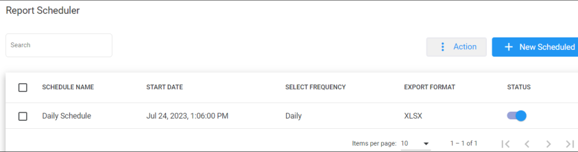

2. Select the report schedule that you wish to edit by selecting the corresponding **Report Schedule** check box.

   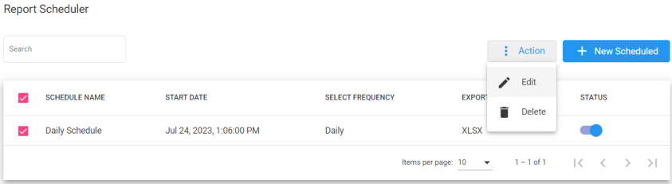

3. From the ‘Actions’ drop-down menu, choose **Edit**; the following appears:

   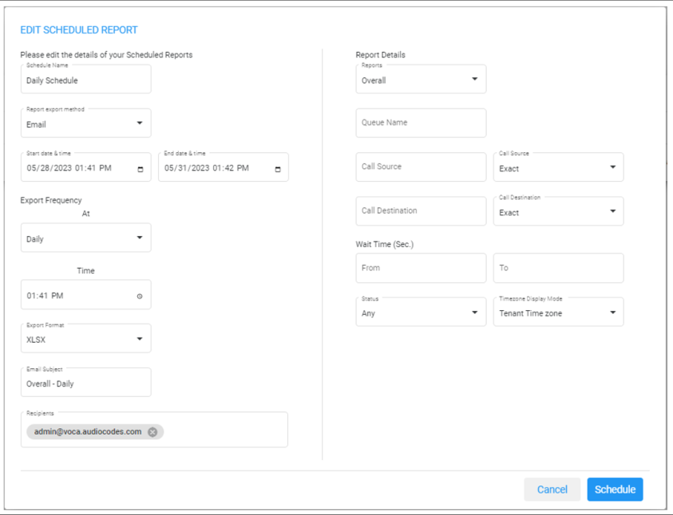

4. Make your changes on the Edit Schedule Report page, and then click **Schedule**.

### Delete a Report Scheduler

The procedure below describes how to delete a Report Scheduler.

#### To delete a Report Scheduler

1. Open the Report Scheduler screen (**Reports** &gt; **Call Queue Reports** &gt; **Report Scheduler**); the following appears:

   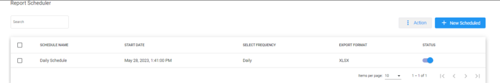

2. Select the report schedule that you wish to delete by selecting the corresponding **Report Schedule** check box.

   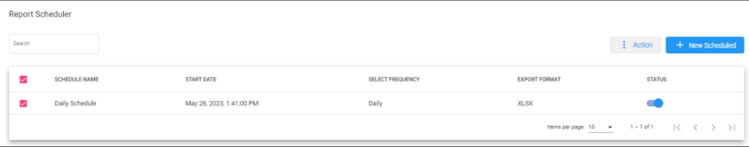

3. From the ‘Actions’ drop-down menu, choose **Delete**.

## Journey Manager Report

The Journey Manager Report displays a summary of calls with a full detailed flow, from the moment the call enters, to the IVR flow, providing all flow interactions.

### To generate the Journey Manager report

1. Open the Journey Manager Report page (**Reports** &gt; **Call Queues Reports** &gt; **Journey Manager**); the following appears.

   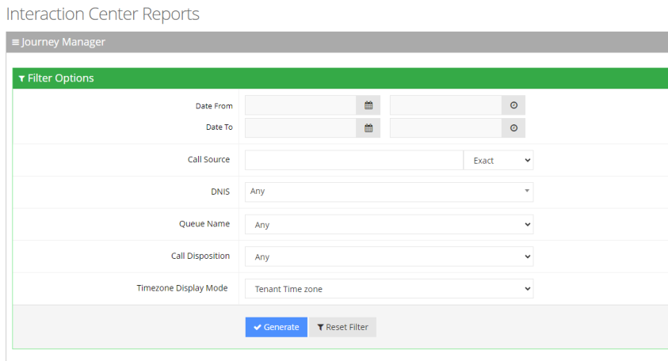

2. Select the appropriate filter fields to generate your report:
   - **Date From:** Displays this report for a specific date/time range.
   - **Date To:** Displays this report for a specific date/time range.
   - **Call Source:** Displays information that is related to a specific source number.
   - **DNIS:** Defines the internal phone number that is called to access Voca. You can select the appropriate value from the drop-down list.
   - **Queue Name:** Defines a specific queue name or 'Any' to show statistics for all call queues.
   - **Call Disposition:** Defines information that relate to calls that end with a specific disposition or “Any’. For an explanation of the different call disposition, refer to [Call Dispositions](/tenant-administration/admin-09-call-dispositions).
   - **Timezone Display Mode:** Displays this report in different time zones. The time zone of calls can be one of the following options:
     - **Tenant time zone:** Displays the information in this report based on the tenant configured time zone.
     - **Flow time zone:** Displays the information in this report based on the time zone configured under the **Telephony Setting** settings.
     - **Local time zone (Web):** Displays the information in this report based on the browser local time zone.
3. Click **Generate** to generate the report; click **Export CSV** to export the report in CSV format.
4. The following is a description of the report fields.

   | **Field** | **Description** |
   | --- | --- |
   | Date | Defines the date of the call. |
   | Timezone | Defines the time zone of the call. |
   | Source | Defines the phone number the call was made from. |
   | Destination | Defines the telephone number that was dialed by the caller. |
   | Duration | Defines the time between when the call is inserted into the queue until the call was transferred, abandoned, or reached the over-flow limit. |
   | DNIS Name | Defines the name of the IVR service. |
   | Queue Name | Defines the Queue name that got the call. |
   | Queue Time | Defines the total time that the customer waited in the queue. |
   | Talk Time | Defines how long the worker was in the talking state. |
   | Disposition | Displays the disposition of the call. |
   | Routed To | Defines the number where the call has been routed to. |

   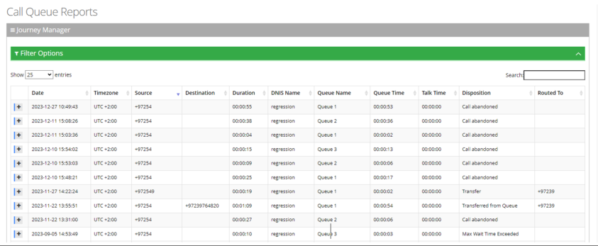

5. Click on any call to view its flow, separated by relevant sections.

   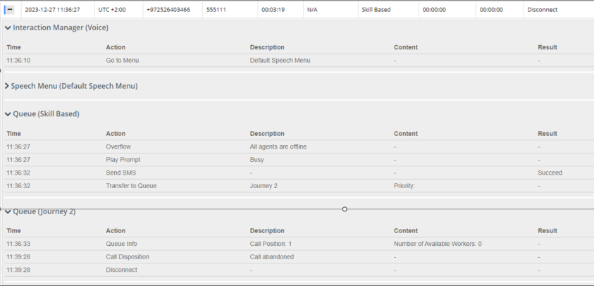

## Overall Report

The Overall Report displays a summary of calls that were transferred, abandoned and overflowed from each queue.

### To generate an Overall report

1. Open the Overall Report page (**Reports** &gt; **Call Queues Reports** &gt; **Overall**); the following appears.

   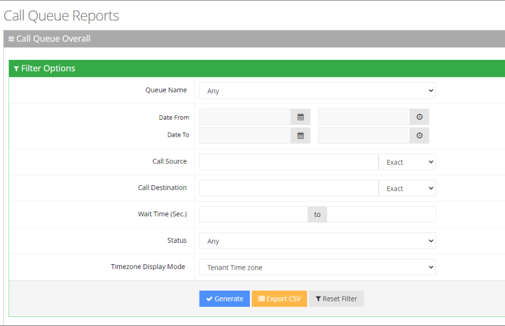

2. Select the appropriate filter fields to generate your report:
   - **Date From:** Display this report for a specific date/time range.
   - **Date To:** Display this report for a specific date/time range.
   - **Call Source:** Display information that is related to a specific source number.
   - **Call Routed:** Display information that is related to call that was routed to a specific destination.
   - **Call Duration:** Display information that is related to a specific duration of a call.
   - **Call Disposition:** Display information that related to calls that ended with a specific disposition or “Any’. For an explanation of the different call disposition, refer to [Call Dispositions](/tenant-administration/admin-09-call-dispositions).
   - **DNIS:** Defines the internal phone number that is called to access Voca. You can select the appropriate value from the drop-down list.
   - **Timezone Display Mode:** Display this report in different time zones. The time zone of calls can be one of the following options:
     - **Tenant time zone:** Display the information in this report based on the tenant configured time zone.
     - **Flow time zone:** Display the information in this report based on the time zone configured under the Telephony Setting settings.
     - **Local time zone (Web):** Display the information in this report on the browser local time zone.
3. The following is a description of the report fields.

   | **Report Column** | **Description** |
   | --- | --- |
   | Disposition | Displays the disposition of the call. |
   | Total Calls | Displays the total number of calls each disposition. |

4. Click **Generate** to generate the report; click **Export CSV** to export the report in CSV format.

   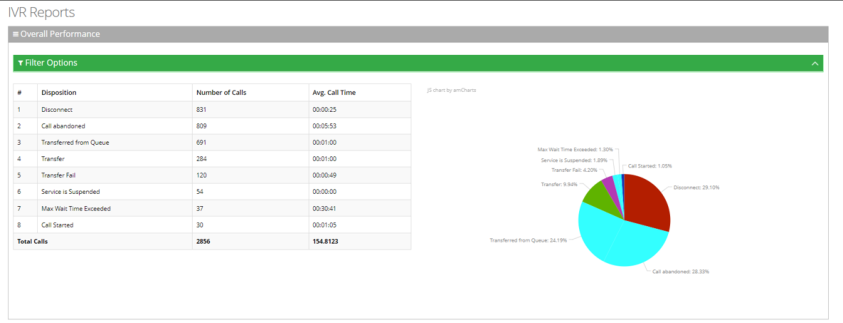

## Call Date Report

The Call Date Report displays a summary of a call's performance on given dates.

### To generate a Call Date IVR report

1. Open the Call Date page (**Reports** &gt; **IVR Reports** &gt; **Call Date**); the following appears.

   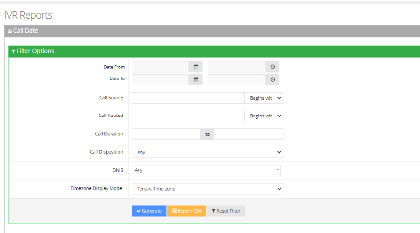

2. Select the appropriate filter fields:
   - **Date From:** Defines this report for a specific date/time range.
   - **Date To:** Defines this report for a specific date/time range.
   - **Call Source:** Defines information that is related to a specific source number.
   - **Call Routed:** Defines information that is related to a call that was routed to a specific destination.
   - **Call Duration:** Defines information that is related to a specific duration of a call.
   - **Call Disposition:** Defines information that related to calls that ended with a specific disposition or “Any’. For an explanation of the different call disposition, refer to [Call Dispositions](/tenant-administration/admin-09-call-dispositions).
   - **DNIS:** Defines the internal phone number that is called to access Voca. You can select the appropriate value from the drop-down list.
   - **Timezone Display Mode:** Defines this report in different time zone. The time zone of calls can be one of the following options:
     - **Tenant time zone:** Defines the information in this report based on the tenant configured time zone.
     - **Flow time zone:** Defines the information in this report based on the time zone configured under the Telephony Setting settings.
     - **Local time zone (Web):** Defines the information in this report on the browser local time zone.
3. The following is a description of the report fields:

   | **Field** | **Description** |
   | --- | --- |
   | Date | Defines the date. |
   | Calls | Defines the number of calls. |
   | Peak Concurrency | Defines the maximum number of concurrent calls the system holds for a specific period of time. |
   | Transfer | Defines the number of transferred calls. |
   | Disconnect | Defines the number of disconnected calls. |
   | Operator | Defines the number of calls moved to the operator for some reason (not Operator Requested or Operator DTMF). |
   | Operator Request | Defines the number of calls moved to the Operator because the user was asked by voice to move the call to the Operator. |
   | Operator DTMF | Defines the number of calls moved to the Operator because the user pressed the DTMF to move the call to the Operator. |
   | Transfer Fail | Defines the number of calls that failed to be transferred. |
   | Not at Working Hours | Defines the number of calls that entered the system, outside of the working hours. |
   | Dropped Calls | Defines the number of calls dropped by the Media Gateway module when it exceeds the number of the concurrent channel license capacity. This deposition parameter represents the dropped calls for the past day. The calls are dropped when the Media Gateway module, which controls the total number of IVR ports, is configured with X number of channels. The X+1 call is rejected by the Media Gateway with SIP Error 404. |
   | Miscellaneous | Defines the number of calls that do not come under other dispositions in this report. |
   | Average Call Time (sec) | Defines the average call time in seconds. |
   | STD Dev Call Time (sec) | Defines the standard deviation in call time in seconds. |
   | Max Call Time (sec) | Defines the maximum call time in seconds. |

4. Click **Generate** to generate the report; click **Export CSV** to export the report in CSV format.

   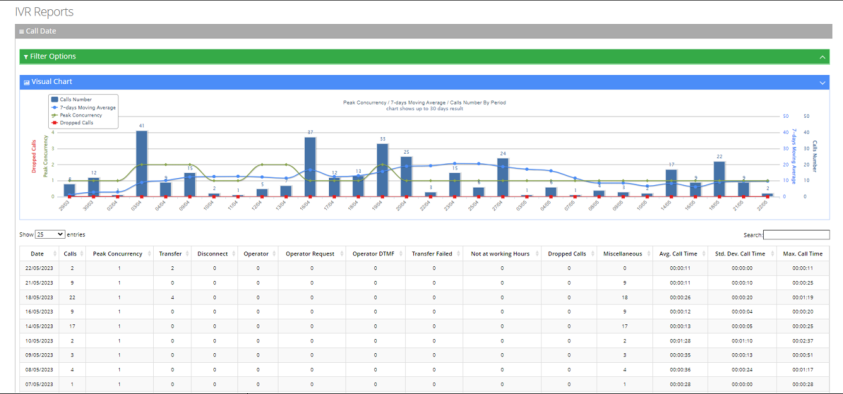

## Drilldown Report

The procedure below describes how to generate an Drilldown report.

### To generate a Drilldown report

1. Open the Call Queue Drilldown page (**Reports** &gt; **Call Queues Report**s &gt; **Drilldown**); the following appears:

   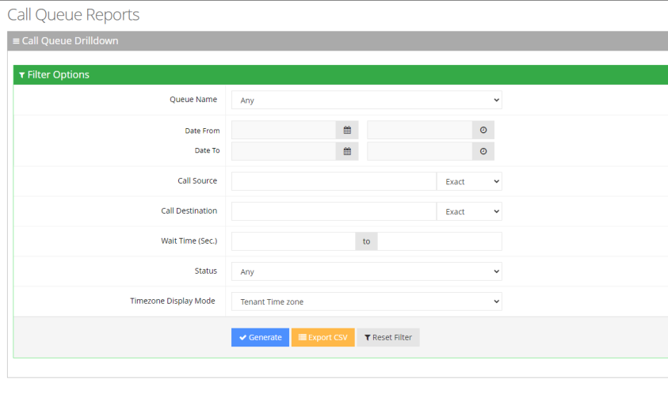

2. Select the appropriate filter fields:
   - **Queue Name:** Select a specific queue name or 'Any' to show statistics for all call queues.
   - **Date From:** Defines the From Date from which the calls were made.
   - **Date To:** Defines the To Date that calls were made till.
   - **Call Source:** Defines the source that calls were made from.
   - **Call Destination:** Defines the destination that calls were routed to from the queue.
   - **Wait Time:** Defines the call waiting time in the queue.
   - **Status:** Defines the disposition of the call when leaving the queue. For an explanation of the different statuses, see [Call Dispositions](/tenant-administration/admin-09-call-dispositions).
   - **Timezone Display Mode:** Define this report in different time zones. The time zone of calls can be one of the following options:
     - **Tenant Time zone:** Defines the information in this report based on the tenant configured time zone.
     - **Flow Time zone:** Defines the information in this report based on the time zone configured under the Telephony settings.
     - **Local Time zone (Web):** Defines the information in this report based on the browser local time zone.
3. The following is a description of the report fields:

   | **Field** | **Description** |
   | --- | --- |
   | Queue Name | Defines the Queue name that got the call. |
   | Source | Defines the originator’s telephone number (ANI – Automatic Number identification). |
   | Destination | Defines the telephone number that was dialed by the caller. |
   | Start Time | Defines the date and time that the call was started. |
   | End Time | Defines the date and time that the call was transferred, abandoned, or reached the overflow limit. |
   | Timezone | Defines the time zone of the call. |
   | Duration | Defines the time between when the call is inserted into the queue until the call was transferred, abandoned, or reached the overflow limit. |
   | Status | Defines if the call was transferred, abandoned, or reached the overflow limit. |

   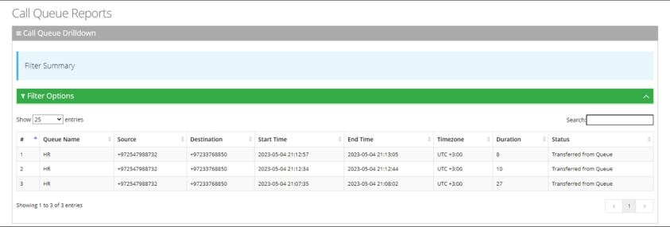

## Callback Detail Report

The Callback Detailed Report provides an overview of all callbacks in the system, including whether they were resolved or unresolved. It also shows the number of attempts made and the specific attempt in which the callback was successfully handled.

### To generate an Callback Detail Report

1. Open the Callback Detail Report page (**Reports** &gt; **Call Queue Reports** &gt; **Callback Detail Report**).

   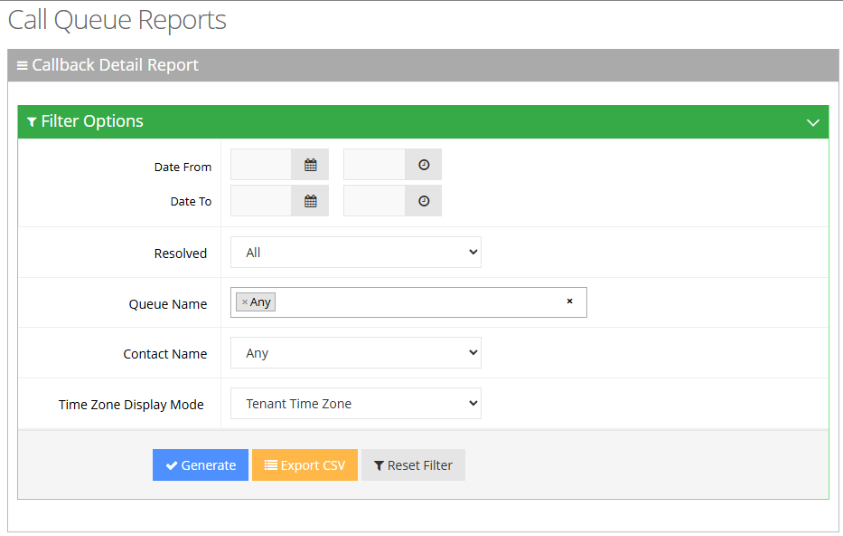

2. Select the appropriate filter fields to generate your report:
   - **Date From:** Defines this report for a specific time range.
   - **Date To:** Defines this report for a specific time range.
   - **Resolved**: Number of times callers engaged with a agent via Callback
   - **Queue Name:** Defines information that is related to a specific queue name or ‘Any’ to show statistics for all call queues.
   - **Contact Name:** Defines information that is related to a specific contact.
   - **Timezone Display Mode:** Display this report in different time zone. The time zone of calls can be one of the following options:
     - **Tenant time zone:** Display the information in this report based on the tenant configured time zone.
     - **Flow time zone:** Display the information in this report based on the time zone configured under the Telephony Setting settings.
     - **Local time zone (Web):** Display the information in this report on the browser local time zone.
3. The following is a description of the report fields.

   | **Report Column** | **Description** |
   | --- | --- |
   | Queue Name | Defines the queue to which the call is queued. |
   | Call Skills | The skill through which the Caller was delivered to the agent. Defines the skills that are associated with the queue to which the call is routed. |
   | Source | The phone number that the contact called from. |
   | Destination | The phone number that the contact dialed to call you. |
   | Request Time | Time of Callback Request |
   | Resolved | **Yes** – Caller engaged with an agent **No** – Caller didn’t engage with an agent |
   | Contact Name | Contact name that accepts the callback call. If Callback isn’t resolved – enter “N/A” |
   | Attempts | The total number of callback attempts, including the one that succeeded. |
   | Attempts Time | Displayed when user use “+” button to extend the record. |
   | Attempt #1 | YYYY/MM/DD HH/MM/SS |
   | Attempt #2 | YYYY/MM/DD HH/MM/SS (If there was no second retry, fill with “N/A”) |
   | Attempt #3 | YYYY/MM/DD HH/MM/SS (If there was no third retry, fill with “N/A”) |

4. Click **Generate** to generate the report; click **Export CSV** to export the report in CSV format.

## Callback Summary Report

The Callback Summary Report provides an overview of all callback requests, showing how many were resolved or unresolved. It also includes the resolution rate and the average number of attempts made to complete a callback.

### To generate a Callback Summary Report

1. Open the Callback Summary Report page (**Reports &gt; Call Queue Reports &gt; Callback Summary Report**); the following appears:
2. 

   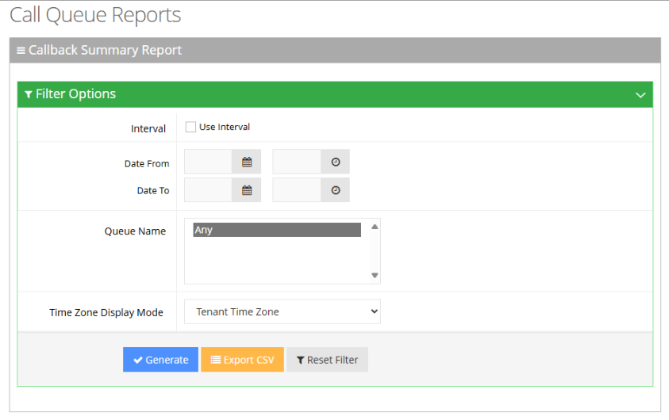

3. Select the appropriate filter fields to generate your report:
   - **Date From:** Defines this report for a specific time range.
   - **Date To:** Defines this report for a specific time range.
   - **Queue Name:** Defines information that is related to a specific queue name or ‘Any’ to show statistics for all call queues.
   - **Timezone Display Mode:** Defines this report in different time zones. The time zone of calls can be one of the following options:
     - **Tenant time zone:** Defines the information in this report based on the tenant configured time zone.
     - **Flow time zone:** Defines the information in this report based on the time zone configured under the Telephony Setting settings.
     - **Local time zone (Web):** Defines the information in this report on the browser local time zone.
4. The following is a description of the report fields.

   | **Report Column** | **Description** |
   | --- | --- |
   | Queue Name | Indicates the Queue name. |
   | Requested | Number of times callers requested a Callback |
   | Resolved | Number of times callers engaged with a agent via Callback |
   | Unresolved | Number of times callers didn’t engaged with a agent after requesting a callback |
   | % Resolved | Resolved / Requested |
   | Avg. Attempts | The total number of callback attempts, including the one that succeeded. |

5. Click **Generate** to generate the report; click **Export CSV** to export the report in CSV format.

## Real-Time Dashboard

The Real-Time Dashboard provides an easy way to monitor the queue activity and to get realtime insights on queues.

### Adding a New Dashboard

The procedure below describes how to add a new dashboard.

#### To add a new dashboard

1. Open the Dashboards page (**Reports &gt; Call Queue Reports &gt; Real-time Dashboard**); the following appears:

   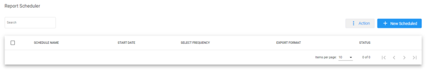

The following is a description of the fields to be entered:

| **Field** | **Description** |
| --- | --- |
| Name | Defines the name of the dashboard. |
| Description | Defines the dashboard description. |
| Dashboard URL | Opens the dashboard in a new window with a permanent link |

2. Click **Add New**; the following appears:

   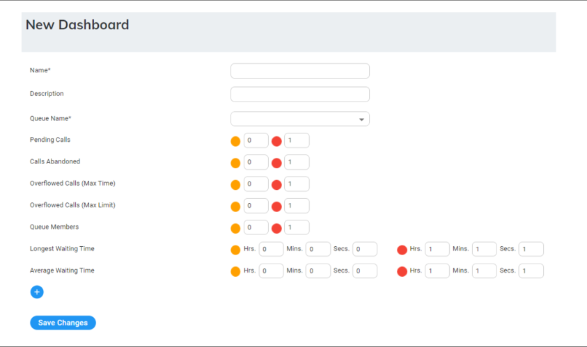

3. The following is a description of the fields to be entered:

   | **Field** | **Description** |
   | --- | --- |
   | Name | Defines the name of the dashboard. |
   | Description | Defines the dashboard description. |
   | Queue Name | Defines the queue to be monitored from the drop-down list. |
   | Pending Calls | Sets the minimum and maximum threshold for calls waiting in the queue. |
   | Calls Abandoned | Sets the minimum and maximum threshold for abandoned calls. |
   | Overflowed Calls (Max Time) | Sets the minimum and maximum threshold for calls that exceeded the Time Limit in the queue level. |
   | Overflowed Calls (Max Limit) | Sets the minimum and maximum threshold for calls that exceeded the Call Limit in the queue level. |
   | Longest Waiting Time | Sets the minimum and maximum threshold for the longest call waiting in the queue (in seconds). |
   | Queue Members | Sets the minimum and maximum threshold for the longest call waiting in the queue. |
   | Longest Waiting Time | Sets the minimum and maximum threshold for the longest waiting time. |
   | Average Waiting Time | Sets the minimum and maximum threshold for the average waiting time. |

Additional queues can be added to the dashboard by pressing the **(+)** button.

<Note>
- The graphic view is generated automatically when up to two queues are configured. If more than two queues are configured, the dashboard displays a table view. The dashboard's data is reset every 24 hours at 00:00.
</Note>

### Editing a Dashboard

The procedure below describes how to edit a dashboard.

#### To edit a dashboard

1. Open the Dashboards screen (**Reports** &gt; **Interaction Center Reports** &gt; **Real-time Dashboard**); the following appears:

   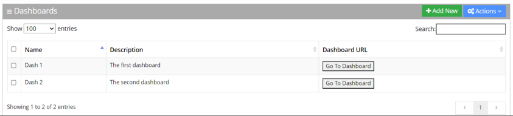

2. Select the dashboard you wish to edit by selecting the corresponding **Dashboards** check box.

   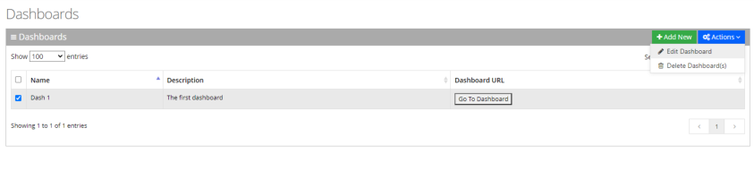

3. From the ‘Actions’ drop-down menu, choose **Edit Dashboard**; the following appears:

   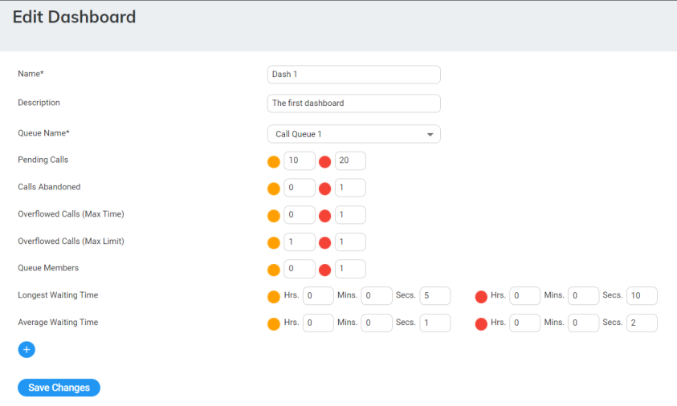

4. Make your changes on the ‘Edit Dashboard’ page, and then click **Save Changes**; the updated Dashboard details appear.

### Deleting a Dashboard

The procedure below describes how to delete a dashboard.

#### To delete a dashboard

1. Open the Dashboards page (**Reports** &gt; **Interaction Center Reports** &gt; **Real-time Dashboard**); the following appears:

   

2. Select the dashboard you wish to delete by selecting the corresponding **Dashboards** check box.

   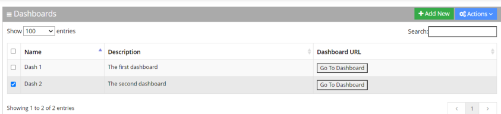

3. From the ‘Actions’ drop-down menu, choose **Delete Dashboard(s)**.

   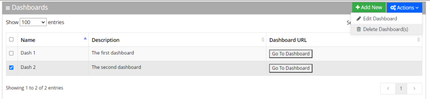

4. The following message appears: "Are you sure you want to delete the selected dashboard (s)?"
5. Click **OK** to delete the selected dashboard.
