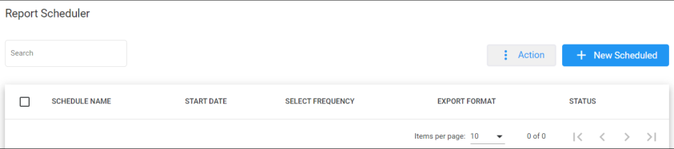
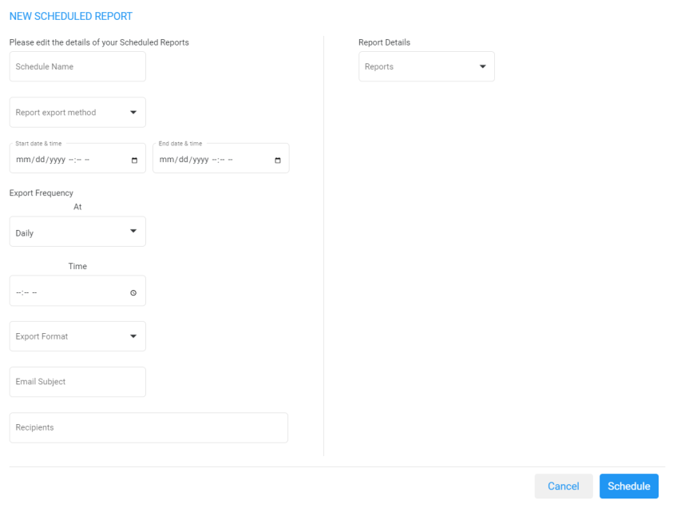
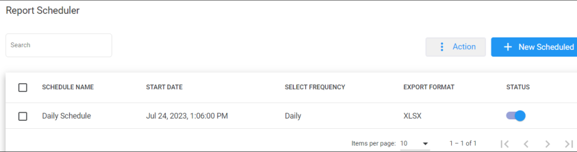
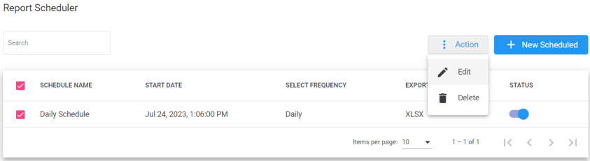
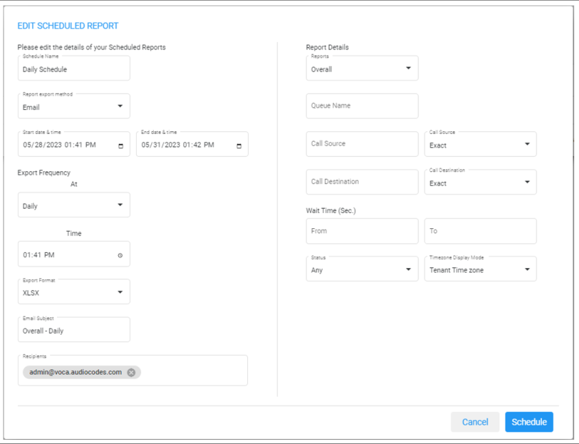
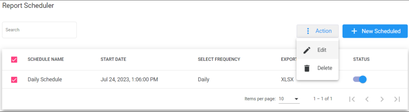

The Report Scheduler provides an easy way to automate the generation of reports on a regular and recurring basis by setting up a schedule. Scheduled reports can run at predetermined times and automatically sent to email recipients as attachments.

<Note>
The Report Scheduler functionality is only applicable if Voca is integrated with an email Server. For more information, click here.
</Note>

## Adding a Report Scheduler

The procedure below describes how to add a new Report Scheduler.

### To add a new Report Scheduler

1. Open the Report Scheduler page (**Reports &gt; Interaction Center Reports &gt; Report Scheduler**); the following appears:

   

2. The following is a description of all the fields:

   | **Field** | **Description** |
   | --- | --- |
   | Schedule Name | Defines the report scheduler name that was configured. |
   | Start Date | Defines the start dates that were configured on the report scheduler. |
   | Select Frequency | Defines the frequency that this report is sent. |
   | Export Format | Defines the format in which this report is sent. |
   | Status | Defines the status of the schedule report. |

3. Click **+ New Scheduled**; the following appears:

   

4. The following is a description of the fields that must be entered:

   | **Field** | **Description** |
   | --- | --- |
   | Schedule Name | Defines the name of the scheduled report. |
   | Report Export Method | Defines the method that this report is sent. |
   | Start Date & Time | Defines the first time that this report is run. The Start Date & Time uses the time zone that is configured at the tenant level. |
   | End Date & Time | Defines the last time that this report will be run. The End Date & Time uses the time zone that is configured at the tenant level. |
   | Export Frequency | Defines the recurrence pattern for the scheduled report. |
   | Time | Defines the time that this report will be generated. |
   | Day | Defines the day that this report will be generated. This option is only available when the frequency is set to **Weekly**. |
   | Range | Defines a specific time range within the month, or choose a custom day range within the month that the report will be generated. This option is only available when the frequency is set to **Monthly**. |
   | Export Format | Defines the format that this report is sent in. |
   | Email Subject | Defines the subject name of email that is sent. |
   | Recipients | Defines the recipients who will be receiving the email. More than one recipient can be added. |
   | Reports | Select the report to be scheduled. |

5. The following is a description of the filter that can be applied for this report:

   | **Field** | **Description** |
   | --- | --- |
   | Queue Name | Filter by a specific queue. If that queue is not selected, it will be considered as any queue. |
   | Call Source | Filter by a specific call source. |
   | Call Destination | Filter by a specific call destination. |
   | Wait Time (sec.) | Filter by Wait Time in seconds. |

6. Click **Save Changes**.

## Editing a Report Scheduler

The procedure below describes how to edit a Report Scheduler.

### To edit a Report Scheduler

1. Open the Report Scheduler page (**Reports &gt; Interaction Center Reports &gt; Report Scheduler**); the following appears:

   

2. Select the report schedule that you wish to edit by selecting the corresponding **Report Schedule** check box.

   

3. From the ‘Actions’ drop-down menu, choose **Edit**; the following appears:

   

4. Make your changes on the Edit Schedule Report page, and then click **Schedule**.

## Deleting a Report Scheduler

The procedure below describes how to delete a Report Scheduler.

### To delete a Report Scheduler

1. Open the Report Scheduler page (**Reports** &gt; **Interaction Center Reports** &gt; **Report Scheduler**); the following appears:

   

2. Select the report schedule that you wish to delete by selecting the corresponding **Report Schedule** check box.

   

3. From the ‘Actions’ drop-down menu, choose **Delete**.
