You can generate the following Voice Interaction Center historical reports:

- Journey Manager
- [Worker Activity Report](#worker-activity-report)
- [Queue Activity Report](#queue-activity-report)
- Abandoned Call Detail Activity Report
- [Worker Call Report](#worker-call-report)
- [Worker State Summary Report](#worker-state-summary-report)
- Worker Login-Logout Report
- [Worker State Detail Report](#worker-state-detail-report)
- [Callback Detail Report](#callback-detail-report)
- [Callback Summary Report](#callback-summary-report)

## Journey Manager Report

The Journey Manager Report displays a summary of calls with a full detailed flow, from the moment it enters to the questions asked and answers provided.

### To generate the Journey Manager report

1. Open the Journey Manager Report page (**Reports** &gt; **Interaction Center Reports** &gt; **Voice Reports** &gt; **Journey Manager**); the following appears:

   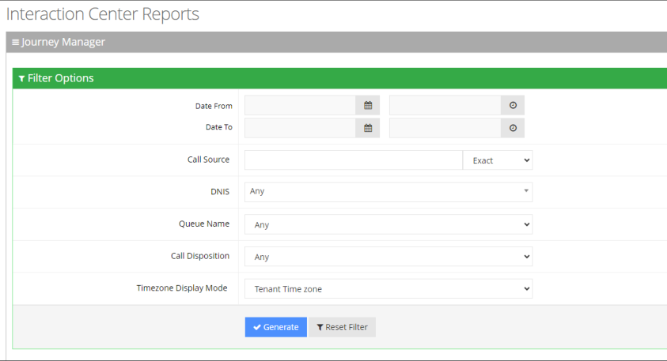

2. Select the appropriate filter fields to generate your report:
   - **Date From:** Displays this report for a specific date/time range.
   - **Date To:** Displays this report for a specific date/time range.
   - **Call Source:** Displays information that is related to a specific source number.
   - **DNIS:** Defines the internal phone number that is called to access Voca. You can select the appropriate value from the drop-down list.
   - **Queue Name:** Defines a specific queue name or 'Any' to show statistics for all call queues.
   - **Call Disposition:** Defines information that relates to calls that ended with a specific disposition or “Any’. For an explanation of the different call disposition, refer to [Call Dispositions](/tenant-administration/admin-09-call-dispositions).
   - **Timezone Display Mode:** Defines this report in different time zones. The time zone of calls can be one of the following options:
     - **Tenant time zone:** Displays the information in this report based on the tenant configured time zone.
     - **Flow time zone:** Displays the information in this report based on the time zone configured under the Telephony Setting settings.
     - **Local time zone (Web):** Displays the information in this report based on the browser local time zone.
3. Click **Generate** to generate the report; click **Export CSV** to export the report in CSV format.
4. The following is a description of the report fields.

   | **Field** | **Description** |
   | --- | --- |
   | Date | Defines the date of the call. |
   | Timezone | Defines the time zone of the call. |
   | Source | Defines the phone number the call was made from. |
   | Destination | Defines the telephone number that was dialed by the caller. |
   | Duration | Defines the time between when the call is inserted into the queue until the call was transferred, abandoned, or reached the over-flow limit. |
   | DNIS Name | Defines the name of the IVR service. |
   | Queue Name | Defines the Queue name that got the call. |
   | Queue Time | Defines the total time that the customer waited in the queue. |
   | Talk Time | Defines how long the worker was in the talking state. |
   | Disposition | Displays the disposition of the call. |
   | Routed To | Defines the number where the call has been routed to. |

   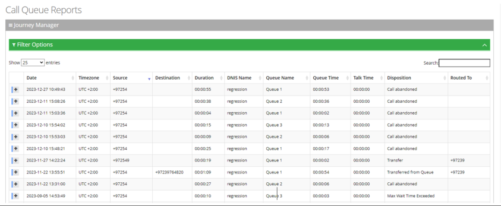

5. Click on any call to view its flow, separated by relevant sections.

   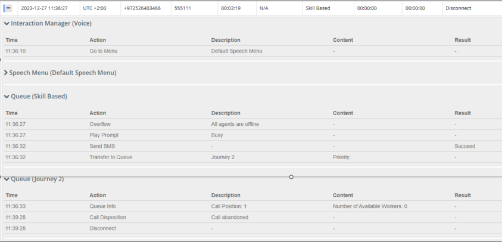

## Worker Activity Report

The Worker Activity Report displays a summary of workers’ activities, including calls and workers state activities.

### To generate a Worker Activity report

1. Open the Worker Activity Report page (**Reports** &gt; **Interaction Center Reports** &gt; **Voice Reports &gt; Worker Activity Report**); the following appears:

   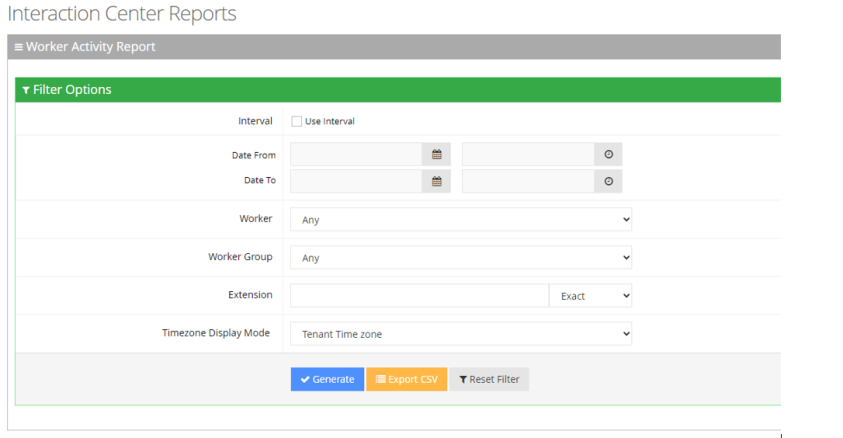

2. Select the appropriate filter fields:
   - **Interval:** Defines how the report's date intervals are segmented. Select the box to reveal a drop-down list of predefined time periods, based on the customer's end date ("Date To"):
     - **Last Day:** Displays data from the past day, segmented by hours.
     - **Last Week:** Displays data from the previous week, separated by days.
     - **Last Month:** Displays data from the previous month, categorized by weeks.
     - **Last Year:** Displays data from the last year, organized by months.
   - **Date From:** Defines this report for a specific date/time range.
   - **Date To:** Defines this report for a specific date/time range.
   - **Workers:** Defines information that is related to a specific worker.
   - **Worker Group:** Defines information that is related to a specific worker group.
   - **Extension:** Defines information that is related to a specific extension.
   - **Timezone Display Mode:** Defines this report in different time zones. The time zone of calls can be one of the following options:
     - **Tenant time zone:** Defines the information in this report based on the tenant configured time zone.
     - **Flow time zone:** Defines the information in this report based on the time zone configured under the **Telephony Setting** settings.
     - **Local time zone (Web):** Display the information in this report on the browser local time zone.
3. The following is a description of the report fields.

   | **Field** | **Description** |
   | --- | --- |
   | Worker Name | Defines the first name and last name of the Worker. |
   | Worker Extension | Defines the Worker's extension number. |
   | Total Calls | Defines the total number of outbound and inbound calls. |
   | Outbound Calls | Defines the total number of outbound calls. Outbound calls refer to calls that workers manually dial. |
   | Inbound Calls | Defines the total number of inbound calls. Inbound calls refer to calls received by workers via queues or direct calls. |
   | Calls Presented | Defines the number of calls routed to the Worker, regardless of whether the Worker picked up the call. |
   | Calls Handled | Defines the number of calls that were accepted by the worker. |
   | Calls Declined | Defines the number of calls that were not answered or were declined by the Worker. |
   | Calls Handle Ratio (%) | Defines the Handle ratio = Calls that the Worker handled / Calls that are routed to the Worker (Overall percentage). |
   | Transfer Out | Defines the available field for queued calls. Defines the number of calls that were transferred by the worker to other workers. |
   | Max Talk Time | Defines the longest talk time of any call that the Worker handled. Talk Time refers to the elapsed time, between the time a Worker connects to a call and the time that the call is disconnected or transferred, including hold time. |
   | Avg. Talk Time | Defines the average talk time for calls that the Worker handled. |
   | Avg. Hold Time | Defines the average hold time for calls that the Worker handled. |
   | Max. Hold Time | Defines the longest hold time of any call that the Worker handled. |
   | Avg. Consult Time | Defines the average consult time of any call that the Worker handled. |
   | Max Consult Time | Defines the longest consult time of any call that the Worker handled. |

4. Click **Generate** to generate the report; click **Export CSV** to export the report in CSV format.

   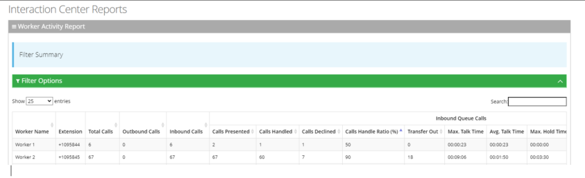

## Queue Activity Report

The Queue Activity Report displays summarized information of calls for each queue - e.g., Presented, Handled and Abandoned.

The procedure below describes how to generate a Queue Activity Report.

### To generate a queue activity report

1. Open the Queue Activity Report page (**Reports &gt; Interaction Center Reports &gt; Voice Reports &gt; Queue Activity Report**); the following appears:

   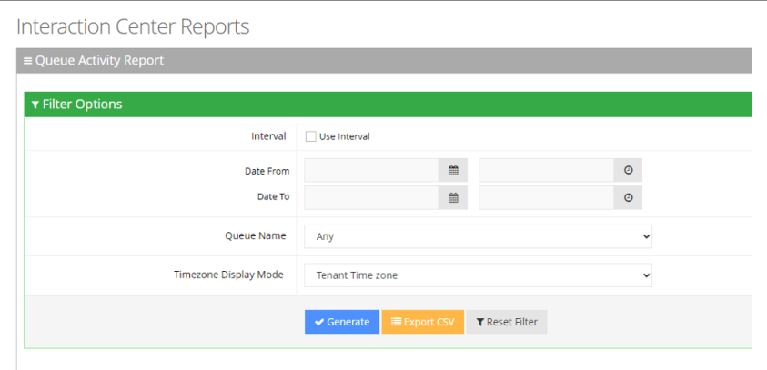

2. Select the appropriate filter fields to generate your report:
   - **Interval:** Defines how the report's date intervals are segmented. Select the check-box to reveal a drop-down list of predefined time periods, based on the customer's end date ("Date To"):
     - **Last Day:** Displays data from the past day, segmented by hours.
     - **Last Week:** Shows data from the previous week, separated by days.
     - **Last Month:** Presents data from the previous month, categorized by weeks.
     - **Last Year:** Displays data from the last year, organized by months.
   - **Date From:** Defines this report for a specific date/time range.
   - **Date To:** Defines this report for a specific date/time range.
   - **Queue Name:** Defines information that is related to a specific queue name or ‘Any’ to show statistics for all call queues.
   - **Timezone Display Mode:** Defines this report in a different time zone.
     - **Tenant time zone:** Defines the information in this report based on the tenant configured time zone.
     - **Flow time zone:** Defines the information in this report based on the time zone configured under the **Telephony Setting** settings.
     - **Local time zone (Web):** Defines the information in this report on the browser local time zone.
3. The following is a description of the report fields.

   | **Field** | **Description** |
   | --- | --- |
   | Queue Name | Defines the queue to which the call is queued. |
   | Calls Presented | Defines the number of calls routed to the queue, regardless of whether a Worker picked up the call. |
   | Calls Handled | Defines the number of calls that are handled by this Queue. A call is handled if a caller is connected to a Worker while queued for this Queue. |
   | Max. Handle Time | Defines the longest handle time of any call that the queue handled by the Worker. |
   | Avg. Handle Time | Defines the average handle time for all calls that the queue handled by the Worker. |
   | Avg. Queue Time | Defines the average queue time for all calls routed to the Queue, Including answered and abandoned calls. |
   | Max. Queue Time | Defines the longest queue time of any one call that was routed to the Queue. |
   | Avg. Answer Speed | Defines the Average Answer Speed = Total queue time / Calls handled. |
   | Num. of Abandoned Call | Defines the calls that are routed to the queue that were not answered by a Worker because the caller hung up while in the queue |
   | Abandoned – Avg. | Defines the average time the calls are in the queue before being abandoned. |
   | Abandoned – Max. | Defines the longest time any call is in the queue before being abandoned. |
   | Abandoned – Avg. per Day | Defines the average time any call is in the queue before being abandoned. |
   | Abandoned – Max. per Day | Abandoned – Max. per Day, defines the average abandoned calls in a day = Number of calls abandoned / Number of days. |
   | Overflow - Max Call Limit | Defines the number of all the calls that overflowed due to exceeding the defined threshold for call limits (in number of calls) for each queue. |
   | Overflow - Max Wait Time | Overflow - Max Wait Time Defines the number of all the calls that overflowed due to exceeding the defined threshold for waiting time (in seconds) for each queue. |
   | Overflow - Max Waiting Time | Defines the number of all the calls that overflowed when all agents are logged out. |

4. Click **Generate** to generate the report; click **Export CSV** to export the report in CSV format.

   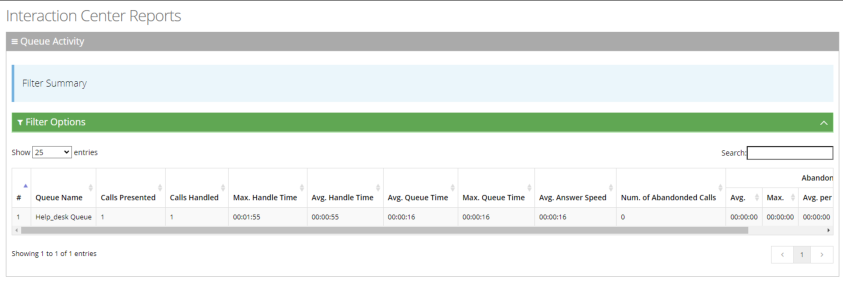

## Abandoned Call Report

An Abandoned Call Report displays the actual information about calls that were abandoned.

The procedure below describes how to generate an Abandoned Call Detail Report.

### To generate an Abandoned Call Report

1. Open the Abandoned Call Report page (**Reports** &gt; **Interaction Center Reports** &gt; **Voice Reports &gt; Abandoned Call Report**); the following appears:

   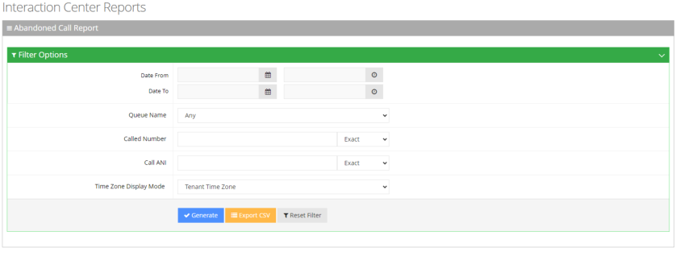

2. Select the appropriate filter fields:
   - **Date From:** Defines this report for a specific time range.
   - **Date To:** Defines this report for a specific time range.
   - **Queue Name:** Defines information that is related to a specific queue name or ‘Any’ to show statistics for all call queues.
   - **Called Number:** Defines information that is related to a specific destination number.
   - **Called ANI:** Defines information that is related to a specific source number.
   - **Timezone Display Mode:** Defines this report in different time zones. The time zone of calls can be one of the following options:
     - **Tenant time zone:** Defines the information in this report based on the tenant configured time zone.
     - **Flow time zone:** Defines the information in this report based on the time zone configured under the **Telephony Setting** settings.
     - **Local time zone (Web):** Defines the information in this report on the browser local time zone.

The following is a description of the report fields.

| **Field** | **Description** |
| --- | --- |
| Call Start Time | Defines the date and time that the call started. |
| Called Number | Defines the telephone number that was dialed by the caller. |
| Call ANI | Defines the originator’s telephone number ANI (Automatic Number identification). |
| Call Routed Queue | Defines the queue to which the call is queued. |
| Call Abandonment Time | Defines the date and time the call was abandoned. |
| Time to Abandon | Defines the elapsed time between the time the call comes to the system and the time it is abandoned. |

3. Click **Generate** to generate the report; click **Export CSV** to export the report in CSV format.

   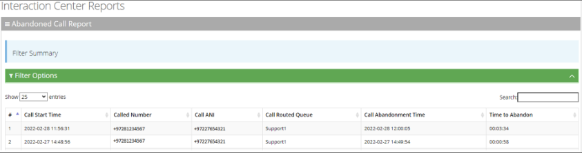

## Worker Call Report

The Worker Call Report presents a summary of each call that is dialed and received by the Worker. The report also includes the type of each call (Inbound/Outbound).

### To generate an Worker Call Report

1. Open the Worker Call Report page (**Reports** &gt; **Interaction Center Reports** &gt; **Voice Reports &gt; Worker Call Report**); the following appears:

   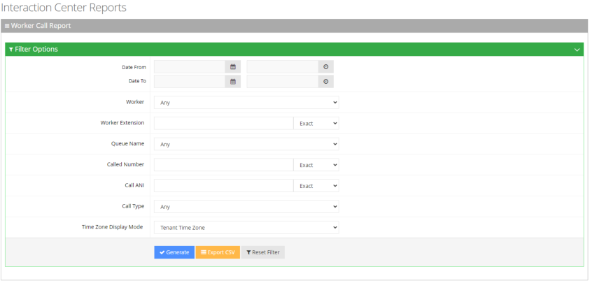

2. Select the appropriate filter fields to generate your report:
   - **Date From:** Defines this report for a specific time range.
   - **Date To:** Defines this report for a specific time range.
   - **Workers:** Defines information that is related to a specific worker.
   - **Workers Extension:** Defines information that is related to a specific extension.
   - **Queue Name:** Defines information that is related to a specific queue name or ‘Any’ to show statistics for all call queues.
   - **Called Number:** Defines information that is related to a specific destination number.
   - **Call ANI:** Defines information that is related to a specific source number.
   - **Call Type:** Defines information that is related to a specific call type:
     - **Any:** Defines the information that is related to inbound and outbound calls.
     - **Inbound:** Defines the information that is related to all the inbound calls.
     - **Outbound:** Defines the information that is related to all the outbound calls.
   - **Timezone Display Mode:** Display this report in different time zone. The time zone of calls can be one of the following options:
     - **Tenant time zone:** Display the information in this report based on the tenant configured time zone.
     - **Flow time zone:** Display the information in this report based on the time zone configured under the Telephony Setting settings.
     - **Local time zone (Web):** Display the information in this report on the browser local time zone.
3. The following is a description of the report fields.

   | **Report Column** | **Description** |
   | --- | --- |
   | Worker Name | Defines the name of the worker. |
   | Worker Extension | Defines the extension of the worker. |
   | Call Start Time | Defines the date and time the call started. |
   | Call End Time | Defines the date and time the call ended. |
   | Call Type | Defines whether the call was inbound or outbound. |
   | Answering Device | Defines whether the call was answered via the Voca Worker App or via Microsoft Teams. |
   | Call Duration | Defines the duration of the call. |
   | Status | Defines whether the call was ‘Accepted’ or ‘Declined’ by the worker. |
   | Called Number | Defines the telephone number that the caller dialed. |
   | Call ANI | Defines the originator's telephone number (ANI = Automatic Number Identification). |
   | Call Routed Queue | Defines the queue to which the call is queued. |
   | Call Skills | Defines the skills that are associated with the queue to which the call is routed. |
   | Participants | Defines the number of additional participants added to the call. |
   | Talk Time | Defines how long the worker was in the talking state. |
   | Hold Time | Defines how long the call was put on hold. |
   | Consult Time | Defines how long the Worker connected with supervisors or others for consultation. |
   | Wrap-up Time | Defines how long the Worker was in Wrap-up state. |
   | Wrap-up State | Defines the selected Wrap-up state. |

   **Report ColumnDescription**

RecordingDefines whether the call was recorded or not.

SentimentDefines the emotional tone of the call.

4. Click **Generate** to generate the report; click **Export CSV** to export the report in CSV format.

   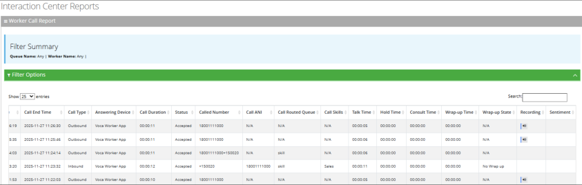

5. Expand call record to view call recording details.
   - For any recorded call, you can:
     - **Listen** to the call recording using playback controls that allow you to forward or rewind by 10 seconds for easy navigation.
     - **Download the recording**. From the **Save Call** drop-down, select **Recording** and click **Save**.
     - **Share** call recording link by clicking the **Copy link** icon, located to the right of the playback controls. By default, only Tenant Admins and Tenant Analysts can access these links. To grant additional users or groups access to recording link, see the [Recording Links](/tenant-administration/admin-06-configuration/admin-06-8-access-management#recording-links) configuration under the [Access Management](/tenant-administration/admin-06-configuration/admin-06-8-access-management) 177 section.
   - If the call used the Agent Insights Add-on, you can also view:
     - **Transcript**
     - **Summary**
     - **Sentiment** - the emotional tone of the call, which can be:
       - **Positive** – The conversation was constructive and friendly.
       - **Negative** – The conversation involved frustration or conflict.
       - **Neutral** – The conversation was matter-of-fact with no strong emotions.
       - **Combined sentiments (e.g., Neutral–Negative)** – The call’s tone shifted

       during the conversation. For example, the call may have started professionally but became tense as the agent or customer grew frustrated.
   - **Additional Notes** - You can view agent’s notes added at the end of the call.

     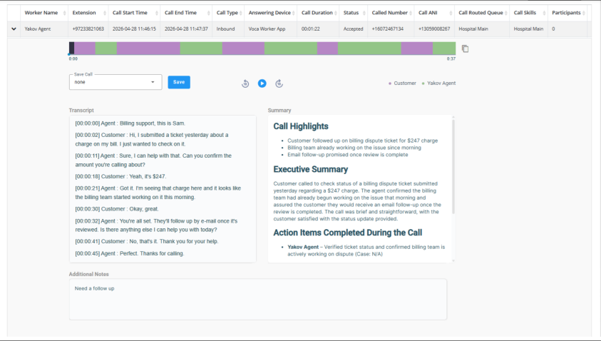

## Worker Login-Logout Report

The Worker Login-Logout Report presents the workers’ Logged-in and Logged-out times. This report is separated by each Worker’s name.

### To generate a Worker State Report

1. Open the Worker Login-Logout Report page (**Reports** &gt; **Interaction Center Reports** &gt; **Voice Reports &gt; Worker Login-Logout Report**); the following appears:

   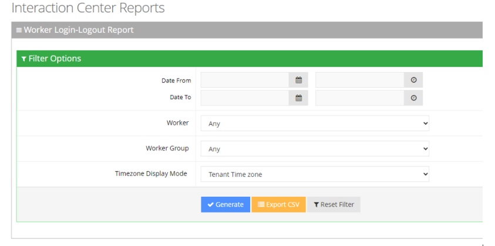

2. Select the appropriate filter fields to generate your report:
   - **Date From:** Defines this report for a specific time range.
   - **Date To:** Defines this report for a specific time range.
   - **Worker:** Defines information that is related to a specific worker.
   - **Worker Group:** Defines information that is related to a specific worker group.
   - **Timezone Display Mode:** Defines this report in different time zones. The time zone of calls can be one of the following options:
     - **Tenant time zone:** Defines the information in this report based on the tenant configured time zone.
     - **Flow time zone:** Defines the information in this report based on the time zone configured under the Telephony Setting settings.
     - **Local time zone (Web):** Defines the information in this report on the browser local time zone.
3. The following is a description of the report fields.

   | **Report Column** | **Description** |
   | --- | --- |
   | Worker Name | Defines the name of the worker. |
   | Logged-In Time | Defines the date and hour of the login. |
   | Logged-Out Time | Defines the date and hour of the logout. |
   | Logged-Out Reason | Defines the cause of the logout: 1. Supervisor Logout: When the supervisor logs out the worker. 2. Connection Lost: Indicating network issues. 3. Worker Logout: Worker-initiated logout from the Worker Application. |
   | Duration | Defines the elapsed time between the login and logout time. |

4. Click **Generate** to generate the report; click **Export CSV** to export the report in CSV format.

   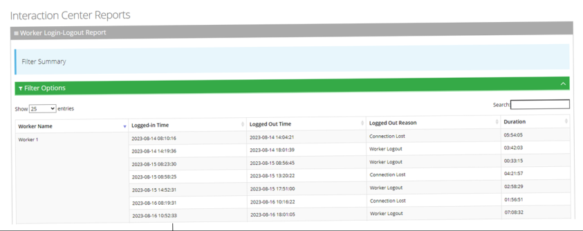

## Worker State Detail Report

The Worker State Detail Report displays the amount of time that workers spend in different states. The Report provides a detailed breakdown of the Workers’ state transitions. This report is divided by the Worker’s name.

### To generate a Worker State Detail Report

1. Open the Worker State Detail Report page (**Reports** &gt; **Interaction Center Reports** &gt; **Voice Reports &gt; Worker State Detail Report**); the following appears:

   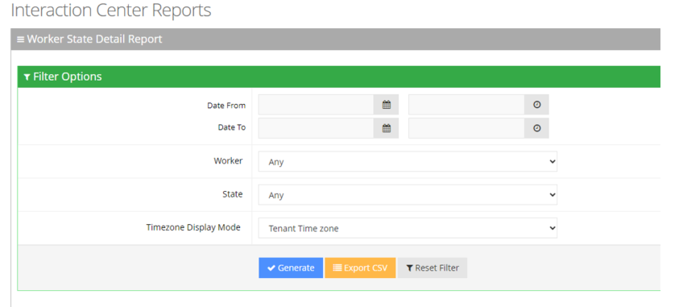

2. Select the appropriate filter fields to generate your report:
   - **Date From:** Defines this report for a specific time range.
   - **Date To:** Defines this report for a specific time range.
   - **Workers:** Defines information that is related to a specific worker.
   - **State:** Defines information that is related to a specific worker state or “Any’. The worker state can be any of the following values:
     - **Any:** Defines the information that related to all states.
     - **Logged-in:** Defines the information that is related only to the login time.
     - **Not Ready:** Defines the information that related only to the not ready time.
     - **In a Call:** Defines the information that is related only to the talking time.
     - **Wrap-up:** Defines the information that is related only to the wrap-up time.
   - **Timezone Display Mode:** Defines this report in different time zones. The time zone of calls can be one of the following options:
     - **Tenant time zone:** Defines the information in this report based on the tenant configured time zone.
     - **Flow time zone:** Defines the information in this report based on the time zone configured under the Telephony Setting settings.
     - **Local time zone (Web):** Defines the information in this report on the browser local time zone.
3. The following is a description of the report fields.

   | **Report Column** | **Description** |
   | --- | --- |
   | Worker Name | Defines the name of the worker. |
   | State | Defines the various states in which a Worker can be in. |
   | Sub State | Defines the 'Sub' state information related to the state (e.g., Not- Ready reasons). |
   | Start Time | Defines the start date and hour. |
   | End Time | Defines the end date and hour. |
   | Duration | Defines the amount of time a worker spends in a particular state. |

4. Click **Generate** to generate the report; click **Export CSV** to export the report in CSV format.

   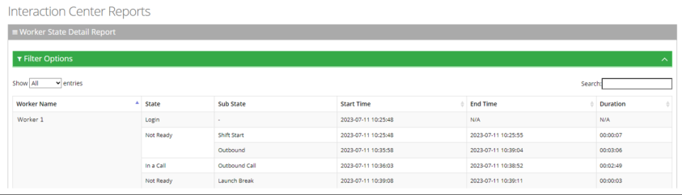

## Worker State Summary Report

The Worker State Summary Report displays a summary of the time workers spend in various states. This report is divided by Worker’s names.

### To generate a Worker State Report

1. Open the Worker State Summary Report page (**Reports** &gt; **Interaction Center Reports** &gt; **Voice Reports &gt; Worker State Summary Report**); the following appears:

   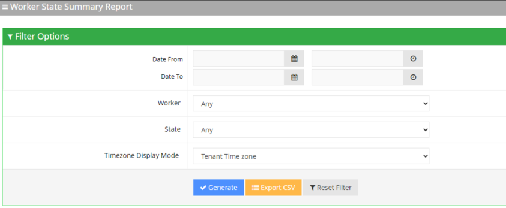

2. Select the appropriate filter fields to generate your report:
   - **Date From:** Defines this report for a specific time range.
   - **Date To:** Defines this report for a specific time range.
   - **Worker:** Defines information that is related to a specific worker.
   - **State:** Defines information that is related to a specific worker state or “Any’. The worker state can be any of the following values:
     - **Any:** Defines the information that relates to all states.
     - **Logged-in:** Defines the information that is related only to the login time.
     - **Ready:** Defines the information that is related only to the ready time.
     - **Not Ready:** Defines the information that is related only to the not ready time.
     - **In a Call:** Defines the information that is related only to the talking time.
     - **Wrap-up:** Defines the information that is related only to the wrap-up time.
   - **Timezone Display Mode:** Defines this report in different time zones. The time zone of calls can be one of the following options:
     - **Tenant time zone:** Defines the information in this report based on the tenant configured time zone.
     - **Flow time zone:** Defines the information in this report based on the time zone configured under the Telephony Setting settings.
     - **Local time zone (Web):** Defines the information in this report on the browser local time zone.
3. The following is a description of the report fields.

   | **Report Column** | **Description** |
   | --- | --- |
   | Worker Name | Defines the name of the worker. |
   | State | Defines the various states in which a worker can be. |
   | Sub State | Defines the 'Sub' state information related to the state (e.g., Not- Ready reasons). |
   | Total | Defines the total time the worker spent on a sub state. |

4. Click **Generate** to generate the report; click **Export CSV** to export the report in CSV format.

   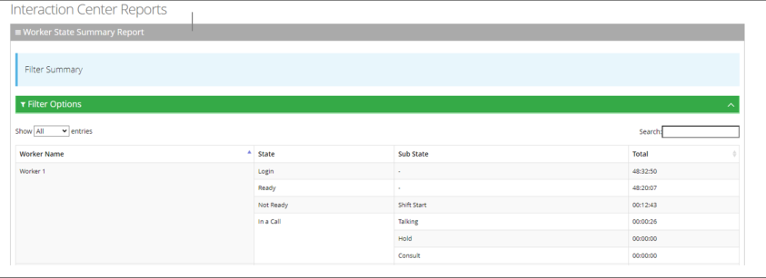

## Callback Detail Report

The Callback Detailed Report provides an overview of all callbacks in the system, including whether they were resolved or unresolved. It also shows the number of attempts made and the specific attempt in which the callback was successfully handled.

### To generate an Callback Detail Report

1. Open the Callback Detail Report page (**Reports** &gt; **Interaction Center Reports** &gt; **Voice Reports** &gt; **Callback Detail Report**); the following appears:

   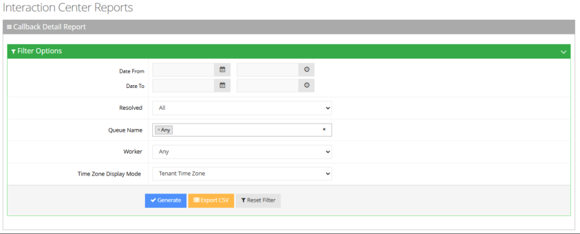

2. Select the appropriate filter fields to generate your report:
   - **Date From:** Defines this report for a specific time range.
   - **Date To:** Defines this report for a specific time range.
   - **Resolved**: Number of times callers engaged with a Worker via Callback
   - **Queue Name:** Defines information that is related to a specific queue name or ‘Any’ to show statistics for all call queues.
   - **Worker:** Defines information that is related to a specific worker.
   - **Timezone Display Mode:** Display this report in different time zone. The time zone of calls can be one of the following options:
     - **Tenant time zone:** Display the information in this report based on the tenant configured time zone.
     - **Flow time zone:** Display the information in this report based on the time zone configured under the Telephony Setting settings.
     - **Local time zone (Web):** Display the information in this report on the browser local time zone.
3. The following is a description of the report fields.

   | **Report Column** | **Description** |
   | --- | --- |
   | Queue Name | Defines the queue to which the call is queued. |
   | Call Skills | The skill through which the Caller was delivered to the agent. Defines the skills that are associated with the queue to which the call is routed. |
   | Source | The phone number that the contact called from. |
   | Destination | The phone number that the contact dialed to call you. |
   | Request Time | Time of Callback Request |
   | Resolved | **Yes** – Caller engaged with an agent **No** – Caller didn’t engage with an agent |
   | Worker Name | Worker name that accepts the callback call. If Callback isn’t resolved – enter “N/A” |
   | Attempts | The total number of callback attempts, including the one that succeeded. |
   | Attempts Time | Displayed when user use “+” button to extend the record. |
   | Attempt #1 | YYYY/MM/DD HH/MM/SS |
   | Attempt #2 | YYYY/MM/DD HH/MM/SS (If there was no second retry, fill with “N/A”) |
   | Attempt #3 | YYYY/MM/DD HH/MM/SS (If there was no third retry, fill with “N/A”) |

4. Click **Generate** to generate the report; click **Export CSV** to export the report in CSV format.

   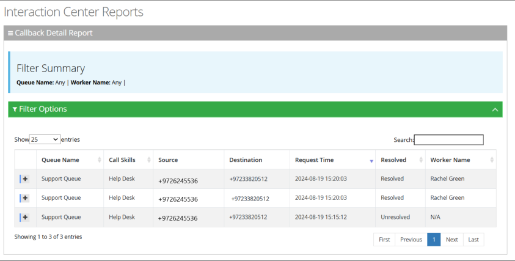

## Callback Summary Report

The Callback Summary Report provides an overview of all callback requests, showing how many were resolved or unresolved. It also includes the resolution rate and the average number of attempts made to complete a callback.

### To generate a Callback Summary Report

1. Open the Callback Summary Report page (**Reports** &gt; **Interaction Center Reports** &gt; **Voice Reports &gt; Callback Summary Report**); the following appears:

   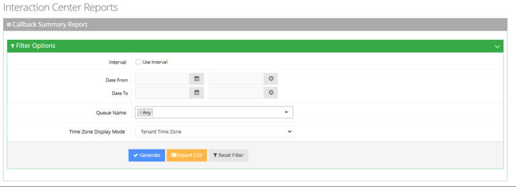

2. Select the appropriate filter fields to generate your report:
   - **Date From:** Defines this report for a specific time range.
   - **Date To:** Defines this report for a specific time range.
   - **Queue Name:** Defines information that is related to a specific queue name or ‘Any’ to show statistics for all call queues.
   - **Timezone Display Mode:** Defines this report in different time zones. The time zone of calls can be one of the following options:
     - **Tenant time zone:** Defines the information in this report based on the tenant configured time zone.
     - **Flow time zone:** Defines the information in this report based on the time zone configured under the Telephony Setting settings.
     - **Local time zone (Web):** Defines the information in this report on the browser local time zone.
3. The following is a description of the report fields.

   | **Report Column** | **Description** |
   | --- | --- |
   | Queue Name | Indicates the Queue name. |
   | Requested | Number of times callers requested a Callback |
   | Resolved | Number of times callers engaged with a Worker via Callback |
   | Unresolved | Number of times callers didn’t engaged with a Worker after requesting a callback |
   | % Resolved | Resolved / Requested |
   | Avg. Attempts | The total number of callback attempts, including the one that succeeded. |

4. Click **Generate** to generate the report; click **Export CSV** to export the report in CSV format.

   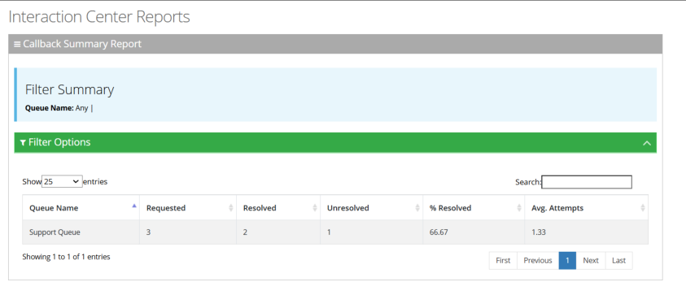
