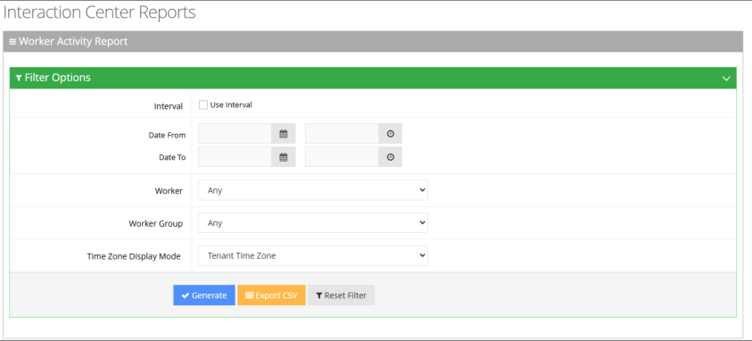
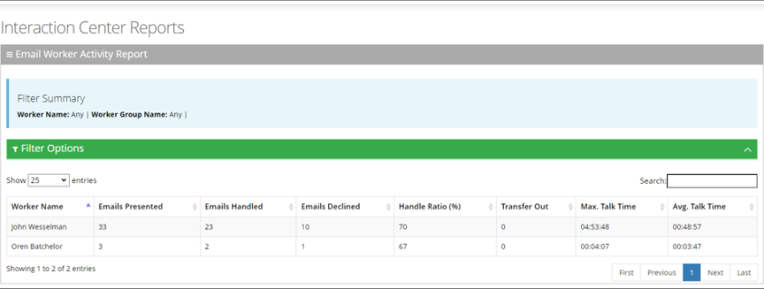
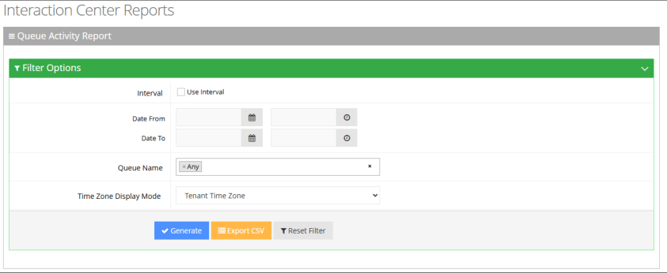
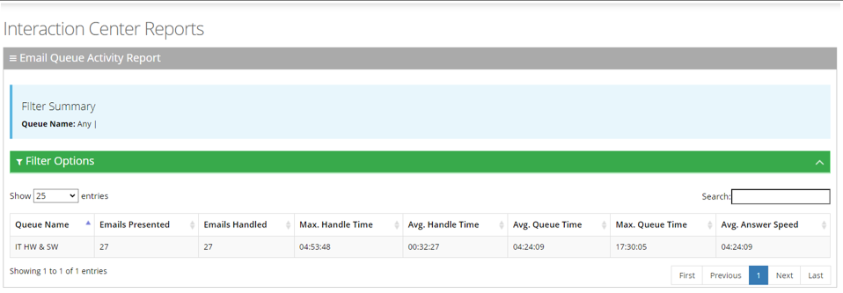
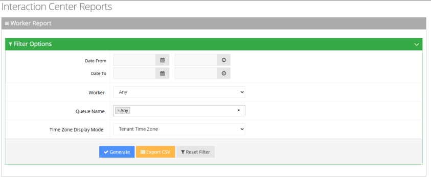
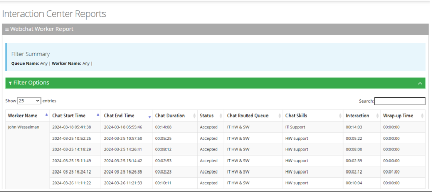

You can generate the following Email Interaction Center historical reports:

- [Worker Activity Report](#worker-activity-report)
- [Queue Activity Report](#queue-activity-report)
- [Worker Report](#worker-report)

## Worker Activity Report

The Worker Activity Report displays a summary of workers’ email activities, including emails and workers state activities.

### To generate a Worker Activity report

1. Open the Email Worker Activity Report page (**Reports** &gt; **Interaction Center Reports** &gt; **Email Reports** &gt; **Worker Activity Report**); the following appears:

   

2. Select the appropriate filter fields:
   - **Interval:** Defines how the report's date intervals are segmented. Select the check box to view a drop-down list of predefined time periods, based on the customer's end date ("Date To"):
     - **Last Day:** Displays data from the past day, segmented by hours.
     - **Last Week:** Displays data from the previous week, separated by days.
     - **Last Month:** Displays data from the previous month, categorized by weeks.
     - **Last Year:** Displays data from the last year, organized by months.
   - **Date From:** Defines the report for a specific date/time range.
   - **Date To:** Defines the report for a specific date/time range.
   - **Worker:** Defines information related to a specific worker.
   - **Worker Group:** Defines information related to a specific worker group.
   - **Timezone Display Mode:** Defines the report in different time zones. The time zone of calls can be one of the following options:
     - **Tenant time zone:** Defines the information based on the tenant configured time zone.
     - **Flow time zone:** Defines the information based on the time zone configured under the Telephony Setting settings.
     - **Local time zone (Web):** Display the information on the browser local time zone.
3. The following is a description of the report fields.

   | **Field** | **Description** |
   | --- | --- |
   | Worker Name | Defines the first name and last name of the Worker. |
   | Emails Presented | Defines the number of emails routed to the Worker, regardless of whether the Worker replied to the email. |
   | Emails Handled | Defines the number of emails that were accepted by the worker. |
   | Emails Declined | Defines the number of emails that were not answered or were declined by the Worker. |
   | Handle Ratio (%) | Defines the Handle ratio: emails that the Worker handled / emails that are routed to the Worker (overall percentage). |
   | Transfer Out | Defines the available field for queued emails. Defines the number of emails that were transferred by the Worker to other Workers. |
   | Max Interaction Time | Defines the longest interacting time of any email that the Worker handled. Talk Time refers to the elapsed time between the time a Worker accepted the email and the time that the email was sent or transferred. |
   | Avg. Interaction Time | Defines the average interacting time for emails that the Worker handled. |

4. Click **Generate** to generate the report; click **Export CSV** to export the report in CSV format.

   

## Queue Activity Report

The Queue Activity Report displays summarized information of emails per queue (e.g., Presented and Handled).

The procedure below describes how to generate a Queue Activity Report.

### To generate a Queue Activity report

1. Open the Queue Activity Report page (**Reports** &gt; **Interaction Center Reports** &gt; **Email Reports** &gt; **Queue Activity Report**); the following appears:

   

2. Select the appropriate filter fields to generate your report:
   - **Interval:** Defines how the report's date intervals are segmented. Select the check box to reveal a drop-down list of predefined time periods, based on the customer's end date ("Date To"):
     - **Last Day:** Displays data from the past day, segmented by hours.
     - **Last Week:** Shows data from the previous week, separated by days.
     - **Last Month:** Presents data from the previous month, categorized by weeks.
     - **Last Year:** Displays data from the last year, organized by months.
   - **Date From:** Defines the report for a specific date/time range.
   - **Date To:** Defines the report for a specific date/time range.
   - **Queue Name:** Defines information related to a specific queue name or ‘Any’ to show statistics for all call queues.
   - **Timezone Display Mode:** Defines the report in a different time zone.
     - **Tenant time zone:** Defines the information in the report based on the tenant configured time zone.
     - **Flow time zone:** Defines the information in the report based on the time zone configured under the Telephony Setting settings.
     - **Local time zone (Web):** Defines the information in the report on the browser local time zone.
3. The following is a description of the report fields.

   | **Field** | **Description** |
   | --- | --- |
   | Queue Name | Defines the queue to which the email is queued. |
   | Emails Presented | Defines the number of emails routed to the queue, regardless of whether a Worker replied. |
   | Emails Handled | Defines the number of emails that are handled by this Queue. An email is handled if a customer is connected to a Worker while queued for this Queue. |
   | Max. Handle Time | Defines the longest handle time of any email that the queue handled by the Worker. |
   | Avg. Handle Time | Defines the average handle time for all emails that the queue handled by the Worker. |
   | Avg. Queue Time | Defines the average queue time for all emails routed to the Queue. |
   | Max. Queue Time | Defines the longest queue time of any one email that was routed to the Queue. |
   | Avg. Answer Speed | Defines the Average Answer Speed: Total queue time / emails handled. |

4. Click **Generate** to generate the report; click **Export CSV** to export the report in CSV format.

   

## Worker Report

The Worker Report presents a summary of each email that is received by the Worker.

### To generate a Worker report

1. Open the Webchat Worker Report page (**Reports** &gt; **Interaction Center Reports** &gt; **Email Reports** &gt; **Worker Report**); the following appears:

   

2. Select the appropriate filter fields to generate your report:
   - **Date From:** Defines the report for a specific time range.
   - **Date To:** Defines the report for a specific time range.
   - **Worker:** Defines information related to a specific worker.
   - **Queue Name:** Defines information related to a specific queue name or ‘Any’ to show statistics for all call queues.
   - T**imezone Display Mode:** Display the report in a different time zone. The time zone of calls can be one of the following options:
     - **Tenant time zone:** Display the information in the report based on the tenant configured time zone.
     - **Flow time zone:** Display the information in the report based on the time zone configured under the Telephony Setting settings.
     - **Local time zone (Web):** Display the information in the report on the browser local time zone.
3. The following is a description of the report fields.

   | **Report Column** | **Description** |
   | --- | --- |
   | Worker Name | Defines the name of the worker. |
   | Email Start Time | Defines the date and time the email started. |
   | Email End Time | Defines the date and time the email ended. |
   | Email Duration | Defines the duration of the email. |
   | Status | Defines whether the email was ‘Accepted’ or ‘Declined’ by the worker. |
   | Email Routed Queue | Defines the queue to which the email is queued. |
   | Email Skills | Defines the skills that are associated with the queue to which the email is routed. |
   | Interaction Time | Defines how long the worker handled the email. |
   | Wrap-up Time | Defines the duration it took the worker to complete the wrap-up. |

4. Click **Generate** to generate the report; click **Export CSV** to export the report in CSV format.

   
