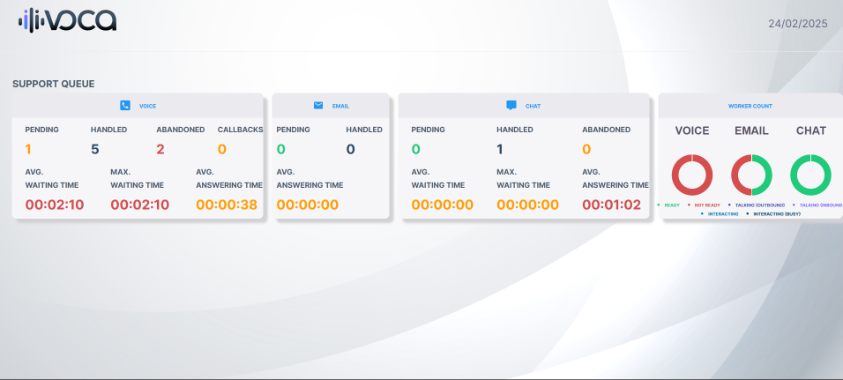
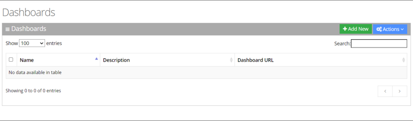
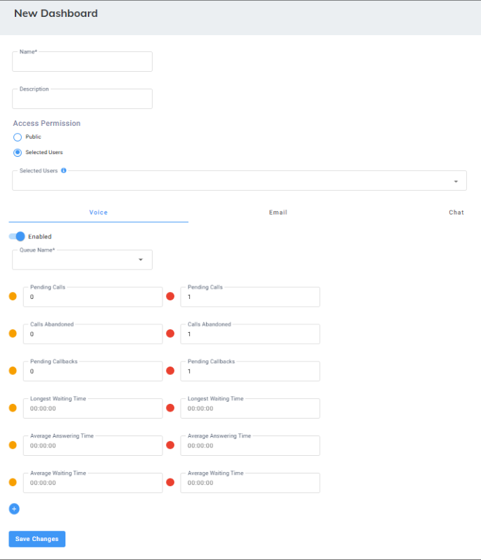
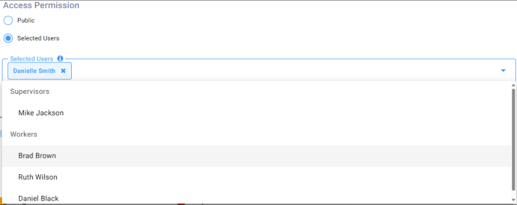
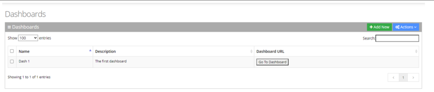
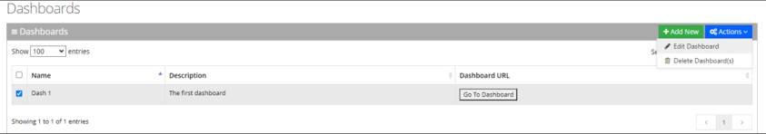
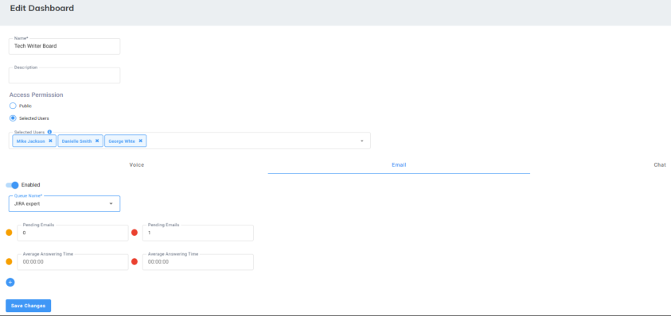
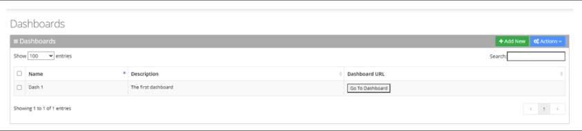
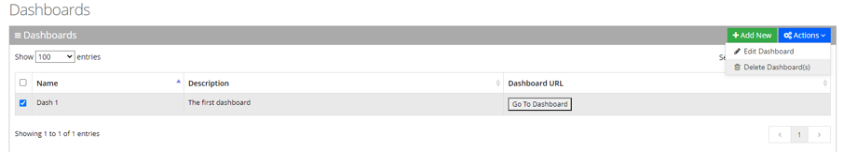

The Interaction Center Dashboard enables Supervisors to monitor the Workers and queue activity by creating customized dashboards to get real-time insights on interaction center performance.

For Tenant with Digital Engagement (omnichannel), the real- time dashboard displays all essential statistics for each communication channel on one-screen.

## Adding a Real-Time Dashboard

The procedure below describes how to add a new real-time dashboard.

<Note>
Before adding a dashboard, ensure you have configured a Skill-based Queue, for details , see [Configuring Worker Queues](/tenant-administration/admin-06-configuration/admin-06-4-configuring-routing/admin-06-4-8-configuring-queues#configuring-worker-queues).
</Note>

### To add a new real-time dashboard

1. Open the Dashboards page (**Reports** &gt; **Interaction Center Reports** &gt; **Real-time Dashboard**); the following appears:

   

   The following is displayed:
   - **Name**: Defines the name of the dashboard.
   - **Description**: Defines the dashboard description.
   - **Dashboard URL**: Opens the dashboard in a new window with a permanent link.
2. Click **Add New**; the following appears:

   

   <Note>
   Additional queues can be added to the dashboard by clicking the (+) button.
   </Note>

   <Note>
   The graphic view is generated automatically when up to two queues are configured. If more than two queues are configured, the dashboard displays a table view. The dashboard's data is reset every 24 hours at 00:00.
   </Note>

3. Enter a name and description for the new dashboard.
4. Choose who can access the real-time dashboard:
   - **Public**: Select this option to make the dashboard accessible to everyone.
   - **Selected Users**: Select this option to grant dashboard access only to specific users. If you select this option, choose users from the drop-down list to grant them access.

     

   <Note>
   The drop-down list displays eligible users for the real-time dashboard. These users are either:

   - SSO users with view/edit permissions (configured in the Users list). For details, see [Access Management](/tenant-administration/admin-06-configuration/admin-06-8-access-management).
   - Supervisors and workers configured in this tenant. For details, see [Adding a Worker](/tenant-administration/admin-06-configuration/admin-06-4-configuring-routing/admin-06-4-2-configuring-workers#adding-a-worker).
   </Note>

5. Toggle the **Enable** button to display the statistics on the real-time dashboard.
6. From the 'Queue Name', select the queue to be monitored.
7. Enter threshold values for voice, email, and chat (if applicable). The threshold colors are determined by the upper limit of each color's number range.

   <Note>
   **Example**:

   If you're setting thresholds for pending calls:

   - Define the yellow: 2 calls (warning)
   - Define the red: 4 calls (critical)

   By default, up to 2 calls (0 or 1) will be green (optimal).
   </Note>

   - **Voice information:**

     | **Field** | **Description** |
     | --- | --- |
     | Pending Calls | Defines the minimum and maximum threshold for calls waiting in the queue. |
     | Calls Abandoned | Defines the minimum and maximum threshold for abandoned calls. |
     | Pending Callbacks | Defines calls that were scheduled for a follow-up but have not yet been completed. |
     | Longest Waiting | Defines the minimum and maximum threshold for the longest call |
     | Time | waiting in the queue (in seconds). |
     | Average Answering Time | Defines the minimum and maximum threshold for the average answering time. |
     | Average Waiting Time | Defines the minimum and maximum threshold for the average waiting time (in seconds). |

   - **Email information**

     | **Field** | **Description** |
     | --- | --- |
     | Pending Email | Defines the minimum and maximum threshold for emails waiting in the queue. |
     | Average Answering Time | Defines the minimum and maximum threshold for the average answering time. |

   - **Chat information**

     | **Field** | **Description** |
     | --- | --- |
     | Pending Chats | Defines the minimum and maximum threshold for chats waiting in the queue. |
     | Chats Abandoned | Defines the minimum and maximum threshold for abandoned chats. |
     | Longest Waiting Time | Defines the minimum and maximum threshold for the longest chat waiting in the queue (in seconds). |
     | Average Answering Time | Defines the minimum and maximum threshold for the average answering time. |
     | Average Waiting Time | Defines the minimum and maximum threshold for the average waiting time (in seconds). |

## Editing a Real-Time Dashboard

The procedure below describes how to edit a real-time dashboard.

### To edit a real-time dashboard

1. Open the Dashboards page (**Reports** &gt; **Interaction Center Reports** &gt; **Real-time Dashboard**); the following appears:

   

   <Note>
   Click **Go to Dashboard** to view the real-time dashboard interface.
   </Note>

2. Select the dashboard you wish to edit by selecting the corresponding Dashboards check box.

   

3. From the ‘Actions’ drop-down menu, choose **Edit Dashboard**; the following appears:

   

4. Make your changes on the Edit Dashboard page, and then click **Save Changes**; the updated Dashboard details appear.

## Deleting a Real-Time Dashboard

The procedure below describes how to delete a real-time dashboard.

### To delete a real-time dashboard

1. Open the Dashboards page (**Reports** &gt; **IVR Reports** &gt; **Real-time Dashboard**); the following appears:

   

2. Select the dashboard you wish to delete by selecting the corresponding Dashboards check box.

   

3. From the ‘Actions’ drop-down menu, choose **Delete Dashboard(s)**.
4. The following message appears: "Are you sure you want to delete the selected dashboard (s)?"
5. Click **OK** to delete the selected dashboard.
