You can generate the following Interactive Voice Response (IVR) reports:

- [Report Scheduler](#report-scheduler)
- [Drill-down](#drill-down-report)
- [Overall Performance](#overall-performance-report)
- [Call Date](/reports-and-analytics/admin-07-generating-reports/admin-07-1-call-queue-reports#call-date-report)
- [Call Hour](#call-hour-report)
- [Requested Contacts](#requested-contacts-report)
- [Requested Departments](#requested-departments-report)

## Report Scheduler

The Report Scheduler provides an easy way to automate the generation of reports on a regular and recurring basis by setting up a schedule. Scheduled reports can run at predetermined times and automatically send to email recipients.

<Note>
The Report Scheduler functionality is only applicable if Voca is integrated with an email Server. For more information, click here.
</Note>

### Adding a Report Scheduler

The procedure below describes hot to add a Report Scheduler.

#### To add a new Report Scheduler

1. Open the Report Scheduler page (**Reports** &gt; **IVR Reports** &gt; **Report Scheduler**); the following appears:

   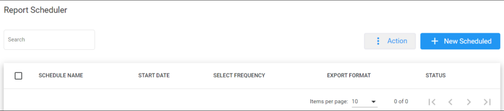

2. The following is a description of all the fields:

   | **Field** | **Description** |
   | --- | --- |
   | Schedule Name | Defines the report scheduler name that was configured. |
   | Start Date | Defines the start dates that were configured on the report scheduler. |
   | Select Frequency | Defines the frequency that this report is sent. |
   | Export Format | Defines the format in which this report is sent. |
   | Status | Defines the status of the schedule report. |

3. Click **+ New Scheduled**; the following appears:

   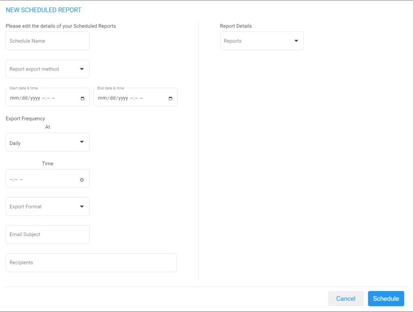

4. The following is a description of the fields that must be entered:

   | **Field** | **Description** |
   | --- | --- |
   | Schedule Name | Defines the name of the scheduled report. |
   | Report Export Method | Defines the method that this report is sent. |
   | Start Date & Time | Defines the first time that this report is run. The Start Date & Time uses the time zone that is configured at the tenant level. |
   | End Date & Time | Defines the last time that this report will be run. The End Date & Time uses the time zone that is configured at the tenant level. |
   | Export Frequency | Defines the recurrence pattern for the scheduled report. |
   | Time | Defines the time that this report will be generated. |
   | Day | Defines the day that this report will be generated. This option is only available when the frequency is set to **Weekly**. |
   | Range | Defines a specific time range within the month, or choose a custom day range within the month that the report will be generated. This option is only available when the frequency is set to **Monthly**. |
   | Export Format | Defines the format that this report is sent in. |
   | Email Subject | Defines the subject name of email that is sent. |
   | Recipients | Defines the recipients who will be receiving the email. More than one recipient can be added. |
   | Reports | Select the report to be scheduled. |

5. The following is a description of the filter that can be applied for this report:

   | **Field** | **Description** |
   | --- | --- |
   | Queue Name | Filter by a specific queue. If that queue is not selected, it will be considered as any queue. |
   | Call Source | Filter by a specific call source. |
   | Call Destination | Filter by a specific call destination. |
   | Wait Time (sec.) | Filter by Wait Time in seconds. |

6. Click **Save Changes**.

### Editing a Report Scheduler

The procedure below describes how to edit a Report Scheduler.

#### To edit a Report Scheduler

1. Open the Report Scheduler page (**Reports &gt; IVR Reports &gt; Report Scheduler**); the following appears:

   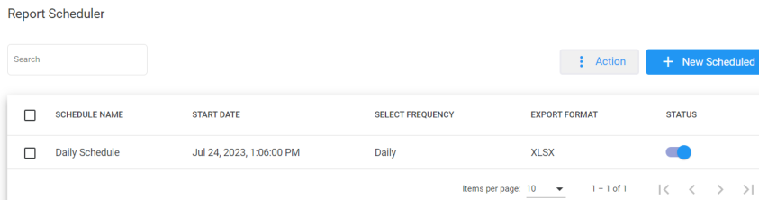

2. Select the report schedule that you wish to edit by selecting the corresponding **Report Schedule** check box.

   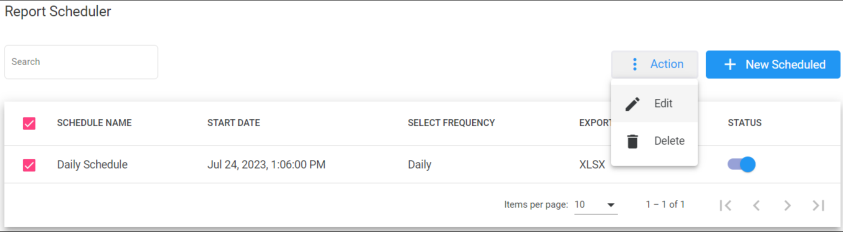

3. From the ‘Actions’ drop-down menu, choose **Edit**; the following appears:

   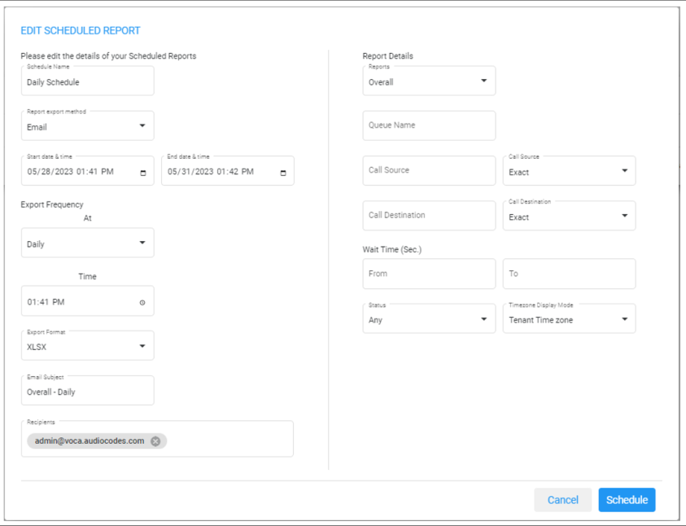

4. Make your changes on the Edit Schedule Report page, and then click **Schedule**.

### Deleting a Report Scheduler

The procedure below describes how to delete a Report Scheduler.

#### To delete a Report Scheduler

1. Open the Report Scheduler page (**Reports &gt; IVR Reports &gt; Report Scheduler**); the following appears:

   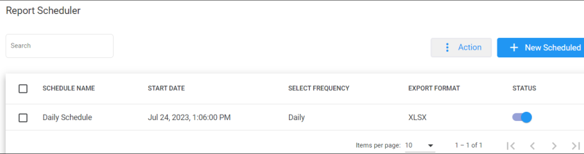

2. Select the report schedule that you wish to delete by selecting the corresponding **Report Schedule** check box.

   

3. From the ‘Actions’ drop-down menu, choose **Delete**.

## Drill-down Report

The Drill-down Report displays the details of all the calls that were entered into Voca and how they were handled.

### To generate a Drill-down report

1. Open the Drill-down page (**Reports** &gt; **IVR Reports** &gt; **Drill-down**; the following appears:

   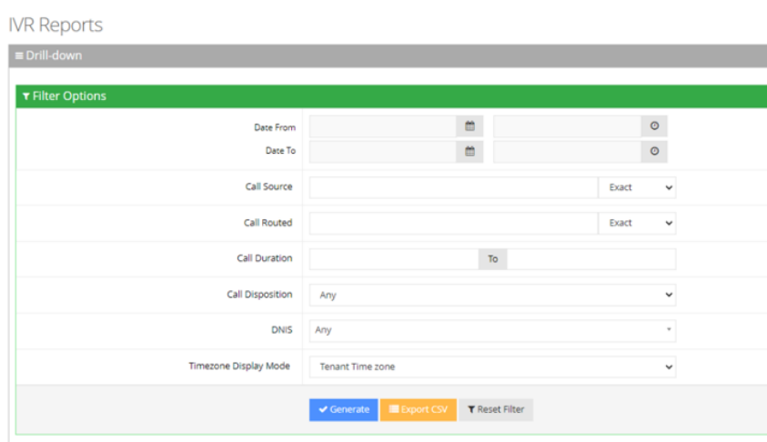

2. Select the appropriate filter fields:
   - **Date From:** Defines this report for a specific date/time range.
   - **Date To:** Defines this report for a specific date/time range.
   - **Call Source:** Defines information that is related to a specific source number.
   - **Call Routed:** Defines information that is related to a call that was routed to a specific destination.
   - **Call Duration:** Defines information that is related to a specific duration of a call.
   - **Call Disposition:** Defines information related to calls that ended with a specific disposition or “Any’. For an explanation of the different call dispositions, see [Call Dispositions](/tenant-administration/admin-09-call-dispositions).
   - **DNIS:** Defines information that is related to a specific leading phone number.
   - **Timezone Display Mode:** Defines this report in different time zone:
     - **Tenant Time zone:** Defines the information in this report based on the tenant configured time zone.
     - **Flow Time zone:** Defines the information in this report based on the time zone configured under the **Telephony Setting** settings.
     - **Local Time zone (Web):** Defines the information in this report on the browser local time zone.

   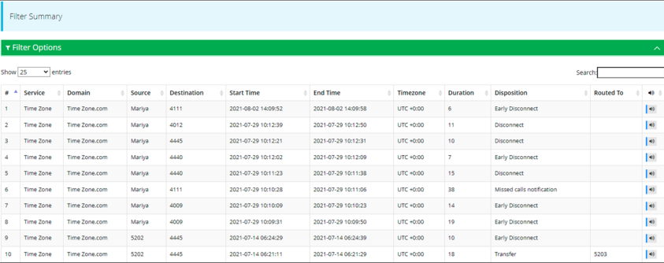

3. The following is a description of the report fields.

   | **Report Column** | **Description** |
   | --- | --- |
   | Customer | Defines the customer name. |
   | Domain | Defines the domain name. |
   | Source | Defines the phone number the call was made from. |
   | Destination | Defines the destination phone number. |
   | Start Time | Defines the start time of the call adjusted to the timezone selected in the filter. |
   | End Time | Defines the end time of the call adjusted to the timezone selected in the filter. |
   | Timezone | Defines the relevant timezone according to the option selected in the filter. |
   | Duration | Defines the duration of the call. |
   | Disposition | Defines the disposition of the call. |
   | Routed To | Defines the number of where the call has been routed to. • Opens the CDR and displays more information, including a recording of the call. |

Call Details information is displayed for each call. If recognitions where made on a particular call, the recognition results (one or more) are shown. When you display the information, the following appears:

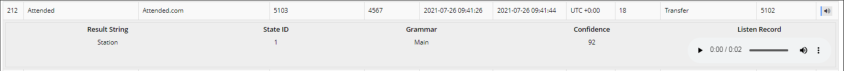

Each recognition includes the following:

| **Field** | **Description** |
| --- | --- |
| Result string | Displays the analyzed result returned from the ASR. |
| State ID | Displays the ID that specifies the step within the call that the recognition was made. |
| Grammar | Displays the grammar used (e.g., Main, Disambiguation) |
| Confidence | Displays the confidence level of the ASR returned for the result. If the confidence level is below a specific threshold, the recognition is rejected and the caller is prompted to request the destination again. (based on the service configuration). For more information on the relevant confidence threshold, contact AudioCodes Support. |
| Listen Record | Displays the recording details for the recognition. |

4. Click **Generate** to generate the report; click **Export CSV** to export the report in CSV format.

   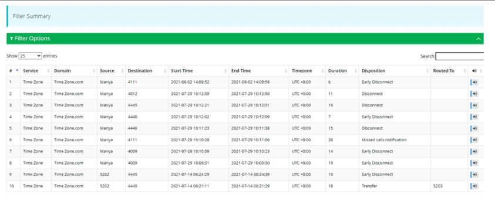

## Journey Manager Report

The Journey Manager Report displays a summary of calls with a full detailed flow, from the moment it enters to the questions asked and answers provided.

### To generate the Journey Manager report

1. Open the Journey Manager Report page (**Reports** &gt; **IVR Reports** &gt; **Journey Manager**); the following appears:

   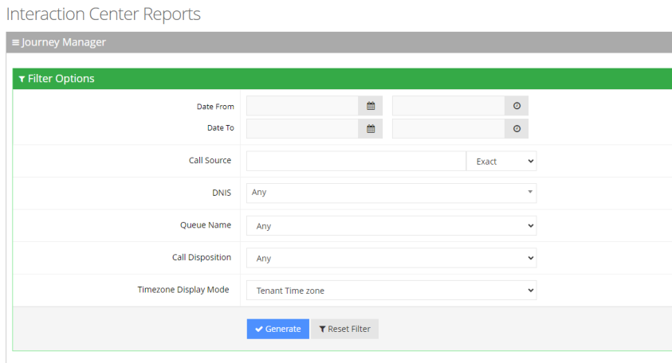

2. Select the appropriate filter fields to generate your report:
   - **Date From:** Displays this report for a specific date/time range.
   - **Date To:** Displays this report for a specific date/time range.
   - **Call Source:** Displays information that is related to a specific source number.
   - **DNIS:** Defines the internal phone number that is called to access Voca. You can select the appropriate value from the drop-down list.
   - **Queue Name:** Defines a specific queue name or 'Any' to show statistics for all call queues.
   - **Call Disposition:** Defines information that relates to calls that ended with a specific disposition or “Any’. For an explanation of the different call disposition, refer to [Call Dispositions](/tenant-administration/admin-09-call-dispositions).
   - **Timezone Display Mode:** Defines this report in different time zones. The time zone of calls can be one of the following options:
     - **Tenant time zone:** Displays the information in this report based on the tenant configured time zone.
     - **Flow time zone:** Displays the information in this report based on the time zone configured under the Telephony Setting settings.
     - **Local time zone (Web):** Displays the information in this report based on the browser local time zone.
3. Click **Generate** to generate the report; click **Export CSV** to export the report in CSV format.
4. The following is a description of the report fields.

   | **Field** | **Description** |
   | --- | --- |
   | Tenant | Defines |
   | Domain | Defines the domain name. |
   | Source | Defines the phone number the call was made from. |
   | Destination | Defines the destination phone number. |
   | Start Time | Defines the start time of the call adjusted to the timezone selected in the filter. |
   | End Time | Defines the end time of the call adjusted to the timezone selected in the filter. |
   | Timezone | Defines the time zone of the call. |
   | Duration | Defines the duration of the call. |

   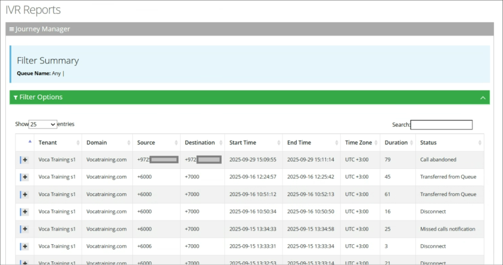

5. Click on any call to view its flow, separated by relevant sections.

   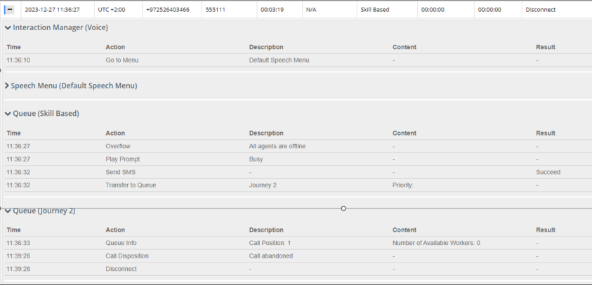

## Overall Performance Report

The Overall Performance Report displays a summary of all the performance of the tenant.

### To generate an Overall Performance report

1. Open the Overall Performance page (**Reports** &gt; **IVR Reports** &gt; **Overall Performance**); the following appears.

   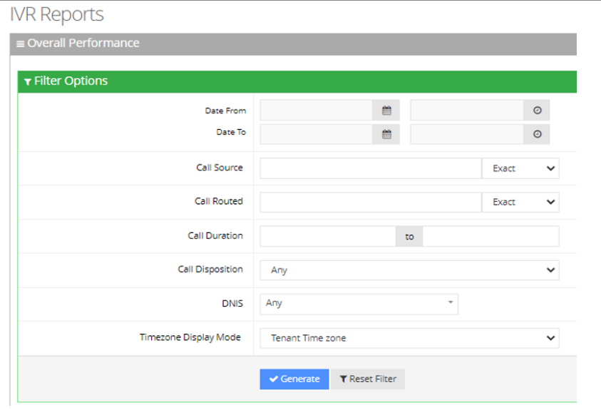

2. Select the appropriate filter fields:
   - **Date From:** Defines this report for a specific date/time range.
   - **Date To:** Defines this report for a specific date/time range.
   - **Call Source:** Defines information that is related to a specific source number.
   - **Call Routed:** Defines information that is related to call that was routed to a specific destination.
   - **Call Duration:** Defines information that is related to a specific duration of a call.
   - **Call Disposition:** Defines information that is related to calls that ended with a specific disposition or “Any’.

   For an explanation of the different call disposition, refer to [Call Dispositions](/tenant-administration/admin-09-call-dispositions).
   - **DNIS:** Defines the internal phone number that is called to access Voca. You can select the appropriate value from the drop-down list.
   - **Timezone Display Mode:** Defines this report in different time zones.

   The time zone of calls can be one of the following options:
   - **Tenant time zone:** Defines the information in this report based on the tenant configured time zone.
   - **Flow time zone:** Defines the information in this report based on the time zone configured under the Telephony Setting settings.
   - **Local time zone (Web):** Defines the information in this report on the browser local time zone.
3. The following is a description of the report fields.

   | **Report Column** | **Description** |
   | --- | --- |
   | Disposition | Defines the disposition of the call. |
   | Number of Calls | Defines the total number of calls for each disposition. |
   | Avg. Call Time | Defines the average call time for each disposition. |

4. Click **Generate** to generate the report; click **Export CSV** to export the report in CSV format.

   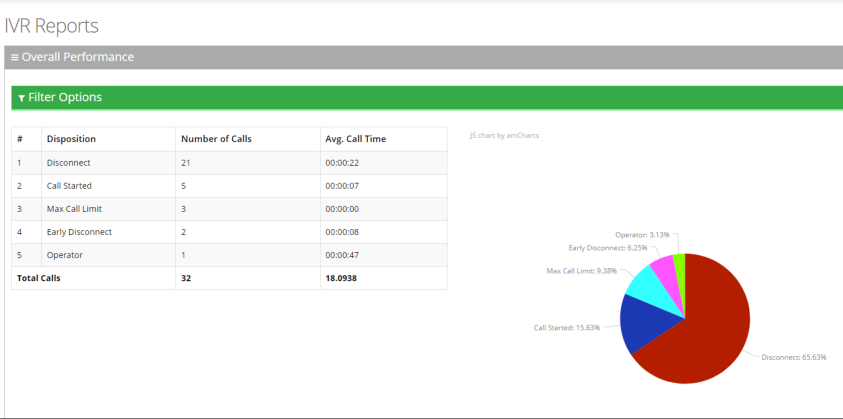

## Call Hour Report

The Call Hour Report displays a summary of call performance by the hour on one specific day.

### To generate a Call Hour IVR report

1. Open the Call Hour page (**Reports** &gt; **IVR Reports** &gt; **Call Hour**); the following appears.

   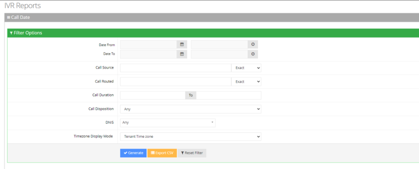

2. Select the appropriate filter fields:
   - **Date From:** Defines this report for a specific date/time range.
   - **Date To:** Defines this report for a specific date/time range.
   - **Call Source:** Defines information that is related to a specific source number.
   - **Call Routed:** Defines information that is related to calls routed to a specific destination.
   - **Call Disposition:** Defines information that is related to calls that ended with a specific disposition or “Any’. For an explanation of the different call dispositions, see [Call Dispositions](/tenant-administration/admin-09-call-dispositions).
   - **DNIS:** Defines information that is related to a specific destination number.
   - **Timezone Display Mode:** Defines this report in different time zones. The time zone of calls can be one of the following options:
     - **Tenant time zone:** Defines the information in this report based on the tenant configured time zone.
     - **Flow time zone:** Defines the information in this report based on the time zone configured under the Telephony Setting settings.
     - **Local time zone (Web):** Defines the information in this report on the browser local time zone.
3. The following is a description of the report fields:

   | **Report Column** | **Description** |
   | --- | --- |
   | Hour | Defines the time frame the calls were made in. |
   | Calls | Defines the number of calls. |
   | Peak Concurrency | Defines the maximum number of concurrent calls the system held for a specific period of time. |
   | Transfer | Defines the number of transferred calls. |
   | Disconnect | Defines the number of disconnected calls. Voca could have tried before to transfer the call with no answer. |
   | Operator | Defines the number of calls transferred to the operator for some reason (not Operator Requested or Operator DTMF). |
   | Operator Request | Defines the number of calls transferred to the Operator because the user pressed “0” and sent a DTMF to transfer the call to the Operator. |
   | Operator DTMF | Defines the number of calls transferred to the Operator because the user pressed “0” and sent a DTMF to transfer the call to the Operator. |
   | Transfer Failed | Defines the number of calls that failed to be transferred. |
   | Not at Working Hours | Defines the number of calls that entered the system outside of the working hours. |
   | Dropped Calls | Defines the number of calls dropped by the Media Gateway module when it exceeds the number of the concurrent channel license capacity. This deposition parameter represents the dropped calls for the past day. The calls are dropped when the Media Gateway module, which controls the total number of IVR ports, is configured with X number of channels. The X+1 call is rejected by the Media Gateway with SIP Error 404. |
   | Miscellaneous | Defines the number of calls with disposition other to the ones in other columns. |
   | Avg. Call Time (sec) | Defines the average call time in seconds. |
   | Std. Dev. Call Time (sec) | Defines the standard deviation in call time, in seconds. |
   | Max. Call Time (sec) | Defines the maximum call time in seconds. |

4. Click **Generate** to generate the report; click **Export CSV** to export the report in CSV format.

   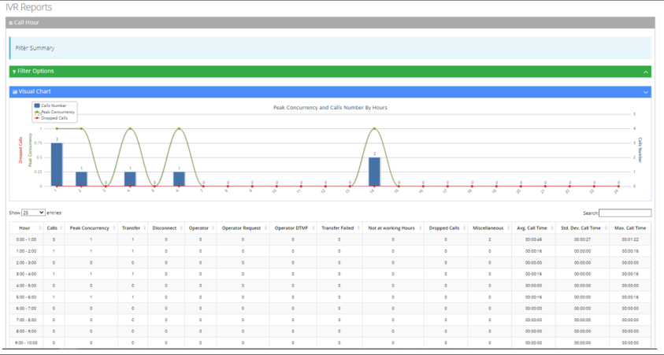

## Requested Contacts Report

The Requested Contacts Report Displays a summary of contacts that were requested during Voca sessions and the transfer results.

### To generate a Requested Contacts report

1. Open the Requested Contacts page (**Reports** &gt; **IVR Reports** &gt; **Requested Contacts**); the following appears.

   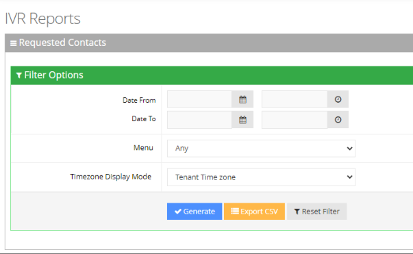

2. Select the appropriate filter fields:
   - **Date From:** Defines this report for a specific date/time range.
   - **Date To:** Defines this report for a specific date/time range.
   - **Menu:** Defines information that related to specific menu or “Any’.
   - **Timezone Display Mode:** Defines this report in different time zones. The time zone of calls can be one of the following options:
     - **Tenant time zone:** Defines the information in this report based on the tenant configured time zone.
     - **Flow time zone:** Defines the information in this report based on the time zone configured under the Telephony Setting settings.
     - **Local time zone (Web):** Defines the information in this report on the browser local time zone.
3. The following is a description of the report fields.

   | **Report Column** | **Description** |
   | --- | --- |
   | Calls | Defines the number of calls made to the Contact. |
   | Transfer Extension | Defines the number of calls that were transferred to the Customer's extension. |
   | Transfer Mobile | Defines the number of calls that were transferred to the Customer's mobile. |
   | Disconnected | Defines the number of calls that were disconnected. |
   | Operator | Defines the number of calls that were transferred to the operator. |
   | Operator Request | Defines the number of calls that were requested to be transferred to the operator. |
   | Operator DTMF | Defines the number of calls that used the Operator DTMF. |
   | Transfer Failed | Defines the number of calls that the transfer failed. |
   | Not at Working Hours | Defines the number of calls made outside of working hours. |
   | Miscellaneous | Defines the number of calls that do not come under other dispositions in this report. |

4. Click **Generate** to generate the report; click **Export CSV** to export the report in CSV format.

   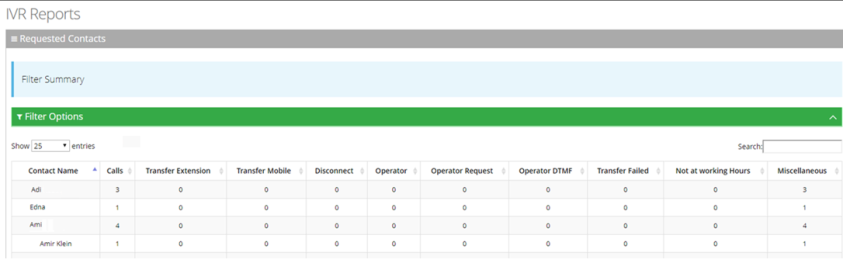

## Requested Departments Report

The Requested Departments Report displays a summary of departments that were requested during Voca sessions and the transfer results.

### To generate a Requested Departments report

1. Open the Requested Departments page (**Reports** &gt; **IVR Reports** &gt; **Requested Departments**); the following appears.

   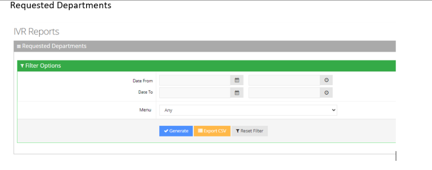

2. Select the appropriate filter fields:
   - **Date From:** Defines this report for a specific date/time range.
   - **Date To:** Defines this report for a specific date/time range.
   - **Menu:** Defines information that is related to specific menu or “Any’.
   - **Timezone Display Mode:** Defines this report in different time zone. The time zone of calls can be one of the following options:
     - **Tenant time zone:** Defines the information in this report based on the tenant configured time zone.
     - **Flow time zone:** Defines the information in this report based on the time zone configured under the Telephony Setting settings.
     - **Local time zone (Web):** Defines the information in this report on the browser local time zone.
3. The following is a description of the report fields.

   | **Report Column** | **Description** |
   | --- | --- |
   | Calls | Defines the number of calls made to the Department. |
   | Transfer | Defines the number of calls that were transferred to the Department. |
   | Disconnected | Defines the number of Department calls that were disconnected. |
   | Operator | Defines the number of Department calls that were transferred to the operator. |
   | Operator Request | Defines the number of Department calls that were requested to be transferred to the operator. |
   | Operator DTMF | Defines the number of Department calls that used the Operator DTMF. |
   | Transfer Failed | Defines the number of Department calls that the transfer failed. |
   | Not at Working Hours | Defines the number of Department calls made outside of working hours. |
   | Miscellaneous | Defines the number of Department calls that come under other categories. |

4. Click **Generate** to generate the report; click **Export CSV** to export the report in CSV format.

   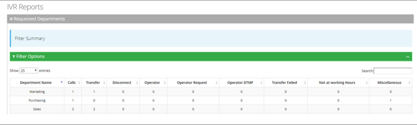
