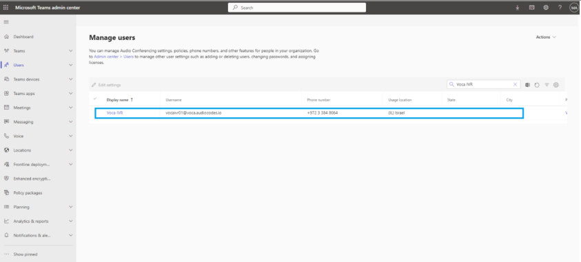
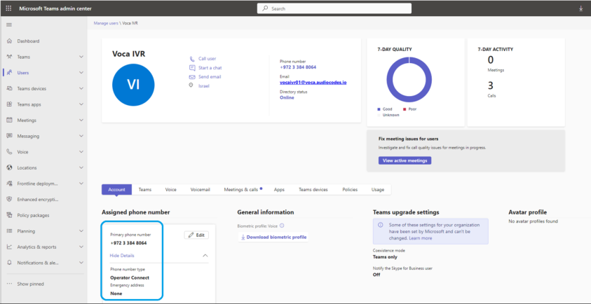

To use a DNIS number that supports Operator Connect or Microsoft Calling plan, make sure you have a designated Microsoft Teams user for it. If not, do the following:

1. Create a new Teams user and assign them a Teams phone license.
2. Make sure the user is visible within the Microsoft Teams Admin Center:

   

3. Assign the Operator Connect/ Calling Plan number to the new user. Each Microsoft Teams user can be associated with one DNIS number.
4. Make sure that the calling policy that is assigned to this user has the “SIP devices can be used for calls” enabled.

   

5. When done, proceed to configure this phone number's flow settings, for details, see [Adding a Flow Setting](/tenant-administration/admin-06-configuration/admin-06-1-configuring-interaction-manager/admin-06-1-1-configuring-voice-settings#adding-a-flow-setting).

   **This page is intentionally left blank.**

   **International Headquarters**

   6 Ofra Haza Street

   Naimi Park

   Or Yehuda, 6032303, Israel

   Tel: +972-3-976-4000

   Fax: +972-3-976-4040

   **AudioCodes Inc.**

   80 Kingsbridge Rd

   Piscataway, NJ 08854, USA

   Tel: +1-732-469-0880

   Fax: +1-732-469-2298

   **Contact us:** [https://www.audiocodes.com/corporate/offices-worldwide](http://https//www.audiocodes.com/corporate/offices-worldwide)

   **Website:** [https://www.audiocodes.com/](http://https//www.audiocodes.com/)

   **Documentation Feedback:** [https://online.audiocodes.com/documentation-](https://online.audiocodes.com/documentation-feedback) [feedback](https://online.audiocodes.com/documentation-feedback)

   ©2026 AudioCodes Ltd. All rights reserved.AudioCodes, AC, HD VoIP, HD VoIP Sounds Better, IPmedia, Mediant, MediaPack, What’s Inside Matters, OSN, SmartTAP, User Management Pack, VMAS, VoIPerfect, VoIPerfectHD, Your Gateway To VoIP, 3GX, AudioCodes One Voice, AudioCodes Meeting Insights, and AudioCodes Room Experience are trademarks or registered trademarks of AudioCodes Limited. All other products or trademarks are property of their respective owners. Product specifications are subject to change without notice.

   Document #: LTRT-28858

   
