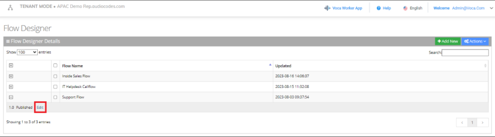
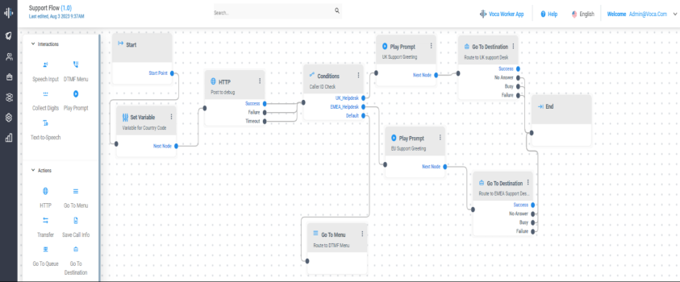
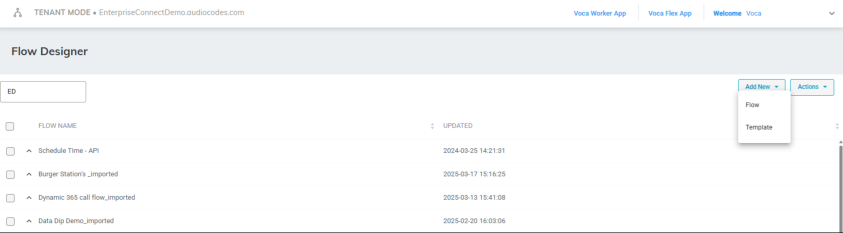
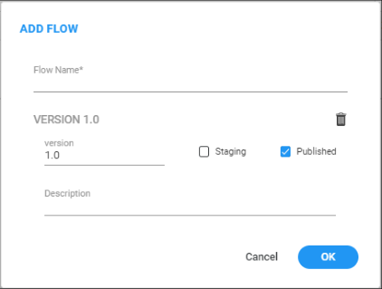
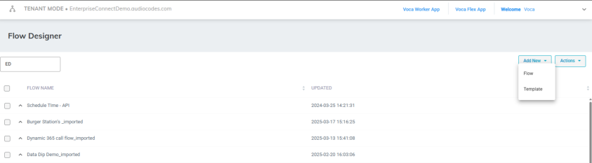
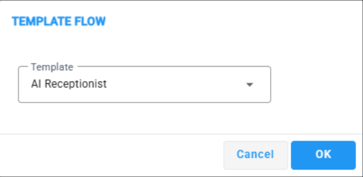
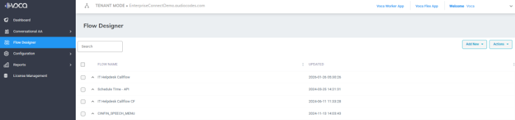
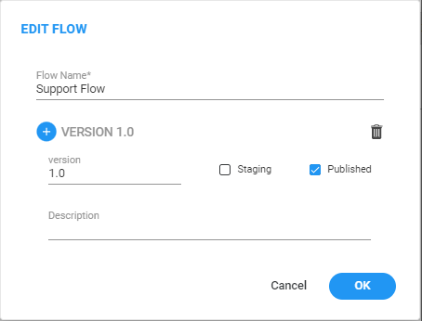
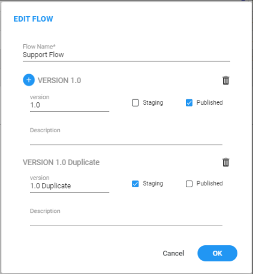
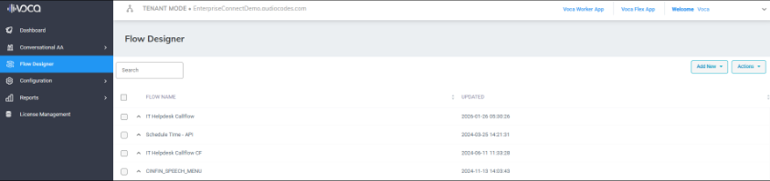

<Info>
Content version: **Voca CIC Flow Designer User's Manual, Version 12.2**
</Info>

The Flow Designer page in the Voca application offers a way to configure, design, and manage complex call flows using a powerful set of building blocks.

#### To access the Flow Designer

1. Log in to the Voca application.

2. From the Navigation pane, click **Flow Designer**; the Flow Designer page opens:

   

3. Select the flow that you want to edit, by clicking the corresponding plus box; the Edit link appears under the selected script:

   

4. Click **Edit**; the main flow designer workspace appears:

   

## Add a new flow

You can add a new flow from scratch or by using an existing template:

- [Add a flow from scratch](/flow-designer-manual/getting-started/fd-02-accessing-flow-designer#add-a-flow-from-scratch)

- [Add a new flow from a template](/flow-designer-manual/getting-started/fd-02-accessing-flow-designer#add-a-new-flow-from-a-template)

### Add a flow from scratch

#### To add a new flow from scratch

1. From the Navigation pane, click **Flow Designer**; the Flow Designer page opens:

   

2. Click **Add New**.

   

3. Select **Flow**.

   

4. In the 'Flow Name' field, enter the name of the flow.

5. In the 'Version' field, enter the number of the version applicable to the flow.

6. Select the 'Staging' check box if the flow is still being developed.

7. Select the 'Published' check box if the flow has been completed and published.

8. In the 'Description' field, enter a description of the flow.

9. Click **OK**.

### Add a new flow from a template

#### To add a new flow from a template

1. From the Navigation pane, click **Flow Designer**; the Flow Designer page opens:

   

2. Click **Add New**.

   

3. Select **Select Template**; the following appears:

   

4. Select a template and click **OK**.

## Edit a flow

The procedure below describes how to edit a flow.

#### To edit a flow

1. From the Navigation pane, click **Flow Designer**; the Flow Designer page opens:

   

2. Select the flow you want to edit by enabling the Flow Name check box.

3. From the ‘Actions’ drop-down menu, choose **Edit**; the following appears:

   

4. It is possible to have more than one flow – for example, you can have one flow for **Staging** (in development), and one flow for **Published** (completed flow).

   To duplicate the flow, click the  button; the following appears:

   

   <Note>
   Only one flow can be set to Published.
   </Note>

5. Click the delete icon  to remove a duplicate flow.

6. Click **OK**.

7. On the Flow Designer page, select the flow entry you want to expand by clicking  plus.

8. Select the flow you want to edit.

## Delete a flow

The procedure below describes how to delete a flow.

#### To delete a flow

1. From the Navigation pane, click **Flow Designer**; the Flow Designer page opens:

   

2. Select the flow you want to delete by enabling the ‘Flow Name’ check box.

3. From the ‘Actions’ drop-down menu, choose **Delete**; a message appears to confirm that you want to delete the selected flow.

4. Click **OK**.
