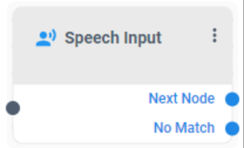
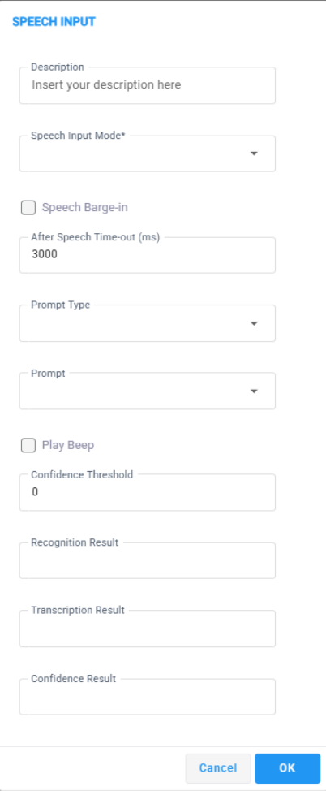
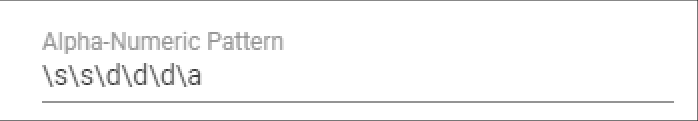

<Info>
Content version: **Voca CIC Flow Designer User's Manual, Version 12.2**
</Info>

The 'Speech Input' building block seamlessly integrates speech recognition into your system, enabling callers to engage in natural interactions through spoken commands. During the Speech Recognition step, it not only interprets spoken input but also allows it to be mapped to variables. These variables can then later be leveraged to route calls based on their values. This significantly enhances user experience by facilitating intuitive voice-driven interactions, thereby improving the accessibility and efficiency of menu navigation and selections.

There are two results when routing a call with the 'Speech Input' building block, depending on how well it understands your voice command.

- **Next Node**: If the system understands the voice command enough (confidence is above the threshold), it will automatically send your call to the next step.

- **No Match**: If the system can't understand your voice command clearly (confidence is below the threshold), it will send your call to a different step called "No Match."

#### To use the Speech Input building block

1. On the left pane, under **Interactions**, click the **Speech Input** option; the following Speech Input building block appears:

   

2. Click the  icon; the following appears:

   

3. In the 'Description' field, enter a description for this building block (up to 50 characters).

4. From the 'Speech Input Mode' drop-down list, select the preferred mode:

   - **Free Speech**: The system records the caller's input and then checks the confidence score. If the confidence score is below the preconfigured threshold (by default configured '0'), the system activates 'No Match'.

   - **Keywords**: The system records the caller's input and then cross-references it with a predefined list of up to 50 phrases that can be configured in the building block. The caller's speech is checked against this list, aiming to identify the phrase with the highest confidence score. If the confidence score is below the preconfigured threshold (by default configured '0'), the system activates 'No Match'.

     When selecting this mode, an additional field, ‘Keywords\*’, becomes available.

   - **Digits**: The system records the caller's input and subsequently attempts to convert this input into a numerical character. If the Automatic Speech Recognition (ASR) result cannot be successfully converted into a numerical character, or if the confidence score falls below the pre-configured threshold (by default configured '0'), the system activates 'No Match'.

     When selected, an additional field called ‘Min Digits’ and ‘Max Digits’ become available. Enter the minimum and the maximum length of the digits that the caller can input.

     <Note>
     This mode is currently in the Beta phase and is exclusively available for the EN-US dialect.
     </Note>

   - **Alpha-Numeric**: The system records the caller's input and subsequently attempts to convert this input into an alphabetical and numerical character. If the Automatic Speech Recognition (ASR) result cannot be successfully converted into an alphabetical and numerical character, or if the confidence score falls below the pre-configured threshold (by default configured '0'), the system activates 'No Match'.

     - When selected, an additional field called ‘Alpha-Numeric Pattern’ becomes available. Define both the length and sequence of the alphanumeric pattern you expect to receive. The syntax for available patterns includes:

       - '\\s' – Indicates an expectation for an alphabetical character.

       - '\\d' – Indicates an expectation for a numeric character.

       - '\\a' – Indicates an expectation for an alphabetical or numerical character.

     **Example**:

     Note this pattern: \\s\\s\\d\\d\\d\\a. This signifies that you anticipate a response with a length of 6 characters, starting with 2 numeric characters, followed by 3 alphabetical characters, and ending with one alphabetical or numerical character. Any other response will be categorized as a "No Match". This allows you to set exactly what format you expect the input to be in.

   

   <Note>
   This mode is currently in the Beta phase and is exclusively available for the EN-US dialect.
   </Note>

   - **Date**: The system records the caller's input and subsequently attempts to convert this input into a date with the following format: 'yyyy-MM-dd'. If the Automatic Speech Recognition (ASR) result cannot be successfully converted into a date, or if the confidence score falls below the pre-configured threshold (by default configured '0'), the system activates 'No Match'.

     When selected, an additional field called ‘Hint’ becomes available. This field allows you to specify whether the system-generated date should be in the past, or in the future, in the event that the customer does not mention the year.

     <Note>
     This mode is currently in the Beta phase and is exclusively available for the EN-US dialect.
     </Note>

   - **Credit Card Number**: The system records the caller's input and utilizes an algorithm to verify the accuracy of the identification number provided by the caller. If the system confirms the identification number as correct, it proceeds to the 'Next Node'. However, if the system detects an incorrect identification number, or if the confidence score falls below the pre-configured threshold (by default configured '0'), the system activates 'No Match'.

     The result destination information is returned in JSON format, encompassing all the relevant details associated with the selected destination.

   - **Credit Card Expiration Date**: The system records the caller's input and utilizes an algorithm to verify the credit card expiration date provided by the caller. If the system confirms the credit card expiration date as correct, it proceeds to the 'Next Node'. However, if the system detects an incorrect identification number, or if the confidence score falls below the pre-configured threshold (by default configured '0'), the system activates 'No Match'.

   - **Destination Dictionary**: The system records the caller's input and proceeds to compare it with a designated destination dictionary (contact/department list).

     It analyzes the caller's spoken input against this dictionary, aiming to identify the phrase with the highest confidence score. In cases where the confidence score falls below the pre-configured threshold (by default configured '0'), the system activates the 'No Match' state.

     When activated, an additional parameter called ‘Destination Dictionary’ becomes available. This parameter allows the users to specify the dictionary against which they want to perform the comparison.

     <Note>
     The result destination information is returned in JSON format, encompassing all the relevant details associated with the selected destination.
     </Note>

**JSON format (for Department):**

```text
{
 "EntityID": "",
 "Type": " DESTINATION",
 "Recording": "",
 "Destination": "",
 "AliasPrompt": "",
 "Extension1": "",
 "Extension2": "",
 "Extension3": ""
}
```

**JSON format (for Contact):**

```text
{
 "EntityID": "",
 "Type": " CONTACT",
 "Recording": "",
 " FN": "",
 " LN": "",
 "Extension": "",
 "Mobile": "",
 "Dect": ""
}
```

5. Enable the 'Speech Barge-In' feature by selecting the checkbox. Activating this option grants callers the ability to interrupt the prompt mid-way using speech, eliminating the necessity to wait for the prompt to finish.

6. In the **After Speech Time out (ms)** field, define how long the system should wait, in milliseconds, after detecting the end of a callers speech before finalizing speech recognition. When the timeout expires without detecting additional speech, the system assumes the utterance is complete and proceeds to process the recognized input.

7. From the 'Prompt Type' drop-down list, select the appropriate prompt type:

   - **User Prompt**: Gives you the capability to designate a specific fixed prompt that will unfailingly play whenever a call is directed through the Speech Input building block.

     When selected, an additional field called "Prompt" becomes available. This field allows you to specify the prompt you want to utilize when the call is routed through the Speech Input building block.

   - **Dynamic Prompt**: By using this prompt type, you gain the flexibility to dynamically adjust the prompt based on previous actions taken by the caller within the flow. When selected, an additional field called "Value" becomes available. This field allows you to specify the name of your prompt as it appears in the system prompt list, using a variable.

     <Note>
     If the specified prompt is not found, the system pauses briefly before continuing to the next step.
     </Note>

   **Example**:

   If you have a single flow that can be triggered from different DID numbers, and you want to change the prompt based on the dialed number. To do this, configure a “Conditions” building block (see [Conditions building block](/flow-designer-manual/building-blocks/fd-06-building-blocks/fd-06-3-call-flow-logic/fd-06-3-1-conditions) for more information) before running the Speech Input building block. This condition block checks the DID number and routes the call to the 'Set Variables' building block accordingly (see [Set Variable building block](/flow-designer-manual/building-blocks/fd-06-building-blocks/fd-06-3-call-flow-logic/fd-06-3-4-set-variable) for more information). The 'Set Variables' block stores the prompt name. This variable can then be used to play distinct prompts for different DID numbers, providing dynamic caller experiences.

   - **Alphanumeric Phonetic**: The Alphanumeric Phonetic mode enables the system to interpret caller input spoken using phonetic representations of letters and numbers. In this mode, the system captures the caller’s spoken response and applies a normalization process that converts phonetic alphabet terms (for example “Alpha,” “Bravo,” “Charlie”) and spoken digit words (for example “Zero,” “One,” “Seven”) into their corresponding alphanumeric characters (A–Z, 0–9).

     This mode enhances recognition accuracy by supporting callers who naturally provide information using phonetic pronunciation. It improves input reliability without altering the behavior of the existing Alphanumeric (beta) mode.

     **Example**:

     A spoken input of “Alpha Bravo Three Seven Zulu” is normalized to “AB37Z.”

     <Note>
     This mode is currently in the Beta phase and is exclusively available for the EN-US dialect.
     </Note>

8. In the 'Confidence Threshold' field, you can configure the threshold for confidence. Calls falling below this confidence threshold are routed to 'No Match'. By default, this field has the value of '0'.

9. Enable the 'Play Beep' option by selecting the corresponding check box. This triggers the playing of a beep sound before the system begins to collect the user's response.

10. In the 'Recognition Result' field, specify a variable in the format `${var_name}` to store the speech input result. If the call is routed to 'No Match', the system automatically replaces the recognition result with "No Match".

11. In the 'Transcription Result' field, specify a variable in the format `${var_name}` to store the original speech input result before the system processing takes place. This variable allows you to access the original speech input content, even if the call is routed to 'No Match'.

12. In the 'Confidence Result' field, define a variable in the format `${var_name}` to capture the confidence score identified by the Automatic Speech Recognition (ASR) system. This score can be utilized later to inform decision-making based on the obtained result.

13. Click **OK**, and then **Save**.
