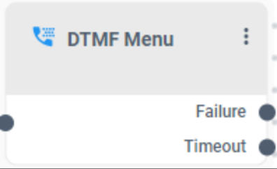
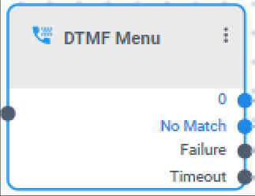
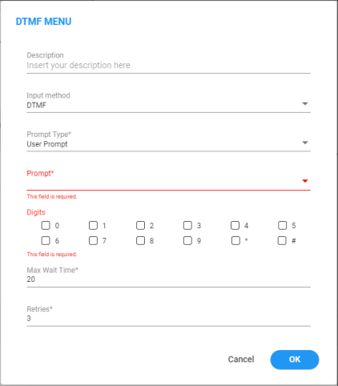
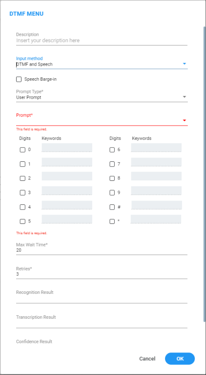

<Info>
Content version: **Voca CIC Flow Designer User's Manual, Version 12.2**
</Info>

The 'DTMF Menu' building block empowers you to offer callers a menu of choices. As an admin, you have the flexibility to select from two input methods tailored to your users' preferences and needs:

- **DTMF**: The DTMF method exclusively employs DTMF (Dual-Tone Multi-Frequency) input, providing callers with a specific interaction mode that does not include the option to utilize ASR (Automatic Speech Recognition).

- **DTMF with Speech**: The DTMF and Speech method offers callers a versatile communication experience, providing two distinct options for interaction. Callers can choose to use DTMF (Dual-Tone Multi-Frequency) input, allowing them to enter information or make selections using the keypad on their phone. Alternatively, callers can take advantage of the ASR (Automatic Speech Recognition) capability, enabling them to interact with the system by speaking naturally. This flexibility empowers callers to engage with the system in the manner that best suits their preferences and needs.

## Without Speech

The 'DTMF Menu' building block has 2 exit legs:

- Failure: Indicates when the system recognizes a DTMF key that is not configured as an option on the menu, and the maximum number of retries has been reached.

- Timeout: Indicates when the system fails to recognize any DTMF input and the maximum number of retries has been reached.

#### To use the DTMF Menu building block without speech method

1. On the left pane, under **Interactions**, click **DTMF Menu**; the following DTMF Menu building block appears:

   

2. Click the  icon; the following appears:

   

3. In the 'Description' field, enter a description of this building block (up to 50 characters).

4. In the 'Input Method' select 'DTMF'.

5. From the 'Prompt Type' drop-down list, select the appropriate prompt type:

   - **User Prompt**: Gives you the capability to designate a specific fixed prompt that will unfailingly play whenever a call is directed through the Speech Input building block.

     When selected, an additional field named "Prompt" becomes available. This field allows you to specify the prompt you want to utilize when the call is routed through the Speech Input building block.

   - **Dynamic Prompt**: Gives you the flexibility to dynamically adjust the prompt based on previous actions taken by the caller within the flow. When selected, an additional field called "Value" becomes available. This field allows you to specify the name of your prompt as it appears in the system prompt list, using a variable.

     <Note>
     If the specified prompt is not found, the following message appears: "We are experiencing system issues. Please call back later." The call will then be disconnected.
     </Note>

   **Example**

   If you have a single flow that can be triggered from different DID numbers, and you want to change the prompt based on the dialed number. To do this, configure a “Conditions” building block (see [Conditions building block](/flow-designer-manual/building-blocks/fd-06-building-blocks/fd-06-3-call-flow-logic/fd-06-3-1-conditions) for more information) before running the Speech Input building block. This condition block will check the DID number and route the call to the 'Set Variables' building block accordingly (see [Set Variable building block](/flow-designer-manual/building-blocks/fd-06-building-blocks/fd-06-3-call-flow-logic/fd-06-3-4-set-variable) for more information). The 'Set Variables' block stores the prompt name. This variable can then be used to play distinct prompts for different DID numbers, providing dynamic caller experiences.

6. In the Digits section, select the specific digits you want to include in the DTMF menu. Available options range from 0 through 9, \*, and #.

   Each digit you select is automatically added as an exit leg.

7. In the 'Max Wait Time' field, enter the maximum waiting time for user input, between 1 to 45 seconds. The default is 20 seconds.

8. In the 'Retries' field, specify the maximum number of retries to repeat the block if DTMF input is not detected. You can set this value between 1 and 10. The default is 3 retries.

9. Click **OK**, and then **Save**.

## With Speech

The DTMF Menu building block has 3 exit legs:

- **Failure**: When the system recognizes a DTMF key that is not configured as an option on the menu, and the maximum number of retries has been reached.

- **Timeout**: When the system fails to recognize input from the caller, whether it's DTMF or speech, and the maximum number of allowed retries has been reached.

- **No Match**: When the confidence result of the speech recognition is '0', the system will route the call to 'No Match'.

#### To use the DTMF Menu building block with speech method

1. On the left pane, under **Interactions**, click **DTMF Menu**; the following DTMF Menu building block appears:

   

2. Click the  icon; the following appears:

   

3. In the 'Description' field, enter a description for this building block, (up to 50 characters).

4. In the 'Input Method' change to 'DTMF and Speech'; the following appears:

   

5. You can enable 'Speech Barge-In' by selecting the corresponding checkbox. Activating this option grants callers the ability to interrupt the prompt mid-way using either speech or DTMF input, eliminating the necessity to wait for the prompt to finish.

6. From the 'Prompt Type' drop-down list, select the appropriate prompt type:

   - **User Prompt**: Gives you the capability to designate a specific fixed prompt that will unfailingly play whenever a call is directed through the Speech Input building block. When selected, an additional field called ‘Prompt’ becomes available. This field allows you to specify the prompt you want to utilize when the call is routed through the Speech Input building block.

   - **Dynamic Prompt**: Gives you the flexibility to dynamically adjust the prompt based on previous actions taken by the caller within the flow. When selected, an additional field called "Value" becomes available. This field allows you to specify the name of your prompt as it appears in the system prompt list, using a variable.

     <Note>
     If the specified prompt is not found, the following message appears: "We are experiencing system issues. Please call back later." The call will then be disconnected.
     </Note>

   **Example**

   If a single flow that can be triggered from different DID numbers, and you want to change the prompt based on the dialed number. To do this, configure a “Conditions” building block (see [Conditions building block](/flow-designer-manual/building-blocks/fd-06-building-blocks/fd-06-3-call-flow-logic/fd-06-3-1-conditions) for more information) before running the Speech Input building block. This condition block will check the DID number and route the call to the 'Set Variables' building block accordingly (see [Set Variable building block](/flow-designer-manual/building-blocks/fd-06-building-blocks/fd-06-3-call-flow-logic/fd-06-3-4-set-variable) for more information). The 'Set Variables' block stores the prompt name. This variable can then be used to play distinct prompts for different DID numbers, providing dynamic caller experiences.

7. In the Digits/Keywords section, customize the DTMF menu by selecting the digits (0-9, \*, and #) and associating keywords with each digit. This feature enables callers to either press the specified digit or verbally say the associated keyword, directing them through the corresponding digit leg.

   To add a new keyword, enter the keyword name and then press enter.

8. In the 'Max Wait Time' field, enter the maximum waiting time for user input, between 1 to 45 seconds. The default is 20 seconds.

   <Note>
   The Automatic Speech Recognition (ASR) system can record audio for a maximum of 1 minute. If the combined length of the prompt and the maximum wait time exceeds one minute, the system will proceed to the next building block after the one-minute mark.
   </Note>

9. In the 'Retries' field, specify the maximum number of retries to repeat the block if DTMF input is not detected. You can set this value between 1 and 10. The default is 3 retries.

10. In the 'Recognition Result' field, specify a variable in the format `${var_name}` to store the speech input/DTMF key result. If the call is routed to 'No Match', the system automatically replaces the recognition result with "No Match."

11. In the 'Transcription Result' field, specify a variable in the format `${var_name}` to store the original speech input result before any system processing takes place. This variable allows you to access the original speech input content, even if the call is routed to 'No Match'.

12. In the 'Confidence Result' field, define a variable in the format `${var_name}` to capture the confidence score identified by the Automatic Speech Recognition (ASR) system. This score can be utilized later to inform decision-making based on the obtained result.

13. Enable the 'Play Beep' option by selecting the corresponding check box. This triggers the playing of a beep sound before the system begins to collect the user's response.

14. Click **OK**, and then **Save**.
