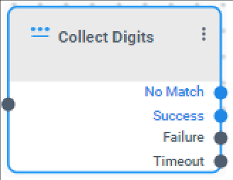
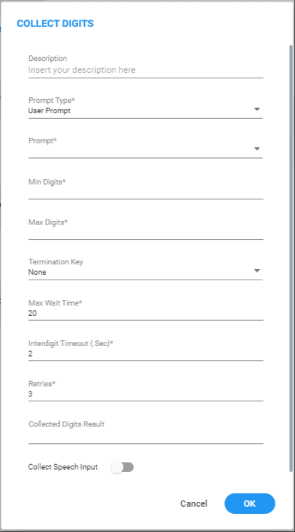

<Info>
Content version: **Voca CIC Flow Designer User's Manual, Version 12.2**
</Info>

'Collect Digits' building blocks enable you to offer callers the option to enter multiple DTMF digits in response to a prompt. Additionally, as an admin, you can enable ASR (Automatic Speech Recognition), further enhancing the overall flexibility and experience for callers.

The 'Collect Digits' building block has 4 exit legs:

- **Success**: When the system successfully collects all the spoken or dialed digits from the caller, and the number of digits aligns with the criteria specified in the 'Min Digits' and 'Max Digits' settings within the building block, the call is automatically routed through this leg.

- **Failure**: If the system has gathered all the spoken or dialed digits from the caller but the number of digits does not align with the criteria defined in the 'Min Digits' and 'Max Digits' settings within the building block, the call is automatically directed through this leg.

- **Timeout**: If the system is unable to recognize input from the caller, whether it's DTMF or speech, and the maximum number of allowed retries has been reached, the call will be automatically directed through this leg.

- **No Match**: When the confidence result of the speech recognition is '0', the system will intelligently route the call to 'No Match'. This leg is only applicable after enabling the 'Collect Speech Input'.

#### To use the Collect Digits building block

1. On the left pane, under **Interactions**, click **Collect Digits**; the following Collect Digits building block appears:

   

2. Click the  icon; the following appears:

   

3. In the 'Description' field, enter a description for this building block (up to 50 characters).

4. From the 'Prompt Type' drop-down list, select the appropriate prompt type:

   - **User Prompt**: Gives you the capability to designate a specific fixed prompt that will unfailingly play whenever a call is directed through the Speech Input building block.

     When selected, an additional field called "Prompt" becomes available. This field empowers you to specify the prompt you want to utilize when the call is routed through the Speech Input building block.

   - **Dynamic Prompt**: Gives you the flexibility to dynamically adjust the prompt based on previous actions taken by the caller within the flow. When selected, an additional field called "Value" becomes available. This field allows you to specify the name of your prompt as it appears in the system prompt list, using a variable.

     <Note>
     If the specified prompt is not found, the following message appears: "We are experiencing system issues. Please call back later." The call will then be disconnected.
     </Note>

   **Example:**

   If you have a single flow that can be triggered from different DID numbers, and you want to change the prompt based on the dialed number. To achieve this, you can configure a “Conditions” building block (see [Conditions building block](/flow-designer-manual/building-blocks/fd-06-building-blocks/fd-06-3-call-flow-logic/fd-06-3-1-conditions) for more information) before running the Speech Input building block. This condition block will check the DID number and route the call to the 'Set Variables' building block accordingly (refer to the [Set Variable](/flow-designer-manual/building-blocks/fd-06-building-blocks/fd-06-3-call-flow-logic/fd-06-3-4-set-variable) building block for more information). The 'Set Variables' block will store the prompt name. This variable can then be used to play distinct prompts for different DID numbers, providing dynamic caller experiences.

5. In the 'Min Digits' field, specify the minimum number of digits to be collected, ranging from 1 to 30 digits.

6. In the 'Max Digits' field, enter the maximum number of digits to be collected, between 1 to 30 digits. Verify that this number is higher than the 'Min Digits' setting.

7. From the 'Termination Key' drop-down list, select the appropriate termination key type:

   - **'None'**: The system will automatically stop collecting digits when the interdigit timeout parameter is reached, and no termination key is required.

   - **'\*'**: To stop digit collection, the caller can simply press the '\*' key.

   - **'#'**: To stop digit collection, the caller can simply press the '#' key.

8. In the 'Max Wait Time' setting, specify the maximum duration for awaiting user input. This duration can be set between 1 to 45 seconds. The default is 20 seconds.

   <Note>
   The Automatic Speech Recognition (ASR) system can record audio for a maximum of 1 minute. If the combined length of the prompt and the maximum wait time exceeds one minute, the system will proceed to the next building block after the one-minute mark.
   </Note>

9. In the 'Interdigit Timeout (sec)' field, specify the permissible waiting time between digits, from 1 to 30 seconds. The default is 2 seconds.

10. In the 'Retries' field, specify the maximum number of retries to repeat the block if DTMF input is not detected, between 1 and 10. The default is 3 retries.

11. In the 'Collected Digit Result' field, specify a variable in the format `${var_name}` to store the speech input/DTMF keys result. If the call is routed through the 'No Match', the system will automatically replace the collected digit result with "No Match."

    

12. In the 'Collect Speech Input' toggle, choose whether to enable or disable the ASR capability for this block. When the toggle is enabled, two new fields and two additional checkboxes are added to the building block:

    - **'Speech Barge-In' checkbox**: Activating this checkbox grants your callers the ability to interrupt the prompt mid-way using either speech or DTMF input, eliminating the necessity to wait for the prompt to finish.

    - **'Transcription Result' field**: Designate a variable in the format `${var_name}` to store the original speech input result before any system processing takes place. This variable allows you to access the original speech input content, even if the call is routed through 'No Match'.

    - **'Confidence Result' field**: Define a variable in the format `${var_name}` to capture the confidence score identified by the Automatic Speech Recognition (ASR) system. This score can be utilized later to inform decision-making based on the obtained result.

    - **'Play Beep' checkbox**: Activating this checkbox will trigger the playing of a beep sound before the system begins to collect the user's response.

13. Click **OK**, and then **Save**.
