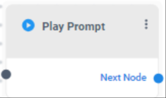
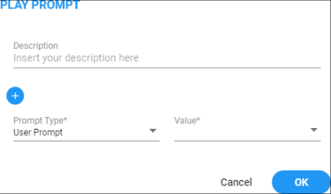

<Info>
Content version: **Voca CIC Flow Designer User's Manual, Version 12.2**
</Info>

'Play Prompt' allows you to integrate audio prompts into your workflows. It gives you the flexibility to play a single prompt or blend multiple prompts together, enabling the creation of dynamic and engaging interactions.

In the 'Play Prompt' building block, a single pathway, referred to as 'Next Node', is available. After the prompt’s playback, the system will automatically guide the call to 'Next Node'.

#### To use the Play Prompt building block

1. On the left pane, under **Interactions**, click **Play Prompt**; the following Play Prompt building block appears:

   

2. Click the  icon; the following appears:

   

3. In the 'Description' field, enter a description for this building block, (up to 50 characters).

4. From the 'Prompt Type' drop-down list, select the appropriate prompt type:

   - **User Prompt**: Select from a drop-down menu containing pre-configured prompts.

   - **Play Date**: The system will read the complete date you entered it out loud. The anticipated format for input in the value field is "yyyy-MM-dd.

     For example, if you entered the value: "2023-11-20" the system will play: 'November twenty, two thousand twenty-three. '

   - **Play Day of the Week**: The system will read out loud the day of the week corresponding to the date entered. Ensure that the date is provided in the expected format: "yyyy-MM-dd"

     For example, if you entered the following value: "2023-11-20" the system will play: 'Sunday. '

   - **Play Day in Month**: The system will read out loud the day of the month corresponding to the date entered. Ensure that the date is provided in the expected format: "yyyy- MM-dd"

     For example, if you entered the following value: "2023-11-20" the system will play: 'twenty. '

   - **Play Month**: The system will read out loud the month corresponding to the date entered in the value field. Ensure that the date is provided in the expected format: "yyyy-MM-dd"

     For example, if you entered the following value: "2023-11-20" the system will play: 'November. '

   - **Play Year**: The system will read out loud the year corresponding to the date entered in the value field. Please ensure that the date is provided in the expected format: "yyyy- MM-dd"

     For example, if you entered the following value: "2023-11-20" the system will play: 'two thousand twenty-three. '

   - **Play Number**: The system will read out loud the number exactly as entered, treating it as a whole number.

     For example, if you entered the following value: "543" the system will play: 'Five hundred and forty-three. '

   - **Digit by Digit**: The system will read out loud the number entered in the field digit by digit, rather than reading it as a whole number.

     For example, if you entered the following value: "543" the system will play: 'Five, four, three. '

   - **Play Ordinal Number**: The system will read out loud the number entered as an ordinal number, such as "first," "second," "third," and so forth.

     For example, if you entered the following value: "2" the system will play: 'Second.'.

   - **Play Time**: The system will read out loud the time in a 12-hour format without seconds. Make sure that the time provided is in 24hour format: "HH:mm".

     For example, if you enter the value "22:43", the system will announce it as 'Ten, forty-three PM.'

   - **Play Time with Seconds**: The system will read out loud the time in a 12-hour format with seconds. Make sure that the time is provided is in a 24 hour format: "HH:mm:ss".

     For example, if you entered the value "22:43:53", the system will announce it as 'Ten, forty-three and fifty-three PM. '

   - **Dynamic Prompt**: Gives you the flexibility to dynamically adjust the prompt based on previous actions taken by the caller within the flow. When selected, an additional field called "Value" becomes available. This field allows you to specify the name of your prompt as it appears in the system prompt list, using a variable.

     For example, if you have a single flow that can be triggered from different DID numbers, and you want to change the prompt based on the dialed number. To do this, configure a “Conditions” building block (see [Conditions building block](/flow-designer-manual/building-blocks/fd-06-building-blocks/fd-06-3-call-flow-logic/fd-06-3-1-conditions) for more information) before running the Speech Input building block. This condition block will check the DID number and route the call to the 'Set Variables' building block accordingly (see [Set Variable building block](/flow-designer-manual/building-blocks/fd-06-building-blocks/fd-06-3-call-flow-logic/fd-06-3-4-set-variable) for more information). The 'Set Variables' block will store the prompt name. This variable can then be used to play distinct prompts for different DID numbers, providing dynamic caller experiences.

5. In the 'Value' field, enter the value you want to play. This value can either be a variable collected earlier in the flow or a static string configured directly in the 'Value' field.

6. Click the  button to include additional prompts.

7. Click **OK**, and then **Save**.
