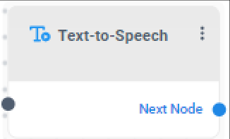
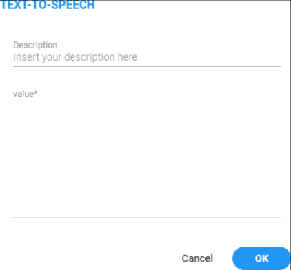

<Info>
Content version: **Voca CIC Flow Designer User's Manual, Version 12.2**
</Info>

The 'Text-to-Speech' (TTS) building block enables the playback of text from a string that has been inserted under this specific building block. By default, the language used for Text-to- Speech is determined by the primary language associated with the tenant at the tenant level.

In this building block, you can combine a static string with variables that collected in the workflow. These elements can be played back as a single prompt.

In the 'Text-to-Speech' building block, a single pathway, referred to as 'Next Node', is available. After selecting text to speech playback, the system will automatically guide the call to 'Next Node'.

#### To use the Text-to-Speech building block

1. On the left pane, under **Interactions**, click **Text-to-Speech**; the following Text-to-Speech building block appears:

   

2. Click the  icon; the following appears:

   

3. In the 'Description' field, enter a description for this building block, (up to 50 characters).

4. In the 'Value' field, you can tailor the playback content according to your specific requirements. This content can be a combination of variable data collected earlier in the workflow, static strings configured directly within the 'Value' field, or a blend of both. This flexibility allows you to create dynamic prompts that adapt to your application's needs.

   For further details on creating dynamic content by combining variables and static strings, seethe section String Expression.

   <Note>
   Text-to-Speech limits the text to 500 characters when playing.
   </Note>

5. Click **OK**, and then **Save**.
