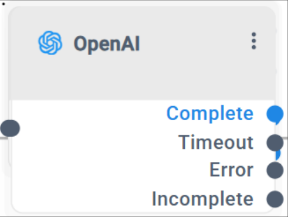
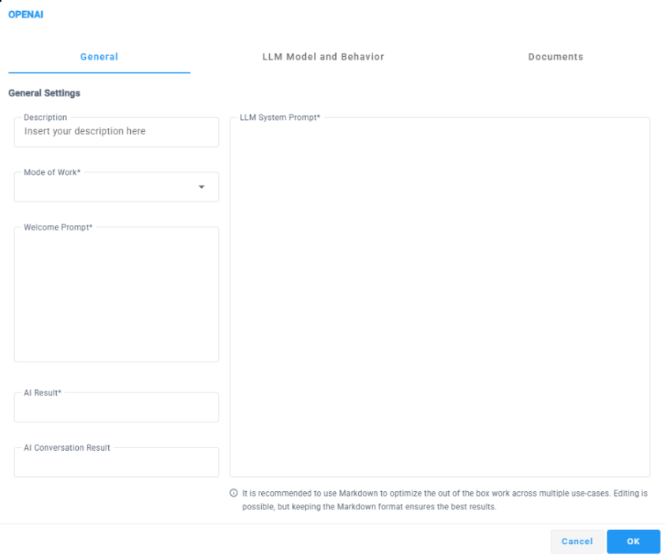
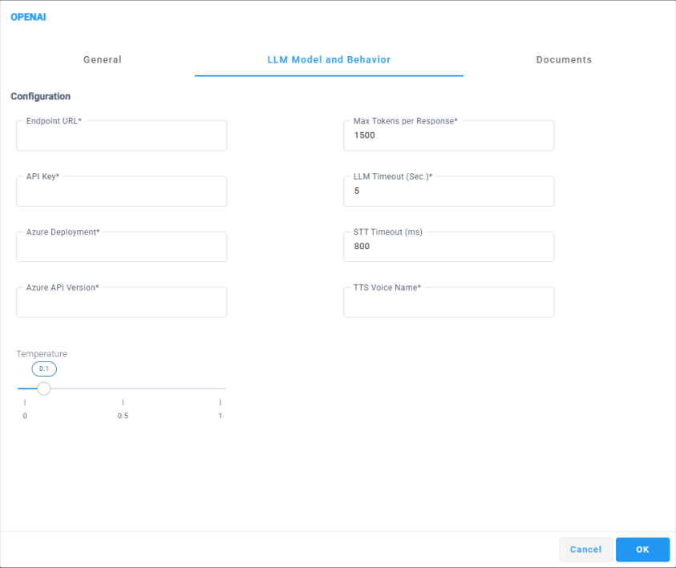
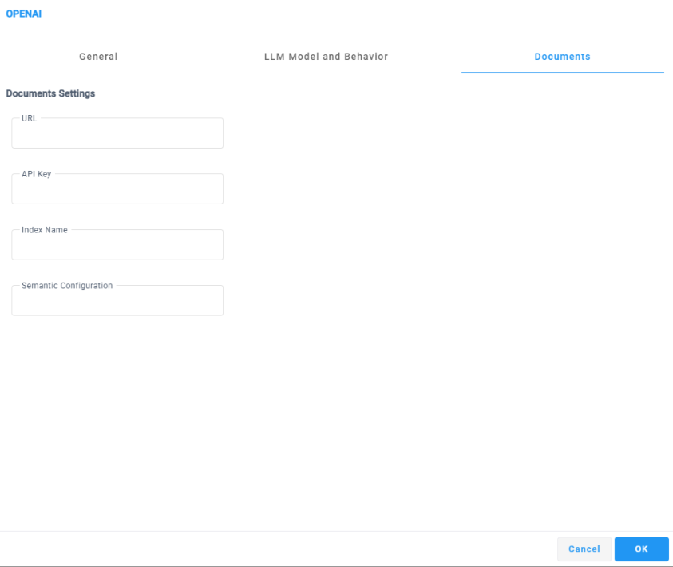

<Info>
Content version: **Voca CIC Flow Designer User's Manual, Version 12.2**
</Info>

The 'OpenAI' building block seamlessly integrates generative AI capabilities into your contact center flows, enabling intelligent, conversational engagements with callers.

This block orchestrates a complete AI-driven interaction by combining speech input collection, real-time analysis via OpenAI models, and dynamic text-to-speech playback of the generated response. It captures the caller’s spoken input, securely processes the request using an AI model to understand intent and generate an appropriate response, and then delivers that response back to the caller in natural-sounding speech.

By abstracting these steps into a single, easy-to-use block, the OpenAI Interaction building block simplifies flow design while empowering developers to create more responsive, contextual, and human- like conversations, ultimately enhancing customer experience and enabling more effective self-service interactions.

The 'OpenAI' building block has 4 exit legs:

- **Complete**: The Complete exit leg indicates a successful interaction between the customer and the 'OpenAI' block.

  - When a **single interaction** is configured, the system successfully receives a response from the LLM and plays it back to the customer using TTS.

  - When a **continuous interaction** is configured, the system routes to this leg once the LLM response contains the predefined completion indicator (e.g., **TASK\_COMPLETE**), signaling that the conversation has successfully concluded.

- **Timeout**: The Timeout exit leg is triggered when the block exceeds the configured LLM or Speech-To-Text (STT) timeout. In this case, the system is unable to receive a response within the defined time limits and routes the call accordingly.

- **Error**: The Error exit leg indicates that the **OpenAI** block encountered a failure during execution.

  This may occur due to configuration or processing issues, such as an invalid or malformed LLM prompt, missing or incorrect URLs, authentication problems, or other runtime errors that prevent the block from completing successfully.

- **Incomplete**: The Incomplete exit leg applies only to **continuous interactions**. It is triggered when the block reaches the configured **Max Interactions** limit before the LLM returns the TASK\_COMPLETE indicator, indicating that the conversation did not conclude successfully within the allowed number of interaction cycles.

  

#### To use the OpenAI building block

1. Click the OpenAI option under the Interaction group; the following OpenAI building block appears:

   

2. Click the  icon; the following appears:

   

3. Select the General tab, and then configure the following:

   - Within the 'Description' field, provide a brief description for this building block, limited to 50 characters.

   - From the 'Mode of Work' drop-down list, select the appropriate type of request:

     - Single Interaction - Performs a one-time interaction where the system collects the customer’s speech input, sends it to the LLM for processing, and plays the generated response using TTS. The interaction ends immediately after the response is played.

     - Continuous Interaction- Enables an ongoing, multi-turn conversation with the customer. The system repeatedly collects speech input and plays LLM responses until a completion indicator (such as TASK\_COMPLETE) is returned or a configured interaction limit is reached.

   - Within the 'Welcome Prompt' field define the welcome message that is played to the customer using TTS when entering the OpenAI block.

   The welcome prompt may include static text, dynamic variables, or a combination of both. Static text and dynamic variables can be written directly one after the other, without using quotation marks, concatenation symbols, or any special separators.

   For example:

   - Hi Welcome to AudioCodes

   - Hi `${companyName}`

   - Hi `${company Name}` How can I help you

   The system automatically resolves dynamic variables at runtime and converts the complete text into speech before the interaction begins.

   - Within the 'AI Result' field, you can specify a variable in the format `${var_name}` to store the response received from the AI. The AI response structure should be defined in the LLM system prompt to ensure the data is returned in the expected format.

   It is recommended to use a **JSON-formatted response**, as this allows easy extraction of specific values using the GetJsonValue function in subsequent flow steps.

   - Within the 'AI Conversation Result' field, you can specify a variable in the format `${var_ name}` to store the full conversation transcript between the customer and the LLM. The stored result is returned as a plain text conversation log, presenting each interaction turn sequentially, clearly indicating what the user said and how the LLM responded at each step.

   This field is intended for logging, auditing, or downstream processing of the complete conversational context rather than structured data extraction

   - The “LLM System Prompt” field allows you to define the system-level instructions that guide how the LLM should interpret user input and generate responses throughout the interaction. The system prompt is used to set context, define rules, control response style, and specify the expected output structure returned by the AI.

   The prompt supports a combination of static text and dynamic variables in the format `${var_name}`. As with the Welcome Prompt field, static text and variables can be written directly together, without quotation marks, concatenation characters, or special symbols. All variables are resolved at runtime before being sent to the LLM.

   It is strongly recommended to write the system prompt using Markdown (MD) formatting, as structured formatting (such as headings, lists, and emphasis) helps the LLM better understand instructions, enforce rules, and return clearer and more consistent responses especially when defining structured outputs or multi-step behaviors.

4. Navigate to the LLM Model and Behavior tab to configure the following settings:

   

   - Within the 'Endpoint URL' field, Specifies the base endpoint URL of the Azure OpenAI service that the OpenAI block will connect to.

   This URL defines the Azure region and OpenAI resource used to process all LLM requests from the flow.

   The endpoint must be provided in the following format:

   `https://<resource-name>.openai.azure.com`

   Ensure that the endpoint corresponds to a valid and accessible Azure OpenAI resource.

   - In the 'Api Key' filed Specify the authentication key used to authorize requests to the Azure OpenAI service. The API key is required to securely connect the OpenAI block to the configured endpoint and must match the Azure OpenAI resource defined in the Endpoint URL.

   - In the 'Azure Deployment' Specifies the name of the Azure OpenAI model deployment that will be used to process requests from the OpenAI block. This value must match the deployment name configured in your Azure OpenAI resource, not the model name itself.

     The selected deployment determines which LLM is used for analyzing user input and generating responses during the interaction. Ensure that the deployment exists, is active, and is supported by the configured endpoint and API key.

   - In the 'Azure API Version’ Specifies the Azure OpenAI API version that will be used to process requests from the OpenAI block. This value must match a supported API version exposed by the configured Azure OpenAI endpoint.

     The selected API version defines the request and response schema used during the interaction. Ensure that the specified version is supported by the Azure OpenAI resource and is compatible with the configured endpoint, deployment, and API key.

   - In the 'Temperature’ slider Controls the randomness and creativity of the LLM responses. Lower values make the AI responses more deterministic, focused, and consistent, while higher values allow more variation, creativity, and flexibility in the generated output.

     The default temperature value is **0.1**, providing stable and predictable responses that are recommended for most contact center and automation use cases. Increasing the value may be useful for more open-ended or conversational scenarios where flexibility is desired.

   - In the 'Mat Token Per Response’ filed Specifies the maximum number of tokens the LLM is allowed to generate in a single response. This parameter limits the length of the AI-generated output, including the actual response text.

     Setting a lower value helps control response size, reduce latency, and prevent overly long answers. Higher values allow more detailed and comprehensive responses but may increase processing time and token consumption. Ensure the configured value aligns with the expected response complexity and the use case of the flow.

   - In the 'LLM Timeout (Sec.)’ filed Specifies the maximum amount of time, in seconds, that the system will wait for a response from the LLM before terminating the request. If the LLM does not return a response within this time limit, the OpenAI block will exit through the 'Timeout' leg.

     This parameter helps control responsiveness and prevent long waits during the interaction. Configuring an appropriate timeout value ensures a balance between allowing sufficient processing time for complex requests and maintaining a smooth customer experience

   - In the ‘STT Timeout (ms)’ filed Specifies the maximum amount of time, in milliseconds, that the system will wait for the Speech to Text (STT) service to return a transcription of the customer’s speech. If no transcription is received within this time limit, the OpenAI block will exit through the 'Timeout' leg.

     This parameter helps control responsiveness during speech collection and ensures that the flow does not wait indefinitely for user input. Configure the value according to expected speech length and network conditions.

   - In the ‘TTS Voice Name’ Specifies the Azure Text To Speech voice that will be used to play AI-generated responses and prompts to the customer. The value must be provided in the **Azure voice identifier format**, as defined by the Azure Speech service.

     The selected voice determines the language, accent, and speaking style of the synthesized speech. Ensure that the specified voice is supported by the Azure region configured for the service.

     For example:

     - en-US-JennyNeural

5. Navigate to the Document tab to configure the following settings:

   

   The Documents section allows you to connect the OpenAI block to an external document index for knowledge-based responses. When configured, the LLM can retrieve and use relevant information from indexed documents to answer customer questions, enabling grounded, context-aware interactions based on your organization’s content.

   This capability is typically used for FAQs, knowledge bases, manuals, or internal documentation.

   - Within the 'URL' field, Specifies the endpoint URL of the document search service (for example, Azure Cognitive Search). This endpoint is used by the OpenAI block to query indexed documents during the interaction.

   - Within the 'API Key' field, Specifies the API key used to authenticate access to the configured document search service. Ensure that the key is valid and has permission to query the specified index.

   - Within the “Index Name” Specifies the name of the document index that contains the searchable content. This value must match an existing index in the configured document search service.

   - Within the “Semantic Configuration Specifies the semantic configuration name used by the document index to improve search relevance and ranking. This configuration controls how document content is interpreted and matched against user queries.
