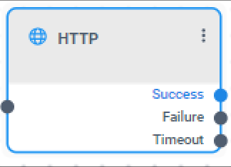
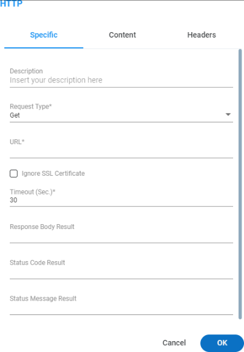
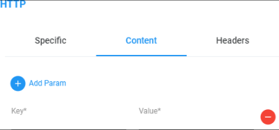
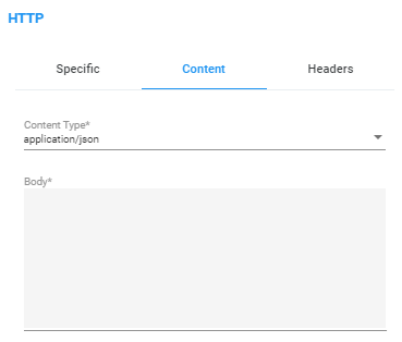
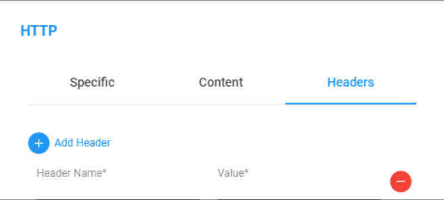
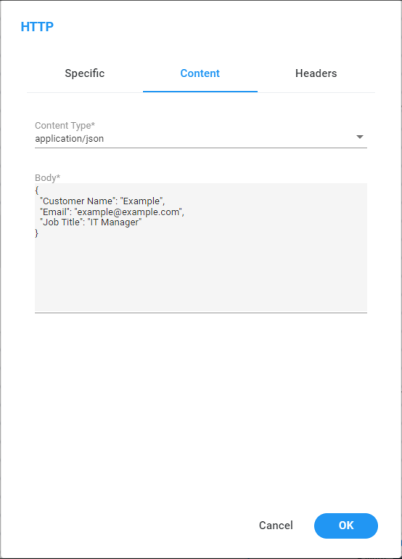
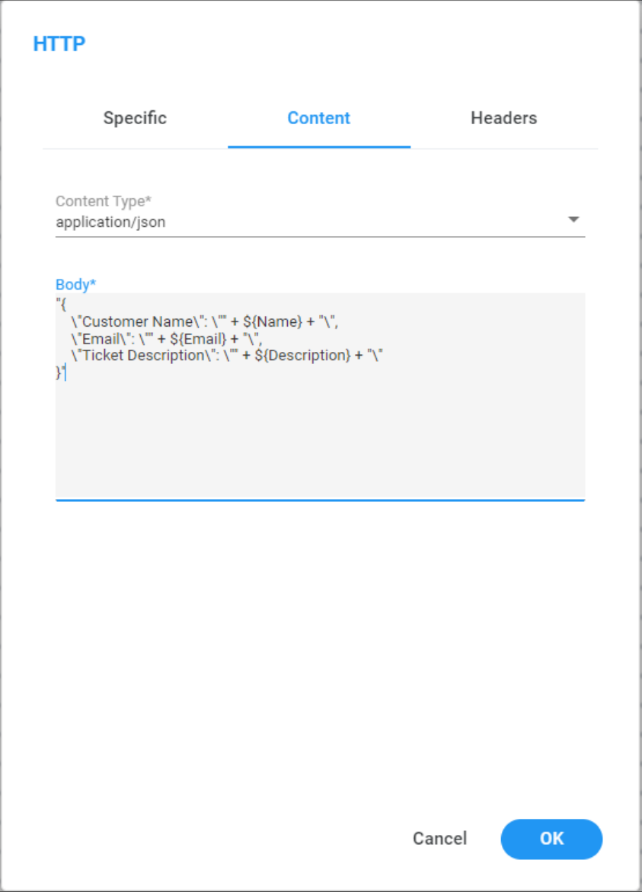

<Info>
Content version: **Voca CIC Flow Designer User's Manual, Version 12.2**
</Info>

The 'HTTP' building block offers a seamless avenue for integration, process automation, and tailored customization, empowering you to engage with an array of systems and platforms. This versatile building block extends the capability to integrate with third-party applications, such as CRM systems, enabling real-time data retrieval and the execution of actions within your third-party applications. It provides a robust framework to enhance your system's connectivity and functionality.

The 'HTTP' building block has 3 exit legs:

- **Success:** Indicates a successful transmission of a request from Voca and the subsequent receipt of a response from the destination. Note that the success exit leg does not necessarily indicate that there are no issues with the response, it just confirms that Voca successfully received a response.

  After a call resulted in success, you should utilize the Condition building block (see Condition building block for more information) to ascertain whether the status code received aligns with the expected status code. This step enables you to validate the outcome of the request and make informed decisions based on the response status code.

- **Failure:** Indicates an unsuccessful request sent from Voca. When a call is processed through this leg, it indicates that there are issues with the request itself, such as an invalid URL, an improperly formatted body, or invalid headers, etc...

  This serves as an indicator that the request could not be successfully initiated due to a specific issue on the request side.

- **Timeout:** Indicates Voca successfully transmitted a request; however, it did not receive any response from the destination. This signifies a situation where the request was sent, but there was no corresponding response received within the expected time frame.

#### To use the HTTP building block

1. On the left pane, under **Actions**, click **HTTP**; the following HTTP building block appears:

   

2. Click the  icon; the following appears:

   

3. Select the **Specific** tab, and then configure the following:

   1. In the 'Description' field, enter a description for this building block (up to 50 characters).

   2. From the 'Request Type' drop-down list, select the appropriate type of request:

      - **Get**

      - **Post**

   3. In the 'URL' field, enter the destination URL. Note, this URL can take the form of a static string, a variable, or an expression that dynamically computes the appropriate REST address during runtime. When opting for a static string, there is no requirement to enclose it within quotation marks at both the start and end of the value.

   4. To disregard the SSL certificate, select the 'Ignore SSL Certificate' check box. This is relevant for self-signed certificates. However, exercise caution when utilizing this option.

   5. In the 'Timeout' field, specify the maximum timeout duration in seconds for the request, ranging from 1 to 60 seconds. Once this predetermined time limit is reached, the call will be routed to the 'Timeout’. The default is 20 seconds.

   6. In the 'Response Body Result' field, specify a variable in the format `${var_name}` to store the received response. The response will be automatically converted into a string and assigned to the specified variable.

   7. In the 'Status Code Result' field, specify a variable in the format `${var_name}` capture the returned status code.

   8. In the 'Status Message Result' field, specify a variable in the format `${var_name}` to capture the returned status message.

4. Navigate to the **Content** tab and configure the following settings. This screen will only appear if you are using a **GET request**:

   1. Click the  **Add Param** icon to add a parameter.

   2. In the 'Key' field, enter the header key, excluding quotation marks.

   3. In the 'Value', enter the values as a static string, a variable, or an expression that dynamically computes the appropriate header value during runtime.

   4. Click the  **Add Param** icon to add more parameters.

   

5. Navigate to the **Content** tab and configure the following settings. This screen will only appear if you are using a **POST request**:

   

   1. From the 'Content Type' drop-down list, select the appropriate content type:

      - Application/json

      - Text/plain

   2. In the 'Body' field, you have the flexibility to define the content you want to include in the HTTP requests. There are two primary options available for formatting the body content:

      - **JSON Payload**: you can input a static JSON payload for transmission. This involves defining a fixed JSON structure with specific key-value pairs. The provided JSON remains constant in the request.

      - **Expression (String Format)**: Alternatively, you can enter an expression in string format. This option allows you the insertion of dynamic content from the workflow into the HTTP request body.

      <Note>
      When incorporating variables into your JSON body, the JSON content should be provided as a string rather than as a structured JSON payload.
      </Note>

   For details how to use the HTTP request body using these options, see Creating a body for HTTP Request.

6. Select the **Headers** tab, and then configure the following:

   1. Click the  **Add Header** icon to add a header.

   2. In the 'Header Name' field, enter the header key, excluding quotation marks.

   3. In the 'Value' field, enter the values as a static string, a variable, or an expression that dynamically computes the appropriate header value during runtime.

   4. Click the  **Add Header** icon to more headers.

   

7. Click **OK**, and then **Save**.

#### To create a body for HTTP Request

- **JSON Payload**: If you want to send a static JSON payload in the body of your HTTP request, follow this format:

  ```text
  {
      "Key1": "Value1",
        "Key2": "Value2",
      ...
  }
  ```

  In this scenario, define the JSON structure with specific key-value pairs, and these values remain constant in the request.

  For example:

  

- **Expression (String Format)**: When you need to insert dynamic variables from your workflow into the HTTP request body, follow these steps:

  1. Convert the JSON structure you expect to receive into a string format. Enclose the entire JSON within quotation marks, like this:

     ```text
     "{
          \"Key1\": \"Value1\",
     \"Key2\": \"Value2\",
           ...
     }"
     ```

     You can use any online JSON-to-string converter for this purpose.

     Converting the JSON to a string format allows for additional manipulation and variable insertion.

  2. Replace the value with the variable that you want to use, using the following format, including the quotation marks:

  | Original value | Formatted value |
  | --- | --- |
  | Value1 | " + `${var_name1}` + " |
  | Value2 | " + `${var_name2}` + " |

  Replace `${ var_name1}` with the actual variable name you want to include. This syntax ensures that the variable's value is dynamically inserted at runtime when the HTTP request is made.

  ```text
  "{
       \"Key1\": \"" + ${var_name1} + "\",
  \"Key2\": \"" + ${var_name2} + "\",
        ...
  }"
  ```

**Example**:


