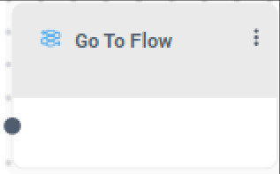
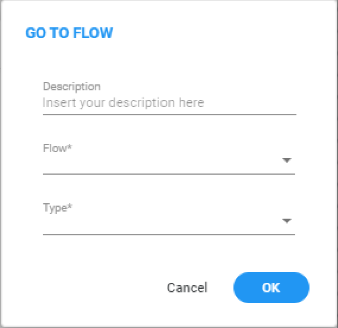

<Info>
Content version: **Voca CIC Flow Designer User's Manual, Version 12.2**
</Info>

The 'Go To Flow' building block provides administrators with the ability to establish distinct boundaries between various call flows within the system while retaining all previously collected information within the call flow. This functionality ensures that essential data and context gathered earlier in the call process are seamlessly preserved as callers transition between different stages of the call flow, promoting a coherent and efficient call handling experience.

#### To use the Go To Flow building block

1. On the left pane, under **Actions**, click **Go To Flow**; the following Go To Flow building block appears:

   

2. Click the  icon; the following appears:

   

3. In the 'Description' field, enter a description for this building block (up to 50 characters).

4. From the 'Flow' drop-down list, select the appropriate flow.

5. From the 'Type' drop-down list, select the appropriate Type.

6. Click **OK**, and then **Save**.
