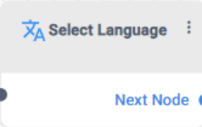
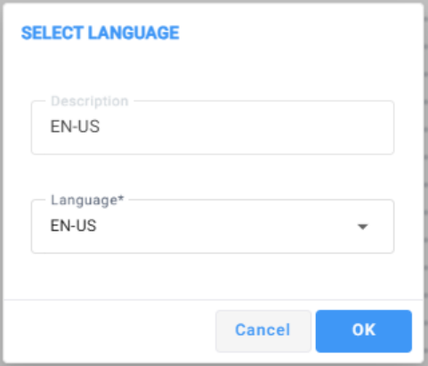

<Info>
Content version: **Voca CIC Flow Designer User's Manual, Version 12.2**
</Info>

The 'Select Language' building block allows you to change the language of the flow. This affects Text-to-Speech (TTS), all prompts (including system prompts), and the speech recognition process, ensuring that all spoken messages play in the selected language. This enables the use of the same flow for multiple languages. The system will automatically direct the call to the 'Next Node,' and from there, it will operate in the selected language.

#### To use the Select Language building block

1. On the left pane, under **Actions**, click **Select Language**; the following Select Language building block appears:

   

2. Click the  icon; the following appears:

   

3. In the 'Description' field, enter a description for this building block (up to 50 characters).

4. From the 'Language' drop-down list, select the appropriate language.

5. Click **OK**.
