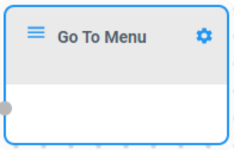
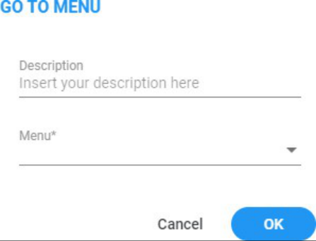

<Info>
Content version: **Voca CIC Flow Designer User's Manual, Version 12.2**
</Info>

The 'Go To’ Menu' building block provides the capability to seamlessly redirect a call directly from the call flow to a menu that is configured under 'Configuration -&gt; Menu Setting' tab.

#### To use the Go To Menu building block

1. On the left pane, under **Actions**, click **Go To Menu**; the following Go To Menu building block appears:

   

2. Click the  icon; the following appears:

   

3. In the 'Description' field, enter a description for this building block (up to 50 characters).

4. From the 'Menu' drop-down list, select the appropriate menu.

5. Click **OK**, and then **Save**.
