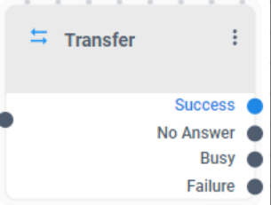
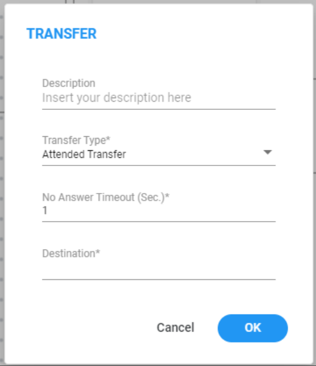

<Info>
Content version: **Voca CIC Flow Designer User's Manual, Version 12.2**
</Info>

The 'Transfer' building block allows you to execute either a blind transfer or an attended transfer directly from the flow designer. Subsequently, you can initiate specific actions based on the response received following the transfer operation.

The ‘Transfer’ block has different exit points depending on the chosen "Transfer Type.

- **Success**: The transfer of the call to the designated destination was completed successfully.

- **No Answer**: The call directed to the assigned destination remained unanswered beyond the duration configured for the "No Answer Timeout" timer. This only appears when you use "Transfer Type" mode during an attended transfer.

- **Busy**: The designated destination was busy, and the call could not be transitioned. This exit leg only appears when you use "Transfer Type" mode.

- **Failure**: The attempt to transfer the call to the specified destination has failed.

#### To use the Transfer building block

1. On the left pane, under **Actions**, click **Transfer**; the following Transfer building block appears:

   

2. Click the  icon; the following appears:

   

3. In the 'Description' field, enter a description for this building block, (up to 50 characters).

4. From the 'Transfer Type' drop-down list, select the appropriate type of transfer:

   - Blind Transfer

   - Attended

5. In the 'No Answer Timeout (Sec)' field, enter maximum time to wait for an answer (1 to 120 seconds). When the predetermined time limit is reached, the call is automatically redirected to 'No Answer'. This field only appears if ‘Attend Transfer’ is selected.

6. In the 'Destination' field, enter the destination number for the transfer operation. This destination can either be a variable collected earlier in the flow or a static string directly configured in the 'Destination' field.

7. Click **OK**, and then **Save**.
