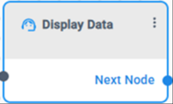
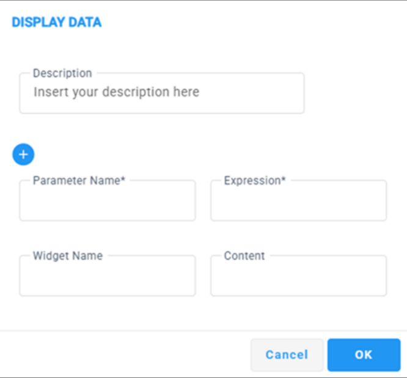

<Info>
Content version: **Voca CIC Flow Designer User's Manual, Version 12.2**
</Info>

The 'Display Data' building block enables you to collect data from the call flow and seamlessly provide this information to your workers when they handle calls through the Flex and Worker queue. In addition, you can configure a CRM screen pop-up within the 'Display Data' block. This feature allows Voca workers to access and update CRM data in real-time within the Voca Flex App or Worker App, all within a unified interface.

To enable the CRM screen pop-up feature, your CRM system must support iframes. The CRM screen pop-up functionality relies on the ability to embed content within an iframe.

In the 'Display Data' building block, you have access to a single pathway called 'Next Node'. When the system has completed the process of saving all collected data, it will direct the call to 'Next Node'.

#### To use the Display Data Info building block

1. On the left pane, under **Actions**, click **Display Data**; the following Worker Application building block appears:

   

2. Click the  icon; the following appears:

   

3. In the 'Description' field, enter a description for this building block (up to 50 characters).

4. In the 'Parameter Name' field, enter the name of the field that will be displayed to the worker after they answer the call.

5. In the 'Expression' field, enter the value corresponding to the field configured in the 'Parameter Name.' This value can either be a previously collected variable within the flow or a static string.

6. In the 'Widget Name' field, enter the name of your CRM system. This name will be displayed at the top of the CRM screen for the worker after they answer the call.

7. In the 'Content' field, enter the URL of your CRM system. Note, this URL can be either a static string, a variable, or an expression.

   Static strings don't need quotation marks.

   <Note>
   **●** The entered URL must support display within an iframe. **●** If the URL contains “.salesforce.com”, the Worker app will automatically open the popup in a new browser tab.
   </Note>

8. Click the  button to include additional parameters.

9. Click **OK**, and then **Save**.
