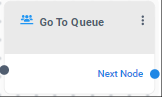
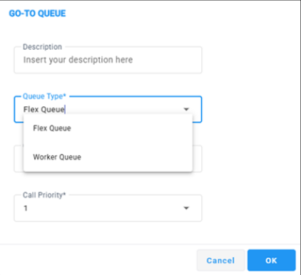

<Info>
Content version: **Voca CIC Flow Designer User's Manual, Version 12.2**
</Info>

The 'Go To Queue' building block allows you to redirect a call directly from the call flow to a queues that configured under the 'Configuration -&gt; Routing -&gt; Queues' tab.

In the 'Go To Queue' building block, you are provided access to a singular route called 'Next Node'. Following the system's call transfer to the designated queue, you can configure supplementary actions that do not require user interaction, such as initiating an HTTP Request or sending an SMS message.

#### To use the Go To Queue building block

1. On the left pane, under **Actions**, click **Go To Queue**; the following Go To Queue building block appears:

   

2. Click the  icon; the following appears:

   

3. In the 'Description' field, enter a description for this building block (up to 50 characters).

4. From the 'Queue Type' drop-down list, select the appropriate type of queue:

   - Flex Queue

   - Worker Queue

5. From the 'Queue Name' drop-down list, select the appropriate queue name.

6. From the 'Skills' drop-down list, select the appropriate skill when transferring a call to a queue. When the call reaches the queue, the system will automatically search for an available worker with all the specified skills from the building block. Note this option is only displayed when the 'Worker Queue' is selected, ensuring that calls are directed to the most qualified workers.

7. From the 'Call Priority' drop-down menu, administrators can designate the call priority for incoming calls. This allows administrators to implement a tiered priority system, guaranteeing the swift handling of critical or high-value calls. Prioritization operates on a numerical scale, where a higher priority value corresponds to increased precedence in the call queue. The default priority level is '1,' but administrators can adjust this priority level up to '10'.

8. Click **OK**, and then **Save**.
