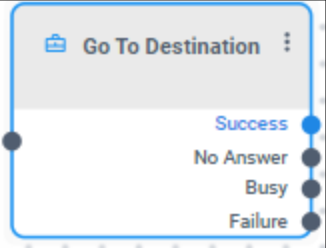
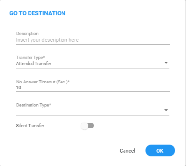
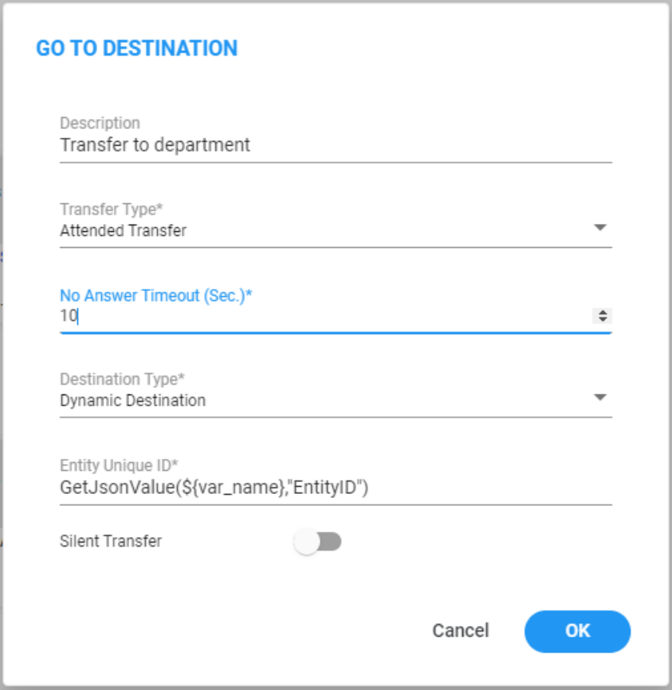

<Info>
Content version: **Voca CIC Flow Designer User's Manual, Version 12.2**
</Info>

The 'Go To Destination' building block provides the capability to redirect a call directly from the call flow to a Departments/Contact on the system.

The Go To Destination" block's exit leg depends on ‘Transfer Type’ mode:

- **Success**: Indicates the transfer of the call to the designated destination was completed successfully.

- **No Answer**: Indicates the call directed to the assigned destination remained unanswered beyond the duration configured for the "No Answer Timeout" timer. This exit leg only appears when you use ‘Transfer Type’ mode during an attended transfer.

- **Busy**: Indicates the designated destination was busy, and the call could not be transitioned. This exit leg only appears when you use "Transfer Type" mode during an attended transfer.

- **Failure**: Indicates the attempt to transfer the call to the specified destination has failed.

#### To use the Go To Destination building block

1. On the left pane, under **Actions**, click **Go To Destination**; the following Go To Destination building block appears:

   

2. Click the  icon; the following appears:

   

3. In the 'Description' field, enter a description for this building block (up to 50 characters).

4. From the 'Transfer Type' drop-down list, select the appropriate type of transfer:

   - **Blind Transfer**: When the system has successfully routed the call to the designated department, it runs configured actions within the department (unless the transfer fails).

   - **Attended Transfer:** Select this option when the department's configured action falls into one of the following categories: 'Transfer to Phone,' 'Silent Transfer to Phone,' or 'Transfer to Extension.' As an administrator, you seek the capability to perform supplementary actions within the same call flow after the transfer process has concluded.

5. In the 'No Answer Timeout (Sec)' field, enter maximum time to wait for an answer (1 to 120 seconds). When the predetermined time limit is reached, the call is automatically redirected to 'No Answer'. This field only appears if ‘Attend Transfer’ is selected.

6. From the 'Destination Type' drop-down list, select the appropriate destination type:

   - **Destination List:** You can select a specific department from a predefined dictionary. When selected, two additional fields become available:

     - 'Dictionary'.

     - 'Department'

   - **Dynamic Destination**: Allows you to dynamically adjust the department destination based on caller interactions leading up to this stage. Enter a variable that holds the department ID from your tenant. When selected, an additional field becomes available:

     

7. In the 'Entity Unique ID' field, enter the department's unique identifier. This value can be derived from a variable gathered earlier in the workflow, such as through speech input, or it can be a fixed string configured directly in the 'Value' field.

   **For example**:

   If you've previously utilized the Speech Input building block in destination dictionary mode in your workflow and stored the result as a variable named `${var_name}`, you can utilize the GetJsonValue function (for more details, see GetJsonValue function) to route the call to the relevant department.

8. Use the 'Silent Transfer' toggle, to enable or disable the default prompt, "Transferring the call to...", before initiating the call transfer to the destination.

9. Click **OK**, and then **Save**.
