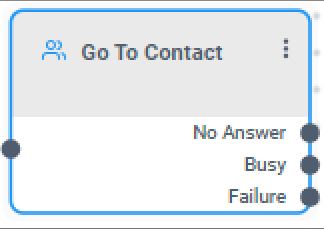
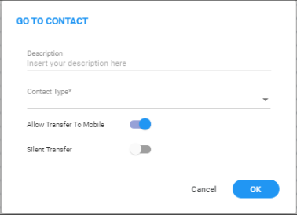
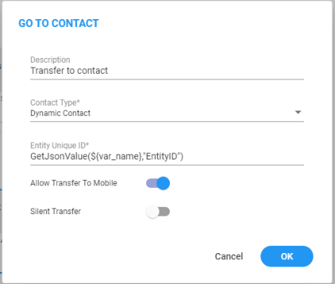

<Info>
Content version: **Voca CIC Flow Designer User's Manual, Version 12.2**
</Info>

The 'Go To Contact' building block allows you to redirect a call directly from the call flow to a contacts that configured under the 'Contacts' tab.

The 'Go To Contact' building block have 3 exit legs:

- **No Answer**: Indicates the call directed to the assigned destination remained unanswered beyond the duration configured for the "No Answer Timeout" timer. This exit leg only appears when you use "Transfer Type" mode during an attended transfer.

- **Busy**: Indicates the designated destination was busy, and the call could not be transitioned.

- **Failure**: Indicates the attempt to transfer the call to the specified destination has failed.

#### To use the Go To Contact building block

1. On the left pane, under **Actions**, click **Go To Contact**; the following Go To Contact building block appears:

   

2. Click the  icon; the following appears:

   

3. In the 'Description' field, enter a description for this building block (up to 50 characters).

4. From the Contact Type' drop-down list, select the appropriate contact type:

   - **Contact List**: The system allows you to select a specific contact from the contact list. When selected, an additional field becomes available.

   - **Dynamic Contact**: This Contact type provides the versatility to dynamically adjust the contact destination based on caller interactions leading up to this stage. In the value field, you can input a variable that holds the contact ID from your tenant. When selected, an additional field becomes available.

     

5. In the 'Entity Unique ID' field, enter the contact's unique identifier. This value can be derived from a variable gathered earlier in the workflow, such as through speech input, or it can be a fixed string configured directly in the 'Value' field.

   **For example**:

   If you've previously utilized the Speech Input building block in destination dictionary mode within your workflow and stored the result as a variable named `${var_name}`, you can utilize the GetJsonValue function (for more details, see GetJsonValue function) to route the call to the relevant department.

6. Use the 'Allow Transfer To Mobile' toggle, to activate or deactivate the capability to route calls to the mobile phones of your contacts.

7. Use the 'Silent Transfer' toggle, to enable or disable the default prompt, "Transferring the call to...s", before initiating the call transfer to the contact.

8. Click **OK**, and then **Save**.
