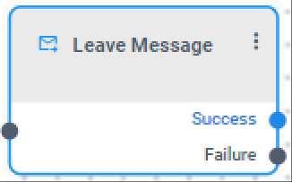
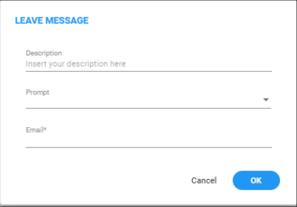

<Info>
Content version: **Voca CIC Flow Designer User's Manual, Version 12.2**
</Info>

The 'Leave Message' building block gives you the ability to offer your customers the option to leave a message that will be transmitted via email. The system permits you to play a prompt, followed by recording the customer's message and sending it as an email attachment.

The 'Leave Message' building block requires an external email service—such as an SMTP server or Azure mail server—to be configured under Email Settings in Voca

The 'Leave Message' building block has two exit legs:

- **Success**: Indicates the email server has successfully received the request to send the email to the recipient.

- **Failure**: Indicates the email server did not successfully receive the request to send the email to the recipient.

#### To use the Leave Message building block

1. On the left pane, under **Actions**, click **Leave Message**; the following Leave Message building block appears:

   

2. Click the  icon; the following appears:

   

3. In the 'Description' field, enter a description for this building block (up to 50 characters).

4. From the 'Prompt' drop-down list, select the appropriate prompt.

5. In the 'Email' field, enter the email address enclosed in quotation marks. This designated email address will be the recipient of the message along with the recording attachment.

   The 'Email' field can be a static string, a variable, or an expression that dynamically computes the appropriate recipient address during runtime.

6. Click **OK**, and then **Save**.
