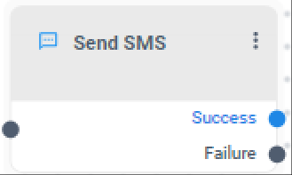
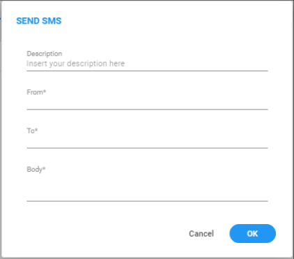

<Info>
Content version: **Voca CIC Flow Designer User's Manual, Version 12.2**
</Info>

The 'Send SMS' building block grants you the capability to send SMS to your customers during the call flow.

The “Send SMS” building block requires Voca to be integrated with a telecom provider to enable outbound SMS functionality.

The 'Send SMS' building block have two exit legs:

- **Success**: Indicates the SMS server has successfully received the request to send the SMS message to the recipient.

- **Failure**: Indicates the SMS server did not successfully receive the request to send the SMS message to the recipient.

#### To use the Send SMS building block

1. On the left pane, under **Actions**, click **Send SMS**; the following Send SMS building block appears:

   

2. Click the  icon; the following appears:

   

3. In the 'Description' field, enter a description for this building block (up to 50 characters).

4. In the 'From' field, enter the sender address from which the SMS will be sent. Make sure that the sender address contains 1 to 11 alphanumeric characters or hyphens (-), without quotes.

5. Enter the recipient's address in E164 format.

6. The 'To' field can be a static string, a variable, or an expression that dynamically computes the appropriate recipient address during runtime.

7. In the 'Body' field, enter the content of the message that will be sent. The message content must be surrounded by quotation marks.

8. Click **OK**, and then **Save**.
