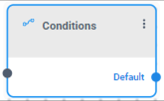
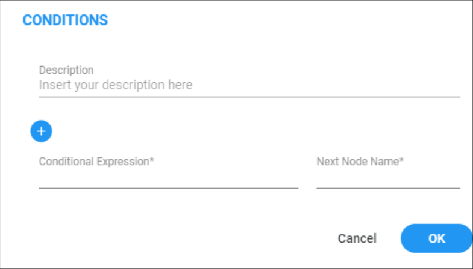

<Info>
Content version: **Voca CIC Flow Designer User's Manual, Version 12.2**
</Info>

The 'Condition' building block serves as a fundamental element in our call flow system, affording administrators fine-grained control over call routing. This building block assesses conditions, yielding 'True' or 'False' results, and guides call routing accordingly. Administrators can establish multiple conditional paths and specify the exit legs for each condition, allowing for intricate routing configurations.

The 'Condition' building block has one exit leg:

- **Default**: When the system has evaluated all configured conditions, and the outcome of each condition is 'False,' the call is automatically routed to this option.

#### To use the Conditions building block

1. On the left pane, under **Call-Flow Logic**, click **Conditions**; the following Conditions building block appears:

   

2. Click the  icon; the following appears:

   

3. In the 'Description' field, enter a description for this building block (up to 50 characters).

4. In the 'Conditional Expression' field, enter the expression for evaluation.

   - If the expression evaluated is 'True,' the node proceeds to the associated exit leg.

   - If the expression evaluated is 'False,' the node checks the next evaluated expression.

   - If no expression is evaluated to 'True', the node proceeds to the default exit leg.

   For further details on creating 'Conditional Expression ', see Boolean Expression.

5. In the 'Next Node Name' field, enter the name for the output leg. The name should be written without quotes. Use alphanumeric characters, underscores (\_), and periods (.). It must commence with a letter. The maximum length is 24 characters.

6. Click the  button to include additional conditions.

7. Click **OK**, and then **Save**.
