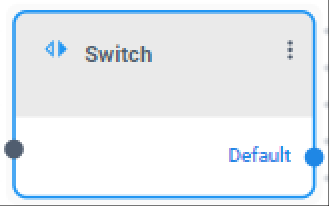
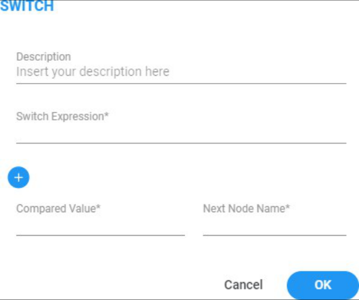

<Info>
Content version: **Voca CIC Flow Designer User's Manual, Version 12.2**
</Info>

The 'Switch' building block allows you to route program logic to various cases by evaluating a specified expression. Administrators can define multiple values for comparison against the expression and specify the corresponding exit leg, enabling the creation of complex routing configurations.

The 'Switch' building block has one exit leg:

- **Default**: The system evaluates all values against the expression, and none of them yield a 'True' outcome, the call is automatically routed to this designated leg.

#### To use the Switch building block

1. On the left pane, under **Call-Flow Logic**, click **Switch**; the following Switch building block appears:

   

2. Click the  icon; the following appears:

   

3. In the 'Description' field, enter a description for this building block (up to 50 characters).

4. In the "Switch Expression" field, enter the expression that requires evaluation. The resulting value is then compared with a predefined list of values.

   - If a match is identified, the node proceeds along the corresponding path.

   - If there is no match, the node proceeds to the default path.

   Note, '0' is a valid option.

5. In the 'Compared Value' field, enter the value to be compared against the result obtained from the 'Switch Expression.

6. In the 'Next Node Name' field, enter the name for the output leg. The name should be written without quotes. Use alphanumeric characters, underscores (\_), and periods (.). It must commence with a letter. The maximum length is 24 characters.

7. Click the  button to add additional conditions.

8. Click **OK**, and then **Save**.
