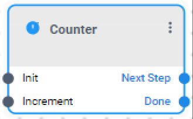
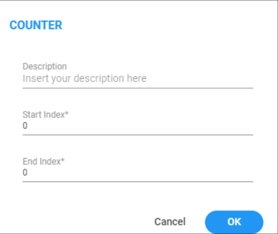

<Info>
Content version: **Voca CIC Flow Designer User's Manual, Version 12.2**
</Info>

The 'Counter' building block lets you establish loops within your call flow. Loops start and end at defined points and can repeat specific actions multiple times. When the loop finishes, additional actions can be triggered.

The 'Counter' building block has four exit legs:

- **Init**: Indicates the starting entry point to the building block. When you connect your building block to this leg, the system automatically assigns the start index. The call will then be directed to 'Next Step'.

- **Increment**: Indicates the entry point for incrementing the index. When you connect your building block to this leg, the system automatically retrieves the assigned index and increases it by 1.

- **Next Step**: Indicates an exit point when the current index is not yet equal to the end index.

- **Done**: Indicates an exit point when the current index is equal to the end index.

#### To use the Counter building block

1. On the left pane, under **Call-Flow Logic**, click **Counter**; the following Counter building block appears:

   

   

2. Click the  icon; the following appears:

3. In the 'Description' field, enter a description for this building block (up to 50 characters).

4. In the 'Start Index' field, enter the initial index value to be assigned when the 'Init' path is activated within the counter building block.

5. In the 'End Index' field, enter the index that will be compared against the index assigned to the call when the call reaches the counter building block.

6. Click **OK**, and then **Save**.
