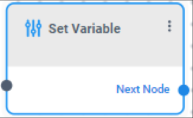
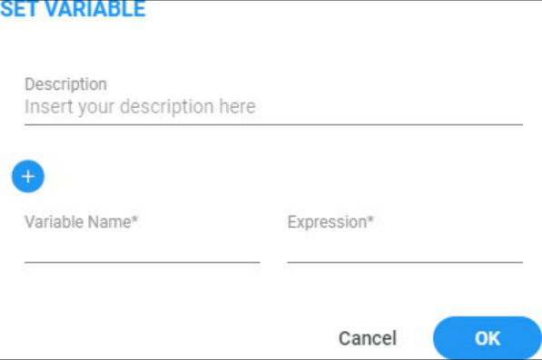

<Info>
Content version: **Voca CIC Flow Designer User's Manual, Version 12.2**
</Info>

The 'Set Variable' building block allows you to configure variables for later use in your call flow.

The 'Set Variable' building block has one exit leg:

- **Next Node**: This is triggered when the system has completed the evaluation of all expressions and stored them as variables.

#### To use the Set Variable building block

1. On the left pane, under **Call-Flow Logic**, click **Set Variable**; the following Set Variable building block appears:

   

2. Click the  icon; the following appears:

   

3. In the 'Description' field, enter a description for this building block (up to 50 characters).

4. In the 'Variable Name' field, enter the variable name in the format `${var_name}`. Note, when using the variable later in your workflow, it is case-sensitive manner. This means the search treats upper and lowercase letters differently, and any disparity may result in potential issues.

5. In the 'Expression' field, enter the expression to be evaluated.

6. Click the  button to add more variables.

7. Click **OK**, and then **Save**.
